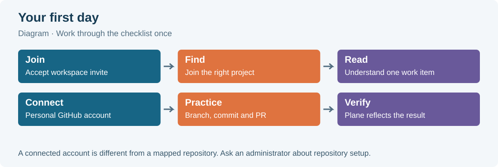

# 01. Welcome to the team

Your team keeps its plans in Plane and its code in GitHub. This handbook helps you use both without losing the connection between a request and the change that delivers it. You do not need to install the server. You need an invitation, access to the right project, and your usual development environment.

Plane is a shared place to describe work. A **work item** is one record of an outcome the team wants: fix a bug, add a feature, investigate a problem, or write a document. Each record has a short identifier, a description and properties that help the team organize it. You will see `WEB-42` throughout this book. `WEB` identifies the Website project; `42` is that item's sequence number. The title can improve over time while the identifier remains the reference people use in conversation and code.

Git is the version control tool on your computer. It records changes in commits and lets you work on a branch without immediately changing the team's main branch. GitHub hosts the shared repository and provides a place to discuss a proposed change. That discussion happens in a **pull request**, often shortened to PR. Merging a PR puts its accepted changes into the selected base branch.

**git-sync** is this repository's integration service. It recognizes Plane identifiers in supported GitHub events, adds development links, applies configured workflow rules and can mirror GitHub issues with Plane work items. It is not a replacement for reading the task, testing the change or requesting review. It handles the bookkeeping that would otherwise require someone to copy information between tools.

## 1.1 The five things to recognize

A workspace is the broad team area you join. A project is a more focused area inside it, such as Website. A work item belongs to a project. A state describes where that item is in the workflow. A view controls which items you see and how they are arranged. These ideas are separate: changing from a list to a board does not move work into another project, and selecting a filter does not change the items it hides.

The fictional team in this book is Acme. Alex Developer implements the Website change and Sam Reviewer checks it. Names and example addresses are fictional. The captured Plane workspace has been given an Acme display alias in the screenshots; its actual test address and unrelated test content are hidden. GitHub screenshots show the authorized demonstration repository. The capture notes explain the environment and every cosmetic redaction.

> Example: “WEB-42 is In Progress, assigned to Alex, in the October cycle” gives four different pieces of information. The identifier selects the record. Its state describes workflow. Its assignee describes responsibility. Its cycle describes a planning window.

## 1.2 How to use the book

Read the first three chapters before changing work. Chapter 4 is the reference for a single work item. Chapters 5 and 6 explain how to organize many items and plan delivery. Chapter 7 covers staying informed. Chapters 8–11 explain the GitHub connection and exact automation rules. Chapter 12 walks through a complete change. The remaining chapters provide suggested conventions, troubleshooting, answers and a printable reference.

Numbered steps give one action at a time. Orange numbered markers in a screenshot point to the controls discussed in its caption. A screenshot is evidence of the captured interface; it does not mean every account has the same permissions. Some actions are available to project or workspace administrators. If your menu has fewer entries, first check your role and project membership.

A **Tip** offers a useful habit. A **Warning** explains a consequence to consider before proceeding. An **Example** gives sample wording or a teaching scenario. Suggested team habits are explicitly identified as suggestions; they are not built-in requirements imposed by Plane.

The PDF contents and bookmarks are clickable. You can also search for an identifier, a button label or an error message. When you need a quick answer during work, start with the troubleshooting table or the last page. Return to the detailed chapter when the underlying idea is unfamiliar.

## 1.3 What administrators have already arranged

An administrator has installed Plane, configured sign-in, deployed git-sync, registered the GitHub App and arranged repository access. Your project also needs a repository mapping and the appropriate policies. Your personal GitHub connection is an additional step: it identifies you as a member and can authorize writes as you. It does not install the App or give you access to a repository you otherwise cannot read.

If installation or server configuration is your job, use the [administrator manual](../manual/README.md) and its [user guide](../manual/user-guide.md). This handbook concentrates on everyday member work. Do not copy a server token into a work item, a screenshot, a commit or a support message.

## 1.4 Your first day: one-page checklist

Use this page with a teammate. A checked box means you have verified the result, rather than merely opened a menu.

- [ ] Accept the intended workspace invitation.
- [ ] Sign in with your own Plane account.
- [ ] Set your name and recognizable display name.
- [ ] Check your timezone in Preferences.
- [ ] Choose comfortable theme and notification settings.
- [ ] Join the project containing your team's work.
- [ ] Find Home, Your work, Drafts and the inbox.
- [ ] Open the command palette and shortcuts dialog once.
- [ ] Read one assigned work item completely.
- [ ] Identify its state, priority, owner and blockers.
- [ ] Open your personal GitHub account settings for the workspace.
- [ ] Connect your own GitHub account if the team requires it.
- [ ] Check that Development shows the intended mapped repository.
- [ ] Practise the branch, commit and PR loop in chapter 12.
- [ ] Confirm that the merged PR and completed item agree.

Ask your onboarding teammate which project view is the team's source for selecting work, which state means ready for review, and whether a PR should finish or only contribute to its referenced item. These are team decisions. Write the answers somewhere shared so the next developer has the same starting point.

> Tip: Keep `WEB-42`, its Plane link, the repository name and your first branch name together in a temporary note. The identifiers help you recover your place when several tabs are open.
