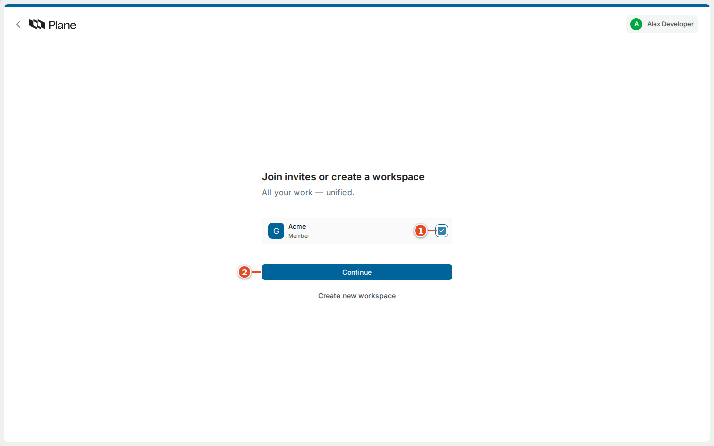
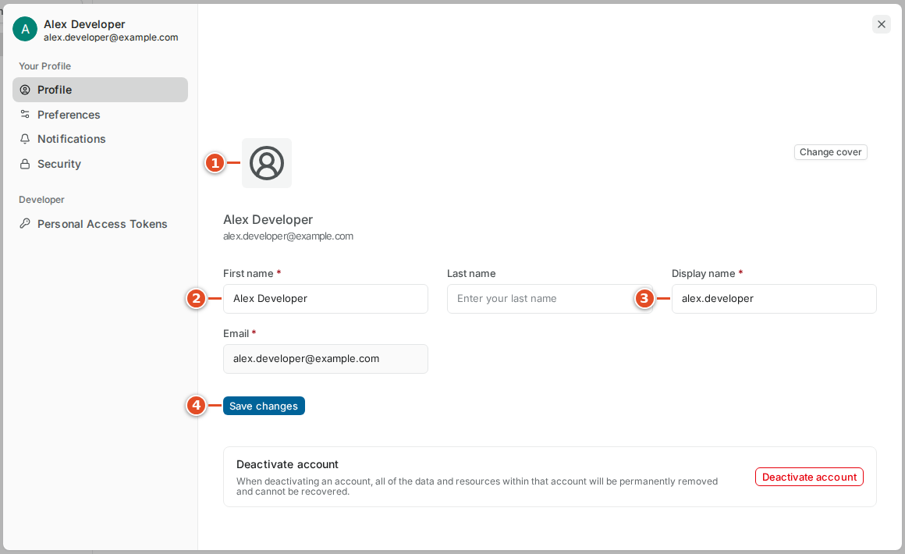
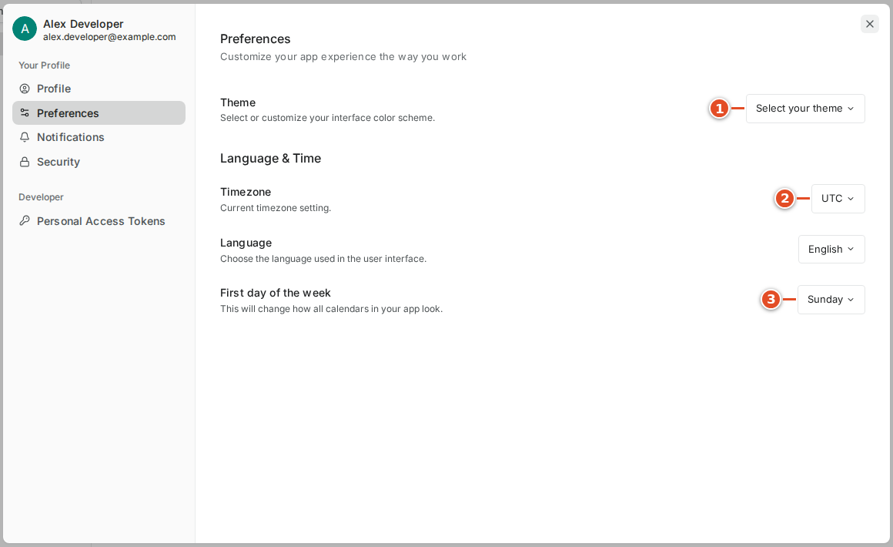
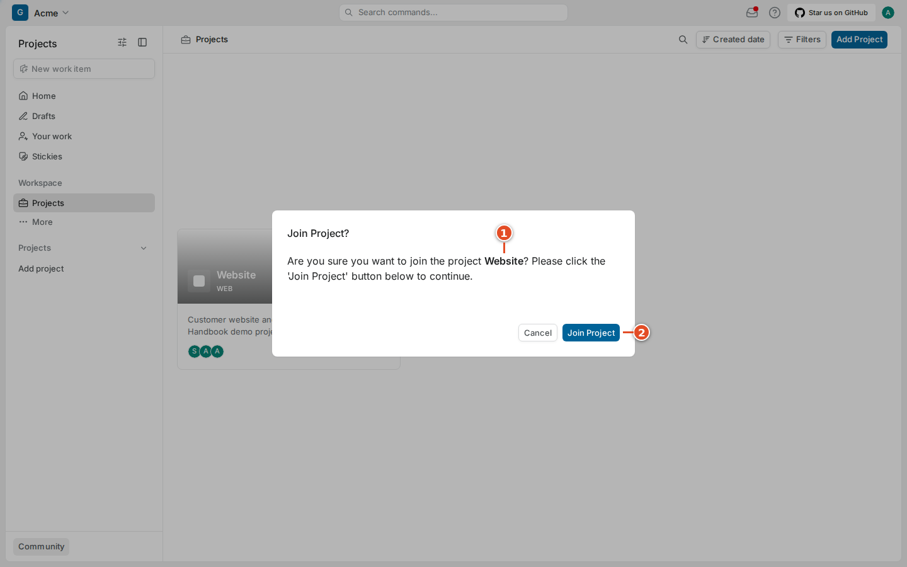

# 02. Getting in and making Plane yours

An invitation gives your account membership in a workspace. Signing in proves which account you are using. Joining a project gives you a place in that project's work. These can be separate steps, so successfully signing in does not by itself mean every project is already in your sidebar.

## 2.1 Accept the right invitation

Your team may send an invitation link by email or tell you to open Plane and find the pending invitation. Use the address provided by your administrator. The examples use `plane.example.com`. Check that you are joining the intended team before accepting. If you have accounts at more than one organization, confirm the email shown in the account menu.

1. Open the invitation link supplied by your team.
2. Sign in or create your own account when Plane asks.
3. Select the checkbox for the intended workspace.
4. Select **Continue**.

The captured first-time invitation screen includes a workspace name and a membership role. Select the actual checkbox; clicking nearby text is not a reliable substitute. The Continue button stays disabled until an invitation is selected. An existing account may enter through Workspace invites instead of the first-time onboarding screen.

If there is no invitation, do not create a second workspace merely to get past onboarding. Ask the inviter to check the exact email address and pending invitation. An invitation sent to an alias may not match the account you have signed into. If an old link fails, return to the workspace invitations screen or ask for a fresh invitation.

## 2.2 Sign in

The demonstration instance uses email and password. Your administrator may enable another sign-in provider. Use the methods actually displayed on your sign-in page. Plane's own account sign-in and the later git-sync GitHub authorization serve different purposes; the presence of one does not establish the other.

1. Open your team's Plane address.
2. Enter your account email.
3. Select **Continue**.
4. Enter your password when prompted.
5. Submit the sign-in form.

Use the password recovery control offered by your instance if you cannot sign in. Do not send your password to a teammate. If a recovery message never arrives, ask an administrator whether outgoing email is configured. The handbook instance has no SMTP configured, so delivery of recovery or invitation mail was not verified. An on-screen success message alone is not evidence that a mailbox received anything.

> Warning: A service account used by git-sync is not your everyday account. The integration deliberately ignores some changes made by its service account to prevent echoes. Using it for normal work can make your edits appear to be ignored.

## 2.3 Set your profile

Your profile helps teammates recognize who is working and who is commenting. Your full name is the human-readable identity. Your display name is the shorter identity shown in parts of the interface. An avatar is a small picture or initial marker used beside assignments and comments. A consistent display name is more useful than one that changes with each task.

1. Select your avatar in the upper-right corner.
2. Select **Settings**.
3. Select **Profile** if another settings section is open.
4. Update **First name**.
5. Update **Last name** if you use one.
6. Update **Display name**.
7. Select **Save changes**.

The profile editor is a modal over the current page in this version. You can close it and return to the work underneath. Use the avatar control if you want to upload a picture; choose a simple image you are comfortable showing to teammates. The captured demonstration uses initials. Avoid uploading customer information or credentials as a profile image.

The email field is also visible here. Changing an account email can affect future invitations and how you identify the account. Ask your administrator about the team's account policy before using that field for a company email change. Do not create multiple accounts to solve a display-name problem.

## 2.4 Check timezone, theme and calendar preferences

Your timezone controls how time-based information is presented. A due date and a notification time are easier to interpret when your settings match where you work. Your theme changes the interface appearance; it does not change a work item's state or another member's preferences.

1. Open your avatar menu.
2. Select **Preferences**.
3. Open the theme selector.
4. Choose the theme you prefer.
5. Open the timezone selector.
6. Choose your working timezone.
7. Set the first day of the week if the default differs from your calendar habit.

The same area includes language preferences. Select a language you can comfortably use while following team instructions. If teammates share screenshots, control positions may be the same even when labels differ. The instructions in this book use the English labels captured in the demonstration.

> Tip: When a meeting or deadline looks a few hours wrong, compare timezone settings before changing the work item's date. A display setting and a planning mistake need different fixes.

## 2.5 Set notification preferences deliberately

A notification is a message that something relevant changed. A subscription says that you want updates about a particular work item. Email notification preferences control which of those updates should reach your mailbox. Turning off an email category is different from removing a subscription or changing an assignment.

1. Open personal **Settings**.
2. Select **Notifications**.
3. Review **Property changes**.
4. Review **State change**.
5. Review **Work item completed**.
6. Review **Comments**.
7. Review **Mentions**.

Choose settings that help you notice requests without making every small edit equally urgent. A useful starting suggestion is to keep direct mentions and comments visible, then adjust property-change email after experiencing a few days of normal activity. Your team may have its own expectations about checking the inbox during working hours.

Email requires a functioning mail configuration on the server. If an expected message does not arrive, first confirm the change appears in Plane itself. Then check your category preferences and mailbox filtering. Ask an administrator about mail delivery after those checks. Do not change instance settings yourself to troubleshoot ordinary member notifications.

## 2.6 Join the Website project

The projects page lists projects you are allowed to discover. A visible project can still have a **Join** action because you are not yet a member. Private projects may require an explicit invitation from a project administrator.

1. Select **Projects** in the workspace navigation.
2. Find the project your teammate named.
3. Select its **Join** action.
4. Check the name in the confirmation dialog.
5. Select **Join Project**.
6. Open **Work items** under the project in the sidebar.

Joining the correct workspace does not mean you should join every visible project. Start with the area you actually work in. If Website is missing, check the workspace switcher before asking for more permissions. If it is present but you cannot join, tell the project administrator what you see and which account you are using. Avoid sending an entire account settings screenshot when a project name and an error message will do.
