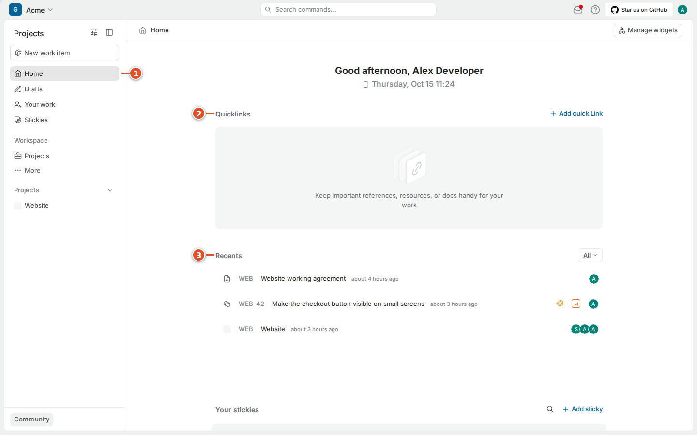
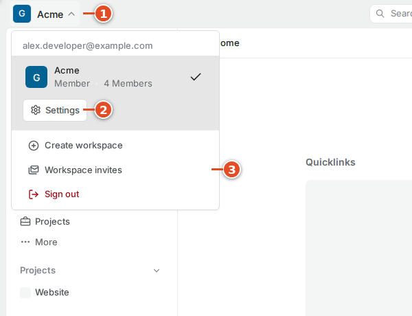
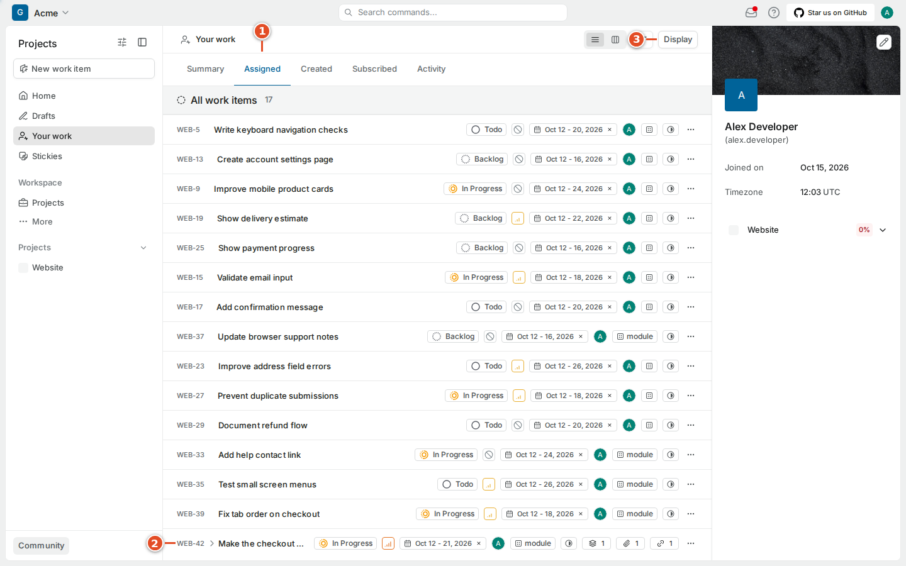
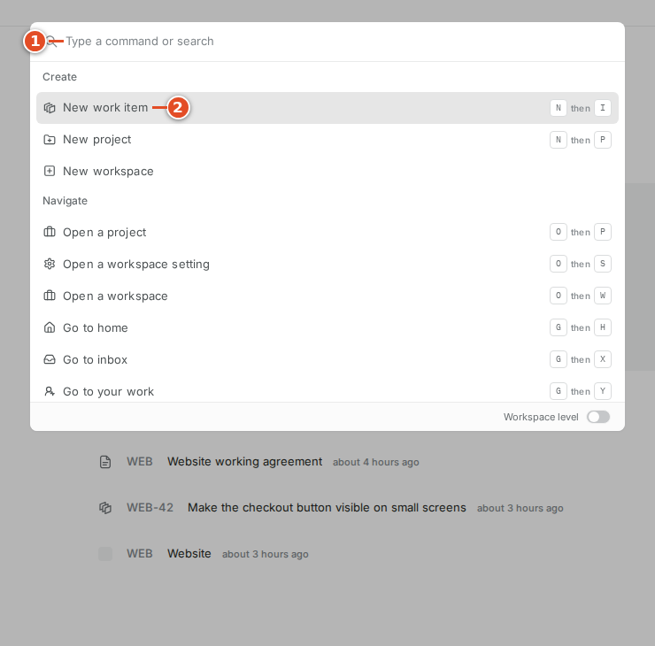
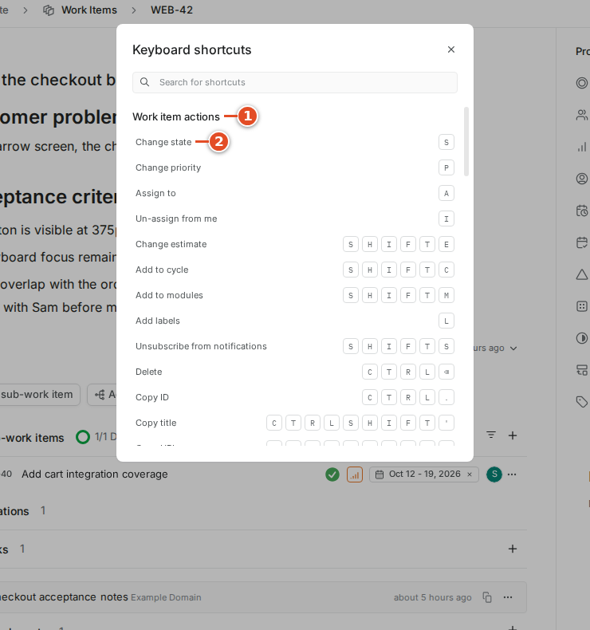

# 03. Finding your way around Plane

Plane has two useful scales of navigation. Workspace navigation takes you to places across the team. Project navigation takes you to the work, plans and documents within one project. Recognizing which scale you are using prevents a common first-day mistake: looking for an item in a view that belongs to another project.

## 3.1 Read the screen from the outside in

The top-left workspace switcher identifies the current team area. The sidebar holds Home, Drafts, Your work and the workspace projects list. Expanding a project reveals its enabled features. The main area shows the selected page. The upper-right controls include the inbox, help and your avatar.

The exact widgets on Home can differ from a teammate's. Home provides a useful starting point and recent destinations. It is not a guarantee that every unfinished task is listed there. Use Your work or a project view when you need a deliberate list of assigned or filtered work.

1. Check the workspace name at the top-left.
2. Select **Home** in the sidebar.
3. Look at the recent work area.
4. Open a recent item only after checking its project and identifier.

Quicklinks let you keep useful destinations nearby. A sticky is a personal note for an idea or reminder. A shared work item should hold the durable task and its acceptance criteria. Avoid keeping the only copy of a team decision in a personal note where other developers cannot discover it.

## 3.2 Switch workspace carefully

1. Select the workspace switcher.
2. Check the currently selected workspace.
3. Choose the workspace you need.

The menu can also expose workspace settings and invitations. Creating a workspace makes a different team area; it does not repair a missing project invitation. If you accidentally enter the wrong workspace, switch back before creating a work item. An identifier such as `WEB-42` is interpreted in the context of the project's workspace and configured mappings, not as a globally unique public ticket number across every Plane installation.

## 3.3 Find Your work and the project list

Your work is a personal work area. It helps you inspect work relevant to you instead of scanning all project items. Its visible categories and filters are useful for separating assigned, created or subscribed activity where provided by the page. A filtered personal list can hide a task, so use the project when you need to verify that a record exists.

1. Select **Your work** in the sidebar.
2. Review the selected category.
3. Check the filters before concluding that nothing is assigned.
4. Open the item you want to inspect.

1. Select **Projects** under Workspace.
2. Find **Website**.
3. Open the project.
4. Select **Work items** in its expanded navigation.

The project navigation in this handbook includes Work items, Cycles, Modules, Views, Pages and Intake. A project administrator can disable optional features, so a missing entry may be a project configuration choice. Ask whether the team uses that feature before assuming the installation is broken. The Community button and billing pages are not evidence that a paid feature is included in your current edition.

## 3.4 Use the command palette

The command palette is a searchable menu for finding destinations and actions from the keyboard. It is especially helpful when you know the name of something but cannot remember which menu contains it.

1. Press **Ctrl + K** on Windows or Linux, or **Cmd + K** on macOS.
2. Type part of the action or item you want.
3. Read the highlighted result.
4. Press **Enter** to select it.
5. Press **Escape** to close the palette when you do not want to act.

A palette action can change data, not merely navigate. Read its label before pressing Enter. If you are typing in a description or code block, close or leave that editor before using a global shortcut. Otherwise the editor may interpret your keystroke as formatting or text input.

## 3.5 Learn shortcuts from Plane's own dialog

The shortcuts dialog is the reference for your running version and operating system. Open it through the help control in the top bar. The table below is transcribed from the running CE dialog, rather than borrowed from a different edition. The interface displays a Command symbol on macOS where appropriate; use the Control equivalent shown on your system.

The dialog groups its shortcuts by context. “Then” means release the first key before pressing the next one. A plus sign means hold the modifier while pressing the other key. The dialog lists some identical combinations in different contexts; the current page determines which action applies.

| Context | Action | Keys shown on Linux |
| --- | --- | --- |
| Work item | Change state | S |
| Work item | Change priority | P |
| Work item | Assign to | A |
| Work item | Un-assign from me | I |
| Work item | Change estimate | Shift + E |
| Work item | Add to cycle | Shift + C |
| Work item | Add to modules | Shift + M |
| Work item | Add labels | L |
| Work item | Unsubscribe from notifications | Shift + S |
| Work item | Delete | Ctrl + Backspace |
| Work item | Copy ID | Ctrl + . |
| Work item | Copy title | Ctrl + Shift + ' |
| Work item | Copy URL | Ctrl + Shift + , |
| Cycle | Add to favorites | Shift + F |
| Cycle | Copy URL | Ctrl + Shift + , |
| Module | Add/remove members | M |
| Module | Change status | S |
| Module | Add to favorites | Shift + F |
| Module | Copy URL | Ctrl + Shift + , |
| Page | Lock | Shift + L |
| Page | Make public | Shift + A |
| Page | Archive | Shift + R |
| Page | Add to favorites | Shift + F |
| Page | Copy URL | Ctrl + Shift + , |

| Context | Action | Keys shown on Linux |
| --- | --- | --- |
| Create | New work item | N then I |
| Create | New page | N then D |
| Create | New view | N then V |
| Create | New cycle | N then C |
| Create | New module | N then M |
| Create | New project | N then P |
| Open | A cycle | O then C |
| Open | A module | O then M |
| Open | A project view | O then V |
| Open | A project setting | O then S |
| Open | A project | O then P |
| Open | A workspace setting | O then S |
| Open | A workspace | O then W |
| Go to | Home | G then H |
| Go to | Inbox | G then X |
| Go to | Your work | G then Y |
| Go to | Work items | G then I |
| Go to | Pages | G then D |
| Go to | Cycles | G then C |
| Go to | Modules | G then M |
| Go to | Project views | G then V |
| Go to | Intake | G then K |
| Go to | Project settings | G then S |
| Go to | Project archives | G then R |
| Go to | Workspace analytics | G then A |
| Go to | Workspace settings | G then S |
| Go to | Workspace drafts | G then J |
| Go to | Workspace archives | G then R |
| Go to | Projects list | G then P |
| Miscellaneous | Toggle app sidebar | Ctrl + B |
| Miscellaneous | Copy current page URL | Ctrl + Shift + C |
| Miscellaneous | Focus search input | Ctrl + F |
| Help | Open keyboard shortcuts | Ctrl + / |

These are the displayed bindings, including potentially surprising overlaps. A Page action appearing in the dialog does not establish that your role can publish a particular page. Use the visible permission controls and your team's sharing policy. The command palette was also opened with Ctrl + K during capture; that launcher is described separately above.

Do not memorize the entire table on day one. Begin with the palette, closing a dialog and creating a work item. Add navigation shortcuts after you recognize the destinations. A shortcut can be convenient while still depending on your permissions: it does not grant access to a private project or enable an administrator-only action.

> Tip: If a shortcut seems ineffective, check whether a text editor, browser address field or dialog has focus. Mouse navigation is a good way to verify the destination before troubleshooting the keyboard combination.

## 3.6 Keep a reliable route back

A direct work item link is usually the most useful thing to share in a discussion. It selects one record rather than describing the clicks another person must repeat. Include the identifier alongside the link so people can recognize it in a message, commit or PR.

1. Open the work item.
2. Use its copy-link control.
3. Paste the link into your intended team discussion.
4. Check that the pasted label or surrounding text includes the correct identifier.

A link does not override permissions. If a teammate receives a not-found screen, ask them to check their workspace and project membership. Do not make a project public as a quick workaround for a single missing invitation. The copied address identifies your team's server; avoid pasting private project links into public GitHub discussions unless your team's policy permits that disclosure.
