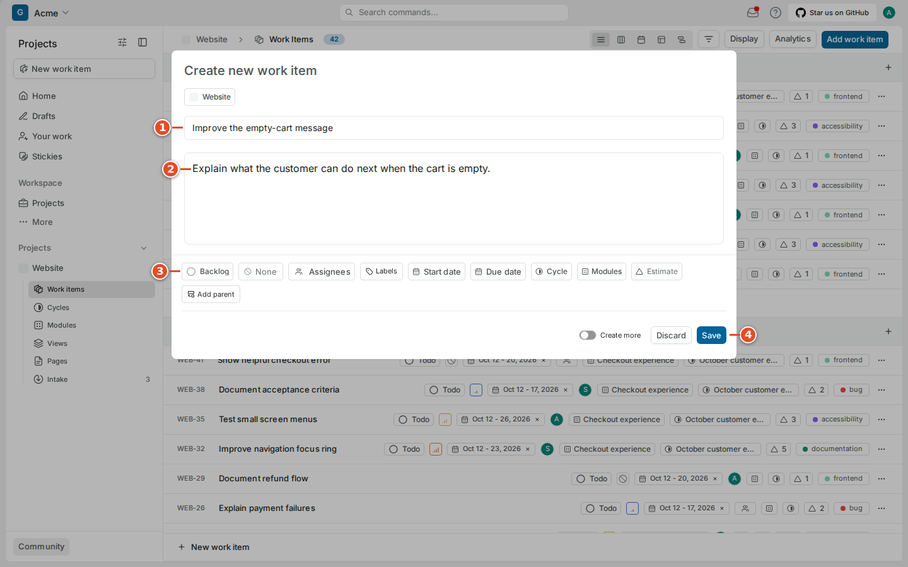
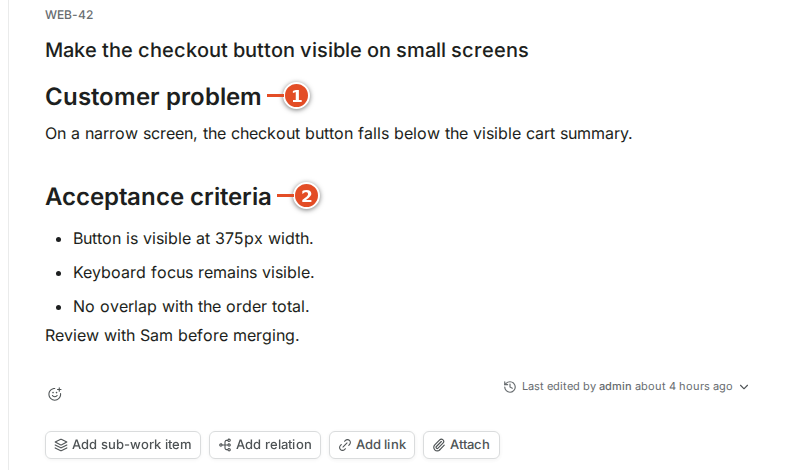
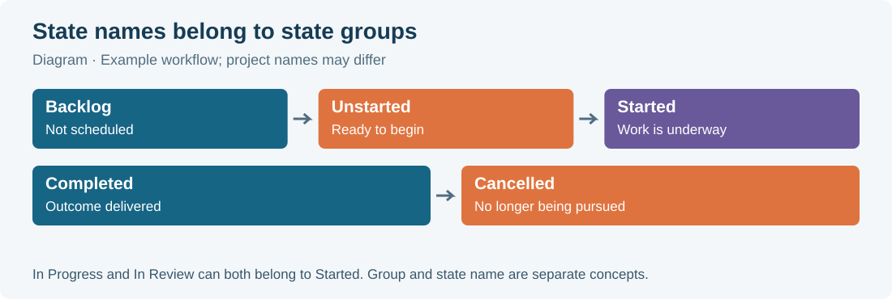
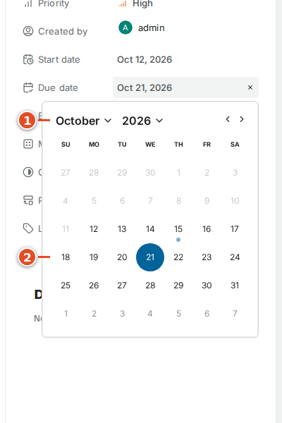
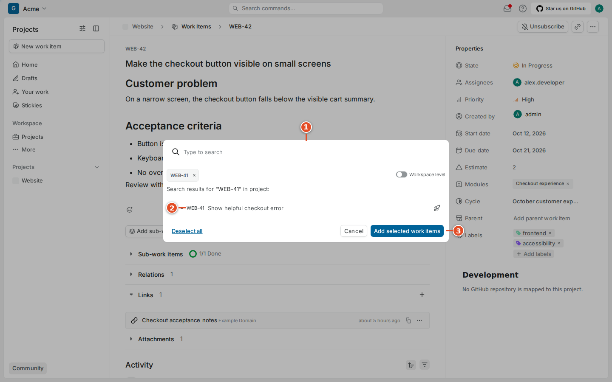
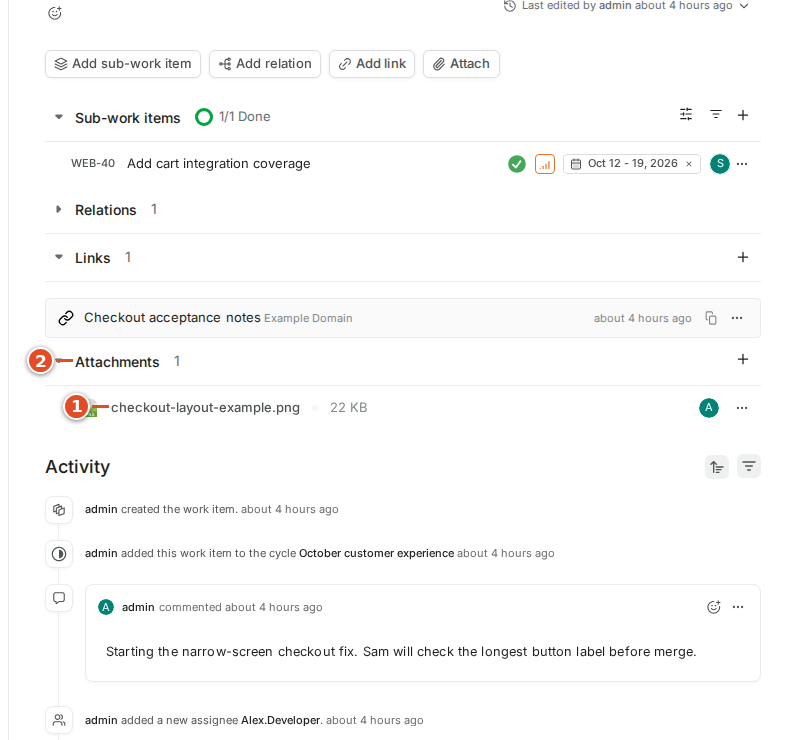
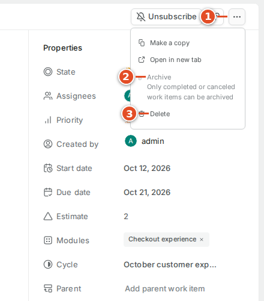
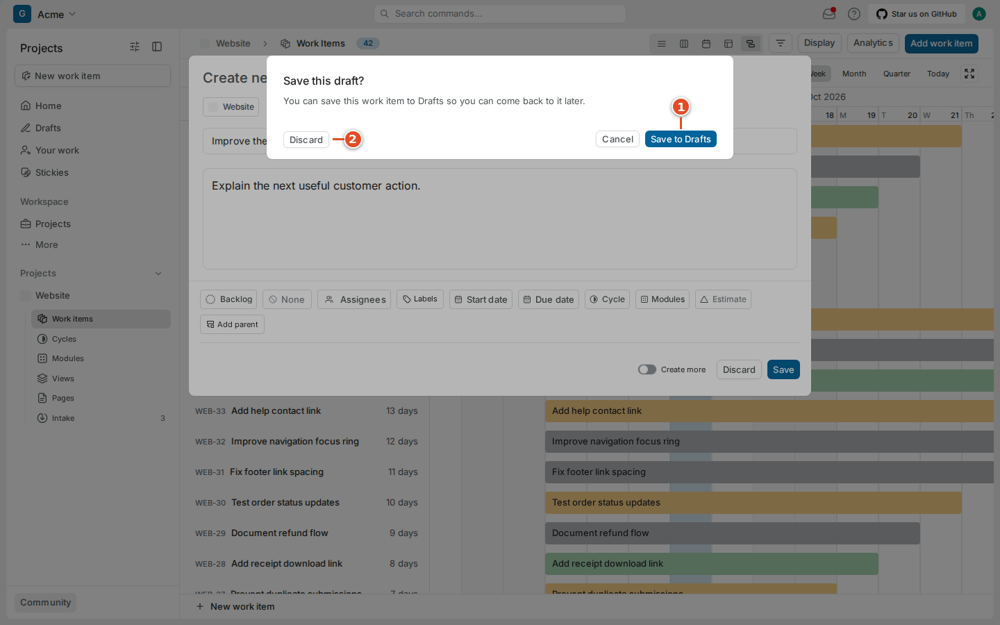

# 04. Work items in depth

A work item is a shared record of an outcome. Its description explains what needs to change. Its properties help people choose, organize and track that work. Its comments preserve the decisions made along the way. You can edit an item from several layouts, but those controls all update the same underlying record.

## 4.1 Create an item with enough context

Before creating a new item, search for an existing one. Two records describing the same bug split the discussion and can cause duplicate implementation. If the request already exists, add useful evidence to that record or use a relation to connect a distinct follow-up.

1. Open the intended project.
2. Select **Add work item** in the project header.
3. Check the project selected in the form.
4. Enter a title describing the outcome.
5. Enter the description.
6. Set the initial state if the default is inappropriate.
7. Set the priority agreed with the team.
8. Add the responsible assignee when known.
9. Select **Save**.

A useful title is “Keep the checkout button visible on small screens.” It tells the reader what should become true. “Checkout” alone forces everyone to open the description to discover the request. Avoid putting a long troubleshooting diary in the title; keep that evidence in the description and comments.

The quick-add controls in a list or board are useful when you already know the project and group. Use the plus or New work item control in the intended group, enter the title and submit the small form. The chosen group can supply the state. Open the created record afterward to add the context that did not fit the quick form. A fast creation path does not remove the need for acceptance criteria.

> Example: A small bug description can contain four short sections: what happened, what should happen, how to reproduce it, and how to confirm the fix. For WEB-42, the key evidence is the affected screen width and whether the button remains keyboard accessible.

## 4.2 Understand the identifier

The project supplies a short identifier such as `WEB`. Plane adds a sequence number to produce `WEB-42`. Use that exact key in discussions and the supported GitHub reference locations. A title is editable prose; an identifier is the compact handle that lets tools and people refer to the same work.

Do not invent an identifier for an unsaved draft. Open the saved item and copy the displayed key. Preserve the hyphen and digits. `WEB_42` and `WEB42` are different strings. Case handling varies by reference location: chapter 9 explains why a lower-case branch key works while some bare lower-case prose does not.

## 4.3 Write and maintain the description

The description editor supports structured writing. Use headings to separate the customer problem, acceptance criteria and implementation notes. Use a checklist for independently checkable outcomes. Use a code block for code or a literal error message so it stays readable. Use a link for supporting material rather than pasting an entire unrelated document.

1. Open the item.
2. Select the description area.
3. Write the customer problem in plain language.
4. Add concrete acceptance criteria.
5. Add useful reproduction steps or references.
6. Finish editing and wait for the saved indication.

Select text to reveal the formatting controls. The editor also offers insertion controls for richer content. Choose the appropriate block rather than imitating a checklist with a paragraph of symbols. A code block should include only the small example needed to explain the issue. Remove credentials, customer details and machine-specific secrets from copied logs before saving them.

An image can explain a visual bug more clearly than several paragraphs. Include enough surrounding interface to identify the problem, and add a sentence explaining what the reader should notice. Use fictional or redacted data when the screenshot might be shared beyond the team. An image of a failure is evidence; it is not itself an acceptance criterion unless the expected result is also described.

A mention identifies a teammate within the editor. Type `@` and choose the intended member from the suggestions when the editor offers them. A typed name that is never selected as a mention is just text. Use mentions to request specific help, such as a decision about expected behavior, and include the question beside the mention. Avoid tagging an entire group for a small property edit.

Keep the description current as decisions change. A comment can explain why the team changed its mind; the description should still tell the next developer which outcome is now expected. If you learn that an acceptance criterion is wrong, resolve that with the owner instead of silently implementing a different task.

## 4.4 States and state groups

A **state** is a named point in the workflow, such as Todo, In Progress, In Review or Done. A **state group** is the broader classification Plane and automation use. The captured project has Backlog, Unstarted, Started, Completed and Cancelled groups. Its Todo state belongs to Unstarted; both In Progress and In Review belong to Started.

1. Open the **State** property.
2. Read the available project states.
3. Select the state that reflects the actual situation.
4. Confirm the updated value on the item.

Moving a task to Done means the agreed outcome is complete according to the team's workflow. It is not the same as archiving the record. Cancelled means the team is no longer pursuing the work; use a comment to preserve the reason. A blocked task usually still has a workflow state plus a blocking relation. Do not create a new state for each temporary obstacle without discussing the workflow with the project administrator.

GitHub automation can also change a state. If a merged PR moves an item to Done, the activity history should help explain the update. Do not repeatedly move it back without understanding the applicable rule. A mapping and its rule configuration determine automation; a familiar state name alone does not enable a transition.

## 4.5 Priority, ownership and labels

Priority expresses relative importance. The captured selector offers None, Urgent, High, Medium and Low. A high priority does not make an item automatically assigned, ready or unblocked. Discuss ordering with the person responsible for the team's plan instead of treating every personally inconvenient issue as urgent.

1. Open **Priority**.
2. Choose the agreed priority.
3. Add a comment if the reason for a significant change is not obvious.

An assignee is a person responsible for moving the item forward. The selector can support more than one person. Multiple assignees are useful for a paired task, but the team should still know who will provide the next update. Removing an assignee does not delete their comments or mean the work is complete.

1. Open **Assignees**.
2. Search for the intended project member.
3. Select the member.
4. Close the selector.
5. Check the resulting names or avatars.

Labels describe reusable categories such as frontend, bug or accessibility. They are different from priorities and states. Use existing labels before creating near-duplicates with different capitalization. A project administrator may manage the label set. A GitHub label of the same name is synchronized only under the configured mapping and label policy; the visual resemblance does not establish a connection by itself.

1. Open **Labels** or **Add labels**.
2. Select the relevant existing labels.
3. Close the selector.

## 4.6 Dates and estimates

A start date marks when work is intended to begin. A due date marks the intended deadline or target. These are planning properties; setting them does not create a calendar invitation. Calendar and Gantt layouts use dates to position work, so a missing date can explain an item absent from a dated view.

1. Open **Start date**.
2. Select the intended date.
3. Open **Due date**.
4. Select the intended date.
5. Check that the range makes sense.

An estimate is the team's agreed expression of relative size or effort. The project administrator configures the estimation system. Do not assume that a value of 3 means three hours. Ask what the selected scale means and how the team uses it for planning. If no estimation system is enabled, the item may not offer an Estimate field. Setting an estimate is separate from the Smart Commit `#time` command: in this integration, that command creates a time-description comment rather than updating a native worklog or estimate.

## 4.7 Parents and sub-work items

A parent groups related work under a larger outcome. A sub-work item is still a work item with its own identifier, state and discussion. Use this structure when pieces can be implemented, reviewed or assigned independently. Use a checklist when the pieces are small checks that do not need their own lifecycle.

1. Open the intended parent.
2. Select **Add sub-work item**.
3. Choose an existing item or create the separate child using the offered form.
4. Check that the child appears in the parent's sub-work item section.

The **Parent** property can also place an item under an existing parent. Check identifiers before moving it. A completed child does not prove the entire parent outcome is complete. Similarly, closing a parent's linked PR is not a documented automatic instruction to close every child. Reference the actual records each change should affect.

## 4.8 Relations explain dependencies and duplicates

Relations connect records without making one a child of another. The captured menu offers **Relates to**, **Duplicate of**, **Blocked by** and **Blocking**. Direction matters. If WEB-42 cannot proceed until another task is finished, WEB-42 is blocked by that other task. Reading the relation backward can mislead the person choosing work.

1. Select **Add relation**.
2. Choose the relation type.
3. Search for the other work item.
4. Select the correct identifier.
5. Confirm the relation if the dialog asks.

Add a short explanatory comment when a dependency is not self-evident. A relation records a fact for the team; it does not guarantee that git-sync will prevent a PR merge. GitHub merge requirements and Plane planning relations are different systems. Mark duplicates deliberately and preserve the useful evidence on the canonical item rather than deleting the second report immediately.

## 4.9 Links and attachments

A link points to a web resource. An attachment is an uploaded file. Use a link for a maintained document and an attachment when the item needs a stable copy of evidence. Check whether the intended reader can access the destination before relying on a private link.

1. Select **Add link**.
2. Enter the destination URL.
3. Enter a useful display title.
4. Select **Add Link**.

1. Select **Attach**.
2. Choose the intended file in the file picker.
3. Wait for the upload result.
4. Open the attachment entry to verify that it is the correct file.

The server may limit file size and accepted uploads. If a large file fails, keep the work item and add an accessible link to the team's approved storage instead. Avoid uploading a second file repeatedly while the first upload is still processing. A visible filename is useful, but opening the file once is a better confirmation that the upload completed.

## 4.10 Comments, reactions and activity

Use a comment to report progress, ask a focused question or record a decision. Keep the action clear: “I need a decision about the maximum label width” is more useful than “Any thoughts?” A reaction is a lightweight acknowledgment attached to an existing comment; it should not replace a clear approval when the team needs an explicit decision.

1. Open the comment editor below Activity.
2. Write the update or question.
3. Select **Comment**.
4. Check the posted comment.

Use the reaction control on a posted comment to choose an acknowledgment. Use the comment's own menu for edit or delete actions available to you. Deleting a comment can remove useful context, so explain a corrected decision instead when that history matters.

Activity records property changes and other events alongside comments. It helps answer who changed a state, when an assignee was added and whether a cycle or module changed. Read it before concluding that an unexpected value is a sync defect. A queued integration action may have occurred after your last manual edit.

## 4.11 Subscribe, share, archive and delete

**Subscribe** asks Plane to keep you informed about that item's changes. The captured subscribed state reads **Unsubscribe**. Open an item you need to follow and select the subscription control near its identifier. Subscription does not assign the work to you. Whether an update also arrives by email depends on your preferences and the server's mail configuration.

Use the item header's copy controls or action menu to copy its link or identifier. The item menu also exposes actions such as Make a copy, Open in new tab, Archive and Delete. The captured CE menu disables Archive for work that is not completed or cancelled.

Archive completed or cancelled work when the team wants it out of normal active lists while retaining the record. Deletion is a stronger action and should follow the team's policy. Read the confirmation carefully and check the identifier. Do not delete a task merely to undo a state transition, a label change or an accidental comment.

> Warning: Archive, deletion, cancellation and completion are different actions. Closing a GitHub PR without merging is another different action. Use the one that describes what actually happened.

## 4.12 Keep unfinished writing in Drafts

If you start creating an item and close it before saving, Plane can offer to keep that unfinished writing in Drafts. This is useful when you need more evidence before creating a shared task. A draft is not the same as a ready work item, and it should not be used as the only place to track something the team has already committed to deliver.

1. Close the unfinished creation form.
2. Select **Save to Drafts** in the confirmation.
3. Open **Drafts** from the sidebar.
4. Open the saved draft when you are ready to finish it.
5. Review its project and properties before publishing it as a work item.

Discard removes the unfinished draft instead. If you are uncertain, save the draft and review it later. Before turning a long-lived draft into a new task, search again: another teammate may have created the shared item while you were gathering context.
