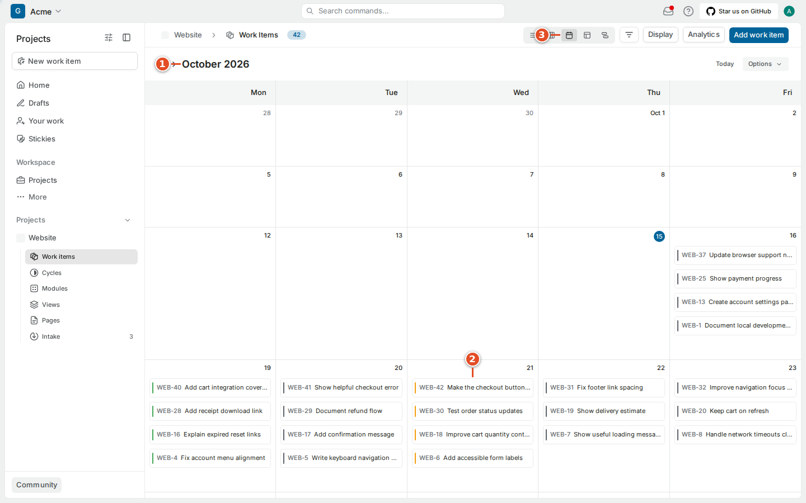
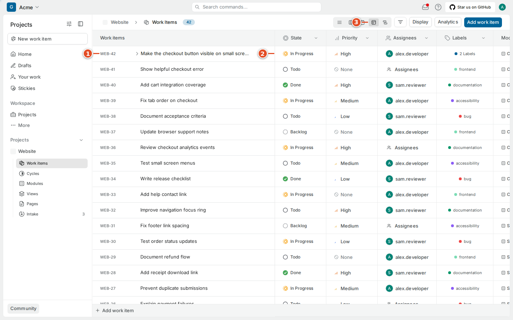
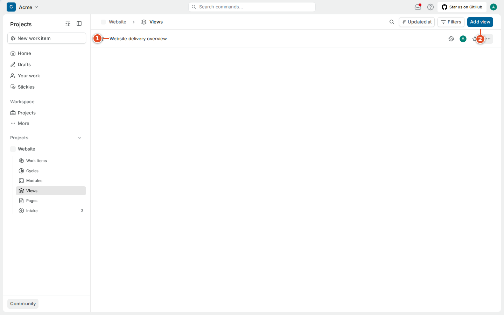

# 05. Seeing work your way

A project can contain more work than you can usefully read at once. A layout changes how records are arranged. A filter chooses which records appear. Grouping divides the matching records into useful sections, and ordering decides which record comes first. A saved view keeps a useful selection so you can return to it without rebuilding the same settings every morning.

These controls affect your presentation of shared work. Editing a property's value still changes the actual work item. Hiding the Due date column does not remove due dates, and filtering to In Progress does not put every hidden item into another state.

## 5.1 Choose a layout

The running CE 1.4.2 project provides five layout buttons in the work-item header. The screenshot markers help locate the selector. Hover an unfamiliar icon to read its tooltip rather than guessing from the shape.

1. Open the project's **Work items** page.
2. Find the row of layout icons in the header.
3. Select the layout suited to your question.

| Layout | A useful question | Remember |
| --- | --- | --- |
| List | What is ready for me to pick up? | Grouping and ordering determine the visible sequence. |
| Board, or Kanban | Where is work accumulating? | A column often represents a state; inspect grouping first. |
| Calendar | What has a date in this period? | An undated item may be absent from the calendar. |
| Spreadsheet | Which properties need a quick comparison? | Editable cells update the shared work item. |
| Gantt | How do the planned date ranges overlap? | A bar's position represents dates, not proof of progress. |

## 5.2 Use the list for a readable queue

List layout gives each work item a row with its identifier, title and selected properties. It is useful when you need to scan titles or compare a small set of fields without the horizontal space a board uses. Expand the item for its description before deciding that the short title tells the full story.

1. Choose the list icon.
2. Read the group heading above the rows.
3. Check the ordering in Display.
4. Open the item you want to inspect.

A count beside a group describes the items matching the current view. If an item is unexpectedly missing, inspect filters and sub-work item visibility before creating a duplicate. A collapsed group can also hide work that still matches the selection.

## 5.3 Use the board to discuss flow

A board arranges work in columns and shows each item as a card. When grouped by state, it is a good shared picture for a stand-up conversation: what is waiting, what is being implemented, and what is ready for review. It also makes a growing review queue easier to notice.

1. Choose the board icon.
2. Check what the column headings represent.
3. Open a card before changing its workflow state.
4. Change the item to the state that reflects the work.

Dragging a card between state columns can update its state. Verify the resulting value when using that interaction. If the board is grouped by a different property, moving a card has a different meaning. Grouping by assignee is not the same workflow operation as grouping by state.

> Tip: A wide board may extend horizontally. Scroll sideways before concluding that Done or Cancelled is missing. Filters can remove entire groups from the visible result as well.

## 5.4 Use the calendar for dated work

Calendar layout places work according to the date information used by that view. It is useful for reviewing a delivery week or noticing several items with the same target date. It is less useful as a complete backlog, because a task without a relevant date has no obvious calendar position.

1. Choose the calendar icon.
2. Check the displayed month or period.
3. Use the date navigation to reach the relevant period.
4. Open the dated item you want to inspect.
5. Verify the date in its properties before changing it.

Changing a deadline should be a planning decision. Do not drag a date simply to improve the appearance of an overcrowded calendar. If several items legitimately share a deadline, discuss scope or capacity with the team and record the decision on the affected work.

## 5.5 Use the spreadsheet for careful property edits

Spreadsheet layout places properties in columns. It helps you compare state, priority, assignees, dates, modules and cycles across a set of items. Some columns contain counts or derived information rather than an editable input. Open an unfamiliar cell to see what the interface permits.

1. Choose the spreadsheet icon.
2. Check the identifier at the left of the row.
3. Select the property cell you intend to change.
4. Choose the new value from its control.
5. Wait for the update to finish.
6. Check the same row before editing another item.

The first identifier column helps preserve context while scrolling horizontally. Keep that context in view when editing similar titles. A row selected for a bulk operation is different from a single open property cell. Read the action's scope before applying it to several records.

> Warning: A spreadsheet is a convenient editor, not a private draft of the project's data. A property edit can trigger a webhook and configured sync behavior just like an edit on the detail page.

## 5.6 Use Gantt to compare date ranges

Gantt layout shows work as bars on a time scale. Use it to see overlapping plans or to discuss a start and target range. Check the scale and visible period before interpreting a short bar as a small task. A one-week range can look different at a monthly scale than at a daily scale.

1. Choose the Gantt icon.
2. Check the time scale in the header.
3. Find the relevant item name.
4. Compare its bar with the displayed dates.
5. Open the item when you need the precise date fields or dependencies.

A date range is a plan. The bar does not establish that someone has started coding, and it does not replace a blocking relation or an explanation in a comment. Keep the state and dates consistent with the team's actual plan instead of using one as a substitute for the other.

## 5.7 Filter without losing your place

The filter control in this project offers categories including State, State Group, Assignees, Priority, Mentions, Label, Cycle, Module, Start date, Target date, Created at, Updated at and Created by. Choose the narrowest useful question. “Assigned to me and not finished” is easier to reason about than a dozen unrelated conditions.

1. Open the filter control beside the layout selector.
2. Choose a property category.
3. Select its desired value or values.
4. Review the resulting list and count.
5. Remove the filter when you need the complete project again.

Different filter controls can combine selections differently. Read the displayed selection and resulting records instead of assuming every click adds a simple “and.” A date filter may use a relative range that changes as time passes. A saved view built around “this week” will show different records next week even if nobody edits the view.

When a teammate says an item is missing, compare the project, filters, selected layout and visible period. Sharing the direct work item link is a quick way to separate a presentation problem from an access problem.

## 5.8 Choose display properties, grouping and ordering

Display controls let you decide which properties are useful in the current layout. The captured list menu includes ID, Assignee, Start date, Due date, Labels, Priority, State, sub-work item count, attachment count, link, Estimate, Module and Cycle. Showing every property can make a narrow screen harder to read; begin with the fields your team uses to choose work.

1. Open **Display**.
2. Select the properties you want to see.
3. Choose a **Group by** option.
4. Choose an **Order by** option.
5. Check **Show sub-work items** if you want children included.
6. Close the menu.

Grouping can use states, priority, cycle, module, labels, assignees, created by or none in the captured list. Ordering includes manual order and property-based choices such as created, updated, dates or priority. The available choices can differ by layout. Sub-work item visibility controls whether children appear in the result; it does not detach them from their parents.

## 5.9 Save a useful project view

A saved view gives a useful query a name. Choose a name that communicates its selection, such as “Frontend work needing review.” Avoid a vague title such as “My view 2” when teammates will depend on it. Check the selected project's scope and any access controls offered by the form.

1. Open **Views** under the project.
2. Start the new-view form.
3. Enter a descriptive name.
4. Add a short explanation of the intended selection.
5. Configure the relevant filters.
6. Save the view.
7. Open it again to verify the resulting records.

A saved view does not copy the work items. An item can appear in several views, and a change made through one view becomes visible wherever the same item matches another query. If a shared view needs a new meaning, discuss that change before editing it; other developers may use its old selection in their daily routine.
