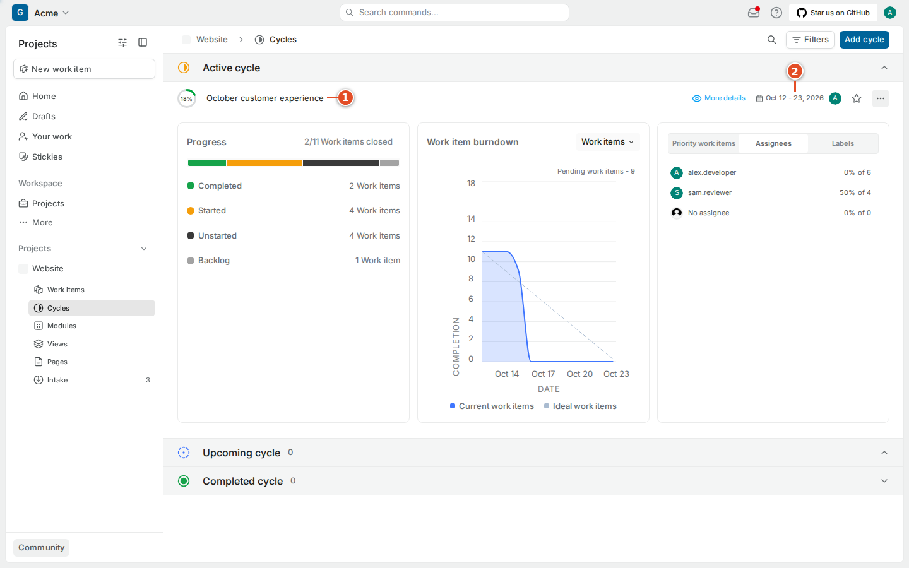
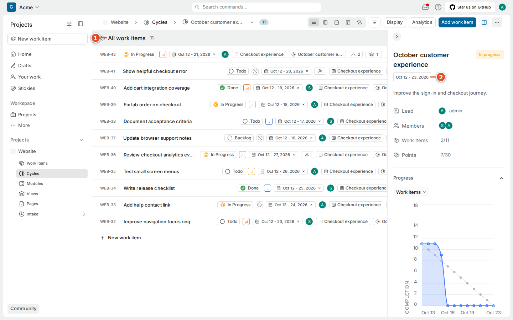
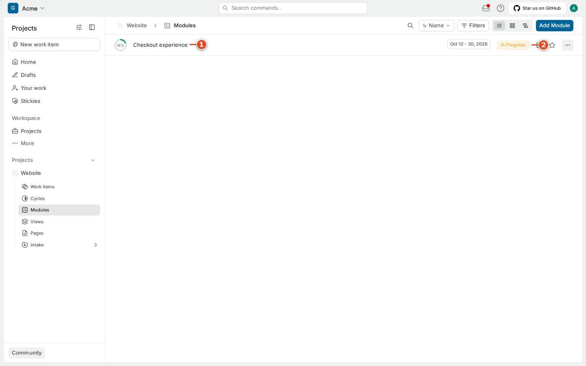
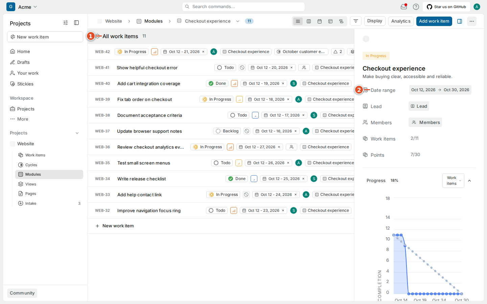
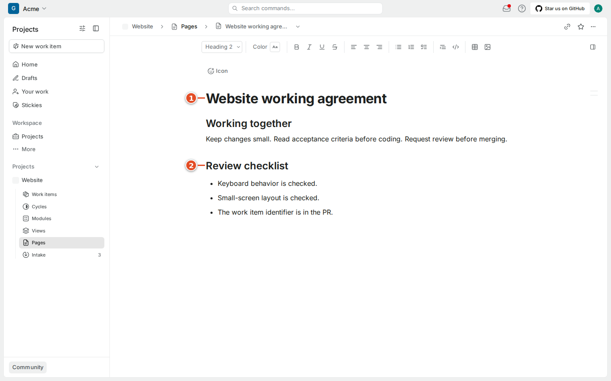
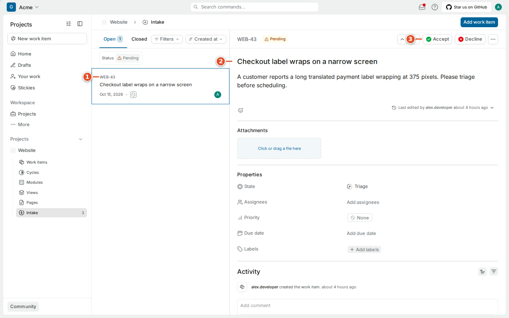

# 06. Planning with cycles, modules, pages and intake

Planning tools answer different questions. A cycle provides a time window. A module groups a feature area or substantial outcome. A page holds written knowledge. Intake receives requests before the team accepts them into its regular plan. These features are present in the captured Community Edition 1.4.2 project; an administrator can enable or disable the optional project entries.

A work item can belong to a module and a cycle at the same time. Moving it into a planning container does not copy its description or create another independent task. Keep the original work item as the place to follow its implementation and discussion.

## 6.1 Work within a cycle

A cycle is a bounded period used to plan and inspect delivery. Some teams call this a sprint. The example **October customer experience** cycle has a start and end date and contains the Website items selected for that window. It is useful for discussing commitments and unfinished work without confusing the current plan with the entire backlog.

1. Open **Cycles** under the project.
2. Find the cycle your team is using.
3. Check its start and end dates.
4. Open the cycle.
5. Read its included work items and progress information.

To place an item into a cycle, use its **Cycle** property and select the intended cycle. Check the dates before choosing a similarly named past cycle. A cycle that is already over is useful historical context, but it may not represent the team's current commitment.

Cycle progress is derived from the work included and its workflow. It can change when items are added, removed or moved between states. Do not interpret a percentage as a promise that the remaining work will take the same proportion of the remaining time. A small unresolved dependency can matter more than several completed minor tasks.

> Tip: During a planning conversation, ask what will move out if an urgent item moves into a committed cycle. Updating the container is easy; making the capacity decision visible is the useful part.

## 6.2 Use modules for a feature area

A module groups related work around an area or larger outcome. The example **Checkout experience** module contains several Website improvements. It is a useful view of progress across tasks that may span more than one cycle. Its status and dates describe the module's plan, while each included item retains its own workflow state.

1. Open **Modules** under the project.
2. Find the module relevant to your task.
3. Open the module.
4. Read its description and properties.
5. Review its included work items.

Use the work item's **Modules** property to add it to an appropriate module. An item can contribute to a broader area without being a sub-work item of every task in that module. A parent relationship describes decomposition; a module describes a planning collection. Avoid creating a very large parent merely to reproduce what a module already communicates.

If your team asks you to create a module, give it a useful name and a description of the outcome or area it covers. Add members and dates where your team's planning practice calls for them. Do not assume that marking a module complete automatically merges PRs or completes its unfinished work items.

## 6.3 Keep team knowledge in Pages

A page is a shared document. It is useful for working agreements, design notes, review checklists and onboarding instructions that should outlive a single task. A work item's description should contain its own acceptance criteria, but it can link to a page describing a convention used by many items.

1. Open **Pages** under the project.
2. Find the document you need.
3. Open it.
4. Read its title and context before following its instructions.

When creating a page, begin with a clear title and a short explanation of its intended audience. Use headings to separate topics. Keep a checklist small enough that a teammate will actually use it during the activity it supports. Link back to a work item for a specific implementation decision instead of duplicating a long comment thread.

Page actions may include favorites, locking, archiving and sharing controls according to your role. A shortcut appearing in the keyboard dialog does not prove that every sharing action is available to your account. Check the actual page controls and permissions. Public sharing can expose content outside the team; use your organization's policy before making a page public. This handbook does not require public page publication.

The captured CE editor and project page list support the ordinary documentation workflow described here. No AI-writing capability, paid knowledge-management feature or advanced publishing workflow is assumed to be included merely because newer Plane documentation mentions it.

## 6.4 Triage new requests through Intake

Triage means deciding what to do with a new report before treating it as planned work. Intake separates incoming bugs, ideas and feedback from the regular project queue. In the captured project, a new request is **Pending** and its work item state is **Triage**. The detail screen offers **Accept** and **Decline** actions.

1. Open **Intake** under the project.
2. Select **Add work item**.
3. Enter a specific report title.
4. Describe the observed behavior and supporting evidence.
5. Select **Create work item**.
6. Open the new request in the pending list.

The person handling triage should check for duplicates, clarify the expected outcome and decide whether the team will pursue it. Acceptance belongs to that triage decision; it should not be used simply to clear an unread count. Declining a report is different from completing an implementation. Preserve a useful reason so the reporter knows what happened.

After accepting work, check its regular project state, priority and ownership according to your team's process. Do not assume that a pending request is already scheduled in the current cycle. In this integration, normal reference resolution excludes triage items, and ordinary sync state changes do not promote work directly from triage. Have the request properly accepted before expecting the regular development automation to apply.

Intake must be enabled for the project. If its navigation entry is missing, ask whether the team uses it and who handles incoming requests. Do not create a separate private backlog as a workaround for an intentionally managed triage process.

## 6.5 Understand the project's estimate system

The administrator's estimate settings offer point systems and categories. The captured Points templates include Fibonacci values `1, 2, 3, 5, 8, 13`, Linear values `1, 2, 3, 4, 5, 6`, and Squares values `1, 4, 9, 16, 25, 36`, along with a custom option. Your team chooses the scale and what those values mean.

As a member, use the active estimate control on a work item when available. Compare the work with examples your team has already sized. If the team has not defined the scale, ask before converting values into hours in a report. An estimate expresses a planning judgment; recorded elapsed time and a deadline are separate concepts.

Changing the project estimate system can affect how many existing items are interpreted. Treat that as an administrator and team decision. The screenshot shows the setting to explain why a field may be absent; it is not a day-one instruction to reconfigure the whole project.

## 6.6 Read project states and labels

States and labels are shared vocabulary. The project's settings organize states by group and list its labels. Reviewing them helps you understand why your team distinguishes In Progress from In Review or frontend from accessibility. Your role determines which settings you may edit.

Ask a project administrator before renaming or deleting a state that automation uses. The integration can target a state name and group, so a casual workflow rename can change which action resolves successfully. Similarly, adding many nearly identical labels makes filters and label mapping harder to understand. Prefer the team's established terms.

The Automations entry in Plane project settings is separate from git-sync's mapping rules. Do not assume a rule configured in one place is represented in the other. For a GitHub-triggered state change, the git-sync mapping and rule reference in chapters 9–11 is the relevant starting point.

## 6.7 Use the analytics that are actually present

The captured CE project has an **Analytics** button in the Work items header. It opens a project summary containing total work items, counts by workflow group, a Created vs Resolved chart, customized breakdown controls, and priority and assignee tables. Export-as-CSV controls appear with the tables. This is observed running functionality, rather than a claim based on a paid-edition feature list.

1. Open the project's **Work items** page.
2. Select **Analytics**.
3. Read the scope and chart labels.
4. Compare the summary with the project records before drawing a conclusion.

Counts explain a selection of records; they do not establish individual productivity or the quality of completed work. A developer can finish an important investigation with one item while another change needs many small records. Use charts to ask useful planning questions, such as why started work is accumulating or whether review capacity is sufficient.

Workspace-level Analytics is also present in workspace navigation. Check its broader scope before comparing its numbers with a single project. This handbook does not assume that every custom dashboard or advanced reporting feature advertised for another edition is available in CE 1.4.2.
