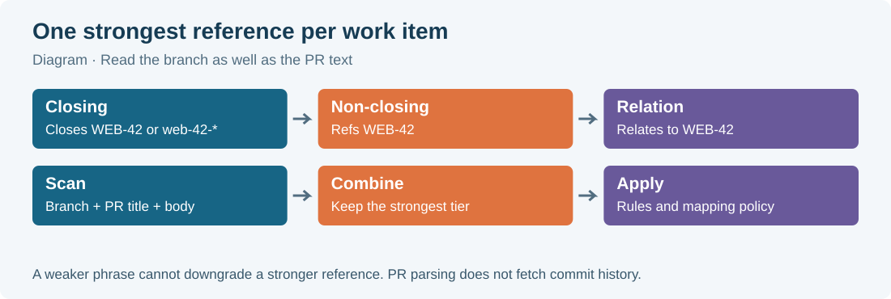

# 09 · Link branches, commits, and pull requests

A work item's identifier is its short address in code discussions. `WEB-42` means work item 42 in the project whose identifier is `WEB`. Putting that address in a branch or pull request lets git-sync connect the code to the task. The connection can also permit automation, so the wording deserves the same care as choosing the task's state by hand.

This chapter describes the current repository implementation. Your administrator chooses which repository is mapped, which rules are active, and which magic words the instance recognizes. The examples use the shipped default word lists. A link alone does not guarantee a state change when no matching rule is configured.



## Choose the right kind of reference

There are three strengths of reference, called **tiers** in the implementation. A tier says how much automation the connection permits. It is separate from the work item's current state.

| Tier | Reader-friendly meaning | Automation allowed |
|---|---|---|
| Closing | This code is intended to finish the item | Configured state changes, including the merge state when the multi-PR condition allows it |
| Non-closing | This code contributes part of the work | Configured state changes before merge; merge-state changes are skipped |
| Relation | This code is useful context | Link information; automatic state changes for that reference are skipped |

For example, `Closes WEB-42` is a closing reference. `Refs WEB-42` is non-closing. `Relates to WEB-42` is a relation. These phrases do not themselves name a Plane state. A team may choose In Progress for an opened PR and Done for a merged PR, while another team chooses different states or different rules based on the destination branch.

These tiers gate state changes in the current executor. Other actions in an administrator rule, such as posting a comment or adding a label, can still run for a relation or non-closing reference. “Relation” is therefore safest read as “do not change the workflow state,” rather than a promise that every configured automation action is disabled.

A common surprise is that a bare identifier in a branch or PR title is already **closing**. If a PR should only contribute part of an item, write a non-closing phrase and check the branch too. A closing branch reference can outrank a carefully worded non-closing body.

## Exact identifier rules

The parser in `src/parse/references.ts` recognizes a project prefix beginning with a letter followed by 1–11 letters or digits, then a hyphen, then decimal digits. Thus the prefix is 2–12 characters long. It resolves the resulting identifier through Plane; recognizing the text does not prove that the work item exists or that the service can read it.

| Text | Recognition rule |
|---|---|
| `WEB-42` | Valid identifier shape |
| `API2-103` | Valid identifier shape |
| `X-42` | Ignored: one-character project prefix |
| `42-WEB` | Ignored: wrong order |
| `WEB_42` | Ignored: underscore instead of hyphen |
| `WEB-42_extra` | Ignored: an underscore immediately after the digits prevents a match |
| `WEB-42more` | Ignored: a letter immediately after the digits prevents a match |
| `feature/WEB-42-login` | Recognizes `WEB-42`; slash and the following hyphen are acceptable boundaries |
| `xWEB-42` | Can represent prefix `xWEB` in a case-insensitive context; it does not identify `WEB-42` |
| `WEB-0042` | Normalized to `WEB-42` |

An immediately preceding letter or digit prevents a match from starting at that position. A following letter, digit, or underscore prevents it from ending there. Do not rely on an identifier buried inside a longer technical token. Use a slash, space, parenthesis, or hyphen boundary and an ordinary key copied from Plane.

The parser has a small fixed deny-list for technical tokens: `UTF`, `SHA`, `ISO`, `AES`, `RSA`, `CVE`, `CWE`, `RFC`, `TLS`, `SSL`, `MD`, `ES`, `PEP`, `USB`, `HTTP`, `IPV`, `SSH`, `GPT`, `RS`, `CRC`, `UTC`, and `WIN`. These prefixes are ignored even after a magic word in the current implementation. If your real project uses one, ask the administrator for a compatible project identifier. Do not assume `Fixes RFC-42` bypasses the deny-list.

## Where identifiers are found

The general parser accepts branch, title, body, and commit-message inputs. Different event handlers provide different inputs. That distinction is useful when a commit seems related but the PR has no connection.

| Location | Bare key case | Bare tier | Current use |
|---|---|---|---|
| PR head branch name | Case-insensitive | Closing | PR linkage and relevant push processing |
| PR title | Uppercase prefix only | Closing | PR linkage |
| PR body | Uppercase prefix only | Relation | PR linkage |
| Commit message | Uppercase prefix only | Relation | Push rules and Smart Commit key discovery |
| Key after a configured magic phrase | Case-insensitive | Phrase's tier | Supported parser inputs supplied by the relevant handler |

The head branch is the branch containing your changes. The base branch is the branch receiving them. A branch-aware rule can inspect the **base** branch, such as `main` or `staging`, but the PR's identifier scan uses its **head** branch.

The current PR handler scans the head branch, title, and body. It does not fetch the PR's commit history and feed those messages into the PR reference parser. Commit text is processed on push paths, including Smart Commits. Put the work-item key in the PR itself or its head branch whenever you want a durable PR connection. A key that exists only in an old commit is a poor substitute.

Case rules explain several apparently inconsistent examples:

```text
Branch: feature/web-42-login       -> closing WEB-42
PR title: WEB-42 Improve login     -> closing WEB-42
PR title: web-42 Improve login     -> no bare match
PR body: Related discussion WEB-42 -> relation WEB-42
PR body: Related discussion web-42 -> no bare match
PR body: Refs web-42               -> non-closing WEB-42
```

Magic phrases are case-insensitive. `REFS web-42`, `Refs WEB-42`, and `refs Web-42` all carry the same default non-closing meaning. A bare lowercase key in a body does not.

## Name a branch deliberately

A useful team convention is a key followed by a short explanation: `web-42-fix-login-redirect`. That is a suggestion, not a mandatory global naming format. The Development panel offers the administrator's actual configured format.

The branch helper's default template is `{key}-{title-slug}`. Supported placeholders are `{key}`, `{title-slug}`, and `{username}`. A configured template must include `{key}` in a position the parser can recover. A title slug is a shortened, lowercase version of the work-item title with words separated by hyphens. A missing username is omitted with its nearby separator.

1. Open the intended Plane work item.
2. Find **Development** in its detail sidebar.
3. Locate the intended repository under **Start work**.
4. Select **Copy branch name**.
5. Create that branch in your local checkout.
6. Push the branch to the mapped repository.

For example, after copying a suggested name you might run:

```bash
git switch -c WEB-42-fix-login-redirect
git push -u origin WEB-42-fix-login-redirect
```

Check the repository before running those commands. A copied name does not choose a local checkout or an `origin` remote for you. The panel's copy button copies text only; its implementation does not change the work-item state. Branch creation or first-push rules may change state when configured, but copying alone is not a promise that work has started.

Project members with sufficient permission may also see **Create branch**. That creates a remote branch from the repository's current default branch using the GitHub App. It does not create a local checkout. If the name already exists, the panel reports **Branch already exists**. An empty repository needs a first commit before a branch can be created. Missing App Contents write permission is an administrator issue.

For partial work, a branch with no work-item key, such as `login-layout-part-one`, plus `Refs WEB-42` in the PR title or body avoids an accidental closing branch reference. `refs/web-42/login-layout` still contains a bare closing key: a slash is not the whitespace required after a magic phrase. Agree on the partial-work convention with the team before relying on it.

## Write a PR that says what it finishes

1. Open the pull request in the mapped GitHub repository.
2. Give it a descriptive title.
3. Add `Closes WEB-42` to the body when it completes that item.
4. Check the head branch for other work-item keys.
5. Check the body for unintended references.
6. Save the pull request.
7. Open the Plane work item to inspect **Development**.

The parser scans the whole supplied text; the identifier need not be at the beginning of the title or on the first line of the body. It is not a Markdown-aware parser. Quoted text and code blocks are still text for reference discovery. A copied example containing `WEB-99` can therefore create an unintended relation. Keep unrelated examples generic, or use the body opt-out for a key before the initial link forms.

A single magic phrase can apply to several keys. Commas, whitespace, `and`, and `&` are supported separators:

```text
Fixes WEB-42, WEB-43 and API-9
Refs WEB-42 WEB-43
Relates to WEB-42 & API-9
Closes: WEB-42
```

The colon is optional. There must be whitespace between the phrase and the key; use `Closes: WEB-42`, not `Closes:WEB-42`. Parentheses between the phrase and key break that phrase's match: `Refs (WEB-42)` leaves a bare key, whose meaning depends on its location.

## Resolve competing references

Each identifier receives the strongest tier found anywhere in the supplied inputs: closing outranks non-closing, which outranks relation. When tiers are equal, the recorded source preference is branch, title, body, then commit. This source preference is bookkeeping; it does not make a relation beat a closing phrase.

Suppose a branch is `web-42-login`, the title is `Refs WEB-42`, and the body says `Relates to WEB-42`. The result is closing because of the branch. If your intention is partial work, remove or change the closing occurrence too. An occurrence already classified by a magic phrase is not separately reclassified as a bare key, so a title containing only `Refs WEB-42` remains non-closing.

In a PR **body**, `skip WEB-42` or `ignore WEB-42` suppresses that key in the current parser result, regardless of where a competing occurrence was found. The words are case-insensitive. This exception is body-only; `skip WEB-42` in a title is not an opt-out. Each key needs its own skip phrase; do not assume `skip WEB-42 WEB-43` suppresses both.

> **Warning:** The running PR handler also loads existing active links from its database. Adding `skip WEB-42` after a link already exists, or deleting the visible key from a PR, does not remove that stored association. Ask an administrator to repair an unintended existing link and check its tier before merging.

## Create a work item from a PR

`WEB-NEW` requests a new item in the WEB project. The current parser recognizes the marker in the PR title **or** body; the suffix `NEW` must be uppercase. `web-NEW` is recognized, while `WEB-new` is not. A branch marker or commit marker does not make this request.

The PR handler processes create requests on opened, edited, and reopened events. It uses the PR title as the new item's name, chooses a started state when one can be resolved, and creates a closing PR association. It does not promise to copy the complete PR body into the new item's description. Repeated delivery of the same request is guarded so ordinary retries do not create a fresh item each time.

Use this shortcut when the team explicitly accepts PR-first work. If the task already exists, reference its real number instead. The marker identifies a project, not the next number you would like Plane to assign.

## Read the Development panel

The panel combines categorized links maintained by git-sync. It can show **Pull requests**, **Builds**, **Deployments**, **Previews**, **Branches**, and **Start work**. A category without links is omitted. Its data reflects recorded events and links; it is not a continuously live GitHub browser.

This version has no separate **Commits** list in the Development panel. Commit connections are visible through Smart Commit provenance, GitHub's PR commits view, and supported build/status links that can point to a commit. A push containing a bare key can supply a target to configured push rules, but it does not by itself promise a new standalone commit row in Plane. Open the linked PR on GitHub when you need its complete commit history.

| Label | Meaning |
|---|---|
| `OPEN` | PR remains open |
| `MERGED` | PR merged |
| `DECLINED` | PR closed without merging |
| `REVIEW` | No current decisive approval/change request is represented, or reviews could not be read completely |
| `APPROVAL` | A current approval exists and no reviewer's standing change request takes precedence |
| `REJECTED` | At least one reviewer has a standing change request |
| Build `pass` | All represented runs passed; neutral/skipped check conclusions count as passed |
| Build `fail` | A represented run failed or ended with another failure conclusion |
| Build `pending` | Runs are incomplete, inconclusive, or absent |

For each reviewer, the latest decisive review counts; dismissing it removes that reviewer's decision. A casual review comment does not erase a previous request for changes. The overall PR badge is `OPEN` if any linked PR is open, otherwise `MERGED` if any merged, otherwise `DECLINED`. That badge summarizes PRs, not the Plane state or production deployment.

A preview is a shortcut to a deployed version for inspection. Supported provider detection includes Vercel, Netlify, Cloudflare Pages, and AWS Amplify environment URLs. A Markdown link whose label ends in `Preview`, such as `[Website Preview](https://preview.example.com)`, can also be detected in supported body inputs. The integration does not deploy the site itself.

Several PRs can link to one work item. At merge automation time, at least one must be merged and none may remain open before merge-state changes proceed. A closed unmerged PR does not block and does not count as a merge. If another PR's current status cannot be read, the implementation conservatively treats it as open. Inspect the whole linked set before deciding an item is stuck.

Implementation references: `src/parse/references.ts`, `src/parse/magicWords.ts`, `src/app/pr.ts`, `src/app/push.ts`, `src/app/rules.ts`, `src/sync/dev-info.ts`, `src/ui/dev-panel.ts`, and `src/ui/client/DevPanel.tsx`.


Completion is evaluated on a qualifying merge event. If one linked PR merges while another remains open, later closing the second PR unmerged does not rerun the first merge under the shipping defaults. Close obsolete PRs before the final completing merge, or agree an explicit state correction with the team.
