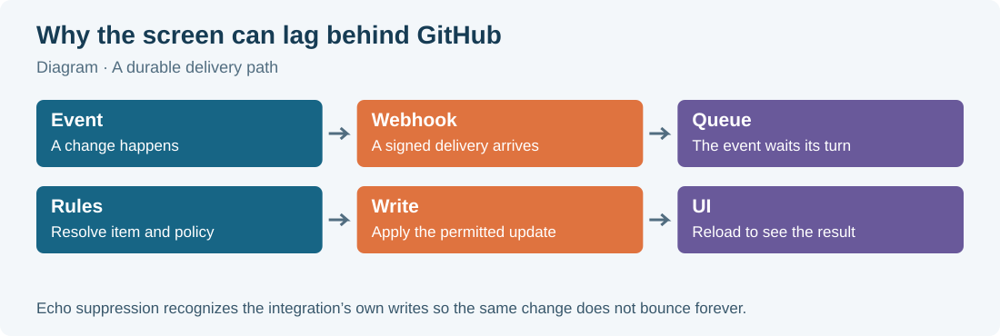

# 11 · What syncs, in which direction, and when

Git-sync connects several kinds of information. A PR can **reference** a Plane work item without copying its fields. An ordinary GitHub issue can instead become a **mirror partner**, where selected fields are copied between the two systems. A Smart Commit performs explicit commands from a pushed message. Keeping these three paths distinct makes most sync behavior easier to predict.

For example, `Closes WEB-42` on a PR permits the team's PR automation for WEB-42. It does not make the PR title replace the Plane item's title. Adding the `plane` label to an ordinary GitHub issue can create a Plane mirror partner whose title and description are synchronized. These are deliberately different relationships.

The behavior in this chapter comes from the implementation, especially `src/sync/mirror.ts`, `src/app/issues.ts`, `src/app/pr.ts`, `src/app/push.ts`, `src/app/rules.ts`, and the design and amendment in `docs/superpowers/specs/2026-10-10-plane-github-sync-design.md`. An administrator's mapping and rules can narrow the behavior described here.

## The quick direction map

| Starting event | Destination behavior | Main condition |
|---|---|---|
| New GitHub issue with `plane` label | Creates a Plane work item | Repository mapping and App access |
| `plane` label added to an unmirrored GitHub issue | Creates a Plane work item | Label-gated opt-in |
| Plane work item gains `github` label | Creates a GitHub issue | Two-way mapping |
| Edited mirrored GitHub issue | Copies eligible fields into Plane | Field policy |
| Edited mirrored Plane item | Copies eligible fields into GitHub | Two-way mapping and field policy |
| PR opened, reviewed, merged, or closed | Updates links and runs configured rules | Recognized/stored reference and tier |
| First push of a keyed branch | Adds branch link; may start work | Matching branch rule for state changes |
| Pushed Smart Commit | Applies explicit commands in Plane | Enabled mapping and optional verification |
| Checks or deployment status | Updates recorded development information | Linked work and relevant event handling |

“Two-way” means both sources are eligible under the mapping. It does not mean every field has identical ownership, or that every change visible in one product is copied. Some fields do not exist on both sides.

## Opt in an ordinary issue

The default gate labels are `plane` on GitHub and `github` on Plane. Label comparisons for these gates are case-insensitive. Their purpose is to request a mirror pair; adding a work-item identifier to prose is a reference, not an equivalent mirror request.

To bring an ordinary GitHub issue into Plane:

1. Open the issue in the mapped repository.
2. Add the `plane` label.
3. Wait for the create operation to finish.
4. Find the new item in the mapped Plane project.
5. Inspect its title, description, and mirror confirmation.

To send a Plane item to GitHub under a two-way mapping:

1. Open the work item in the mapped Plane project.
2. Add the `github` label.
3. Wait for the create operation to finish.
4. Open the resulting GitHub issue.
5. Check its title and description.

If the gate label does not exist, ask the administrator or someone with label-management permission. The integration creates required target-side labels during supported writes; that does not mean every developer can create source labels in every project.

The mirror keeps a durable association between the two item IDs. Removing a gate label later does not delete the pair or turn synchronization off. Likewise, a linked PR is not treated as an ordinary issue mirror. The mirror code explicitly excludes pull requests, preventing a PR edit from unexpectedly renaming its task.

On GitHub-to-Plane creation, title, converted description, mapped assignees, ordinary labels, and a suitable initial state can be supplied. On Plane-to-GitHub creation, the current create path supplies title, converted description with a Plane-origin footer, and labels; it does not pass the Plane assignee list or terminal state as create fields. Later supported assignment/state changes can synchronize them. Check a newly created partner instead of assuming it began with every source property.

## The six mirrored fields

| Field | GitHub → Plane | Plane → GitHub |
|---|---|---|
| Title | Issue title becomes work-item name | Work-item name becomes issue title |
| Description | Markdown becomes Plane HTML | Plane HTML becomes GitHub Markdown |
| State | Closed/reopened issue selects mapped state | State group closes or reopens issue |
| Assignees | GitHub accounts mapped to Plane members | Plane members mapped to GitHub accounts |
| Labels | Names resolved or created in Plane | Added/removed ordinary labels applied to GitHub |
| New comments | Added as new Plane comments with provenance | Added as new GitHub comments with provenance |

These fields belong to **mirror partners**. A manually added URL, branch reference, or magic-word PR association does not automatically opt into six-field copying. A work item's Development section and its ordinary mirror relationship may coexist, but they answer different questions.

## Understand field ownership before editing

The mapping has one conflict policy per field. “Conflict” means both sides could change a value; the policy says which changes are eligible to cross over. The shipped defaults are:

| Field | Default policy | Practical effect |
|---|---|---|
| Title | GitHub is source of truth | Later GitHub title edits can update Plane; Plane title edits do not update GitHub |
| Description | GitHub is source of truth | Edit the mirrored description on GitHub by default |
| State | Last write wins | Supported changes from either side may cross |
| Assignees | Last write wins | Supported mapped assignments may cross |
| Labels | Last write wins | Supported ordinary label changes may cross |
| Comments | Last write wins | Eligible new comments may cross in both directions |

The available policy values in source are `last_write_wins`, `source_of_truth:github`, and `source_of_truth:plane`. Administrators may change defaults. Ask where your team wants edits made if the two screens disagree.

A source-of-truth policy is an outbound eligibility rule, not an editing lock. Plane may let you edit a title even while its GitHub partner owns title synchronization. That local edit can remain visible until a later eligible GitHub title change arrives. The integration does not prevent you from typing it, and it does not promise to immediately reverse every local edit.

The mapping direction has priority. **GitHub to Plane** (`github_to_plane`) blocks Plane-origin mirror writes entirely. Selecting Plane as source of truth for a field in such a mapping does not create a reverse channel; it can leave neither direction eligible for that field. An administrator should resolve that policy combination.

“Last write wins” also needs care. Delivery order is not a dependable clock. The implementation reads the source object's current value and compares its `updated_at` timestamp with the delivered snapshot for full-value fields. It avoids applying an older snapshot when a newer current value is available. This is not a collaborative text merge, and it does not provide a human conflict-resolution dialog. Make substantial description edits on the agreed source side and communicate concurrent changes.

## Closing and reopening ordinary issues

A mapping may choose explicit Plane **open** and **closed** states. The names are project-specific. GitHub has a simpler open/closed distinction, so several Plane workflow states can correspond to one GitHub state.

| Event or state | Mirror result when state policy permits |
|---|---|
| GitHub issue closed | Chosen closed state; otherwise a completed-group state |
| GitHub issue reopened | Chosen open state; otherwise an unstarted-group state |
| Open GitHub issue first mirrored | Chosen open state if valid; otherwise Plane's project default |
| Closed GitHub issue first mirrored | Chosen closed state or completed-group fallback |
| Plane item enters completed group | GitHub issue closed with reason `completed` |
| Plane item enters cancelled group | GitHub issue closed with reason `not_planned` |
| Plane item enters another group | GitHub issue opened with reason `reopened` when the state changes |

The fallback resolver prefers a suitable default state in the requested group. If an explicit chosen state was deleted or became unsuitable, the service records a fallback in the audit log. If no appropriate state can be resolved, it does not invent one. Automation refuses to move work into triage.

Moving a task from In Progress to In Review may cause no visible GitHub issue state change because both are normally open groups. That is expected: GitHub's binary issue state cannot display every Plane workflow step. A PR review badge carries different information and should not be used as a substitute for the work item's state.

Closing a GitHub issue as “not planned” does not necessarily choose a cancelled Plane state. The incoming issue path uses the mapping's configured closed state or completed fallback. If your team distinguishes cancelled work, agree on the chosen closed state and the side where that decision should be made.

## Assigned people and mentions

People are translated through the workspace user map. A GitHub assignee's stable account ID identifies the linked Plane user. A person without a mapping cannot be assigned by guessing their display name or git email. The result can therefore contain fewer assignees than the source.

For Plane-to-GitHub updates, the service reconciles the mapped part of GitHub's assignee list. It removes mapped accounts that Plane no longer wants, adds mapped accounts Plane requests, and leaves GitHub assignees that Plane cannot represent alone. Clearing the last mapped Plane assignee is a real change, even though the desired set is empty.

A personal account link helps establish this relationship, but it does not override repository eligibility. GitHub can still refuse an assignment or a user-token write when the account lacks appropriate access. Give the administrator both the account name and repository name when assignment differs.

Mentions inside descriptions and comments are converted too. A mapped GitHub `@login` can become a native Plane mention. An unmapped GitHub login becomes a profile link. A Plane mention of a mapped member becomes `@login` on GitHub; an unmapped member is represented by their display name where available. These conversions preserve readable text without manufacturing an identity match.

GitHub issue references such as `#123`, `owner/repo#123`, and full issue URLs can become explicit GitHub links in the converted Plane content. That is prose conversion, separate from recognizing `WEB-42` for automation. Inline code and code blocks are not rewritten by the prose converter, even though the separate work-item reference parser can scan textual keys in supplied PR text.

## Labels and comments are not full object copies

Ordinary label names are synchronized, with missing target labels created where supported. The gate labels have special handling to avoid recursively creating mirror pairs. Names, rather than internal label IDs, connect the two systems. Colors and label descriptions are not promised as mirrored fields.

GitHub label events use the source's current label set for the Plane update, excluding the GitHub `plane` gate through the helper logic. Plane label events use the reported additions and removals, resolving label IDs back to project label names. This means label synchronization is not simply copying a screenshot of one side's entire settings page.

Only **new** ordinary comments are mirrored by these handlers. Editing or deleting a comment does not edit or delete its existing counterpart. A correction should be a new comment if both sides need to receive it. Historical comments are not automatically copied as a complete conversation when a new mirror pair is created.

A mirrored comment identifies its source author and side. A GitHub comment copied into Plane includes who commented and, when available, a link to the original. A Plane comment copied into GitHub has a “commented in Plane” introduction. Where usable personal authorization exists, supported GitHub writes can use it; otherwise the App identity performs the write. The provenance remains useful in either case.

## PR events and configured automation

PR lifecycle automation is driven by ordered rules. The first matching rule supplies its actions. The simple lifecycle-to-state settings are another way to configure this same engine. There is no second independent state engine running alongside those rules.

| Lifecycle point | Meaning to a developer |
|---|---|
| Drafted | PR is a draft |
| Opened | PR is open for normal work/review |
| Review requested | Someone was asked to review |
| Changes requested | A review requests changes |
| Approved | An approval review event occurred |
| Ready for merge | Integration checked readiness from GitHub |
| Merged | PR merged into its base branch |
| Closed unmerged | PR closed without a merge |
| Reopened | A closed PR was reopened |

Rules can inspect the base branch, head branch, labels, author, repository, and target project. For example, a team can map merge into `staging` to In QA and merge into `main` to Done. Those are examples of configured behavior, not an assertion that every project has those states or ships those rules.

Actions can select a state, add or remove a label, assign a mapped person, post a comment, add a link, record time as a comment, or create another work item. Your administrator owns the actual rule set. Unexpected labels or comments after a PR event may therefore be deliberate rules rather than part of ordinary issue mirroring.

Readiness is checked from current GitHub data for an open, non-draft PR. It needs at least one standing approval and no standing request for changes. Relevant check suites must be completed with success, neutral, or skipped conclusions; stale suites and suites with zero latest runs are non-blocking. Combined commit statuses must succeed, while a reported zero-status set is allowed. A visible approval badge alone does not establish readiness. Missing permissions or incomplete reads cannot safely be treated as green. The ready-for-merge event is guarded per PR head commit so several simultaneous approval/check events do not repeatedly apply the same readiness action. A new head commit can become ready again.

Closing without merge does not inherently finish or cancel a task. It has its own lifecycle point, and a team may configure no action. Merging a closing PR still waits for the linked-PR condition described in Chapter 09. Review and check information can update even when the Plane state stays unchanged. In the current rule executor, reference tiers and the multiple-PR merge guard gate state changes specifically. Other configured actions, such as labels or comments, can still run even when a state change is skipped.

## Development information and linkbacks

The integration stores categorized Plane links for PRs, branches, builds, deployments, and previews. It updates a stored rollup link in place when a status changes. The Development panel groups those links for convenient reading. Native Plane links can also show reserved prefixes such as `[PR]`, `[Branch]`, `[CI]`, `[Deploy]`, or `[Preview]`.

Checks and deployment statuses report work done by GitHub workflows or external deployment systems. Git-sync does not run the build or deploy your application. A merged PR can have a failed build or a pending deployment; verify the relevant category before claiming a release is live.

The mapping's **linkback** option controls extra cross-links. For a newly created mirror pair, it permits a Plane link to the GitHub issue and a GitHub comment linking the Plane item. A Plane-side “Mirrored from/to” confirmation is separate and remains part of creation. For a newly linked PR, linkback can post a GitHub comment beginning “Linked Plane work item” or “Linked Plane work items.” Linkback off suppresses those extra cross-links, not the underlying mirror or reference.

**Report problems** is a separate option and defaults off. When enabled, the service can place durable diagnostic notices on a PR, commit, or known Plane item. Some unresolved-key notices are restricted to linked workspace members and true missing-item results. A lack of a public notice is therefore not proof that every supplied key resolved.

## Queues, delays, and echoes

A webhook is a short notification that something changed. The incoming HTTP request is validated and queued; workers then interpret it and register outbound writes. GitHub-bound and Plane-bound writes have separate queues so one side's outage need not block all work on the other side.

The service records multi-step operations durably. For example, creating a mirror partner, remembering its ID, and posting a cross-link are related steps that may finish at different times. A create can be accepted while its linkback is still pending. Retries resume eligible unfinished work rather than asking you to create the issue again.

There is no guaranteed instant update or fixed number of seconds promised to developers. Rate limits, outages, queued work, and authorization failures affect completion. Avoid editing both sides repeatedly to “wake up” the integration. Inspect the source, wait for processing, and give the administrator a concrete event URL and expected result if the delay persists.

Two-way sync must also avoid an endless bounce: Plane changes GitHub, GitHub reports that change, and the integration would otherwise write it back to Plane. The service keeps a recent ledger of fields it wrote and recognizes matching return notifications as **echoes**. It also filters Plane events authored by the configured Plane service user. GitHub bots are not universally ignored. An echo is a receipt for work already performed, so ignoring it is the correct result.

Echo suppression differs from deduplication. A repeated webhook delivery should not repeat its effects; a repeated Smart Commit SHA should not repeat completed commands; an echo should not start a reverse write. These are separate safeguards. A changed SHA after history rewriting is still a new Smart Commit identity, as Chapter 10 explains.

Plane can emit one notification per changed field, so one edit may create several queue entries without representing several user actions. The service compares full-value fields with newer source snapshots where possible. An old PR lifecycle event that contradicts the current PR state is skipped rather than moving work backward after a merge or reopen.

## What is never assumed to sync

The six-field mirror is deliberately narrower than the whole Plane data model. Priority, start and due dates, estimates, cycles, modules, parent/sub-work-item structure, relations, subscribers, reactions, attachments as independent objects, saved views, pages, notification preferences, and project settings are not ordinary mirrored fields. A description can contain links or images after conversion without that implying an independent attachment-sync feature.

Deleting a Plane item is not a closing instruction. Plane v1.4.2 does not provide the necessary issue-deletion webhook for immediate deletion mirroring. A periodic reconciliation sweep examines linked items. It distinguishes archived items and archived projects where it can, and marks a confirmed or repeatedly missing partner as orphaned. It does not close a GitHub issue merely because Plane returned a 404.

Archiving is also different from Done. Archived items can be hidden by Plane's detail API while still existing. The reconciliation logic records archived links without treating that as deletion. Do not delete or archive an item as a way to force a GitHub close; use the agreed workflow state.

GitHub issue deletion and comment deletion do not trigger destructive counterpart deletion in the ordinary mirror handlers. Reopening a task does not automatically revert code, reopen every PR, or undo a deployment. A reverted commit does not magically reverse old comments or time notes. Those are separate team decisions requiring explicit work and, when appropriate, new links or state changes.

## A reliable way to investigate a mismatch

1. Identify whether the relationship is a mirror, a PR reference, or a Smart Commit.
2. Open the original event or source object.
3. Check the exact identifier and repository.
4. Check all linked PRs when completion is expected.
5. Read any visible connection or problem notice.
6. Record the expected result and the observed result.
7. Send the evidence to your workspace administrator through the team's normal channel.

The administrator can check mapping health, direction, field ownership, rule order, App access, signature policy, queue status, and audit entries. A screenshot of the result and a source URL are more useful than repeated edits. Include a rough time and timezone so the administrator can find the relevant delivery. Share no tokens or webhook secrets.

Implementation references: `src/sync/mirror.ts`, `src/sync/reconcile.ts`, `src/sync/dev-info.ts`, `src/app/issues.ts`, `src/app/pr.ts`, `src/app/push.ts`, `src/app/rules.ts`, `src/github/pr-automation.ts`, `src/queue/index.ts`, and `src/ui/validate.ts`.

A completion check runs at a qualifying merge event. Closing another linked PR unmerged later does not automatically revisit an earlier merge that was blocked by that PR. Reconciliation does not imply continuous re-evaluation of this merge rule.
