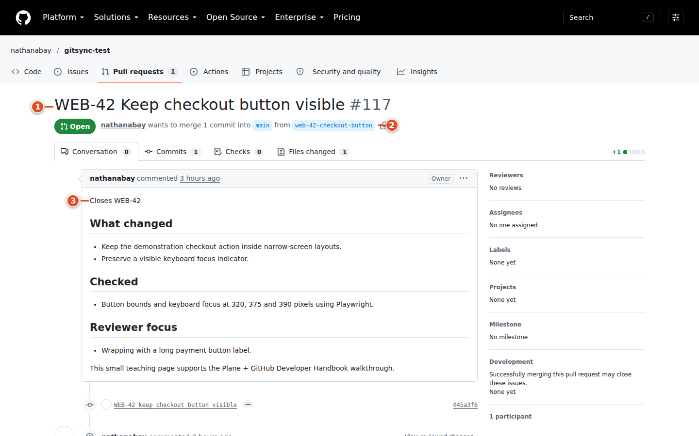
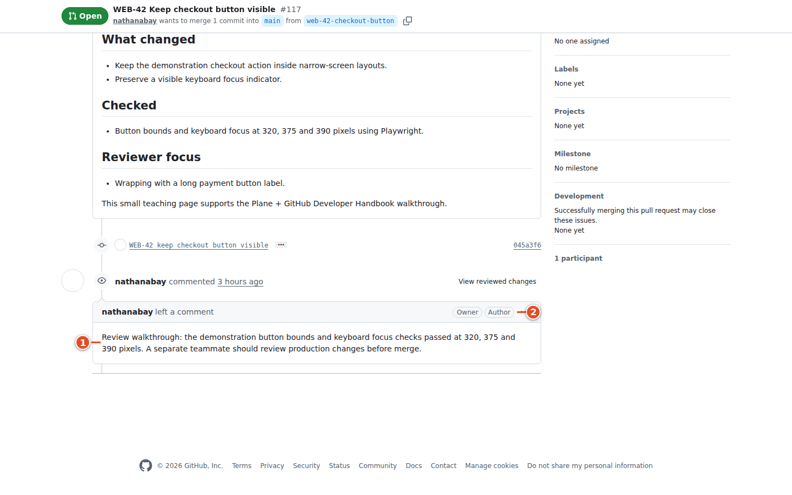

# 12. A day in the life

This chapter follows Alex Developer through one small change: **WEB-42 — Keep the checkout button visible on a narrow screen**. Sam Reviewer reviews the code. The names and checkout scenario are teaching examples. Use your team's actual repository and assigned work item when doing real work. Captures for this handbook use a dedicated demonstration project and an authorized GitHub test repository. Captions and the image notes distinguish real captured events from illustrations or prepared examples.

A work item describes the outcome the team wants. A branch holds a developer's changes. A commit records a set of changes. A pull request asks the team to review and merge those changes. git-sync recognizes references to the work item's identifier, such as `WEB-42`, in the relevant branch, PR or Smart Commit processing. The identifier travels with the work, so another developer can discover why a change exists without remembering who wrote it.

The worked result assumes a mapped repository, enabled Smart Commits, the shipping automation defaults, a project with suitable In Progress, In Review and Done states, and a pull request merged into `main`. Administrators can change these policies. Treat each expected result below as a checkpoint against your team's configuration. The final state also depends on other linked pull requests: an open linked PR prevents the merge completion transition.

> Tip: Keep Plane in one browser tab and the repository in another. Use your terminal for git commands. Return to the work item at each checkpoint so a missing connection is discovered early.


> Warning: The capture environment’s GitHub connection was unavailable during this edition. The Plane edits and GitHub PR #117 are real, but automated Smart Commit comments, linked Development entries and the final Done/MERGED transition have not yet been verified live. The remaining automation checkpoints describe the behavior checked in this repository’s code. The image notes record the blocker and the open PR for completion after the test connection is restored.

## 12.1 Choose a task with a clear finish line

1. Open the Website project in Plane.
2. Open the view your team uses to choose its next work item.
3. Open `WEB-42`.
4. Read its description.
5. Read its comments.
6. Check its assignees.
7. Check its priority.
8. Check any linked blocking work.

Alex learns that the checkout button disappears below a width of 400 pixels. The description asks for a visible button at 320, 375 and 390 pixels, no overlapping text, and unchanged keyboard access. A comment says that Sam can review the visual change. Those details provide a finish line: a small CSS adjustment plus checks at the listed sizes. “Make checkout better” would be too vague to implement confidently.

An assignee identifies who is responsible for moving work forward. It does not prove that person is currently writing code. Alex checks ownership before starting so two people do not independently implement the same fix. A blocking relation means another outcome is needed first. Reading the work item can reveal a dependency that a short board card does not show.

9. Assign the work item to yourself if your team expects developers to claim work.
10. Move the work item to In Progress.
11. Add a short comment describing your intended approach.

> Example: “Starting the narrow-screen checkout fix. I will preserve keyboard focus order and check the three widths listed above.” This tells the team what is happening without repeating the entire description.

Manually setting In Progress is a normal way to declare that work has begun. The default branch and PR automation can also move a linked item into a started state. A later automatic transition does not make this first update unnecessary: your teammates need to know that you are investigating before the first push.


## 12.2 Prepare a clean local branch

The following terminal steps assume you already have a local clone and a remote called `origin`. They do not install anything. Substitute the directory containing your team's checkout. A clean starting point matters because unrelated edits can accidentally become part of the same pull request.

1. Open a terminal in your local repository.
2. Inspect your current changes.

```bash
git status
```

If you have unfinished work, preserve it according to your team's git practice before switching branches. Do not discard unfamiliar files just to make this example easier to follow. Ask a teammate to help identify changes you do not recognize.

3. Switch to the base branch.

```bash
git switch main
```

4. Update the base branch without creating an unexpected merge commit.

```bash
git pull --ff-only
```

5. Create the task branch.

```bash
git switch -c web-42-checkout-button
```

The lower-case `web-42` in this branch is recognized. Branch references are case-insensitive. Keeping the key near the start makes it easy for humans to read, although the parser can find a correctly delimited key elsewhere in a branch name. Hyphens make useful separators. Avoid changing the identifier into `WEB_42`, `WEB42`, or `WEB-42_fix`: those are different strings, and the last form fails the parser's trailing boundary rule because an underscore follows the number.

The Development panel offers **Copy branch name** for each mapped repository. Its suggested name follows the administrator's template. Use that suggested name when your team has standardized it. **Create branch**, when available, creates a remote branch from the repository's default branch; it does not switch your local checkout. After using it, fetch the remote branch and switch to it instead of creating an unrelated branch with a different name. The branch controls and authorization are implemented in `src/ui/client/DevPanel.tsx` and `src/ui/dev-panel.ts`.

> Warning: A bare key in a branch is a closing reference. A later `Refs WEB-42` in the PR body cannot weaken it because the parser keeps the strongest reference found. Use the no-key branch and explicit non-closing PR wording in section 12.8 when you are contributing only part of an item.


## 12.3 Implement a focused change

1. Edit the files needed for the checkout fix.
2. Run the project's relevant checks.
3. Inspect the change before staging it.

```bash
git diff
```

4. Stage the intended files.

```bash
git add path/to/checkout.css path/to/checkout.test.ts
```

The paths above are examples. Select files that actually exist in your repository. Specific paths make it easier to avoid committing unrelated local work. Your project may use different tests or have no automated visual test; record what you actually checked.

5. Inspect the staged change.

```bash
git diff --cached
```

6. Create a commit with a Smart Commit line.

```bash
git commit -m "WEB-42 keep checkout button visible" \
  -m "WEB-42 #time 45m #comment Checked 320, 375 and 390 pixel widths."
```

The first line gives a concise description. The second message paragraph contains an identifier before commands on the same line. `#time 45m` records a comment describing 45 minutes. Community Edition does not receive a native worklog entry from this command. `#comment` adds the remaining text as a Plane comment. Put it last because everything after `#comment` is comment text, including strings that look like additional commands.

7. Push the branch.

```bash
git push -u origin web-42-checkout-button
```

A local commit does not contact git-sync. The push causes GitHub to deliver an event to the service. Smart Commit processing then depends on the mapping being enabled and, where configured, signature verification. The authenticated GitHub event sender determines attribution; changing the author email in a commit does not authorize acting as another Plane member.

8. Reopen the Plane work item.
9. Check its comments for the Smart Commit result.
10. Check Development for the branch link.

Do not expect a separate commit list in the current Development component: it renders PRs, builds, deployments, previews and branches. The Smart Commit comment can provide commit provenance. The initial branch link is associated with a newly pushed branch; repeatedly pushing the same branch is not a general repair command for a missing initial branch event. See `src/app/push.ts` and `src/github/smart-commits.ts` for these distinctions.


## 12.4 Open the pull request with an explicit outcome

1. Open the repository on GitHub.
2. Start a pull request from `web-42-checkout-button`.
3. Check that its base branch is `main`.
4. Set the title to `WEB-42 Keep checkout button visible`.
5. Enter the pull request description.

```text
Closes WEB-42

What changed
- Keep the checkout action within the narrow-screen layout.
- Preserve the existing keyboard focus order.

Checked
- 320, 375 and 390 pixel widths.
- The project's checkout tests.

Reviewer focus
- Text wrapping with the longest supported button label.
```

6. Create the pull request.

Here, `Closes WEB-42` states that this PR intends to finish the item. Under the default vocabulary, `Closes` is a closing word. A bare uppercase identifier in the title also counts as closing, as does the branch's identifier. The duplication is useful communication for people reading the PR, but the parser still produces one strongest reference per work item.

The phrase addresses git-sync's Plane reference parser. It does not claim that GitHub itself understands a Plane identifier as a native GitHub issue reference. A GitHub issue has a repository number such as `#123`; `WEB-42` belongs to Plane. When both are involved, make each relationship explicit and review its effects.

7. Return to `WEB-42` in Plane.
8. Open Development.
9. Check the linked PR title.
10. Follow the PR link to verify its destination.

A typical linked entry reads `#123 WEB-42 Keep checkout button visible · OPEN · REVIEW`. `OPEN` describes the PR lifecycle. `REVIEW` describes the aggregate review outcome while it is open. The Plane work item may still be In Progress. These are different records: linking a PR does not mean somebody has requested a review yet.

If a linkback comment is enabled, git-sync also posts a comment on the GitHub PR when new Plane links are established. Its absence is not sufficient evidence of a failed link because administrators can turn linkback off. The Plane Development entry and the admin audit log provide other evidence.



## 12.5 Ask for review and respond to feedback

1. Request Sam as a reviewer on GitHub.
2. Return to the work item.
3. Check its state.

With the shipping defaults, the review-request event asks Plane to move the item to In Review in the started group. Simply publishing the PR does not use this review-request transition. If your team's states or rules differ, use their documented review state instead of creating a new state just for this example.

4. Read Sam's review on GitHub.
5. Implement any agreed changes.
6. Run the checks affected by those changes.
7. Commit the revision.
8. Push the revision.
9. Respond to the review discussion.

> Example: Sam spots wrapping with a translated label. Alex adjusts the layout and replies with the checked width and label. The work item comment can summarize the outcome for teammates who do not follow every code discussion.

An approval changes the review summary but does not, by default, move the work item to Done. A requested change can produce a `REJECTED` review summary while the PR remains `OPEN`. This word describes review feedback, not a deleted work item or an abandoned task. An approving review from another person does not cancel a different reviewer's standing request for changes. Latest decisive reviews are considered per reviewer.

Build links and deployment links appear only when the relevant data is available to git-sync. A green display is evidence about reported checks, not a promise that every possible test has run. Follow the project's required review and merge rules. git-sync's readiness calculation and GitHub's ability to permit a merge are separate concerns.



## 12.6 Merge and verify the completed work

1. Confirm that the pull request meets the team's merge requirements.
2. Merge it into `main` using the repository's permitted method.
3. Open `WEB-42` in Plane.
4. Check that the state reaches Done.
5. Check that Development reports the PR as `MERGED`.
6. Add any useful handover or release note to the work item.

Under the defaults, a closing-linked PR merged into `main` triggers the completed Done target. Completion waits until no linked PR remains open, and at least one linked PR has merged. A closed, unmerged PR does not itself prove completion and does not block a different merged PR. If another linked PR cannot be read, the service conservatively treats that unknown PR as open. These safeguards live in `src/app/pr.ts` and `src/github/pr-automation.ts`.

Completion is checked at a qualifying merge event. If PR A merges while PR B remains open, the item stays started. Closing B later without merging does not, under the default rules, revisit A’s completion check. Close obsolete PRs before the final completing merge, or make an explicit team-approved state correction after a later abandonment.

Updates travel through webhooks and queues, so the browser can lag behind the completed merge. Reload once after allowing processing time. If the state remains unchanged, check the merge branch, all linked PRs, link tier and mapping policy before manually fighting the automation. Chapter 14 provides a troubleshooting order.

7. Switch your local checkout to `main`.
8. Update your local base branch.
9. Delete the completed local task branch if your team permits it.

Deleting a local branch is optional cleanup after the merge is confirmed. Preserve unmerged work. The work item remains useful after coding ends: it holds the reason for the change, discussion, and links to implementation. A merged PR is also different from a production deployment. Record a deployment or release separately when that distinction matters to your team.

## 12.7 Variant: a bug begins as a GitHub issue

A user reports a checkout bug as GitHub issue `#140`. The team wants to plan it in Plane while keeping the discussion accessible on GitHub. Issue mirroring is an opt-in relationship, separate from a PR reference.

1. Open the existing GitHub issue.
2. Check whether it already links to a Plane work item.
3. Add the `plane` label if your team's mapping permits this workflow.
4. Wait for the mirror to create its Plane partner.
5. Open the linked Plane work item.
6. Confirm the title and description describe the same bug.
7. Triage the work item with your team.
8. Follow the normal branch and PR loop using the new Plane identifier.

The label can be present when an issue opens or added later. With an eligible mapping, that event requests creation. Do not create a second Plane item while the first request is pending. When linkback is enabled, the cross-link helps you find the new record. If it is disabled, an administrator can identify the mapping and created partner.

Only a mirror pair receives ordinary issue field synchronization. Mentioning `WEB-42` on an unrelated GitHub issue does not create the same field mirror. Allowed directions and per-field policies still apply. New comments can mirror; edits to an existing comment are not a reliable way to send a correction to the other side. Add a follow-up comment when both audiences need the correction.

## 12.8 Variant: split work across sub-work items and PRs

Suppose `WEB-42` is too large for one review. The team creates `WEB-43` for layout and `WEB-44` for keyboard behavior as sub-work items. A parent expresses the shared outcome; the children make ownership and acceptance checks smaller. Parentage does not automatically make every child PR a closing PR for the parent.

1. Open the parent work item.
2. Create a sub-work item for one independently testable outcome.
3. Create a second sub-work item for the remaining outcome.
4. Write acceptance checks on each child.
5. Assign each child to its owner.
6. Create a branch for the child you are implementing.
7. Reference that child with a closing phrase in its PR.
8. Reference the parent with an explicit non-closing phrase.

```text
Closes WEB-43
Refs WEB-42
```

Use branch `web-43-checkout-layout` and a title centered on `WEB-43`. Keep a bare `WEB-42` out of the branch and title; either would promote the parent to a closing reference. The PR handler compares the branch, title and body and keeps their strongest tier. Commit messages are handled separately by push processing; inspect their Smart Commit commands so they do not move the parent directly.

For a single item implemented across several partial PRs, use a branch without the key, such as `checkout-layout-part-one`. Use `Refs WEB-42` in the PR title and body. A branch such as `refs/web-42/layout` still contains a bare key and is closing: the slash does not satisfy the magic-word parser's required whitespace. Non-closing references can participate in earlier lifecycle state changes, but their merge does not complete the item. `Relates to WEB-42` is weaker: it links without lifecycle state changes. Make the final completion decision explicit when the whole outcome is ready.

## 12.9 Variant: one PR completes two work items

1. Check that both work items have clear acceptance criteria.
2. Describe both outcomes in the PR.
3. Add an explicit closing line covering both identifiers.

```text
Closes WEB-42, WEB-45
```

4. Check Development on each work item.
5. Review the acceptance checks for both items.
6. Merge after both outcomes are ready.
7. Verify the state of each item separately.

One PR can link several identifiers. The parser accepts separators such as a comma or `and` after a magic word. Each item's other linked PRs and policies still matter. One item may complete while another remains started because it has another open PR. Avoid bundling unrelated changes simply to reduce the number of pull requests: the review should remain understandable.

## 12.10 Variant: revert a merged change

A revert is a new change that undoes earlier code. git-sync does not have a special “undo every Plane effect of the original PR” operation. The branch lifecycle rule avoids starting old work solely from branch names beginning `revert-`, but ordinary PR references and Smart Commit processing still apply. A title or quoted message in the revert can still be parsed, which makes careful wording important.

1. Open a work item describing why the revert is needed.
2. Decide with the team whether the original item should reopen.
3. Create the revert using the repository's established git process.
4. Inspect the revert PR's branch, title, body and commit messages for identifiers.
5. Use the new corrective item's identifier for its intended completion.
6. Describe the relationship to the original change deliberately.
7. Merge after the required review.
8. Verify both work items' states.

For example, close a new corrective item with `Closes WEB-51` and describe the original with `Relates to WEB-42`. If a generated revert PR contains a bare original key in its branch or title, or a closing phrase in its body, the relation alone will not weaken that stronger reference. A deliberate `skip WEB-42` in the **PR body** suppresses that identifier for PR reference parsing. Use this exclusion before the PR first establishes that link: existing stored PR links remain active, so adding `skip` later is not an unlink operation. It also does not cancel Smart Commit commands already executed by an earlier push. Review the generated text before pushing, especially if it copied `#done` or `#time` from an earlier message.

Reopen the original work item explicitly if its promised outcome is no longer delivered and your team's policy calls for reopening. The absence of an automatic reopen is expected: merge history is not an inverse workflow engine. Retain the explanation so the next developer understands whether the task is unfinished, replaced, or intentionally withdrawn.
