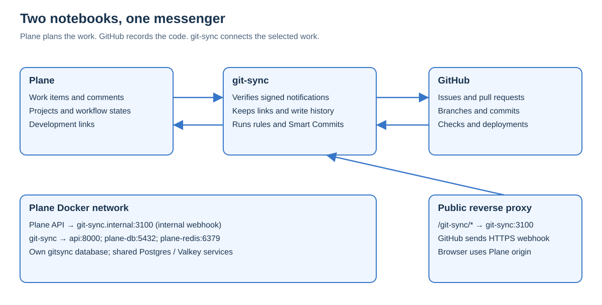

# git-sync illustrated manual

Imagine your team keeps one notebook for jobs and another for changes to the code. **git-sync is the messenger between them.** It connects selected Plane projects with selected GitHub repositories, mirrors work items and issues when you opt them in, and attaches pull requests, branches, builds and deployment information to the work being planned.

It runs beside your self-hosted Plane Community Edition installation as one additional Docker service. It uses a separate database on Plane's existing Postgres and queues on Plane's existing Valkey. You configure it through Plane sessions and Git Sync settings pages.

*Diagram: the two notebooks and the messenger, including the internal Docker route and public proxy. Arrows describe permitted flows; mapping direction and field policies decide which writes actually happen.*

| Start here | Who it is for | What you will learn |
| --- | --- | --- |
| [User guide](user-guide.md) | Someone new to servers, Plane integrations or GitHub Apps | The vocabulary, bot account, installation, every App registration field, connecting a repository, daily use, updates and troubleshooting. |
| [Developer and operator guide](developer-guide.md) | Someone maintaining the service or its deployment | Runtime architecture, configuration, routes, database, security, installer internals, local development, testing and operations. |
| [Screenshot and verification notes](MANUAL_NOTES.md) | Reviewers and anyone comparing these pictures with their own system | Where each real screenshot came from, what was hidden, and the limits of verification. |

The real Plane screenshots show the **test Plane v1.4.2** workspace `gitsync-test`. They are examples of navigation, not credentials or configuration to copy. The test workspace was empty of repository mappings during capture. GitHub form pictures and mapping-dependent behavior pictures are explicitly labelled **Illustration**. Terminal pictures contain output from the real installer running against its disposable test stack, with paths and the origin simplified.

Read the steps using your own Plane URL, account and project names. `https://plane.example.com` is a placeholder for your public Plane site; `bot@example.com` is a publication-safe example address. Do not copy test sink addresses from screenshots into your deployment.

The guides describe the implementation in this checkout. Older design and runbook passages describe planned “wave 2” features that now have handlers; the current source takes precedence. Important limits are called out where they matter: deletion is not a closing event, time commands create comments in Community Edition, autolinks are unavailable in the current mapping UI, and the stored signed-commit checkbox is not wired into the live push handler.

For the shorter installation reference, see [INSTALL.md](../../INSTALL.md). For the underlying operator runbook, see [deploy/APPLY.md](../../deploy/APPLY.md).
