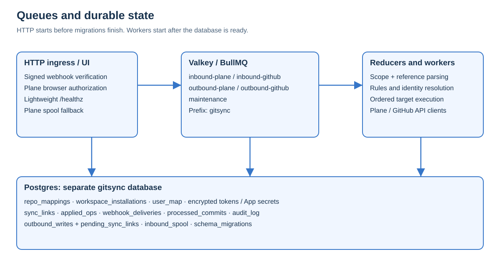
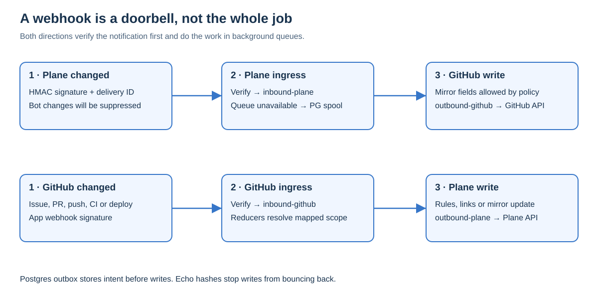
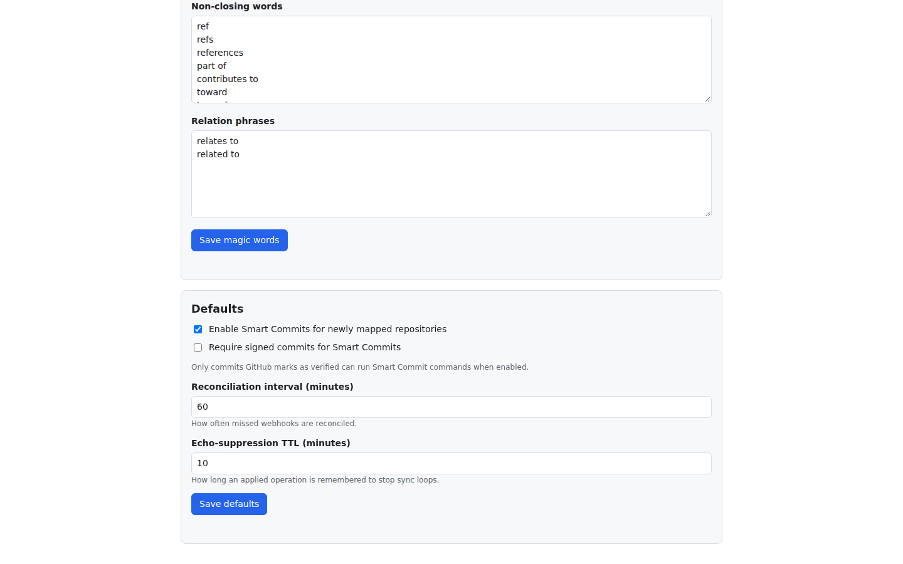
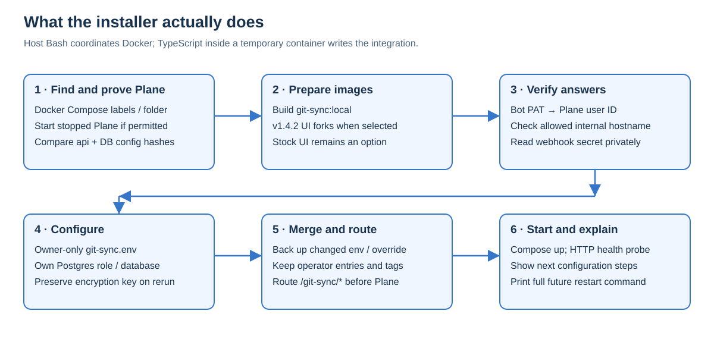
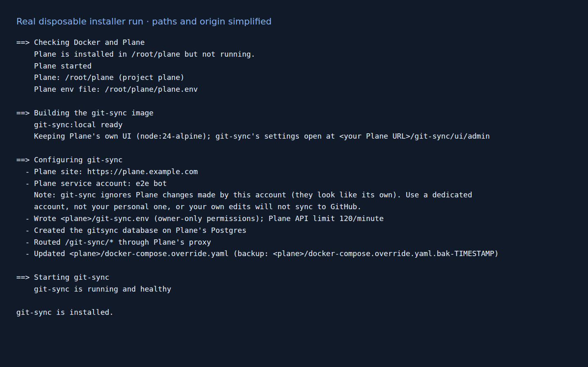
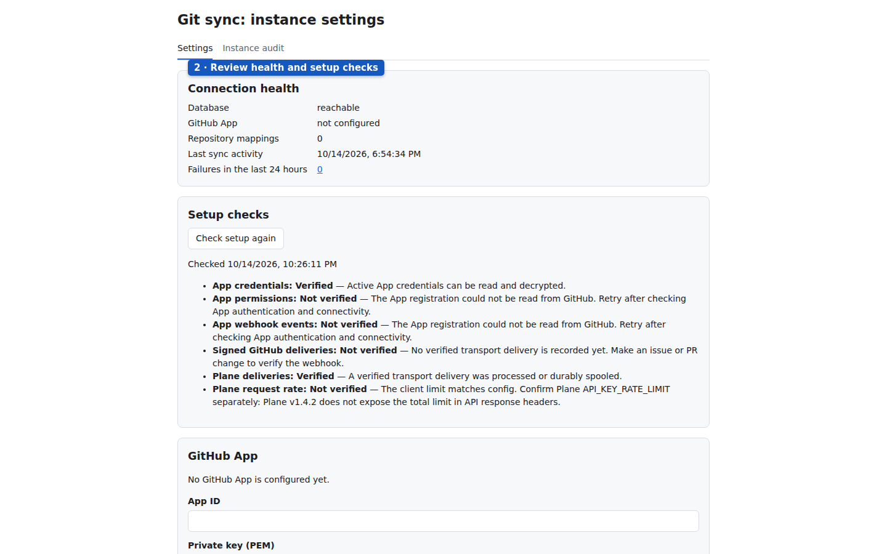

# Developer and operator guide

This guide describes the executable code in this checkout, the deployment scripts that accompany it, and evidence collected while producing this manual. It is intended for developers changing behavior and operators responsible for a self-hosted Plane Community Edition deployment. Read the [user guide](user-guide.md) for the browser setup sequence and the [manual notes](MANUAL_NOTES.md) for screenshot provenance and verification limits.

Use a dedicated development deployment for mutation tests. On the manual-authoring host, the test Plane was restricted to read-only inspection, Docker-heavy work was serialized, and the full suite was deliberately not run. Commands below explain supported workflows; they are not claims that every workflow ran during manual production.

## Contents

- [Architecture and trust boundaries](#architecture-and-trust-boundaries)
- [Repository map and change ownership](#repository-map-and-change-ownership)
- [Configuration reference](#configuration-reference)
- [HTTP interface and authorization](#http-interface-and-authorization)
- [Database and migrations](#database-and-migrations)
- [Security model and proxy framing](#security-model-and-proxy-framing)
- [Installer internals](#installer-internals)
- [Build and run locally](#build-and-run-locally)
- [Testing and evidence](#testing-and-evidence)
- [Operations and recovery](#operations-and-recovery)
- [Changing behavior safely](#changing-behavior-safely)
- [Source and verification map](#source-and-verification-map)

## Architecture and trust boundaries

The production entry point is [src/index.ts](../../src/index.ts). It exports a small HTTP router and starts the composed service only when executed as the main module. Importing it for tests does not start the application. [src/app/main.ts](../../src/app/main.ts) builds the dependency graph: configuration, database, queues, Plane client, credential source, GitHub clients, identity vault, ordered outbox, HTTP routes, workers and maintenance.



*Diagram: runtime components and durable state. Shared infrastructure means existing Plane Postgres and Valkey services; git-sync still owns a separate database and queue namespace.*

The added service listens on port 3100 by default and joins Plane's default Compose network with the alias `git-sync.internal`. The internal Plane webhook goes directly to `http://git-sync.internal:3100/git-sync/webhooks/plane`. The Plane API client uses `http://api:8000` in the installer-generated environment, avoiding the public proxy round trip.

Browser requests and GitHub webhooks reach git-sync through the public Plane origin under `/git-sync/*`. With Plane's bundled proxy, the installer inserts a route before the catch-all to `web:3000`. With an external proxy, git-sync can join a supplied gateway network under alias `git-sync`; the operator supplies the public route. The repository's static [docker-compose.override.yaml](../../docker-compose.override.yaml) shows a gateway topology and UI forks, while the installer-generated override adapts to selected options. Do not assume the static file exactly represents every generated installation.

Only the integration's own database is created on Plane's Postgres. Business writes to Plane go through its API. The service does not mutate Plane's application tables. BullMQ uses Plane's Valkey under a configurable prefix, normally `gitsync`, with four queues: `inbound-github`, `inbound-plane`, `outbound-plane` and `outbound-github`. A fifth `maintenance` queue owns recurring work.

### Startup, outage behavior and shutdown

`runService` creates the HTTP ingress before it attempts database migrations. Migration failures are logged and retried every five seconds. This lets signed ingress remain available during database recovery when queuing still works. Workers and maintenance start only after migration succeeds; an HTTP 200 from `/healthz` therefore does not imply migrations or background processing are ready.

The shutdown path first stops accepting HTTP requests, then waits for background startup to settle, closes workers, closes maintenance, closes queues and closes the database. SIGINT and SIGTERM use this path. Operators should allow sufficient termination time for active work instead of routinely killing the container immediately.

Plane v1.4.2's webhook behavior makes acknowledgment important: the runbook documents retries for transport failure, while an HTTP answer ends the delivery. Plane ingress therefore acknowledges a verified event once it is queued, or returns 202 once Postgres spooling succeeds during a Redis outage. Only when neither durable destination succeeds does it return 503. GitHub ingress has no equivalent Postgres spool fallback in this handler; a queue failure returns 503, and failed GitHub deliveries require explicit redelivery after recovery.

### Request and event flow



*Diagram: two event directions. Verification and durable acceptance precede reducers and remote API work; the outbox supplies write ordering and recovery.*

The handlers in [src/api/handler.ts](../../src/api/handler.ts) read the raw body with a 25 MiB limit before parsing it. Oversized declared or streamed bodies receive 413 and a closing connection. Plane requires `X-Plane-Delivery`, `X-Plane-Event` and a raw hexadecimal HMAC-SHA256 in `X-Plane-Signature`. It accepts the current and optional previous Plane secret. GitHub requires `X-GitHub-Delivery`, `X-GitHub-Event` and `X-Hub-Signature-256`, verified through the Octokit verification helper.

Malformed delivery headers receive 400; absent or mismatched signatures receive 401; malformed JSON receives 400 after signature verification. Plane events outside the allowed catalog return 200 with `ignored: true`; GitHub ping is similarly ignored. The accepted Plane catalog includes project, issue, module, module_issue, cycle, cycle_issue and issue_comment, but the production router currently has business reducers for issue and issue_comment only. Accepted unsupported events can be audited as unhandled.

GitHub reducers cover installation, installation_repositories, pull_request, pull_request_review, push, issues, issue_comment, check_suite, check_run, status and deployment_status. Reducers resolve the mapping and verify its installation/workspace before admitting writes. Installation deletion or suspension invalidates mappings; relevant creation, unsuspension, permissions and repository additions refresh them. Removed repository access is invalidated even when the same delivery also adds repositories.

### Delivery deduplication, echo suppression and outbox ordering

There are several distinct identities; combining them breaks correctness. Queue job IDs are `source-deliveryId`, and completed jobs remain for a day, bounded by 10,000. The Postgres delivery ledger prevents repeated processing beyond queue presence. Plane comments also use a short-lived content identity based on workspace, project, item and comment object ID because Plane transport delivery IDs can change.

`applied_ops` records normalized, field-level operation hashes in the direction of the write. Inbound processing compares incoming changes to recent applied operations and consumes matching echoes. The service-user filter suppresses common bot-origin Plane changes, while content hashes keep per-user attribution from forming loops. The default echo TTL is ten minutes; the composition caches that setting for fifteen seconds and maintenance prunes expired operations periodically. Increasing the TTL indiscriminately can suppress a later identical human action; shortening it too far can miss delayed echoes.

Reducers register durable intents through [src/app/writers.ts](../../src/app/writers.ts) and [src/operations/outbox.ts](../../src/operations/outbox.ts). Production uses one shared ordered outbox. `outbound_writes` stores sequence, side, target, workspace, actor identity, write data, status, attempt count, retry deadline and result. Workers serialize execution per target so a later update cannot overtake an earlier create or update for that target.

Create workflows are persisted as plans with result references, sync-link steps, audit steps and reducer continuations. `pending_sync_links` protects a partner whose creation is still in progress. Subsequent events are fenced behind the creation and its continuation instead of guessing a partner ID or creating another object. Plane creates carry `external_source=gitsync` and an intent-derived external ID; the durable `plane_created_items` table preserves that identity after applied outbox rows are pruned.

Queued writes freeze their admitting mapping's workspace, mapping ID, repository ID and installation ID. The outbox authorizer rechecks that exact authority on execution and retry. A later mapping edit, installation revocation or newly added unrelated mapping does not confer access on an old queued write. Actor credentials are reloaded from the encrypted vault at execution; plaintext PATs are not stored in write JSON.

The outbox recovery loop runs on startup and every fifteen seconds. General inbound jobs have ten attempts with exponential backoff beginning at two seconds. Outbound jobs have thirty attempts and a custom strategy. Each worker has concurrency one. Rate-limit errors move a job to its deadline and release the worker instead of sleeping through the cooldown. GitHub deadlines also persist through reserved delivery-ledger entries so replicas cannot independently hammer the same installation during a cooldown.

### Reconciliation is bounded repair

[src/sync/reconcile.ts](../../src/sync/reconcile.ts) sweeps existing links, not every historical object on both systems. Default reconciliation is every sixty minutes. Plane work-item deletion lacks the needed webhook in v1.4.2, and a detail 404 can also mean archive. The sweep checks archive/deletion evidence and durable external identities where available; an unexplained missing item needs confirmation rather than immediate closure of GitHub work. Archived links remain active with archive metadata; confirmed missing partners become orphaned.

Maintenance also checks for Plane changes that are old enough to suggest a silent webhook, replays the inbound spool every minute, prunes applied operations every ten minutes, and prunes retention ledgers and OAuth state hourly. Silent detection uses the runbook's thirty-minute windows and can take a reconciliation interval to appear. It reports the affected workspace in audit; it does not recreate or silently re-enable Plane's webhook.

## Repository map and change ownership

| Path | Responsibility |
| --- | --- |
| `src/index.ts` | HTTP routing, method selection, decoded path checks, lightweight health and executable entry point. |
| `src/config/` | Environment loader and GitHub bootstrap/host validation. |
| `src/api/` | Signed webhook ingress and App configuration helpers. |
| `src/app/` | Runtime composition, scoped mappings and identity, event reducers, credentials, rules, issue/PR/push/check processing. |
| `src/auth/` | Secret wrappers and AES-GCM vault, user attribution, GitHub personal authorization/token refresh and API clients. |
| `src/db/` | Postgres adapter, ordered migrations, schema types, ledgers, encrypted token store and parity data helpers. |
| `src/queue/` | Queue names/options, workers, retry scheduling and maintenance jobs. |
| `src/sync/` | Plane and GitHub write paths, echo hashing, mirrors, text conversion, development links, event router and reconciliation. |
| `src/parse/` | Work-item reference grammar and default magic-word tiers. |
| `src/github/` | Host derivation, Smart Commits, PR lifecycle/readiness/execution, error classification, durable problem reports and safe HTML helpers. |
| `src/rules/` | Shared YAML rule schema, validation, evaluation and action contract. |
| `src/operations/` | Durable outbox plans, target mutations, backfill, replay and dry-run tooling. |
| `src/ui/` | Authenticated API, Plane directory reads, App setup checks, Connect/OAuth flows, Development API, static asset server and UI builder. |
| `src/ui/client/` | React instance/workspace pages, pickers, connection UI, health, audit, Development panel and browser routing. |
| `src/install/` | Container-side installation logic, Plane facts, private env renderer, YAML override merge, database and bundled-proxy patch. |
| `apps/` | Minimal Plane v1.4.2 frontend fork surface and image build scripts. |
| `deploy/` | Example service environment, database/proxy deployment reference and operations runbook. |
| `scripts/` | Verifiers, test runners, datastore test helpers, heavy-job lock and e2e harness. |
| `tests/` | Parser, identity, reducer, queue, database, UI API, installer and integration regression tests. |
| `docs/` | Design, implementation plans/evidence and this manual. |

Within `src/app`, `context.ts` supplies scoped dependency helpers; `mappings.ts` filters and revalidates authority; `credentials.ts` owns credential source retirement; `identity.ts` handles conservative email linking; `issues.ts`, `pr.ts`, `push.ts` and `checks.ts` process their respective events. `rule-events.ts` is the shared event translator for live rules and preview. `rules.ts` groups targets by project and chooses the newest saved rule set or shipping defaults. `writers.ts` exposes the shared outbox and compatibility adapters.

The [apps README](../../apps/README.md) identifies eight upstream fork files: three admin files for navigation, route registration and iframe page; five web files for navigation, route registration, iframe page, settings-access registration and the work-item sidebar iframe. The actual mirrored files, patch files and build scripts live under `apps/admin` and `apps/web`. The workspace access constant is included in the web patch even though its upstream path is outside `apps/web`. The bulk of the integration UI remains in this repository's React app, keeping the Plane patch surface small.

## Configuration reference

The following table covers every environment input named in [deploy/git-sync.env.example](../../deploy/git-sync.env.example) and [src/config/env.ts](../../src/config/env.ts), including commented optional inputs. Required means required by the loader unless the row gives a conditional rule. Defaults are loader defaults, with installer-generated values distinguished explicitly. Sample secrets in the example file must be replaced; copying it unchanged does not produce a working installation.

| Variable | Meaning | Default / generated value | Required? |
| --- | --- | --- | --- |
| `PORT` | HTTP listening port | `3100` | No. Parsed with `parseInt`; do not assume complete numeric range validation. |
| `HOST` | Bind address | `0.0.0.0` | No; absent from the example file but read by the loader. |
| `DATABASE_URL` | Postgres connection to the integration database | None; installer writes the `gitsync` role/database on Plane's database host | Yes. |
| `REDIS_URL` | BullMQ/Valkey connection | None; installer derives Plane's Redis URL | Yes. |
| `QUEUE_PREFIX` | Queue key namespace | `gitsync` | No; keep consistent across replicas. |
| `PLANE_BASE_URL` | Plane API server base, without the public API path | None; installer normally writes `http://api:8000` | Yes. |
| `PLANE_SERVICE_PAT` | Dedicated service user's Plane PAT | None | Yes; private credential. |
| `PLANE_SERVICE_USER_ID` | Owning service user's Plane ID for echo filtering | None; installer resolves it through `/api/v1/users/me/` | Yes; whitespace-only is rejected. |
| `PLANE_WEBHOOK_SECRET` | Current Plane signature secret | None | Yes. |
| `PLANE_WEBHOOK_SECRET_PREVIOUS` | Additional accepted Plane secret during rotation | Unset | No; remove after the rotation overlap. |
| `PLANE_SESSION_COOKIE_NAME` | Plane web-session cookie forwarded for browser authorization | `session-id`; installer derives Plane's configured name | No; valid cookie-name syntax required. |
| `PLANE_API_RATE_PER_MINUTE` | Plane client request budget per sixty seconds | `60`; installer refreshes it from Plane's running API setting | No; positive integer required when supplied. |
| `GITHUB_APP_ID` | Numeric App bootstrap identifier, represented as a string in config | Empty | Conditional: provide together with key path and webhook secret, or leave all three empty. |
| `GITHUB_PRIVATE_KEY_PATH` | Readable PEM path for App bootstrap | Empty; installer mount path `/run/secrets/github-app.pem` when supplied | Same three-input rule. |
| `GITHUB_WEBHOOK_SECRET` | GitHub signature bootstrap secret | Empty | Same three-input rule; database configuration later takes precedence. |
| `GITHUB_CREDENTIAL_MARKER_PATH` | Persistent writable bootstrap-retirement marker | `/var/lib/gitsync/credentials/bootstrap-retired` | No; mount durable storage, separately from the read-only PEM. |
| `GITSYNC_TOKEN_KEY` | Encryption key for persisted tokens, App secrets and PKCE verifier | None; installer generates 32 random bytes encoded as base64 | Yes; strict canonical base64 decoding to exactly 32 bytes. |
| `PUBLIC_ORIGIN` | Browser-facing Plane origin for CSRF, callbacks and links | Legacy source default `https://tasks.qelal.et`; installer derives the actual Plane site | No to loader, but explicitly set your deployment's origin. The legacy address is not a target for manual commands. |
| `GITHUB_EDITION` | GitHub host family | Inferred; `github` when no selectors supplied | No; one of `github`, `ghe_cloud`, `ghes`. |
| `GITHUB_GHE_SUBDOMAIN` | Enterprise Cloud residency subdomain | Unset | Required to derive Cloud hosts unless inferred from a matching legacy API URL. |
| `GITHUB_GHES_BASE_URL` | Enterprise Server web origin | Unset | Required for Server unless inferred from legacy API URL. |
| `GITHUB_API_BASE_URL` | Legacy API bootstrap URL and edition inference input | GitHub.com API is effectively `https://api.github.com`; config property can remain unset for normal GitHub.com | No; must agree with explicit edition/host inputs. |
| `GITHUB_WEB_ORIGIN` | Derived web/OAuth/install host in the Config interface | Derived from selected edition | Output only; an environment value does not override it. |
| `GITHUB_CLIENT_ID` | GitHub App personal-authorization client identifier | Unset | Optional bootstrap, but must be supplied with client secret. |
| `GITHUB_CLIENT_SECRET` | Server-side personal-authorization client secret | Unset | Optional bootstrap, paired with Client ID. |
| `GITHUB_APP_SLUG` | Name used to build the App installation URL | Unset | Optional loader input; needed for normal Connect installation flow. |
| `REQUIRE_VERIFIED_COMMITS` | Signature guard supplied to live Smart Commit processing | False; `1`, `true` or `yes`, case-insensitively, enables it | No. See current stored-setting limitation below. |

Host selection derives these URL pairs:

| Edition | Input | REST API base | Web / OAuth / App installation origin |
| --- | --- | --- | --- |
| `github` | None | `https://api.github.com` | `https://github.com` |
| `ghe_cloud` | `GITHUB_GHE_SUBDOMAIN=octocorp` | `https://api.octocorp.ghe.com` | `https://octocorp.ghe.com` |
| `ghes` | `GITHUB_GHES_BASE_URL=https://ghe.example.com` | `https://ghe.example.com/api/v3` | `https://ghe.example.com` |

Cloud accepts a single DNS label, not a whole hostname. Server configuration accepts an HTTPS web origin; the host builder normalizes a legacy `/api/v3` suffix. Conflicting old/new selectors fail startup. Local loopback HTTP API hosts are supported for test stand-ins; use the intended production HTTPS hosts. App installation and user authorization are on the derived web host, while service callbacks always use `PUBLIC_ORIGIN`.

### Settings stored in Postgres

The service stores App credentials separately from environment bootstrap. A stored App row is authoritative, including edition/host selection. App private key, webhook secret and client secret are encrypted; DTOs return identifying fields and configured status rather than secrets. Empty secret fields on an App edit retain the existing values. Once the App has been stored, the retirement state forbids falling back to stale environment credentials after row deletion or a cold database outage.

Instance settings expose Smart Commits default, reconciliation interval, echo TTL and require-verified checkbox. Defaults are true, sixty minutes, ten minutes and the environment-derived signature flag. The UI validates positive intervals up to 10,080 minutes. Retention settings exist at the schema/helper layer: delivery thirty days, processed commits 180 days, audit payload ninety days, and applied/failed outbound rows thirty days. Do not confuse those defaults with an implemented general retention editor in the UI.

**Implementation discrepancy:** `src/ui/api.ts` persists `require_verified_commits` through `src/db/parity.ts`, but `src/app/push.ts` passes `ctx.config.REQUIRE_VERIFIED_COMMITS` to `processPush`. It does not read that stored override. For actual live enforcement in this checkout, configure the environment flag and restart the service. Treat a checkbox save as evidence of persistence only. Likewise `repo_mappings.branch_template` and the branch renderer exist, but the mapping request validator and current form do not expose normal template editing.



*Screenshot: the test instance's Defaults panel and adjacent magic words, read without saving. Signature enforcement still has the implementation limitation described above.*

Mappings store two-way versus GitHub-to-Plane direction, Smart Commits, linkback, report-problems, autolinks, chosen open/closed states and installation identity. Report problems defaults off; linkback defaults on; newly created mappings use the instance Smart Commits default when omitted. Open and closed states must differ if both are supplied. The current form preserves externally managed autolinks but disables its checkbox as unavailable.

The conflict-policy fields are title, description, state, assignees, labels and comments. Title and description default to GitHub source of truth; remaining fields default to last-write-wins. One-way direction overrides Plane-origin mirror eligibility regardless of policy. Current-state reads reduce damage from out-of-order deliveries; they do not provide a cross-service transaction.

## HTTP interface and authorization

All service routes retain the `/git-sync` prefix. The router picks exact paths before patterns, then uses literal-segment specificity; unsupported methods return 405 with Allow. It decodes segments and rejects traversal segments. UI client routes are paths served by the static wildcard and interpreted by the React router; they are not distinct server API routes.

In the following tables, `I` means `/git-sync/api/instance`, `W` means `/git-sync/api/workspaces/:slug`, and `D` means `W/projects/:projectId/work-items/:issueId`. GET generally returns JSON with no-store; mutation bodies are JSON and normally limited to one MiB. IDs and request fields have additional validation in `src/ui/validate.ts` and route-specific code.

| Method | Route | Purpose / access |
| --- | --- | --- |
| GET | `/git-sync/healthz` | Public HTTP liveness, `{"status":"ok"}`; not datastore readiness. |
| POST | `/git-sync/webhooks/plane` | Plane HMAC ingress, signed delivery required. |
| POST | `/git-sync/webhooks/github` | GitHub HMAC ingress, active App secret required. |
| GET | `/git-sync/install/github/callback` | Consume installation state and verify/continue the Connect flow. |
| GET | `/git-sync/oauth/github/callback` | Consume OAuth state, exchange code with PKCE, identify user and finish link/claim. |
| GET | `/git-sync/ui/*` | Built app/assets and client-route fallback; protected APIs supply private data. |
| GET | `I/health` | Instance database, credential status, mapping count, activity and failures. |
| GET | `I/setup-check` | Read-only App permissions/events, decryption, delivery and rate checks. |
| GET, PUT | `I/github-app` | Read non-secret App DTO or save encrypted App settings. |
| GET, PUT | `I/magic-words` | Read/replace all three word lists. |
| GET, PUT | `I/settings` | Read/update instance defaults and intervals. |
| GET | `I/installations` | List workspace installation allow-list. |
| PUT, DELETE | `I/installations/:installationId` | Assign or remove installation authority. |
| GET | `I/disabled-mappings` | Inventory unresolved/revoked mappings for repair. |
| GET | `I/workspaces` | Plane instance workspace directory. |
| GET | `I/workspaces/:slug/projects` | Project directory for manual recovery. |
| POST | `I/workspaces/:slug/mappings` | Verified manual repository-ID mapping recovery. |
| PATCH | `I/workspaces/:slug/mappings/:id` | Verified manual mapping change. |
| DELETE | `I/workspaces/:slug/stale-data` | Remove old integration state for a deleted/reused workspace slug; instance-admin access and live workspace identity checks. |
| GET | `I/audit` | Instance audit including appropriate unscoped rows and all-workspace option. |

Every instance API route authenticates the Plane admin application's `admin-session-id` through `/api/instances/admins/me/`. A normal workspace session is insufficient. The disabled-mapping endpoint is composed separately in `src/app/main.ts` but uses the same instance-admin guard.

| Method | Workspace route | Purpose |
| --- | --- | --- |
| GET | `W/defaults` | Smart Commits default for new mappings. |
| GET | `W/projects`, `W/members` | Plane project/member picker directories. |
| GET | `W/projects/:projectId/states` | Project states excluding triage. |
| GET | `W/github/user?login=...` | Canonical GitHub user lookup. |
| GET | `W/github/repository?name=...` | Verify repository name/ID under workspace authority. |
| GET | `W/github/connection` | Connected installations, pending requests and personal status. |
| POST | `W/github/connect` | Create single-use installation journey. |
| POST | `W/github/connect/handoff` | Create organization-bound owner handoff; body names account ID or login. |
| GET | `W/github/claimable` | Installations the viewer may finish connecting. |
| POST | `W/github/installations/:installationId/claim` | Prove ownership/access and connect an existing installation. |
| DELETE | `W/github/installations/:installationId` | Disconnect the workspace installation. |
| GET | `W/github/repositories` | Paginated, personal-user-scoped repository choices. |
| GET, POST | `W/mappings` | List or create validated repository/project mappings. |
| PATCH, DELETE | `W/mappings/:id` | Update or remove a mapping. There is no separate GET detail route here. |
| GET, PUT | `W/mappings/:id/rules` | Read/save rule YAML with a new version. |
| GET | `W/mappings/:id/rules/versions` | Rule version history. |
| POST | `W/mappings/:id/rules/versions/:version/restore` | Restore as a new version. |
| GET, PUT | `W/mappings/:id/conflict-policies` | Read/save per-field policy. |
| GET | `W/user-links` | Linked identities and reauthorization status. |
| PUT, DELETE | `W/user-links/:planeUserId` | Validated manual link/unlink and token/tombstone effects. |
| GET | `W/audit`, `W/health` | Scoped activity and mapping health. |
| POST | `W/dry-run` | Evaluate proposed rules against supplied or recorded context; no action execution. |
| POST | `W/audit/:id/replay` | Replay retained delivery payload; returns 202. |
| POST | `W/outbound-writes/:id/retry` | Schedule retry of an owned failed intent; returns 202, otherwise 404. |
| POST | `W/mappings/:id/backfill` | Link existing open issue/PR references in resumable batches. |

These workspace configuration routes authenticate a valid web session and a Plane workspace role of at least 20. They also bind the workspace slug to Plane's immutable workspace ID. A new Plane workspace reusing a deleted workspace's slug receives 409 until an instance admin deliberately clears stale integration data; it cannot inherit the previous workspace's credentials, audit or installations.

| Method | Member/work-item route | Permission |
| --- | --- | --- |
| GET | `W/github/account` | Workspace member role at least 15; reads viewer's own link. |
| POST | `W/github/account/connect` | Same member access; begins own authorization/reconnection. |
| DELETE | `W/github/account` | Same member access; disconnects own personal GitHub grant locally and attempts remote revocation. |
| GET | `D/development` | Plane viewer can read that exact work item; guest visibility is delegated to Plane. |
| POST | `D/branches` | Readable item, project role at least 15, active mapping/installation; body contains mappingId only. |

The Development routes re-fetch viewer identity, item, project and project membership with the viewer's Plane cookie. An inaccessible item returns 404 to avoid revealing it. The branch operation resolves the repository default ref, creates a validated branch name and handles an already-existing branch without creating another. An empty repository cannot supply a default commit.

Audit filters include pagination and scope controls; the UI supplies mappingId, errors and hours filters for health links. Inspect the handler before scripting exact query bounds. Raw audit data can contain issue/comment content and actor details. Authenticated access and no-store reduce exposure but do not make that data public-safe.

## Database and migrations

[src/db/migrate.ts](../../src/db/migrate.ts) reads `.sql` migrations in filename order. Each migration runs in a transaction on a dedicated connection where available, takes a shared transaction-scoped advisory lock, checks `schema_migrations`, applies unseen SQL and records its filename. Concurrent replicas therefore serialize schema changes. The production Postgres adapter supports dedicated connection work; PGlite tests can use their single-connection adapter.

Do not edit an already deployed migration to change schema history. Add a numbered migration, consider old rows and live readers, and test both fresh setup and upgrade state. There is no general down-migration runner. Restoring a compatible database/config backup is the conservative rollback route for a schema-incompatible upgrade.

| Migration | Added or changed behavior |
| --- | --- |
| `001-init.sql` | Links, echo/delivery/commit ledgers, audit, mappings, rules, conflict policy, identity/token storage and instance/App settings. |
| `002-audit-scope-devinfo.sql` | Workspace-scoped audit indexes and development rollup link identity. |
| `003-installation-and-label-sync.sql` | Mapping installation ID and label-mirror uniqueness. |
| `004-commit-workspace-retention.sql` | Commit claims scoped by SHA/workspace and retention defaults/indexes. |
| `005-outbound-writes.sql` | Durable ordered intents and outbound retention. |
| `006-workspace-installations.sql` | One-workspace installation allow-list and pending create links. |
| `007-user-link-tombstones-credential-state.sql` | Unlink suppression, persistent credential retirement and active-only mirror uniqueness. |
| `008-identity-locks-credential-retirement.sql` | Workspace identity locks and a trigger retiring bootstrap on credential saves. |
| `009-plane-ingress-spool-link-visibility.sql` | Plane ingress fallback spool, silent ingress state, archived/missing link evidence. |
| `010-parity-connect-oauth-mapping-states.sql` | App client/host fields, one-use OAuth state, refresh tokens/expiry, mapping states/reporting/template and stored signature preference. |
| `011-workspace-identity.sql` | Immutable Plane workspace ID binding for slug reuse protection. |
| `012-plane-created-items.sql` | Durable external identities for created Plane items, backfilled from retained outbox results. |

Core data relationships are straightforward but operationally significant. `repo_mappings` owns rule versions and conflict policies through cascading foreign keys. `workspace_installations` authorizes one workspace per installation. `sync_links` records item/repository/number/kind/tier/provenance and active/orphan status. The active label-mirror uniqueness constraint prevents duplicate partners while allowing a replacement after a confirmed orphan.

`user_map` pairs Plane users with stable GitHub IDs, while `user_tokens` stores encrypted credential material by Plane user and kind. `user_link_tombstones` prevents an explicit unlink from being undone by the next email-match event; workspace lock rows coordinate conflicting identity decisions. GitHub logins can change, so the immutable ID is the authority for actor mapping.

`webhook_deliveries`, `processed_commits` and Smart Commit step audit/intents have separate dedupe roles. A commit SHA is scoped to a workspace; pushing the same SHA through another branch in that workspace does not intentionally repeat completed commands. Rebasing or amending can change the SHA and therefore changes that identity; do not promise dedupe across different SHAs simply because their messages look the same.

`inbound_spool` retains verified Plane payloads when Valkey is unavailable. `ingress_health` and scoped audit describe silent ingress. `outbound_writes` and `pending_sync_links` retain incomplete create/update workflows. `dev_info_links` remembers the Plane link to update in place. `plane_created_items` survives outbox retention to distinguish archived/deleted created partners. These tables are recovery state, not disposable caches to clear while troubleshooting.

## Security model and proxy framing

Webhook HMACs prove message possession of the shared secret; they do not establish mapping authority by themselves. Every admitted write still requires an approved installation and matching workspace/project scope. Browser APIs verify Plane sessions with Plane on each request, rather than trusting a client role or keeping a long-lived role cache. Only the relevant session cookie is forwarded on those reads.

Mutation requests to the configuration API must have Origin exactly equal to the normalized `PUBLIC_ORIGIN`. Requests with bodies must use `application/json`; malformed/oversized input is rejected. Development branch creation applies its corresponding origin and JSON checks. GET callbacks use single-use expiring state and PKCE instead of the JSON mutation guard. Installation state is thirty minutes, OAuth state ten minutes, and organization-owner handoff state seven days in the current implementation.

Connect never trusts a callback's installation ID alone. A personal installation must belong to that GitHub user; an organization installation needs active owner/admin membership. The handoff is bound to the intended organization and requires GitHub ownership proof without assuming a Plane identity for its recipient. The repository picker filters for manage-issues capability, including triage/write/maintain/admin, and save-time checks repeat user-scoped access plus App installation and Plane project verification.

Secrets use AES-256-GCM with a random twelve-byte IV and sixteen-byte authentication tag in a versioned encrypted blob. `GITSYNC_TOKEN_KEY` must decode to exactly 32 bytes. `SecretString` reduces accidental string/JSON exposure; it is not a substitute for respecting credential boundaries. Plane PATs grant their owning user's permissions, so use a dedicated service account and protect any optional per-user PATs.

The App source prefers encrypted database settings over environment bootstrap. Retirement is persisted both in Postgres and on writable durable marker storage. Once retired, removing the configuration row cannot safely revive a previously rotated environment secret. Cold database failure refuses verification; a previously successfully loaded database credential can remain usable during an outage. An unreadable marker is a failure, not permission to assume bootstrap was never retired.

The static UI emits a Content Security Policy with `frame-ancestors 'self'`, self-only scripts, and no arbitrary external scripts. Static assets have immutable cache headers when hashed; HTML is no-cache, while APIs are no-store and nosniff. Paths outside the asset directory are rejected; missing asset extensions get 404 instead of an HTML fallback. The source CSP includes GitHub.com-related connect/avatar allowances; do not infer that these are arbitrary remote embed permissions.

### Caddy example: retain same-origin iframe access

The following is an operator adaptation of the repository's external proxy route. Move any blanket frame-denial header into the fallback, and preserve the service's own CSP. Validate it with your deployed Caddy version before reloading.

```caddyfile
plane.example.com {
    handle /git-sync/* {
        header -X-Frame-Options
        reverse_proxy git-sync:3100
    }
    handle {
        header X-Frame-Options DENY
        reverse_proxy plane-proxy:80
    }
}
```

`handle` blocks at the same level are mutually exclusive, and `handle` retains the prefix needed by the service. The deletion header operation is deferred to response writing. If your configuration also adds a CSP with `frame-ancestors 'none'`, restrict that policy to the Plane fallback rather than adding it to git-sync. Source: [Caddy handle](https://caddyserver.com/docs/caddyfile/directives/handle) and [header operations](https://caddyserver.com/docs/caddyfile/directives/header), retrieved through Context7 and checked against the official pages. The example was not applied to the test host.

### nginx example: put frame restrictions on Plane's location

```nginx
location /git-sync/ {
    proxy_pass http://git-sync:3100;
    proxy_set_header Host $host;
    proxy_hide_header X-Frame-Options;
    add_header X-Content-Type-Options nosniff always;
}
location / {
    proxy_pass http://plane-proxy:80;
    add_header X-Frame-Options DENY always;
}
```

Move global DENY and proxy-added frame-none CSP directives into the Plane location. Under the standard nginx inheritance rule, a location's own `add_header` prevents inheriting the enclosing add_header list; newer configurations can alter that with `add_header_inherit`, so inspect the actual version and configuration. `proxy_hide_header` removes an upstream header and does not itself cancel an enclosing `add_header`. Preserve upstream git-sync CSP and existing TLS/proxy settings. Source: [nginx header module](https://nginx.org/en/docs/http/ngx_http_headers_module.html) and [proxy module](https://nginx.org/en/docs/http/ngx_http_proxy_module.html), retrieved through Context7/official documentation. This excerpt requires an upstream reachable from that nginx deployment and was not applied here.

After a change, inspect response headers for `/git-sync/ui/admin` through every public proxy layer and load it inside Plane. An upstream policy cannot relax a denial added by another layer. Avoid removing all CSP restrictions simply to make an iframe work; keep the intended same-origin constraint.

## Installer internals



*Diagram: installer stages. The host shell selects the deployment and orchestrates Docker; container-side TypeScript writes integration configuration.*

[install.sh](../../install.sh) is Bash with `set -euo pipefail`. It parses options, validates paired App arguments and confirms Docker/Compose access. Its normal image tags are `git-sync:local`, `plane-admin-gitsync:v1.4.2` and `plane-frontend-gitsync:v1.4.2`. The installer does not require Node on the host; it runs its TypeScript installer inside the built Node image.

Detection looks for a Compose `api` service whose project also contains `plane-db`. Labels identify the project name, working directory and config files. `--plane-dir` narrows multiple deployments. If only stopped containers exist, it offers to start the project containers as they are. If containers are gone, it checks recognizable install directories and starts Plane using its Compose/env-file convention. Specify the target directory rather than relying on a broad search on a multi-install host.

Before it applies changes to an existing running deployment, the shell reconstructs the Compose inputs and compares calculated configuration hashes for `api` and `plane-db` with the running containers' labels. It tries the supplied env file or plausible deployment env files while excluding `git-sync.env`. Failure stops the installation. This protects against recreating Plane with a different password or settings; it is not a proof that an operator's previously unused override is harmless. If an existing override was not loaded in the original start, the installer warns that its entries will now apply.

The selected default network is normally `<project>_default`, with an API-container network fallback. A private scratch directory receives the running API and database environments, and the bundled proxy image's Caddyfile when needed. The shell runs `src/install/main.ts` as root inside a temporary installer container on that network with `/plane` and `/install` mounts. That privilege is for configuration file ownership; the long-running service image uses the non-root Node user.

`src/install/plane-env.ts` parses environment text and derives public origin, database superuser/host/port, Redis URL, cookie name and rate limit. Rate conversion supports Plane's number/period notation and produces a positive integer per minute. `plane-api.ts` verifies the service PAT through `/api/v1/users/me/`, retrying temporary Plane startup failures in the coordinator for up to three minutes. The dedicated-user warning is printed before configuration writes.

The running API allow-list must contain `git-sync.internal`. The installer deliberately refuses an absent host before writing integration configuration and instructs the operator to apply API/worker/beat-worker changes first. It obtains the Plane webhook secret but does not create the webhook itself. The bot, PAT and webhook are prerequisites supplied by the user.

`env-file.ts` preserves existing nonempty settings and extra keys, refreshes the live Plane request limit and replaces explicitly supplied PAT/webhook values. It keeps the existing database password from DATABASE_URL and, critically, `GITSYNC_TOKEN_KEY`. New database passwords use URL-safe random hex and are URL-encoded when rendered. Secrets must fit its plain-token env-file rules; whitespace and special characters rejected by `checkValue` cannot simply be pasted into an unquoted generated assignment.

The generated env file is mode 0600. The PEM is owned by container UID 1000 and mode 0400; an empty placeholder file prevents Docker making a directory before an App is configured. The writable credential-state directory is owned by UID 1000 and mode 0700. Database provisioning uses Plane's actual database superuser and only creates/resynchronizes the `gitsync` role and database. Password quoting is delegated to Postgres rather than raw SQL concatenation.

`compose.ts` parses YAML as a document to preserve comments and Compose `!override`/`!reset` tags. It refreshes integration-owned fields while retaining operator entries, additional networks/aliases and unrelated services. A conflicting operator web/admin image refuses automatic fork replacement; another proxy Caddyfile mount similarly refuses takeover. In bundled mode `caddy.ts` inserts `reverse_proxy /git-sync/* git-sync:3100` before the recognized Plane catch-all, refusing an unknown shape.

Files receive timestamped backups before changes. The shell validates the merged Compose model, performs `up -d`, waits up to roughly two minutes for git-sync HTTP health, and probes proxy recovery in bundled mode. It prints integration setup links and the full future Compose start command. It does not prove App installation, webhook approval or end-to-end business synchronization at this stage.

The UI auto-selection recognizes v1.4.2-like/fork web image tags; other releases retain stock UI unless explicitly forced. Existing fork tags are reused rather than rebuilt. Upgrading fork patches therefore requires deliberate image rebuilding/tagging. Keep the release constants in the installer, build scripts, patches and Compose image selections consistent.

Uninstall rebuilds the service image to run matching removal logic, removes git-sync and installer-managed override entries, and starts Plane without those entries. Without purge it keeps configuration, state and the integration database. Purge drops only `gitsync` database/role and deletes current integration files/state; backups remain. Externally maintained proxy routes are not magically removed by the container-side override cleanup.

## Build and run locally

Use the Node version required by [package.json](../../package.json): Node 24 or newer. TypeScript runs through Node's native type stripping, so there is no compiled backend directory. The UI bundles React with esbuild into `dist/ui`; the static server expects that directory alongside the source tree.

```bash
npm ci
npm run build:ui
npm run typecheck
```

Run the service against a dedicated local Postgres database, Valkey instance and a permitted Plane API/test deployment. Copy the example environment into a private ignored file outside shared artifacts, replace sample credentials, and set localhost database/Redis URLs if running Node outside Compose. The internal `api`, `plane-db` and `plane-redis` names do not resolve automatically on the host.

```bash
node --env-file=/path/to/private-dev.env src/index.ts
```

The loader allows an initially empty GitHub bootstrap triple so the service can start before an App is configured. Plane credentials and the token key remain required. A local HTTP server can exercise routing and fixtures without a publicly reachable GitHub callback. Do not claim a real OAuth or webhook flow works from localhost unless the chosen test topology actually supplies it.

The Dockerfile has a full-dependency UI build stage and a production-dependency runtime stage. It copies the TypeScript sources and built UI, sets production mode and runs as `node`. Build it with your environment's Docker context and, on a shared host using the repository lock, wrap heavy work:

```bash
sh scripts/heavy.sh docker build -t git-sync:local .
```

An embedded UI needs both normal Plane and admin sessions at the same public origin as appropriate. Running a browser UI from an unrelated origin fails the configured Origin guard and does not share the expected cookies. Avoid changing the security checks just to accommodate a separate dev server; serve the built UI through the application or use explicit isolated test adapters.

## Testing and evidence

The standard project command `npm test` invokes Node's test runner over `tests/**/*.test.ts`. Tests include pure grammar/validation cases, PGlite and Postgres-backed integration cases, Valkey queue behavior, API authorization, reducer wiring, ordered workflow recovery and installer safety. Some tests start datastores and have substantial memory cost. The manual brief prohibits a full-suite run on this live shared host; the command is documented from the script, not executed here.

`npm run typecheck` runs `tsc --noEmit -p tsconfig.json`. That verifies types, not remote behavior or UI appearance. For bounded test execution, `scripts/run-tests.mjs` takes a minimum passing count and repository-relative test directories. It discovers `.test.ts` files, uses concurrency two, adds a 1536 MiB worker heap limit, captures TAP totals, refuses failures/cancellations/skips/todos/too-few passes, and imposes a thirty-minute timeout with process-group cleanup.

```bash
sh scripts/heavy.sh node scripts/run-tests.mjs MINIMUM TEST_DIRECTORY
```

Replace those uppercase arguments with the measured expectation and relevant test directory. Do not copy an arbitrary minimum that could let omitted coverage pass. Choose the narrow existing tests for the changed behavior and read their setup before running them. A whole-suite run belongs on a host with sufficient capacity and explicit permission for its fixtures.

The machine-wide lock in `scripts/heavy.sh` uses `flock` under the current user's cache. It serializes heavy commands using that lock; jobs that do not use the wrapper are not controlled by it. Run one datastore/image-heavy check at a time and retain the intended rootless/rootful context rather than switching daemons to evade a lock.

### Installer and real-system oracles

`verify-install-e2e.mjs` constructs a uniquely named disposable Plane-shaped stack with actual Postgres, Valkey and Plane proxy images, plus small stand-ins for API and web. It drives the **real** `install.sh`, testing stopped installation, preserved override tags/comments, correct env-file detection, healthy proxy route, bot lookup, rate propagation, migrations, re-run with App bootstrap, rejected key, uninstall, reinstall, purge and folder-only discovery. It checks the original API/database/Redis container IDs and cleans up its own stack.

```bash
SHOW_OUTPUT=1 sh scripts/heavy.sh node scripts/verify-install-e2e.mjs
```

This command ran during manual production and printed **INSTALL E2E PASSED**. The two terminal pictures came from its printed installer output. Its mock key and temporary paths are not production configuration. Because the stand-in web does not carry Plane v1.4.2 UI tags, this run deliberately keeps stock UI and does not test the first fork-image build.



*Terminal screenshot: actual successful installer output; temporary project, paths, backup timestamp and origin were simplified for readability.*

`verify-install-real-plane.mjs` creates a throwaway **real Plane v1.4.2** stack on loopback, provisions a service user/workspace/PAT/webhook, runs the installer, checks actual webhook delivery and forked admin navigation, then uninstalls with purge and removes that stack. It refuses if its reserved `plane-app` Compose project already exists. This is a mutation-heavy integration oracle, not a read-only probe of your existing Plane. It was inspected but not run for this manual.

```bash
sh scripts/heavy.sh node scripts/verify-install-real-plane.mjs
```

The scenario suite in [scripts/e2e/](../../scripts/e2e/) is different again: it targets the configured test Plane and test GitHub repository. `lib.mjs` guards allowed host/repository scope and lazily loads credentials; scenarios intentionally create/update/delete test objects. It must not be run under a read-only screenshot authorization.

`run.mjs` supports `--list`, `--only S01,S14`, `--keep`, and `--timeout <seconds>`. It registers scenario files in order, executes chosen scenarios, records evidence and cleanups, and writes Markdown/JSON reports in `docs/impl/e2e-runs/`. Cleanup runs in reverse order unless objects are kept. A known-defect failure still counts as FAIL, and the process exits nonzero for failures; SKIP is recorded separately and is not evidence that the scenario passed.

| Scenario file | Coverage family |
| --- | --- |
| `01-setup.mjs` | Connection/setup behavior. |
| `02-security.mjs` | Authorization and security boundaries. |
| `03-mirror.mjs` | Issue/work-item mirroring. |
| `04-dev.mjs` | Development activity and rollups. |
| `05-smartcommit.mjs` | Smart Commit commands and attribution. |
| `06-reports.mjs` | Failure reports. |
| `07-resilience.mjs` | Outages, retries and recovery. |
| `08-ui.mjs` | Browser/user-interface behavior. |

Fork updates have their own `scripts/verify-fork-patch.mjs all` oracle: it applies patches to a pristine upstream checkout, compares mirrored files and verifies the small fork surface including Development iframe. Build both fork images only after reviewing the pinned release and use the heavy-job lock. Do not interpret a service UI bundle build as verification of the upstream Plane patch.

## Operations and recovery

Keep the exact Compose command printed by the installer in the deployment's runbook. All examples below assume execution in **your own Plane directory** and filenames matching that deployment. Preserve the original project name, config files, env-file and Docker context. On the manual-authoring host, no production Plane command below was executed.

```bash
docker compose -f docker-compose.yaml -f docker-compose.override.yaml --env-file plane.env logs --tail 100 git-sync
docker compose -f docker-compose.yaml -f docker-compose.override.yaml --env-file plane.env ps git-sync
curl -i https://plane.example.com/git-sync/healthz
```

The public probe should return 200 and the status JSON. Inspect the authenticated instance health for database reachability and credential decryption; inspect workspace health for mapping-specific last deliveries, last successful write, failures and cooldown. The App configured display can distinguish a stored row from environment bootstrap, so it is not by itself proof that no effective credentials exist. Setup checks read active credentials and App registration separately.

A registration permission check uses App JWT `GET /app`; it is distinct from installed permission acceptance. A “Not verified” rate check is expected when no authoritative Plane deployment-limit reader is wired. Compare the running Plane API `API_KEY_RATE_LIMIT` with `PLANE_API_RATE_PER_MINUTE`: raising only one wastes capacity or causes 429s. The Plane client tracks a sixty-second sliding budget with bounded short bursts.



*Screenshot: live read-only test instance results, including unknown registration/rate checks. This picture is not a claim that a working GitHub App was registered or tested.*

### Backups and upgrades

Back up the **gitsync database**, current `git-sync.env`, key/state directory, relevant Compose files and any externally maintained proxy configuration. Preserve `GITSYNC_TOKEN_KEY` together with the database whose encrypted rows require it. Include the persistent credential retirement marker and preserve ownership/permissions. Environment and timestamped backup files are private even when the browser never exposes those values.

Plan a consistent backup window: stop intake/processing or use an appropriate database-consistent snapshot procedure for your deployment, and account for Valkey queue persistence. Postgres protects registered write intents and the Plane fallback spool; it does not imply every accepted inbound Redis job is recoverable from Postgres. Restoring only the SQL database after losing Valkey can lose queued inbound events. Record a delivery time boundary so you know what requires redelivery or manual resaving.

The installer is safe to re-run in its tested topology, and preserves its encryption key. Upgrade the checkout, build the new service image through the installer with the same options, then inspect migration logs and both authenticated health levels. Keep the previous source revision, image and compatible data/config backup for rollback. Merely restoring a proxy file is not a database-schema rollback.

Plane UI forks are pinned to v1.4.2. An upstream Plane upgrade requires reviewing/reapplying the eight-file surface and rebuilding both UI images; the installer can retain stock UI and direct integration URLs while that work is completed. Existing fork image tags are reused on rerun, so changed patch source does not automatically mean deployed frontend changes. Do not use Plane's setup.sh start command after installation without ensuring the integration override is included.

### GitHub redelivery, replay and failed intent retry

After fixing a GitHub signature/queue/credential outage, open the App's Advanced → Recent deliveries and explicitly redeliver failed notifications from the outage interval. The runbook documents that GitHub does not automatically retry failed deliveries. Delivery IDs and durable intents make repeat delivery safe for the intended effects; they are not a reason to replay arbitrary unrelated payloads.

If the signed delivery already reached git-sync and its raw payload is retained, an authorized workspace admin can use Audit replay. `replayDelivery` only accepts retained inbound-delivery rows, creates a new transport delivery ID and preserves stable write identity for already registered effects. Recovery restores retained create workflows and saved API results rather than replacing immutable writes. An audit entry with a summarized or pruned payload cannot provide a full replay source.

Use Retry write for a specific failed outbox intent after correcting the underlying permission/state/connectivity problem. The route scopes the lookup to the current workspace and returns 404 for unknown, foreign or nonfailed IDs without revealing another workspace's data. The executor rechecks current authority before a retry reaches a remote API. A permanently revoked installation must be restored deliberately; queue repair cannot override authorization.

A retry already scheduled by the worker should generally be left to reach its cooldown deadline. Treat rate-limit times as lower bounds. Secondary 403s can be throttling rather than lack of permission; the classifier considers headers and known message patterns. Avoid changing an installation's permissions in response to a verified cooldown alone.

### Plane silent webhook recovery

The runbook describes Plane disabling a webhook after repeated transport failures across its retry window, approximately five attempts over thirty to fifty minutes. The service's sweep can emit `plane_webhook_silent`, with newest Plane change and last-delivery evidence, and later `plane_webhook_recovered`. Quiet workspaces do not prove webhook failure simply because they have no recent events.

Repair reachability first. Re-enable the disabled webhook in Workspace settings only after the integration is available. Changes while it was disabled are not automatically resent; re-save affected work items in a human account or deliberately make the corresponding GitHub change. Use the audit gap to choose affected items. Reconcile checks existing links and missing partners; it is not a full substitute for the missing original webhook history.

If Valkey alone is unavailable, verified Plane deliveries can wait in Postgres and replay every minute after recovery. If both stores are unavailable, Plane ingress answers 503, which Plane v1.4.2 does not automatically redeliver after receiving the answer. Keep operations monitoring aware of the difference between a connection failure and an HTTP failure response.

### Credential rotation

**Bot PAT:** generate another PAT as the same dedicated bot, then supply it on an installer rerun. The installer verifies the new owner and writes both PAT and owning user ID. This interactive shell pattern avoids putting the secret itself into shell history:

```bash
read -r -s -p 'New bot PAT: ' GITSYNC_PLANE_PAT
export GITSYNC_PLANE_PAT
sudo --preserve-env=GITSYNC_PLANE_PAT ./install.sh --plane-dir /path/to/plane
unset GITSYNC_PLANE_PAT
```

Use the non-sudo form on a rootless deployment where that user owns the actual Plane daemon and files. Preserve only required environment variables through sudo according to the server's policy. Do not use shell tracing or paste tokens into command-line arguments. Revoke the old key after verifying the replacement.

**Plane webhook secret:** Plane generates the new secret first. Set it as `PLANE_WEBHOOK_SECRET`, retain the old value as `PLANE_WEBHOOK_SECRET_PREVIOUS`, and apply the service environment change with the full Compose `up -d git-sync` command. Keep the change window short; messages signed between generation and applying the new environment can fail. After the runbook's one-hour overlap, remove the previous secret and apply again. Do not leave old secrets accepted indefinitely.

**GitHub App key/client/webhook secret:** save replacements through the instance App form, where empty secret fields preserve existing values. The credential source normally rereads within five seconds; there is no previous-GitHub-secret overlap option in this loader. Coordinate webhook secret replacement between GitHub registration and the stored service secret, then redeliver failed interval deliveries. Verify App ID, Client ID, slug and host still refer to the same App. Changing App identity invalidates incompatible personal tokens and requires reconnection.

**Encryption key:** do not rotate `GITSYNC_TOKEN_KEY` by changing one environment value and hoping stored rows survive. The installer preserves it, and no general re-encryption migration command is provided. Changing it makes existing encrypted App/user/PKCE data unreadable; health reports decryption failure and GitHub ingress can return 503. Restore the matching key when available, or plan controlled credential replacement/re-authorization with retained backups and explicit handling of lost encrypted data. Ingress recovery still requires redelivery of failed GitHub deliveries.

### Uninstall and purge

Run the installer with `--uninstall` to remove the service while keeping data, or add `--purge` for permanent deletion of integration database/current state. Use the original `--plane-dir`/`--env-file` options as needed. Review backups afterward because purge does not remove every timestamped backup. An external proxy route may remain and needs operator cleanup. Verify Plane itself and the absence of the old integration route after removal.

## Changing behavior safely

Start from the source owning the behavior rather than from a historical design sentence. The design document contains older public-Plane-webhook advice and phase labels superseded by the internal hostname and executable callback handlers. [INSTALL.md](../../INSTALL.md), current tests and actual runtime composition settle those differences.

For references, change `src/parse` and preserve strongest-tier competition, multi-key parsing, opt-out behavior and technical-token exclusions. A bare title or branch key is closing-tier; bare body/commit prose is relation-tier. Parser output alone does not remove a stored historical link. A new magic word must also align with shared validation/UI defaults and per-instance saved lists.

For Smart Commits, preserve same-line grammar, per-workspace SHA/step identity, authenticated-sender attribution and retry of only unfinished work. `#comment` consumes the rest of its line; `#time` becomes a Plane comment. When requiring signatures, test the live composition path in addition to the pure helper. The stored-signature-override gap described above is a concrete example of why helper tests and a visible checkbox are insufficient integration evidence.

For rules, reuse the shared event translator and first-match evaluator. Conditions support base/head branch regex, labels_any/labels_all, author, repo and project. Actions support set_state, add_label, remove_label, assign, comment, add_link, log_time and create_issue. State writes still enforce relation/non-closing/all-linked-PR and triage guards. The simple lifecycle UI compiles to YAML; do not add a second competing evaluator.

An example advanced rule from the supported schema is:

```yaml
- name: Merge into staging
  when: pull_request.merged
  if:
    base_branch: '^staging$'
  then:
    - set_state: 'started:In Review'
    - comment: 'Merged to staging; check the preview.'
```

Choose a target present in the actual Plane project. Test the preview, then relevant executor/permission tests. A matching preview proves rule selection and actions, not successful remote state resolution or execution. Invalid YAML, unknown keys, invalid regex and unsupported trigger/action syntax are rejected; create_issue's project value must be a valid project identifier or UUID rather than an arbitrary path/template.

For a new remote side effect, register an outbox intent and freeze/recheck its source authority. Avoid API calls from ingress and raw inline mutations that bypass ordering. Creates need durable identity and result-dependent continuations. Add a regression for crash/retry, duplicate delivery and authority revocation, with meaningful failure assertions rather than a test mirroring an implementation detail.

For UI work, keep secrets server-side and reuse field/request validation. Check the appropriate Plane role, Origin guard, scoped directory access and no-store behavior. Validate direct and embedded pages, including denied and empty states. A mocked populated screenshot must be labelled an illustration; repository UI code is not evidence that a live account has granted access.

For schema work, add ordered migrations and test existing data as well as fresh creation. Preserve recovery tables and encryption-key compatibility. For Plane fork work, keep mirrored files, patches, release tags and installer image selection aligned, and verify the supported fork surface before building.

Before submitting a change, summarize the concrete behavior difference, relevant checks actually run, checks deliberately not run and why, migration/deployment implications, and operator recovery requirements. Update the user-facing instructions and this reference when settings, routes or runtime behavior change. The manual itself is verified with `node scripts/verify-manual.mjs`; that structural oracle supplements source and visual review, and does not prove a live bidirectional GitHub workflow.

## Source and verification map

| Topic | Primary repository evidence |
| --- | --- |
| Installation UX and supported switches | [INSTALL.md](../../INSTALL.md), [install.sh](../../install.sh), [src/install](../../src/install/) |
| Runtime and queue composition | [src/app/main.ts](../../src/app/main.ts), [src/queue](../../src/queue/) |
| App permission/event requirements | [src/ui/setup-check.ts](../../src/ui/setup-check.ts), [deploy/APPLY.md](../../deploy/APPLY.md), [apps/README.md](../../apps/README.md) |
| Configuration and host derivation | [src/config/env.ts](../../src/config/env.ts), [src/github/hosts.ts](../../src/github/hosts.ts) |
| API/auth/security | [src/ui/api.ts](../../src/ui/api.ts), [src/ui/plane-auth.ts](../../src/ui/plane-auth.ts), [src/auth](../../src/auth/) |
| Database upgrade history | [migrations](../../src/db/migrations/) |
| Linking, Smart Commits and rules | [src/parse](../../src/parse/), [src/github/smart-commits.ts](../../src/github/smart-commits.ts), [src/rules](../../src/rules/) |
| Mirror/reconcile/outbox semantics | [src/sync](../../src/sync/), [src/operations](../../src/operations/) |
| Original design and later amendments | [design specification](../superpowers/specs/2026-10-10-plane-github-sync-design.md) |

The notes record the exact screenshots and actual installer verification. Real-plane installation, full test-suite execution, GitHub registration/authorization and live bidirectional edits were not performed as part of this read-only manual task. That distinction is intentional evidence accounting, not a suggestion that those workflows have been independently certified by the pictures.
