# The git-sync user guide

You do not need to understand the program to use this guide. You do need access to the person who runs your Plane server. Some steps happen in a browser; a few happen in the server's text window. If you only use work items day to day, ask your administrator to complete sections 2–12, then start at section 13.

Pictures show the test installation. Blue numbered labels were added in the browser before capture. No tokens were generated and no settings were saved to make these pictures. Where a picture says **Illustration**, it is a drawing of the required choices, not a screenshot of GitHub.

[Manual home](README.md) · [Developer guide](developer-guide.md) · [Picture provenance](MANUAL_NOTES.md)

## Contents

- [1. What git-sync does](#1-what-git-sync-does)
- [2. What you need before starting](#2-what-you-need-before-starting)
- [3. Words you will meet](#3-words-you-will-meet)
- [4. Create a separate bot account in Plane](#4-create-a-separate-bot-account-in-plane)
- [5. Create the bot's API key](#5-create-the-bots-api-key)
- [6. Allow Plane's internal webhook destination](#6-allow-planes-internal-webhook-destination)
- [7. Create the Plane webhook](#7-create-the-plane-webhook)
- [8. Run the installer](#8-run-the-installer)
- [9. Fix a blank embedded Git Sync page](#9-fix-a-blank-embedded-git-sync-page)
- [10. Register the GitHub App](#10-register-the-github-app)
- [11. Enter the App in God mode](#11-enter-the-app-in-god-mode)
- [12. Connect a repository and map it to a project](#12-connect-a-repository-and-map-it-to-a-project)
- [13. Everyday use](#13-everyday-use)
- [14. Update, change keys and uninstall](#14-update-change-keys-and-uninstall)
- [15. Troubleshooting](#15-troubleshooting)
- [16. Glossary and FAQ](#16-glossary-and-faq)

## 1. What git-sync does

Imagine a repair shop. The front desk keeps job cards; the workshop keeps a notebook of actual repairs. Without a messenger, someone must repeatedly copy updates between them. Here, the job cards are **Plane work items**, the workshop notebook is **GitHub**, and the messenger is **git-sync**.

A work item might say “repair the sign-in page.” A GitHub **issue** can carry the corresponding discussion. A **pull request**, often shortened to PR, is a proposed set of code changes. A **commit** records a particular change. A **branch** keeps work separate while someone develops it. git-sync can connect all of these to the relevant job card.


*Diagram: Plane holds planned work; GitHub holds issues and code activity; git-sync joins selected work across them.*

Two jobs are easy to confuse. **Mirroring** keeps an opted-in issue and work item in step. **Linking** attaches a PR, branch or development update to a work item. Linking a PR does not turn it into a GitHub issue mirror. Workflow rules may move the linked work item as the PR progresses.

The messenger follows your settings. A repository must be mapped to a project, an App installation must be approved for the workspace, and the selected direction must permit the write. Title and description changes have their own conflict policies. An unrelated issue does not automatically appear in Plane just because the App can see its repository.

## 2. What you need before starting

Like adding a new tool to a workshop, installing this integration assumes the workshop already exists. You need **a running self-hosted Plane installation** managed with Docker Compose. This repository adds the integration; it does not install Plane itself. Plane v1.4.2 is the version for the supplied menu patches and the screenshots.

A shipping crate contains a tool and its dependencies together. That is the everyday idea behind **Docker**. The installer adds one crate, called the `git-sync` service, alongside Plane's crates. It reuses Plane's storage services while keeping git-sync's database separate.

A text conversation with the server lets you give it commands. That is a **server shell**, often reached over SSH. Ask the operator for the correct host and Plane installation directory. Commands below are instructions for your own deployment; they were not run against the screenshot system.

You also need a GitHub account and permission to register or administer a GitHub App. An organization may require its owner to install the App. In Plane, a workspace administrator configures repository mappings and webhooks; an instance administrator uses **God mode** for the App configuration. These are different levels of access.

Before starting, collect this small checklist:

1. Confirm that your Plane site opens normally.
2. Confirm that the operator can use Docker Compose on its server.
3. Find the directory containing Plane's Compose and environment files.
4. Choose the Plane workspace and project you intend to connect.
5. Choose the GitHub account or organization that owns the repository.
6. Arrange a safe place to keep the bot key and webhook secrets.

## 3. Words you will meet

A key to a staff entrance lets an authorized person enter without someone opening the door each time. An **API key**, also called a **Personal Access Token** or PAT in Plane, similarly lets a program make requests as its owning user. The bot's key grants that bot's Plane access. Treat it like a password.

A doorbell alerts you when something happens rather than making you check the door every minute. A **webhook** is the same idea: Plane or GitHub sends git-sync a notification after a change. The notification includes a signature made with a shared secret, like a seal proving who sent a letter.

A named contractor with an explicit list of rooms it may enter resembles a **GitHub App**. You register the contractor once, then **install** it on the account and repositories where it may work. Registering an App and installing it are separate actions. Authorizing your personal GitHub account is another separate action.

A receptionist who sends each visitor to the correct room resembles a **reverse proxy**. Requests beginning with `/git-sync/` go to git-sync; other requests continue to Plane. A doorway has both a building address and a room number: a URL names the destination and a **port**, such as `3100`, identifies the service listening there.

A private corridor connects rooms inside the building. The **Docker network** lets Plane reach `git-sync.internal` without going through the public Internet. The `.internal` part matters because Plane's URL validation refuses a hostname without a dot. The name works inside the installation's network, not as an address you should type into your laptop browser.

A translator's address book pairs people who use different names. A **user link** associates a Plane member with a GitHub account. A **repository mapping** pairs a GitHub repository with a Plane project. A **rule** says what should happen after a particular event. A **queue** is a waiting line for background work; an **audit log** is a diary of what the messenger tried and why.

## 4. Create a separate bot account in Plane

Give the messenger its own staff badge. That is the **bot account**, also called the **service account**. It is a second ordinary Plane user with its own email address and a name such as “GitHub Bot.” It is not your existing account renamed.

This distinction directly affects whether your edits sync. git-sync recognizes Plane changes made by its service user as its own echoes and ignores them. If you supply your personal PAT as the service PAT, your own edits look like messenger activity and can disappear from the sync path. A separate account also makes automated activity easier to recognize.

On your own Plane installation:

1. Open Plane's sign-in page in a separate browser session.
2. Choose **Sign up**, if your instance permits self-registration.
3. Enter the bot's separate email address.
4. Complete the account creation process presented by that instance.
5. Give the account a recognizable bot display name.
6. Return to your administrator session.
7. Open **Workspace settings → Members**.
8. Invite the bot to the workspace you will sync.
9. Accept the invitation using the bot's session.
10. Ensure the bot can read and update the intended project.

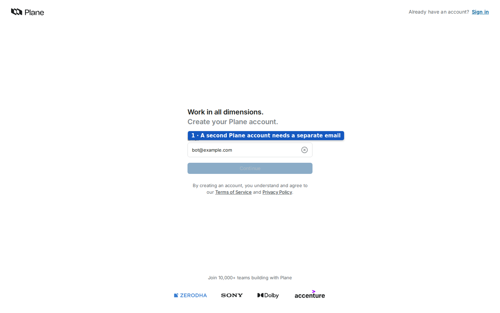

*Screenshot: the real Sign up page with only `bot@example.com` entered. Continue was not pressed and no account was created.*

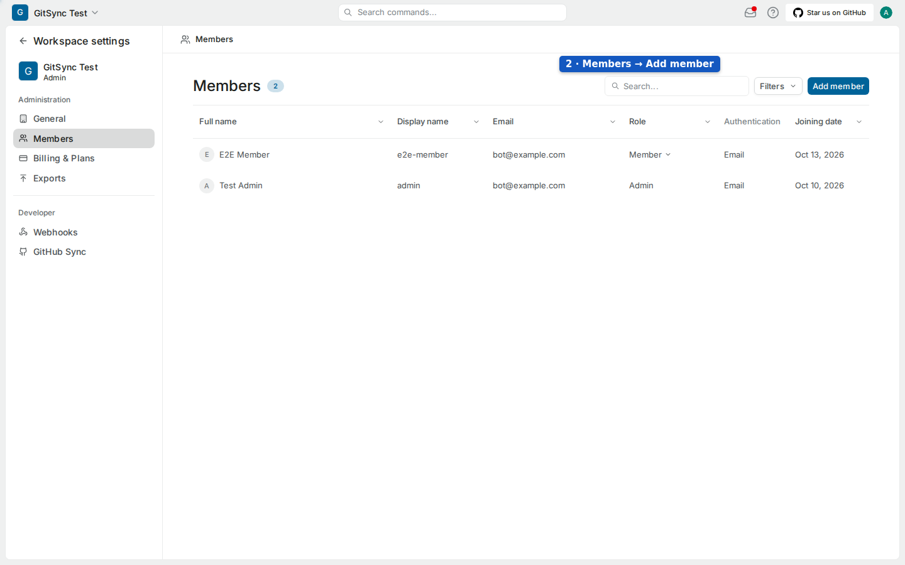

*Screenshot: where a workspace administrator finds Add member. Existing test member emails were replaced; no invitation was sent.*

If self-registration or invitations are disabled, ask the instance administrator to provision the second user through the instance's supported account process. The installer does not create that user. The exact invitation and email flow depends on Plane's instance settings, so this guide does not promise a particular confirmation screen.

A Gmail mailbox can receive mail addressed with a plus suffix: for example, `yourname+git-sync@gmail.com` goes to the same mailbox as `yourname@gmail.com`. This can provide a distinct email string for the second Plane account without creating another mailbox. Use it only if your instance accepts that address. It does not make the bot the same Plane identity as you; check the signed-in account before generating its PAT. This tip is part of the installation brief, not something exercised on the test system.

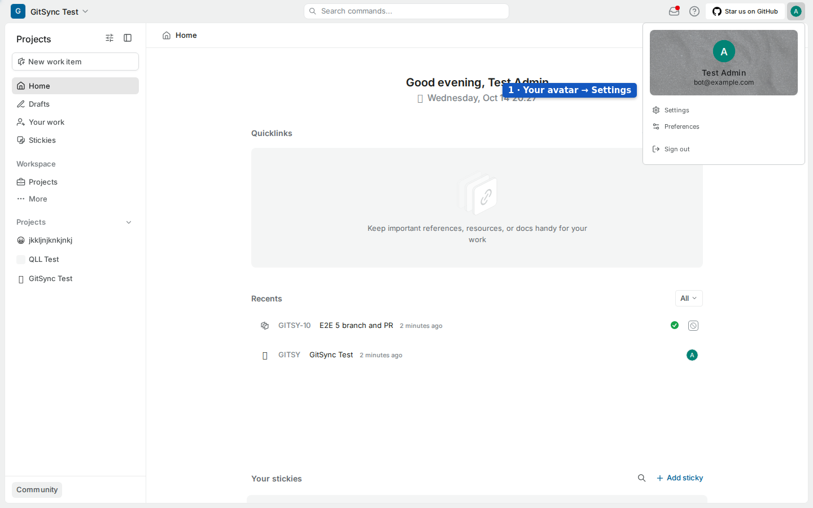

*Screenshot: the test administrator's avatar menu shows where Settings opens. The email was replaced with `bot@example.com`; this is navigation evidence, not evidence that a bot was created.*

## 5. Create the bot's API key

The bot now needs its entrance key. Plane calls this a **Personal Access Token**. Generate it while signed in **as the bot**. A token made from your administrator session still belongs to the administrator, even if its title says “bot.”

1. Open the bot's avatar menu.
2. Choose **Settings**.
3. Choose **Personal Access Tokens** under Developer.
4. Select **Add access token**.
5. Enter a title such as `git-sync bot`.
6. Select an expiry appropriate for your deployment.
7. Select **Generate token** on your own installation.
8. Copy the generated key into your protected temporary record.


*Screenshot: Profile settings → Personal Access Tokens on test Plane. Only token titles and status are visible; no token value is shown.*

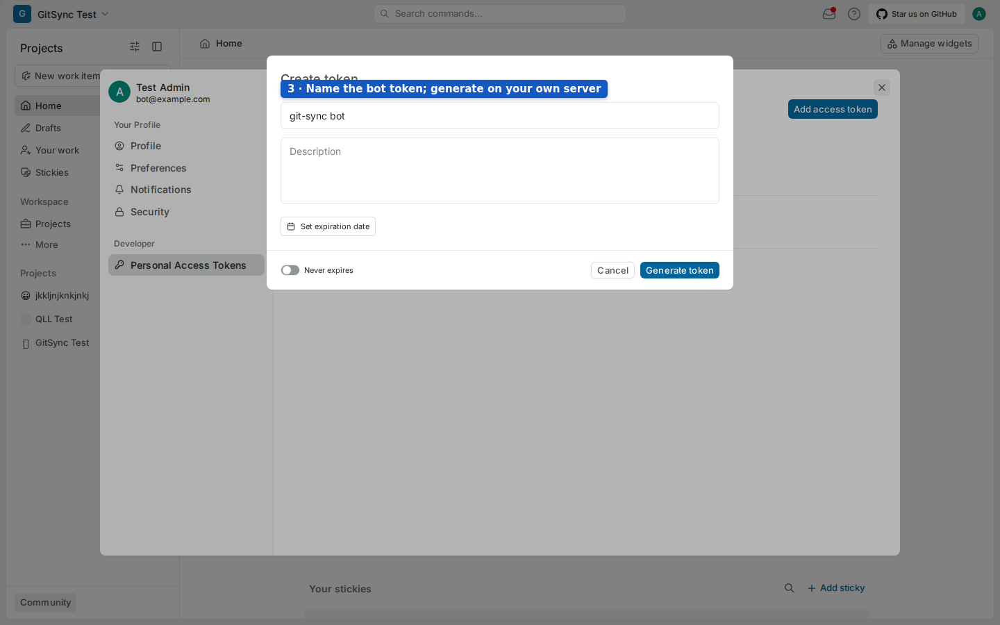

*Screenshot: the real Create token dialog, filled only with an example title and then cancelled. The test administrator was signed in; perform this step as your bot.*

Set a reminder before an expiring key expires. A revoked or expired key prevents the service from using Plane. The installer verifies the key through Plane and records its owning user ID automatically; you do not need to find or type that ID yourself.

Do not send the token in chat or put it in a screenshot. You will paste it into the installer's hidden prompt. Keep the key available until installation succeeds; the installer stores the resulting service settings in an owner-readable environment file on the server.

## 6. Allow Plane's internal webhook destination

Plane guards its outgoing doorbells so they cannot be used to knock on arbitrary private services. The allowed-destination list is named **`WEBHOOK_ALLOWED_HOSTS`**. Put git-sync's internal name on that list before creating the webhook.

Plane refuses the public URL of its own site as a webhook destination in this installation flow. It also refuses a dot-less name such as `git-sync`. The supported address uses **`git-sync.internal`**, which has a dot and is an alias the installer adds on Plane's Docker network.

Ask the server operator to do the following:

1. Open Plane's environment file, often named `plane.env`.
2. Find `WEBHOOK_ALLOWED_HOSTS`.
3. Set its value to `git-sync.internal` if it is empty.
4. Append `,git-sync.internal` if other allowed hosts are already present.
5. Save that environment file.
6. Restart Plane's `api`, `worker` and `beat-worker` using the deployment's full Compose command.

The required line for an otherwise empty list is:

```dotenv
WEBHOOK_ALLOWED_HOSTS=git-sync.internal
```

A typical command in Plane's installation directory is below. Replace the filenames with those used by your deployment; preserve all existing Compose files and environment arguments.

```bash
docker compose -f docker-compose.yaml --env-file plane.env up -d api worker beat-worker
```

Using `up -d` allows Compose to recreate services when their environment changed. A bare `restart` can restart a container with its old environment. After git-sync installation, also include the override file in your full command. The installer checks the **running API container's** allow-list, so editing a file without applying it does not satisfy the check.

## 7. Create the Plane webhook

Now connect the doorbell wire. A Plane webhook belongs to a workspace and covers its project events. Keep your bot signed in if you want the bot to own this webhook and receive any disabled-webhook notification. The account used here needs permission to manage workspace webhooks; ask the workspace administrator if the page is unavailable.

1. Open the intended workspace.
2. Open **Workspace settings**.
3. Choose **Webhooks** under Developer.
4. Select **Add webhook**.
5. Enter `http://git-sync.internal:3100/git-sync/webhooks/plane` as the payload URL.
6. Choose **Send me everything**.
7. Select **Create** on your own installation.
8. Copy or download the webhook secret Plane supplies.
9. Keep that secret with the bot PAT for the installer.

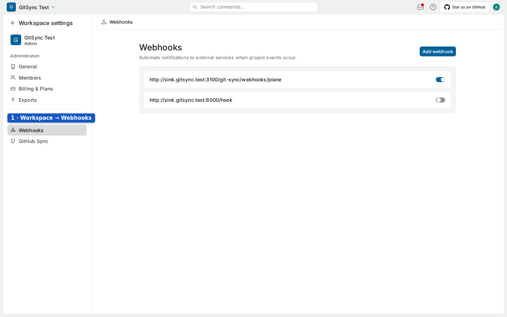

*Screenshot: where to find Webhooks and Add webhook. The listed `sink.gitsync.test` addresses are existing test sinks, not the address to configure.*


*Screenshot: the correct internal URL and “Send me everything” in the test dialog. It was cancelled without creating a webhook.*

The secret proves that incoming messages came from this webhook. It is different from the bot PAT and different again from the GitHub webhook secret. Do not substitute one for another. The design notes describe a CSV download at creation; preserve whatever secret export your deployed version provides. We did not create a webhook to verify that final screen.

You can prepare the webhook before git-sync exists. Until the installer starts the service and adds its network alias, it cannot receive deliveries. Keep this interval short and check that the webhook remains enabled after installation.

## 8. Run the installer

The setup helper is **`install.sh`**. Think of it as assembling the messenger's desk: it finds Plane, prepares the program, checks your answers and adds the necessary wiring. Run it on the server hosting Plane, from a checkout of this repository.

1. Open the server shell.
2. Clone the repository.

```bash
git clone https://github.com/nathanabay/git_plane-intergration.git git-sync
```

3. Enter the checkout.

```bash
cd git-sync
```

4. Start the installer with the permissions required by that server.

```bash
sudo ./install.sh
```

Use `./install.sh` without `sudo` when your current user can already access the correct Docker daemon and write Plane's directory. This matters with rootless Docker: switching to root can select a different daemon. Ask the operator which context owns Plane before changing user.

The installer normally discovers Plane from Docker Compose labels. If more than one installation exists, specify the intended one with `--plane-dir /path/to/plane`. If it cannot reproduce the deployment's settings, provide `--env-file /path/to/plane/plane.env`. Paths in the terminal pictures were simplified to `/root/plane`; that is an example, not a requirement.

### Understand every prompt

| Prompt or request | What it means | What to enter |
| --- | --- | --- |
| Start Plane now and install git-sync? | A stopped installation was found. Starting it changes the running state. | Accept only for the intended installation; otherwise cancel and ask its operator. |
| Plane API key of the git-sync service account | The messenger's Plane entrance key. Typed characters are hidden. | The bot PAT from section 5. |
| Plane webhook secret | The seal used on Plane's notifications. | The secret obtained when creating the webhook in section 7. |
| Public URL of your Plane site | The installer could not derive the browser-facing address. | Your public origin, such as `https://plane.example.com`. |
| GitHub App webhook secret | Only requested if App ID and private-key options were supplied at install time. | The same secret configured in that App's webhook field. |
| Delete git-sync's database, settings and stored credentials? | Only during interactive uninstall with purge. | Confirm only when you intend permanent removal of integration data. |

A re-run usually keeps existing values and does not ask for the Plane secrets again. A rejected stored PAT can trigger a replacement prompt in an interactive terminal. Non-interactive installation with `-y` takes secrets from environment variables and fails if required answers are missing; it does not invent them.

### Read the output


*Terminal screenshot: actual output from the passing disposable installer oracle. Temporary paths, project name, backup timestamp and public origin were simplified; the test stack deliberately kept Plane's stock UI.*

“Checking Docker and Plane” identifies the installation. “Building the git-sync image” prepares the service. “Configuring git-sync” verifies the service user, writes the private environment file, creates the separate database, patches the proxy route and merges the override. “Starting git-sync” starts the integration and checks its HTTP endpoint. “git-sync is installed” means those installer checks succeeded; GitHub still needs configuration.

On Plane v1.4.2, the automatic mode can build forked web and admin images to add menu entries. The installation reference estimates **10–20 minutes for the first UI build**. Download speed, cached images and server capacity affect that estimate. The small disposable installer test is different: it uses stand-in API and web services and does not measure a real first UI build. A re-run with cached images is normally shorter; no fixed completion time is promised.

Use `--keep-plane-ui` to keep stock Plane images and skip the fork build. Open the direct Git Sync URLs printed by the installer in that case. `--with-plane-ui` explicitly chooses the pinned fork images; review compatibility before forcing them onto another Plane release.

### What changes on the server

The installer adds a `git-sync` Compose service, an owner-only `git-sync.env`, a `git-sync/` directory for key and durable credential state, a separate `gitsync` Postgres role and database, and an override containing the integration's entries. In bundled-proxy mode it writes a patched Caddyfile and mounts it into Plane's proxy. Selected UI forks replace the web/admin image entries.

Existing override entries and supported Compose merge tags are preserved. Changed environment and override files get timestamped backups. The installer checks configuration hashes before applying the Compose configuration. Its test verifies that Plane's API, database and Valkey containers are not recreated in the tested installation flow; the proxy and selected UI apps can restart. This is a safety check, not a promise that an arbitrary operator override cannot affect other services.


*Terminal screenshot: real next-step output, with temporary names simplified. Keep the full Compose command printed for your actual installation.*

Copy that future start command into your operations notes. Plane's own `setup.sh` can omit the integration override when starting or restarting Plane. Use the complete printed command, including both Compose files and the chosen environment file, to include git-sync thereafter.

## 9. Fix a blank embedded Git Sync page

A photograph inside a frame is easier to carry than a whole room. Plane's menu pages similarly show git-sync inside an **iframe**. Some operators add headers forbidding all framing to their reverse proxy. `X-Frame-Options: DENY` or a Content Security Policy containing `frame-ancestors 'none'` then prevents the Git Sync page from appearing inside Plane.

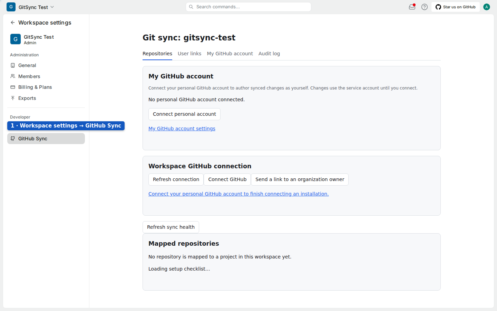

*Screenshot: GitHub Sync in the real workspace navigation, with its settings loaded. The test host exempts the Git Sync response from Plane's DENY header; a proxy applying DENY to this iframe response would prevent it loading.*

1. Open your public Plane URL followed by `/git-sync/ui/admin` in its own tab.
2. Sign in to God mode if the page requests instance-administrator access.
3. Check whether the direct page displays while the embedded page remains blank.
4. Ask the proxy operator to exclude `/git-sync/*` from the blanket frame-denial headers.
5. Reload the embedded page after the operator validates and reloads that proxy configuration.

The developer guide includes Caddy and nginx examples. For Caddy, place the `/git-sync/*` route in its own `handle` block and put blanket Plane-only frame restrictions in the fallback block. For nginx, use a dedicated `location /git-sync/` and make sure a global `add_header` or upstream DENY is not applied there. A matching route alone does not cancel an inherited header.

Keep git-sync's own `frame-ancestors 'self'` policy. It allows Plane to embed the integration on the same origin without making it generally frameable by unrelated sites. Fix all proxy layers that add a denial; a second conflicting CSP can still block the frame. This change belongs to the operator's deployment, not to the bot account or GitHub App.

## 10. Register the GitHub App

Give the contractor its badge and permitted rooms. This is **registering a GitHub App**. In GitHub, use **Settings → Developer settings → GitHub Apps → New GitHub App** for a personal account. For an organization-owned App, start from that organization's settings. GitHub's layout can change; the illustrations show the fields to match, not exact current pixels.

1. Open **New GitHub App**.
2. Choose a unique, recognizable name such as `Example Plane Sync`.
3. Enter a short description of its purpose if desired.
4. Enter your Plane homepage URL.
5. Enter the user authorization callback URL below.
6. Leave **Request user authorization (OAuth) during installation** off.
7. Leave **Enable Device Flow** off; this service uses the browser callback flow.
8. Keep expiring user tokens enabled if using GitHub's default; the implementation supports refresh.
9. Enter the setup URL below.
10. Enable **Redirect on update**.
11. Enable the webhook's **Active** option.
12. Enter the GitHub webhook URL below.
13. Generate a fresh webhook secret privately.
14. Enter that secret in the App's webhook secret field.

Generate the webhook secret in a private shell with `openssl rand -hex 32`, as the installation reference specifies. Do not capture or share the output. Keep it available for the Plane App settings. Each endpoint uses the public origin that people actually visit, with no added trailing path or invented port.


*Illustration: three different public endpoints. GitHub authorization returns to the OAuth callback; App installation returns to the setup callback; notifications go to the webhook.*

| Field | Example value or choice | Why |
| --- | --- | --- |
| GitHub App name | A unique name identifying your installation | Recognizable identity for installation and automated activity. |
| Homepage URL | `https://plane.example.com` | Shows users where this integration is used. |
| Callback URL | `https://plane.example.com/git-sync/oauth/github/callback` | Returns a person after authorizing their GitHub account. |
| OAuth during installation | Off | Keeps the setup URL available and separates App installation from personal authorization. |
| Enable Device Flow | Off | No device-code flow is implemented in this service. |
| Expire user authorization tokens | Keep enabled for the usual expiring-token flow | The service stores expiries and refreshes tokens; a failed refresh prompts reconnection. |
| Setup URL | `https://plane.example.com/git-sync/install/github/callback` | Returns the installation to the intended Plane workspace. |
| Redirect on update | On | Returns after installation repository selection changes. |
| Webhook Active | On | Enables notifications to git-sync. |
| Webhook URL | `https://plane.example.com/git-sync/webhooks/github` | Receives GitHub's signed events. |
| Webhook secret | Your freshly generated private value | Lets git-sync verify GitHub's signatures. |
| Where can this App be installed? | Owning account only, or any account when required | Determines which personal/organization accounts can install it. |

If all repositories belong to the App's owner, an owner-only App may be sufficient. If you intend installation on other accounts or organizations, select the availability that permits those installations. Availability does not grant access to every repository: installation repository selection and organization approval still control actual access. GitHub's [registration parameters](https://docs.github.com/en/apps/sharing-github-apps/registering-a-github-app-using-url-parameters) explain this distinction.

### Choose every permission and event

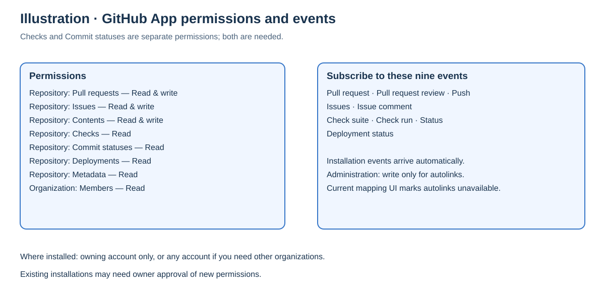

*Illustration: the required permissions and event subscriptions from the repository's setup checker. No GitHub session was used to make this picture.*

Set each of the following permissions separately:

| Scope | Permission | Access | Why git-sync asks for it |
| --- | --- | --- | --- |
| Repository | Pull requests | Read and write | Read PR lifecycle and post PR-related comments. |
| Repository | Issues | Read and write | Mirror issue fields, labels, assignees and discussion. |
| Repository | Contents | Read and write | Read commits and branches; create a branch when requested. |
| Repository | Checks | Read | Read build checks and suites. |
| Repository | Commit statuses | Read | Read legacy commit status results for readiness and build links. |
| Repository | Deployments | Read | Read deployment results and preview information. |
| Repository | Metadata | Read | Identify repositories and verify installation access. |
| Organization | Members | Read | Support organization access checks. |
| Repository, conditional | Administration | Read and write only for autolink management | The runbook lists this for autolinks; the current mapping UI marks autolinks unavailable. |

Checks and Commit statuses are different permissions. Selecting Checks does not cover Commit statuses. Leave unrelated permissions at their default unless your deployment has a separately justified need.

Under **Subscribe to events**, select each of these nine entries:

1. Pull request.
2. Pull request review.
3. Push.
4. Issues.
5. Issue comment.
6. Check suite.
7. Check run.
8. Status.
9. Deployment status.

Installation and installation-repository events arrive automatically; you do not select them manually. Checks can remain Read: the service uses completions and does not require check-suite requested/rerequested actions. After changing permissions later, existing installations may need their owners to approve the new grant. A successful registration check does not prove the installation has accepted an updated permission set.

### Find the six values Plane needs

1. Select **Create GitHub App** on GitHub.
2. Open that App's settings page.
3. Copy the numeric **App ID**.
4. Copy the **Client ID** from the same GitHub App registration.
5. Record the **App slug**, the last part of the App's public link.
6. Generate a **client secret**.
7. Generate a **private key**.
8. Keep the downloaded `.pem` file in protected storage.

The numeric App ID and text Client ID are not interchangeable. On GitHub.com, the expected GitHub App client ID begins with `Iv`; an OAuth App's `Ov` client ID is the wrong registration for this flow. The exact prefix is a GitHub.com diagnostic from the brief, not an independent validation rule in git-sync. The slug is a URL name, such as `example-plane-sync`, not the numeric App ID.

The client secret is used for personal account authorization. The private key authenticates the App itself. The webhook secret authenticates incoming events. Keep all three private. You will enter the key's file contents in Plane, not the local filename. If GitHub no longer shows a generated secret, generate an appropriate replacement instead of trying to recover it from a public page.

GitHub Enterprise deployments use the same service callback paths but an App registered on the selected GitHub host. Ask your operator to choose the edition and host in the developer guide; a GitHub.com App cannot simply be installed on an unrelated Enterprise Server.

## 11. Enter the App in God mode

The building manager configures the shared contractor once. That manager is the **Plane instance administrator**, and their control area is **God mode**. A workspace administrator may not have access to this area.

1. Open God mode on your Plane site.
2. Sign in with an instance-administrator account.
3. Choose **Git Sync**; the patched navigation may label it **GitHub Sync**.
4. Find the **GitHub App** section.
5. Enter the numeric App ID.
6. Paste the downloaded private key's contents into **Private key (PEM)**.
7. Enter the GitHub webhook secret.
8. Enter the App slug.
9. Enter the OAuth Client ID.
10. Enter the OAuth client secret.
11. Select the GitHub edition appropriate to your App.
12. Select **Save GitHub App**.
13. Review **Setup checks**.

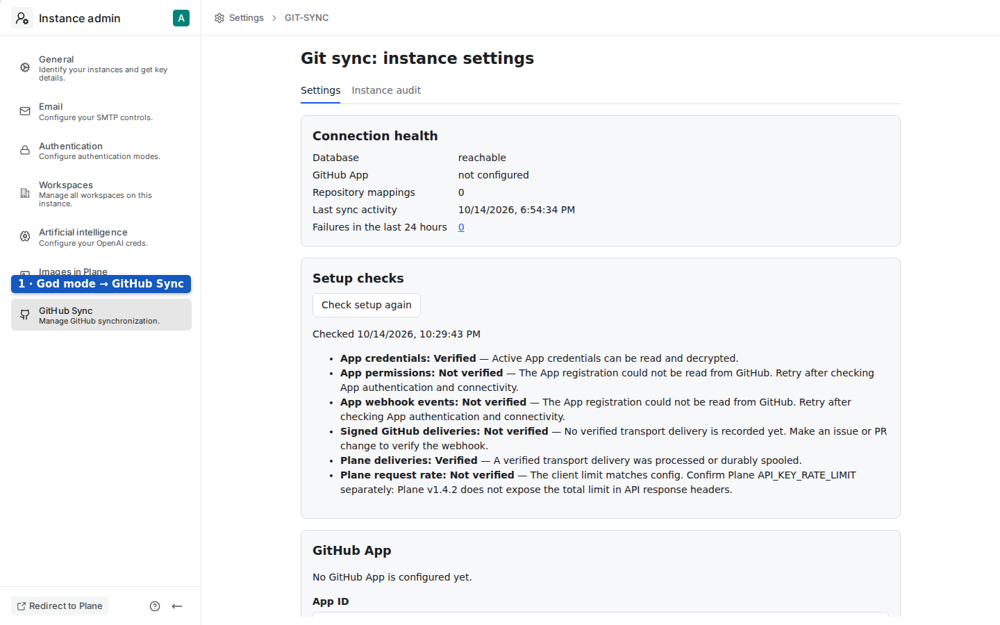

*Screenshot: the real test God mode navigation. Use an instance-admin session, which is separate from the normal workspace session.*


*Screenshot: the real instance page's health and setup results at capture time. A result saying “Not verified” is useful information, not an instruction to invent a passing result.*

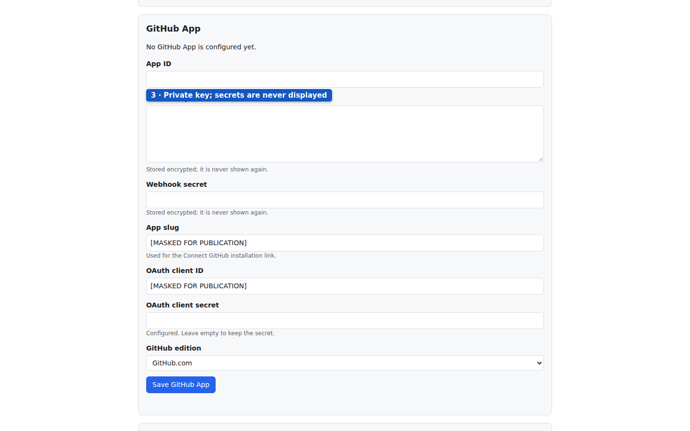

*Screenshot: the real App form with secrets empty and identifying App fields masked for publication. It was read without saving.*

Stored App secrets are encrypted and are not shown again. On a later edit, leave secret fields empty to keep the stored secrets. Enter a new value only when replacing it. If you change to a different App identity, expect personal GitHub accounts to need reconnection; the service cannot safely carry their old authorization into another App.

The setup checks distinguish credentials, registration permissions, event subscriptions and recorded deliveries. No recorded delivery can simply mean nothing has changed yet. The Plane request-rate check can remain **Not verified** because Plane v1.4.2 does not expose its total limit in response headers. The operator must compare Plane's `API_KEY_RATE_LIMIT` with git-sync's configured limit separately.

## 12. Connect a repository and map it to a project

Choose which workshop notebook belongs to which set of job cards. This is **connecting a repository** and creating a **mapping**. It happens in the intended workspace's Git Sync settings, not in the instance-wide App form.

1. Sign in to Plane with a workspace-administrator account.
2. Open **Workspace settings → GitHub Sync**.
3. Use the direct `/git-sync/ui/workspaces/your-workspace-slug` page if the embedded page is blocked.
4. Select **Connect GitHub**.
5. Choose the GitHub account or organization holding the repository.
6. Install the App on the intended repositories.
7. Complete any personal GitHub authorization requested on the return journey.
8. Return to the workspace connection page.
9. Select **Refresh connection** if necessary.
10. Connect your personal GitHub account if the repository picker requests it.

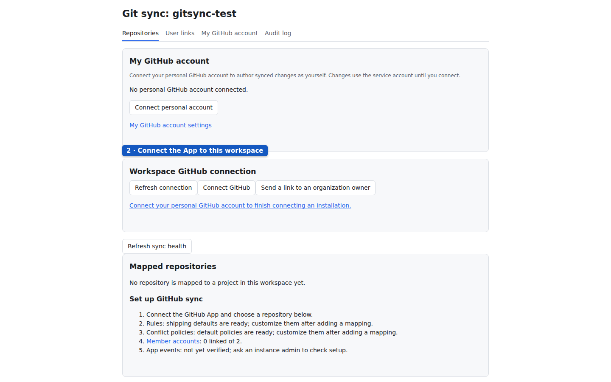

*Screenshot: the test workspace's actual empty setup state, with the personal account and workspace connection sections. No connection was initiated for capture.*

App installation grants the App access. Personal authorization identifies what you may choose and enables supported attribution. A connected workspace installation belongs to one Plane workspace at a time. If the page says an installation belongs elsewhere, ask its administrators to resolve ownership; guessing a different installation ID will not fix it.

An organization owner may need to approve installation. The page supports **Send a link to an organization owner** and pending approvals. Share that link only with the intended owner. The owner can complete the GitHub proof without a Plane account; the workspace admin then refreshes the connection. Installation approval does not grant the owner general Plane access.

After the connection is available:

1. Find **Map a repository**.
2. Select the GitHub repository.
3. Select the Plane project.
4. Choose an open state, or keep **Project default**.
5. Choose a different closed state, or keep **Project default**.
6. Choose **Two-way** or **GitHub to Plane only**.
7. Review the **Smart Commits** checkbox.
8. Review **Post link-back comments on GitHub**.
9. Review **Report problems as comments on GitHub and Plane**.
10. Select **Add mapping**.
11. Choose whether to link existing open PRs and issues when offered.

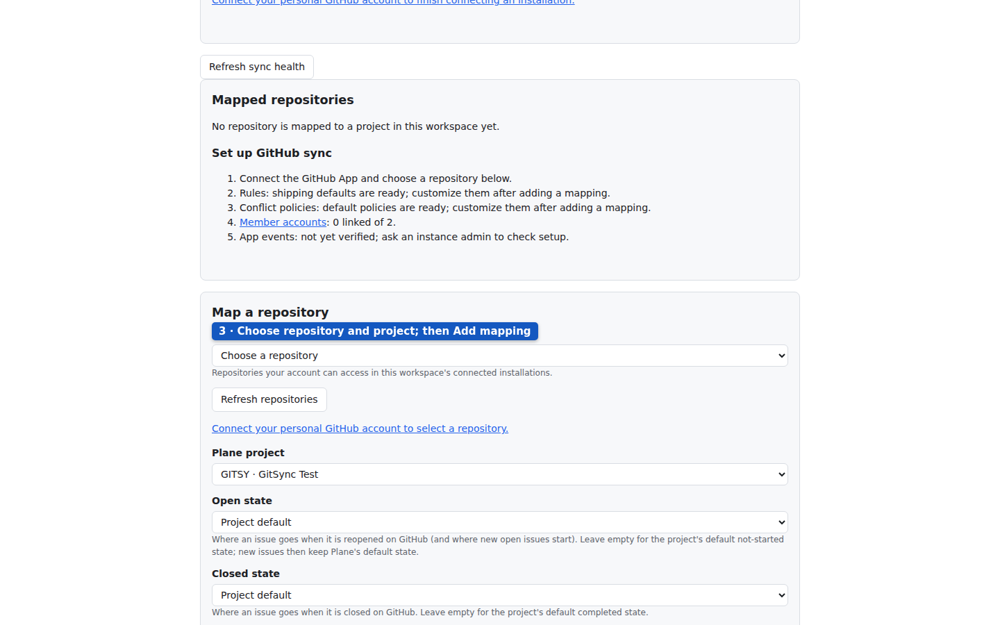

*Screenshot: the real mapping form with a project selected locally. The repository picker requests personal authorization, and Add mapping was not used.*

The picker is limited by both the App's installed repository access and your own GitHub access. Refresh it after changing repository selection on GitHub. An instance administrator has manual mapping recovery by verified repository ID when personal authorization is unavailable; ordinary users should use the picker.

**Two-way** permits opted-in issue updates in both directions, subject to field policies. **GitHub to Plane only** prevents Plane-origin issue mirroring back to GitHub. The shipped conflict policy makes GitHub authoritative for title and description even on a two-way mapping. Change that deliberately if your team expects title edits in Plane to overwrite GitHub.

The backfill offer links existing open references; it is not a promise to import every historical closed item. It can require multiple batches. You may choose **Not now** and perform it later from the mapping's settings.

## 13. Everyday use

### Opt issues into mirroring

Put a routing sticker on a job card before asking the messenger to copy it. That sticker is an **opt-in label**. Add `plane` to a GitHub issue to create a linked Plane work item. Add `github` to a Plane work item to create a linked GitHub issue on a suitable two-way mapping. Use a human Plane session for that change, not the service account.

The mirrored fields include title, description, state, represented assignees, labels and supported comment creation. Conflict policy decides which side may update each field. Mapping users lets the service translate assignees and mentions; an unmapped GitHub assignee cannot be represented as a Plane member. Unmapped GitHub assignees are preserved rather than blindly removed.

Closing a GitHub issue moves its Plane partner to the mapping's closed state, with a completed-group fallback. Reopening uses the open state, with an unstarted-group fallback. Newly created open issues without an explicitly selected state keep Plane's default. Plane completed states close GitHub issues as completed; cancelled states close them as not planned; other states reopen them. Automation refuses to move work into the triage group.

Deleting a Plane work item is different from completing it. Plane v1.4.2 does not supply the required issue-delete webhook. A periodic check later marks confirmed missing partners orphaned; it does not close the live GitHub issue. Archived items remain linked when the service can identify them. Do not use deletion as a workflow shortcut.

### Link PRs, branches and commits

Write the job-card number on the workshop note. That number is a **work-item key**, such as `WEB-34`: the project identifier followed by the item's sequence number. Use your real project's identifier, not a GitHub issue number.

The parser scans branch names, PR titles, PR bodies and commit messages in their applicable event paths. Uppercase keys are safest in prose. Bare free-text keys are uppercase-only; branch keys are case-insensitive. Project identifiers here begin with a letter and have 2–12 letters or digits. Technical tokens such as `UTF-8` and `SHA-256` are deliberately excluded.

Examples:

| Where you write it | Example | Meaning |
| --- | --- | --- |
| Branch | `feature/WEB-34-fix-sign-in` | Bare branch key is closing-tier eligible. |
| PR title | `Fixes WEB-34` | Closing link; allows configured merge-state automation. |
| PR body | `Refs WEB-34` | Non-closing link; avoids the final merge-state transition. |
| PR body | `Relates to WEB-34` | Relation link; no automatic state transition from that tier. |
| PR body | `Fixes WEB-34, WEB-35 and API-9` | One PR links several work items. |
| PR body | `skip WEB-34` or `ignore WEB-34` | Suppresses that key from this parsing result. |
| PR title or body | `WEB-NEW` | Requests a new work item in that project on supported PR actions. |
| Commit prose | `Touches WEB-34` | Bare commit key is relation-tier; a Smart Commit command is a separate instruction. |

Use `skip` when preparing a PR, before a link is created. It is a parser opt-out, not a documented button for erasing already stored historical links. An independent bare key in the branch can also be stronger than a non-closing word in the body. If the PR must never close the work item, classify references consistently across the branch, title and body.

The complete default **magic words** are:

| Tier | Words |
| --- | --- |
| Closing | close, closes, closed, closing; fix, fixes, fixed, fixing; resolve, resolves, resolved, resolving; complete, completes, completed, completing; implement, implements, implemented, implementing |
| Non-closing | ref, refs, references, part of, contributes to, toward, towards |
| Relation | relates to, related to |

The strongest tier wins for repeated references. Instance administrators can replace the lists in God mode. A closing word does not instantly complete an item: it makes that link eligible for the configured lifecycle rule. With multiple linked PRs, at least one must be merged and none can remain open before a merge transition advances the item. Closed-unmerged PRs neither count as a merge nor block a completed merge.

### Use Smart Commits

Add a short instruction to the workshop note so the messenger also updates the job card. These instructions are **Smart Commits**. They operate on a pushed commit message, with a work-item key before a `#command` on the same line.

```text
WEB-34 #comment corrected the sign-in error
WEB-34 #time 1h 30m
WEB-34 #in-review #comment ready for review
WEB-34 WEB-35 #done #time 30m #comment shipped together
```

`#comment` takes the rest of the line as its text, so put it last when combining commands. `#time` accepts weeks, days, hours and minutes, including decimals: one week is five eight-hour days; one day is eight hours. **Plane Community Edition time is recorded as a comment**, not as a native time-sheet entry.

A state command such as `#in-review` resolves against that work item's project. It tries the full hyphenated state name, then a spelling ignoring hyphens and apostrophes, then an unambiguous prefix. Unknown or ambiguous states are reported rather than guessed. Each new line needs its own key; a command cannot borrow the key from a previous line.

Commands need the mapping's Smart Commits switch enabled. Attribution uses GitHub's authenticated event sender, not the name or email written into the commit. Unlinked people and unsupported actor identities fall back to the service identity, with audit information. Do not expect `git commit --author` to impersonate a Plane member.

**Current signed-commit limitation:** God mode displays a saved “Require signed commits for Smart Commits” checkbox, but the live push path in this checkout reads `REQUIRE_VERIFIED_COMMITS` from the service environment. Ask the operator to set that flag and restart git-sync when signature enforcement is required. Do not rely on the checkbox alone. The developer guide names the relevant source paths.

### Read the Development panel

The job card can have a pocket for workshop documents. In Plane that is the **Development panel** in the work-item sidebar. It shows linked PRs, builds, deployments, previews and branches when that information exists. The PR rollup reads OPEN if any linked PR is open, otherwise MERGED if one is merged, otherwise DECLINED for closed-unmerged work.

1. Open the work item.
2. Find the Development area in its sidebar.
3. Open a linked PR or build to inspect its source.
4. Use **Copy branch name** to copy the suggested name.
5. Use **Create branch** only when you intend to create it on GitHub.

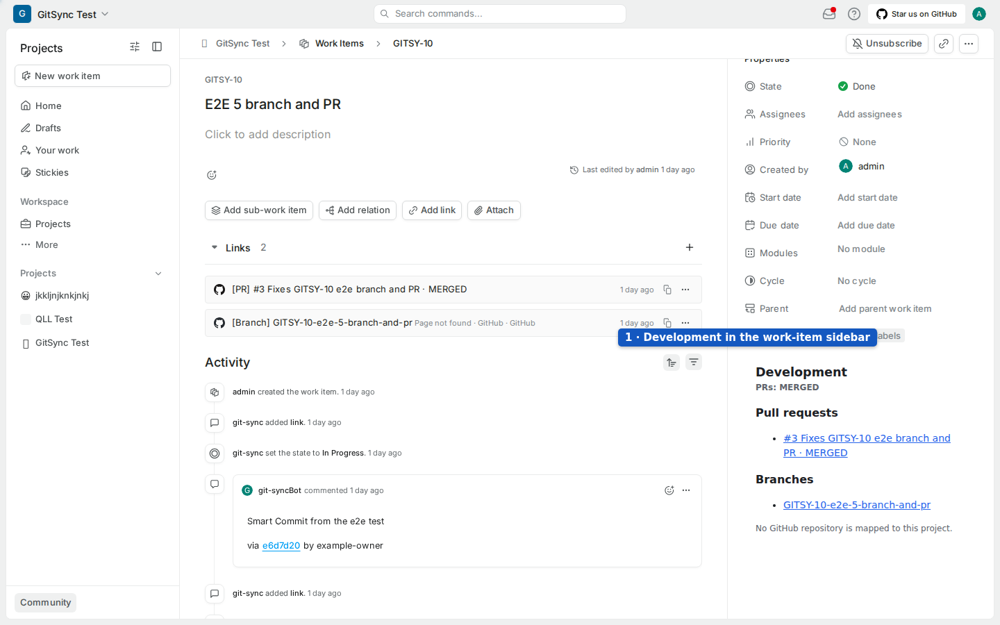

*Screenshot: an existing test work item and its sidebar, locating the embedded Development panel. No work-item fields were changed.*


*Screenshot: the direct Development page for the same existing work item. The workspace had no mapped repository, so the panel accurately reports that no repository is mapped.*

Branch creation requires Plane project-member access and an approved repository mapping. It starts from the repository's default branch. Copying a name does not create a branch or change a state. The first push can trigger a configured branch rule. The renderer supports branch templates in the data layer, but this checkout does not expose a normal template editor in the mapping form.

### Configure rules and read health

A shop procedure says, “when repairs are approved, move the job card to inspection.” That is a **rule**. Open a mapped repository's **Edit** page and choose **Rules**. The simple lifecycle table compiles into the same ordered rules used by the advanced YAML editor. The first matching rule wins.

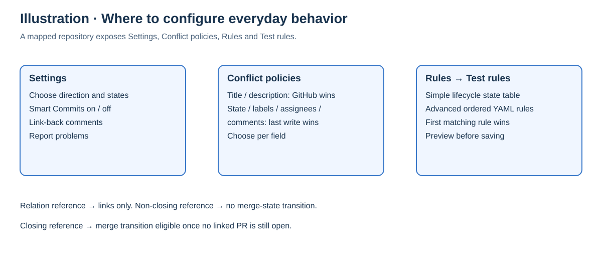

*Illustration: mapping-dependent tabs and shipped policy behavior from the source. These pages could not be photographed without creating a mapping on the read-only test system.*

The shipping workflow moves branch-created, drafted and opened work to an In Progress target, review-requested work to In Review, and merged work to Done only when the base branch matches `^main$`. It deliberately does nothing for several other lifecycle points unless you configure them. State groups help accommodate projects whose state names differ; always review the selected project states.

1. Open the mapping's **Rules** tab.
2. Choose the state for the lifecycle point you want to change.
3. Open **Test rules**.
4. Enter the representative event context.
5. Run the preview.
6. Review the matched rule and proposed actions.
7. Save the rule configuration when the result matches your intent.

The preview does not execute the actions. Saved rules have versions; restoring a version creates a new saved version. Ordered branch rules can distinguish a merge into staging from one into main. Advanced rules can add labels, comments, links and other supported actions, but they remain subject to permission, reference-tier and triage guards.

Health is the messenger's status board. Workspace mapping cards report recent deliveries, successful writes, errors and rate-limit deadlines. “Disabled” means installation or mapping authority needs repair. A service can be alive while no useful synchronization is happening, so use those cards and the authenticated setup checks as well as `/git-sync/healthz`.

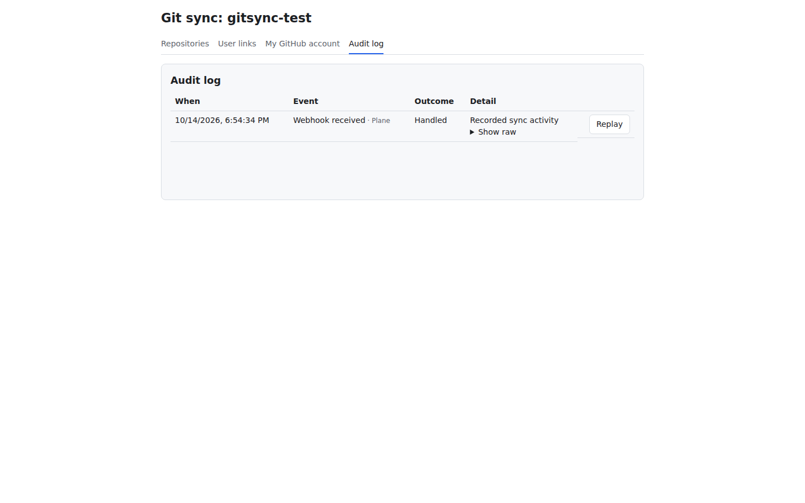

*Screenshot: the real Audit log with a handled Plane delivery and its Show raw and Replay controls. Raw payloads were left collapsed; replay and retry actions were not invoked.*

A diary explains the messenger's decisions: that is the **Audit log**. Use it after checking the mapping and direction. Filter errors or a recent interval, expand **Show raw** only when needed, and keep raw payloads private. Replay reprocesses a delivery and can create writes; Retry write repairs a failed outbound intent. Ask the operator to diagnose the cause before using either.

## 14. Update, change keys and uninstall

### Updating and re-running

Refresh the messenger's program while retaining its notebook. That is an **upgrade**. The installation reference uses `git pull` followed by re-running the installer.

1. Back up git-sync's database and private configuration with the operator.
2. Open the checkout on the server.
3. Run `git pull`.
4. Run the same installer command and options used for that deployment.
5. Check the health endpoint.
6. Review the authenticated health and setup pages.

The installer builds the service from the checkout and preserves the encryption key and stored configuration. It does not automatically rebuild an already-present fork image merely because a source patch changed. The operator guide explains pinned UI image upgrades. Record any `--proxy external`, network, directory and environment-file options so a re-run uses the intended topology.

### Changing the bot key

Replace the entrance key without changing the staff badge. Generate another PAT while signed in as the same bot. Supply it as `GITSYNC_PLANE_PAT` when re-running the installer. Prefer its interactive replacement prompt when available; the operator guide shows an environment method that avoids placing the value in command history. The installer verifies it and refreshes the service-user ID.

Do not change `GITSYNC_TOKEN_KEY` when changing the bot PAT. That is the encryption key for stored secrets; replacing it casually makes saved App credentials and user tokens unreadable. Revoke the old bot PAT only after verifying the new one works.

### Removing the integration

1. Open the service checkout on your own server.
2. Run `sudo ./install.sh --uninstall`, using the permissions and deployment options appropriate there.
3. Check that Plane still opens.

Uninstall removes the service and installer-managed override entries while keeping the integration database, environment file and state directory. A later installation can reuse them. For permanent deletion, use `sudo ./install.sh --uninstall --purge` instead and read the confirmation carefully. Purge deletes git-sync's database and role, `git-sync.env` and its state directory. It does not delete Plane's database; timestamped backup files may still contain private integration settings and need separate handling.

An externally maintained proxy route is your operator's responsibility after uninstall. Remove or update it so it does not keep pointing at a missing service.

## 15. Troubleshooting

Start with the visible symptom, then check the smallest relevant part. Repeatedly reinstalling cannot fix the wrong account or the wrong GitHub callback. The table includes the installation reference's problems and issues found while reviewing this checkout.

| Symptom or message | Likely cause | What to do |
| --- | --- | --- |
| Plane is not installed here | No recognizable Plane deployment found | Install Plane first, or point to its actual directory with `--plane-dir`. |
| Found more than one Plane | Docker holds multiple eligible Compose projects | Specify the intended installation directory. |
| Could not work out how this Plane was started | Reconstructed Compose config does not match running services | Supply the actual `--env-file`; preserve all original Compose files. |
| Config-hash comparison refuses the env file | Proposed environment differs from running Plane | Check how Plane was started; do not bypass the safety check. |
| Plane rejected the API key | Expired, revoked or wrong-user PAT | Generate a valid bot PAT and re-run with the replacement. |
| Plane does not allow webhooks to git-sync yet | Running API allow-list lacks the alias | Add `git-sync.internal` to `WEBHOOK_ALLOWED_HOSTS` and apply api/worker/beat-worker environment changes. |
| Webhook not created | Own-domain URL, dot-less hostname or internal-host restriction | Use the exact internal URL in section 7 and check the running API allow-list. |
| git-sync did not become healthy | Startup or connectivity failure | Read the printed logs and the deployment's `docker compose logs git-sync`. |
| Plane's proxy already mounts its own Caddyfile | Installer cannot safely replace operator proxy configuration | Use external proxy mode and add its route yourself. |
| God mode Git Sync page is blank | DENY or `frame-ancestors 'none'` on the iframe response | Try the direct page, then exclude `/git-sync/*` from blanket frame denial. |
| Not authorised on the direct admin page | Normal Plane session without God mode login | Sign in to the instance admin app and reload. |
| `redirect_uri is not associated with this application` | Wrong callback, public origin, host, or Client ID | Compare the exact OAuth callback with the GitHub App registration; use the App's `Iv` Client ID, not an OAuth App's `Ov` ID. |
| Setup URL cannot be entered on GitHub | OAuth during installation is enabled | Turn that option off, then enter the setup URL and enable Redirect on update. |
| Connect GitHub is disabled | Client ID, client secret or slug is missing | Ask the instance admin to complete and save App configuration. |
| Repository list is empty | Personal account unlinked, inaccessible installation, insufficient repository access or pending approval | Connect/reconnect the personal account, confirm App repository selection and approval, then refresh. |
| Installation already belongs to another workspace | One-workspace ownership rule | Have the administrators deliberately resolve the existing connection. |
| Edits made in Plane do not sync | Service PAT belongs to the person editing; mapping direction; field policy; missing webhook | Use a dedicated bot, check Two-way and policies, then inspect delivery health. |
| Title edits in Plane do not reach GitHub | Default GitHub source-of-truth policy | Change that field's policy if your team intentionally wants another behavior. |
| An issue never creates a partner | Missing opt-in label or disabled/unmapped repository | Add the correct `plane` or `github` label and check mapping authority. |
| PR does not move the item to Done | Non-closing/relation tier, another open PR, different base branch or no matching rule | Inspect all references and linked PRs; review the merge rule's branch condition. |
| Smart Commit does nothing | Switch disabled, invalid key/command, unknown state or required signature missing | Check the mapping, message grammar, project state and audit outcome. |
| Signed-commit checkbox appears saved but enforcement is uncertain | Stored setting is not read by the live push handler here | Set `REQUIRE_VERIFIED_COMMITS` in the service environment and restart with the full Compose command. |
| Plane webhook switched itself off | Service was unreachable through Plane's retry window | Repair access, re-enable the webhook, then re-save important affected items; old changes are not automatically resent. |
| GitHub App credentials cannot be decrypted | Lost or changed token encryption key | Restore the matching key or deliberately replace saved secrets and reconnect users. |
| Installer stops without a message | Shell error, lost terminal, Docker operation failure or resource problem | Record the exit code, check Docker access/context and logs, and re-run interactively with the correct options. Do not use `bash -x`: it can expose secrets. |
| Plane's setup.sh restart leaves git-sync out | That command ignored the override | Use the full start command printed by the installer. |
| Deleted Plane item leaves a GitHub issue | Deletion is not a completion event and no issue-delete webhook arrives | Let reconciliation identify the orphan; close the GitHub issue yourself only if that is intended. |

The silent installer row is a diagnostic procedure, not a verified single root cause. If asking for help, share sanitized error messages, the command's non-secret options, Plane version and which page failed. Never share environment-file contents or raw tokens.

## 16. Glossary and FAQ

| Word | Everyday reminder |
| --- | --- |
| API | A service counter where programs request information or changes. |
| API key / PAT | The entrance key tied to a Plane user. |
| Bot / service account | The messenger's separate staff identity. |
| Webhook | A doorbell notification after a change. |
| Webhook secret | The shared seal used to verify that notification. |
| GitHub App | The named contractor with selected permissions. |
| Installation | The contractor's approved access to an account's repositories. |
| OAuth | The authorization journey linking your personal account. |
| Client ID | The public identifier of the App's authorization client. |
| Client secret / private key | Private credentials for authorization and App authentication. |
| Repository / project | The code notebook / the collection of Plane job cards. |
| Mapping | The pairing between one repository and one project. |
| Pull request / PR | Proposed code changes for review. |
| Commit / branch | A recorded change / a separate line of work. |
| Magic word / tier | A phrase stating whether a reference may close, advance or merely link work. |
| Smart Commit | A commit-message command asking for a Plane action. |
| Reverse proxy | The receptionist routing browser and webhook requests. |
| Queue / outbox | The waiting line / the durable list of intended writes. |
| Echo suppression | Recognizing the messenger's own update so it does not bounce forever. |
| Reconciliation | A periodic check of existing links and webhook silence. |
| Orphan | A link whose Plane partner is confirmed missing. |

**Do I need a second GitHub account for the bot?** The separate bot account described here is a Plane user. GitHub uses the GitHub App's installation identity, with supported personal authorization for attribution.

**Can I use my own Plane PAT just to get started?** Avoid that. Your edits would be recognized as service-account echoes. Create the separate Plane account first.

**Must every work item be mirrored?** No. The integration uses mappings, labels and references. Choose the work that belongs in the connection.

**Does installing the App automatically map a repository?** No. App access and the repository-to-project mapping are separate decisions. The repository picker also needs your personal account's access.

**Can I open `git-sync.internal` from my laptop?** Normally no. It is a Docker network alias for Plane's internal webhook sender. Use your public Plane URL for browser pages.

**Does health OK mean the whole integration is ready?** No. `/healthz` proves the HTTP service answers. Inspect the authenticated health, setup checks and recent deliveries for the integration's useful work.

**Can I remove git-sync and keep Plane?** Yes. Uninstall removes the integration. The installer operates on a separate database and role; purge is for deleting integration data permanently.

**Will the pictures exactly match my version?** They show test Plane v1.4.2 and this checkout's service UI. Other Plane releases can keep stock UI and use direct links. The GitHub forms are illustrations, and unverified creation/approval screens are explicitly identified in the notes.

**Where should an operator go next?** Read the [developer guide](developer-guide.md), especially configuration, proxy framing, backups, webhook recovery and secret rotation. The [installation reference](../../INSTALL.md) remains a useful shorter checklist.
