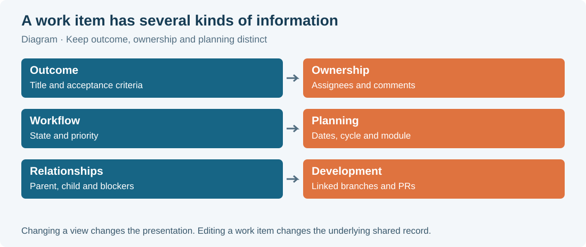
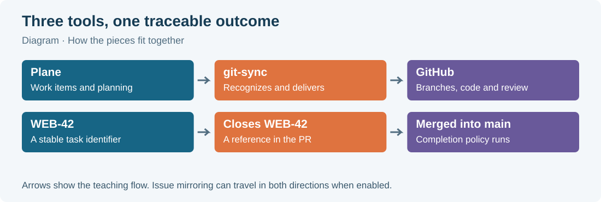

# 01 · Welcome

Your team keeps its plans in Plane and its code in GitHub. This chapter explains the handful of Plane ideas you meet every day. It then explains, at a high level, what git-sync adds on top of Plane and where to read more. It ends with a one-page checklist for your first day.

You do not need to install anything on a server. You need an invitation to the workspace, membership of the right project, and your usual development tools.

## 1.1 Plane in one page

Plane is a shared place to describe and organize work. These are the ideas you will meet first.

| Idea | What it is | Example |
|---|---|---|
| **Workspace** | The broad team area you are invited to. Everything else lives inside one workspace. | **Acme** |
| **Project** | A focused area of work inside the workspace, with its own identifier, states, labels and members. | **Website** (`WEB`) |
| **Work item** | One record of an outcome the team wants: a bug to fix, a feature to add, something to investigate or write. | `WEB-42` *Make the checkout button visible on small screens* |
| **State** | Where a work item is in the workflow. Each state belongs to a **state group** (Backlog, Unstarted, Started, Completed, Cancelled, plus Triage for intake). | Todo, In Progress, In Review, Done |
| **Cycle** | A time window for planning delivery; some teams call it a sprint. | **October customer experience** |
| **Module** | A collection of work around a feature area or larger outcome, possibly spanning several cycles. | **Checkout experience** |
| **View** | A saved selection of work items with filters, grouping and layout. | **Website delivery overview** |
| **Page** | A shared document for knowledge that outlives a single task. | **Website working agreement** |
| **Intake** | An inbox for new requests that the team has not yet accepted into its plan. | A pending bug report waiting for triage |

Each work item has a short **identifier**, also called its **key**. In `WEB-42`, `WEB` is the project identifier and `42` is the item's sequence number in that project. The title can change over time; the identifier stays the same. People use it in conversation, and git-sync uses it to connect code to the task.

These ideas are independent of each other. Changing from a list to a board does not move work to another project. Applying a filter does not change the items it hides. Adding an item to a cycle does not copy it.

> **Example:** "WEB-42 is In Progress, assigned to Alex, in the October cycle" gives four separate facts. The identifier selects the record, the state describes the workflow, the assignee names who is responsible, and the cycle names a planning window.

## 1.2 Git, GitHub and pull requests in one paragraph

Git is the version-control tool on your computer. It records changes as **commits** and lets you work on a **branch** without changing the team's main branch. GitHub hosts the shared repository and the discussion of proposed changes. That discussion happens in a **pull request**, or **PR**. A PR asks to merge a branch (the **head branch**) into another branch (the **base branch**, often `main`). Reviewers can comment, request changes or approve, and automated checks (**CI**) run on the PR's commits. Merging the PR puts its changes into the base branch.

## 1.3 What git-sync adds

Plane Community Edition v1.4.2 has no GitHub integration of its own. **git-sync** is a separate self-hosted service that your administrators installed next to Plane. It listens to events from both GitHub and Plane and does the bookkeeping that would otherwise mean copying information between two tools by hand.

At a high level, git-sync adds six things.

1. **Links from code to work items.** When a branch name, PR title or PR body contains a work-item key such as `WEB-42`, git-sync links that branch or PR to the work item. Words before the key, called **magic words**, decide how strong the link is: `Closes WEB-42` means "this PR finishes the item", `Refs WEB-42` means "this PR contributes to it", `Relates to WEB-42` means "this is useful context". See chapters 9 and 10.
2. **A Development panel on each work item.** The work item's sidebar gains a **Development** section. It shows the linked pull requests with their status and review badges, CI builds, deployments, preview links and branches. Before any code exists, it offers **Copy branch name** and **Create branch**. See chapter 12.
3. **Automatic workflow states.** With the shipped rules, pushing a new branch or opening a PR moves the item to **In Progress**, requesting a review moves it to **In Review**, and merging into `main` moves it to **Done**. Administrators can change these rules per repository. See chapter 14.
4. **Smart Commits.** A commit message such as `WEB-42 #comment Checked on small phones` or `WEB-42 #time 1h 30m` adds a comment to the work item. A command such as `#in-review` changes its state. See chapter 11.
5. **Issue mirroring.** A GitHub issue labelled `plane` gets a matching Plane work item; a Plane work item labelled `github` gets a matching GitHub issue. Title, description, state, assignees, labels and new comments then stay in step in both directions. See chapter 13.
6. **Your own GitHub identity.** You can connect your personal GitHub account, so that changes git-sync makes on GitHub for you appear under your name. See chapter 8.

Chapter 15, *A day in the life*, puts these together. It follows `WEB-42` from **Create branch** to merged PR, with a screenshot of the Development panel after every step.

git-sync is not a replacement for reading the task, testing your change or asking for review. It only records and moves information. If a link or a state looks wrong, the chapters above explain why it happened and chapter 17 explains how to fix it.

> **Note:** git-sync only works for repositories that an administrator has **mapped** to a Plane project. A key in a repository that is not mapped does nothing. Chapter 8 explains the four connections that must all be in place.

## 1.4 Who sets what up

Most of the setup is done for you before you arrive.

| Already arranged by administrators | Done by you |
|---|---|
| Plane installed, sign-in configured | Accept the invitation and sign in |
| git-sync installed and the GitHub App registered | Set your profile, preferences and notifications |
| GitHub App installed on the organization and connected to the workspace | Join your project |
| Repository mapped to the Plane project, rules and policies chosen | Connect your personal GitHub account, if your team uses it |
| Optional: your GitHub account linked to your Plane account by an admin | Use keys, magic words and Smart Commits in your daily work |

If installing or configuring the server is your job, read Part B. Never paste a server token, a Plane personal access token or a GitHub secret into a work item, a commit, a screenshot or a support message.

## 1.5 How to use this part of the manual

Chapters 2–7 teach Plane itself: getting in, finding your way, work items, layouts, planning and notifications. Chapters 8–15 teach the GitHub connection. Chapters 16–19 give team conventions, troubleshooting, answers to common questions and a printable cheat sheet.

Some actions need a project or workspace administrator. If your menu has fewer entries than a screenshot, first check your role and project membership before assuming something is broken.

## 1.6 Your first day: one-page checklist

Work through this list with a teammate. Tick a box only when you have checked the result, not merely opened the menu.

- [ ] Accept the invitation to the intended workspace (chapter 2).
- [ ] Sign in with your own Plane account.
- [ ] Set your name and a recognizable display name.
- [ ] Check your timezone in **Preferences**.
- [ ] Choose a theme and notification settings that suit you.
- [ ] Join the project that contains your team's work.
- [ ] Find **Home**, **Your work**, **Drafts** and the inbox (chapter 3).
- [ ] Open the command palette and the shortcuts dialog once.
- [ ] Read one assigned work item completely (chapter 4).
- [ ] Identify its state, priority, owner and any blockers.
- [ ] Open **My GitHub account** for the workspace (chapter 8).
- [ ] Connect your own GitHub account if your team uses it.
- [ ] Check that the work item's **Development** panel shows the mapped repository (chapter 12).
- [ ] Practice the branch, commit and PR loop (chapter 15).
- [ ] Confirm that the merged PR and the completed work item agree.

Ask your onboarding teammate three questions, and write the answers somewhere shared:

1. Which project view is the team's source for choosing work?
2. Which state means "ready for review"?
3. Should a PR *finish* its referenced item (`Closes`) or only *contribute* to it (`Refs`)?

These are team decisions, not product settings. Chapter 16 suggests sensible defaults.

> **Tip:** Keep `WEB-42`, its Plane link, the repository name and your branch name together in a scratch note while you work. The identifiers help you find your place again when many tabs are open.

## What you learned

- A workspace contains projects; a project contains work items, each with a stable key such as `WEB-42`.
- States, cycles, modules, views, pages and intake answer different planning questions and are independent of each other.
- git-sync is a separate service that links branches and PRs to work items, adds a Development panel, moves states by rule, runs Smart Commits, mirrors labelled issues and can act as you on GitHub.
- Nothing happens for a repository that an administrator has not mapped to a Plane project.

## Source files

- `docs/superpowers/specs/2026-10-10-plane-github-sync-design.md` (design of git-sync)
- `src/parse/references.ts`, `src/app/pr.ts`, `src/app/push.ts` (linking)
- `src/ui/client/DevPanel.tsx` (Development panel)
- `src/github/smart-commits.ts` (Smart Commits)
- `src/sync/mirror.ts` (issue mirroring)
