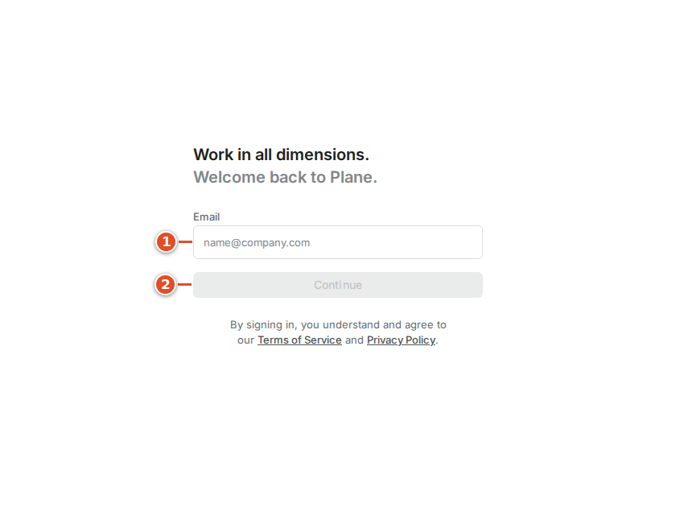
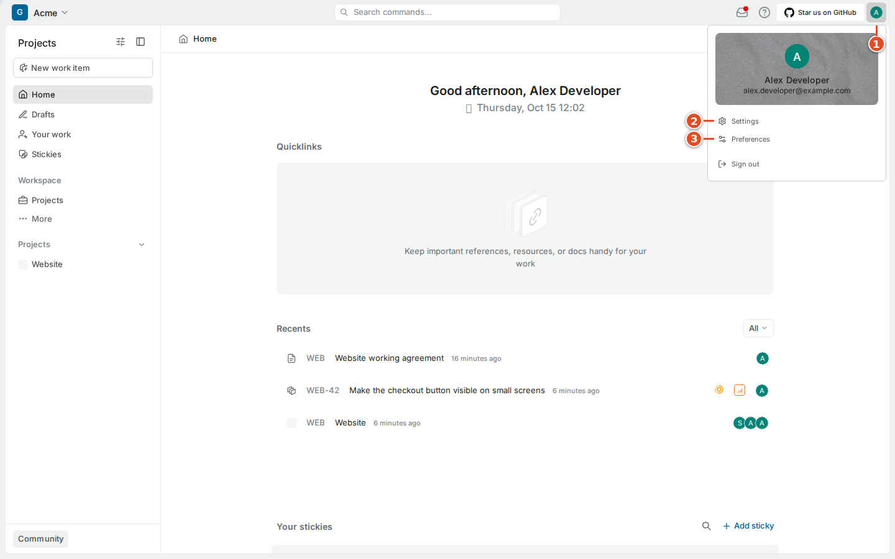
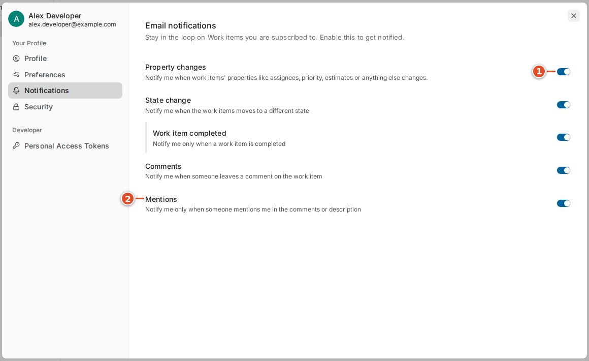

# 02 · Getting in

Three separate steps put you in front of your team's work. An **invitation** gives your account membership of a workspace. **Signing in** proves which account you are using. **Joining a project** gives you a place in that project's work. They can happen at different times, so signing in successfully does not mean every project is already in your sidebar.

This chapter walks through all three, then shows how to set your profile, preferences and email notifications.

## 2.1 Accept the invitation

### Goal: become a member of the team's workspace

**Before you start:** your team has sent you an invitation link by email, or told you to open Plane and look for a pending invitation. Use the Plane address your administrator gave you; the examples use `plane.example.com`. If you have accounts at more than one organization, check which email you are signed in with.

**Steps**

1. Open the invitation link from your team.
2. Sign in, or create your own account when Plane asks.
3. Select the checkbox for the intended workspace. ①
4. Select **Continue**. ②

**Result:** Plane opens the workspace. The first-time invitation screen shows the workspace name and your membership role. Select the checkbox itself; clicking the text beside it is not reliable. **Continue** stays disabled until an invitation is selected. An existing account may reach the invitation through **Workspace invites** instead of this onboarding screen.

**If it went wrong:**

- *No invitation is listed* → the invitation was sent to a different address, perhaps an alias. Ask the inviter to check the exact email. Do not create a new workspace just to get past onboarding.
- *An old link fails* → open the workspace invitations screen, or ask for a fresh invitation.
- *You joined the wrong workspace* → use the workspace switcher (chapter 3) and tell the inviter.

## 2.2 Sign in

The test instance uses email and password. Your administrator may enable other sign-in methods; use whichever methods your sign-in page shows. Signing in to Plane is separate from authorizing git-sync on GitHub (chapter 8). Having one does not give you the other.

### Goal: sign in with your own account

**Steps**

1. Open your team's Plane address.
2. Enter your account email. ①
3. Select **Continue**. ②
4. Enter your password when asked, and submit the form.

**Result:** you see your workspace's Home page.

**If it went wrong:**

- *Wrong password* → use the password-recovery control your instance offers. Never send a password to a teammate.
- *No recovery email arrives* → ask an administrator whether outgoing email is configured. The handbook's test instance had no mail server, so email delivery was not verified there. A success message on screen is not proof that a mailbox received anything.

> **Warning:** git-sync uses a separate **service account** (a bot user) to write to Plane. It deliberately ignores changes made by that account, to avoid sync loops. Never use the service account for your normal work: your edits would look ignored.

## 2.3 Set your profile

Your profile helps teammates recognize who is working and who is commenting. Your **full name** is your human-readable identity. Your **display name** is the shorter name shown in many places. Your **avatar** is the small picture or initials shown beside assignments and comments.

### Goal: make yourself recognizable

**Steps**

1. Select your avatar in the top-right corner. ①
2. Select **Settings**. ②
3. Select **Profile** if another section is open.
4. Update **First name** and, if you use one, **Last name**.
5. Update **Display name**.
6. Select **Save changes**.

**Result:** your new name appears beside your comments and assignments.

In Plane CE v1.4.2 the profile editor opens as a dialog over the current page, so you can close it and carry on where you were. Use the avatar control (① in the profile screenshot) to upload a picture, or keep the initials. Do not upload images that contain customer data or credentials.

The profile also shows your email address. Changing it can affect future invitations and how you sign in, so ask your administrator about the team's account policy first. Do not create a second account to fix a display-name problem.

> **Tip:** Choose a display name that teammates can match to your GitHub username. It makes reviews and mentions easier to follow, and it helps an administrator who has to link your accounts by hand (chapter 27).

## 2.4 Set theme, timezone and first day of the week

Your **timezone** controls how dates and times are displayed to you. Your **theme** only changes how Plane looks to you; it changes no data and no other member's view.

### Goal: make dates and times match where you work

**Steps**

1. Open your avatar menu and select **Preferences**.
2. Open the theme selector and choose a theme. ①
3. Open the timezone selector and choose your working timezone. ②
4. Set the first day of the week if the default differs from your calendar. ③

**Result:** due dates and notification times are shown in your local time.

The same area has a language setting. This manual uses the English labels; control positions stay the same in other languages.

> **Tip:** If a meeting time or a deadline looks a few hours off, compare timezone settings before you change the work item's date. A display setting and a planning mistake need different fixes.

## 2.5 Set email notification preferences

A **notification** tells you that something relevant changed. A **subscription** says you want updates about a particular work item. **Email notification preferences** decide which of those updates also reach your mailbox. Turning off an email category is not the same as unsubscribing from an item or being unassigned.

### Goal: get the emails that matter, not every small edit

**Steps**

1. Open personal **Settings** and select **Notifications**.
2. Review **Property changes**. ①
3. Review **State change**, **Work item completed** and **Comments**.
4. Review **Mentions**. ②

**Result:** Plane emails you only for the categories you left on. In-app notifications in the inbox continue regardless (chapter 7).

A good starting point is to keep **Mentions** and **Comments** on, and decide about **Property changes** after a few days of normal activity. git-sync's automatic updates (state changes, development links, Smart Commit comments) are ordinary Plane changes made by the service account, so they produce notifications like any other change.

**If it went wrong:**

- *An expected email never arrives* → first check that the change appears in Plane itself, then your categories, then your mailbox filters. If all three look right, ask an administrator about mail delivery. Do not change instance settings to debug your own notifications.

## 2.6 Join your project

The **Projects** page lists the projects you are allowed to discover. A project can be visible but still show a **Join** action because you are not a member yet. Private projects need an explicit invitation from a project administrator.

### Goal: become a member of the Website project

**Steps**

1. Select **Projects** in the workspace navigation.
2. Find the project your teammate named.
3. Select its **Join** action.
4. Check the project name in the confirmation dialog. ①
5. Select **Join Project**. ②
6. Open **Work items** under the project in the sidebar.

**Result:** the project appears in your sidebar and you can see and edit its work items.

**If it went wrong:**

- *The project is not listed* → check the workspace switcher first; you may be in another workspace. Otherwise the project is private and you need an invitation.
- *You cannot join* → tell the project administrator which account you are using and what you see. Send the project name and the message, not a screenshot of your whole account settings.

> **Note:** Project membership matters for git-sync too. The **Create branch** button in the Development panel is only available to project members (chapter 12).

Joining the right workspace does not mean you should join every visible project. Start with the projects you actually work in.

## What you learned

- Invitation, sign-in and project membership are three separate steps.
- Your profile, display name, timezone and theme are personal settings; they change nothing for others.
- Email preferences control which notifications reach your mailbox; they do not unsubscribe or unassign you.
- Never use git-sync's service account for normal work, and never share passwords or tokens.

## Source files

- Plane CE v1.4.2 web application (`apps/web/`), observed in the running test instance
- `docs/handbook/HANDBOOK_NOTES.md` (screenshot provenance)
- `src/queue/workers.ts` (ingress filter: why the service account's own changes are ignored)
