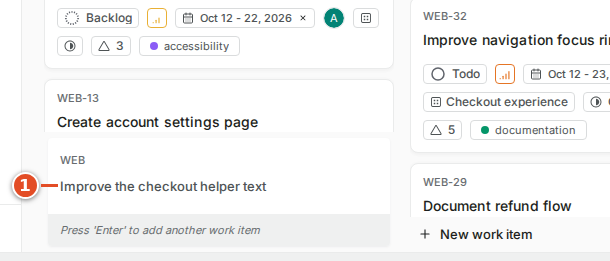
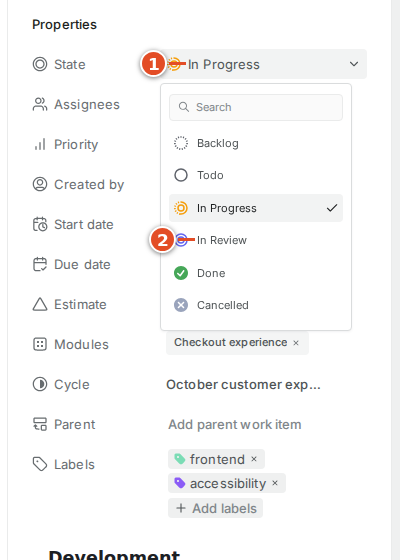
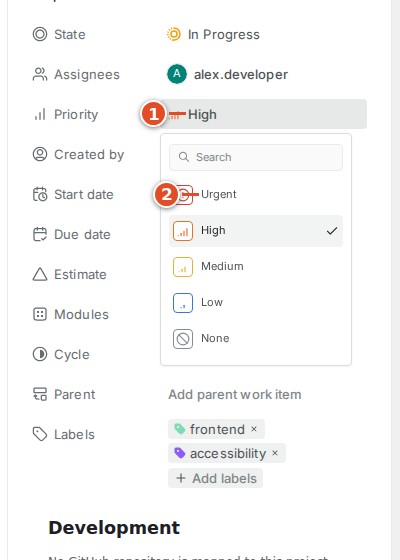
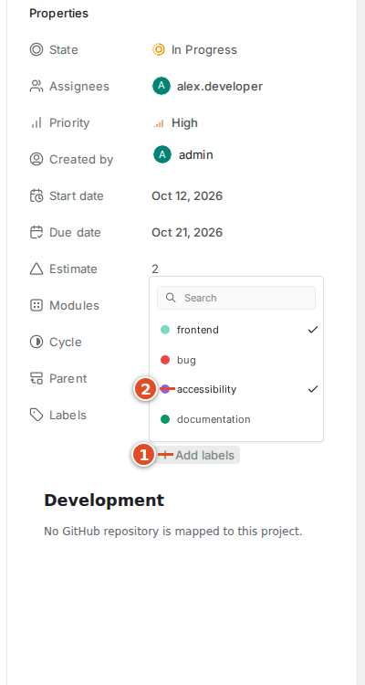
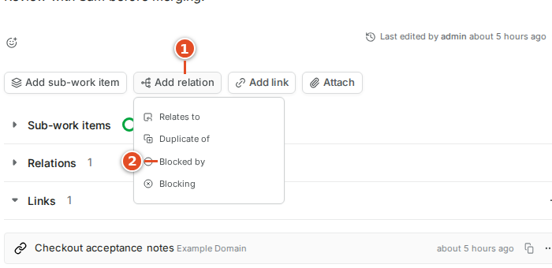
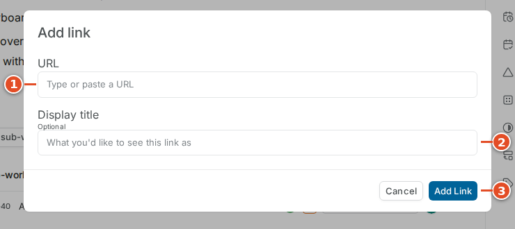
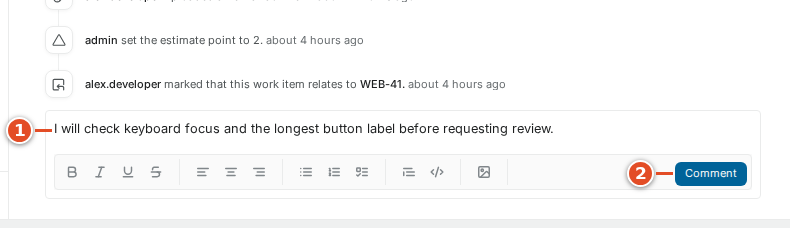
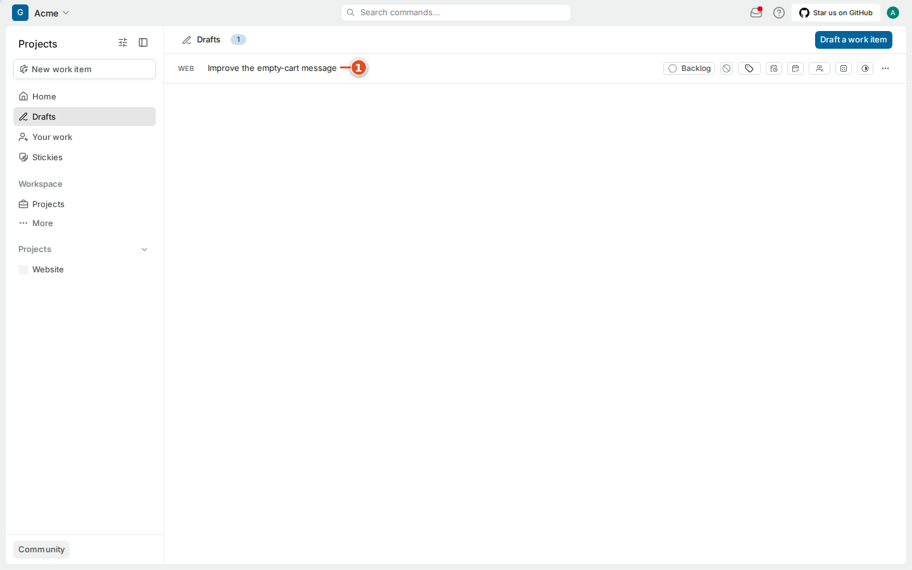

# 04 · Work items

A work item is a shared record of an outcome. Its **description** explains what needs to change. Its **properties** (state, priority, assignees, labels, dates, estimate, cycle, module) help the team organize and track it. Its **comments** and **activity** keep the history of decisions. You can edit an item from many layouts, but they all change the same record.

This chapter is the reference for a single work item. It also notes, where relevant, how git-sync interacts with each property.

## 4.1 Anatomy of a work item

1. **Title and identifier.** The identifier (`WEB-42`) never changes; the title can be improved.
2. **Description.** The problem, the acceptance criteria and supporting notes.
3. **Properties.** State, assignees, priority, labels, dates, estimate, cycle, module and parent, in the right-hand sidebar. When a repository is mapped to the project, the sidebar also contains git-sync's **Development** section (chapter 12).
4. **Sub-work items.** Smaller items that belong to this one.

Below the description are links, attachments, relations, and the activity feed with comments.

## 4.2 Create a work item with enough context

Before you create an item, search for an existing one. Two records for the same bug split the discussion and can cause duplicate work. If the request already exists, add your evidence there, or link a separate follow-up with a relation (section 4.9).

### Goal: create a new work item

**Before you start:** you are a member of the project.

**Steps**

1. Open the project and select **Add work item** in its header, or press **N then I**.
2. Check that the right project is selected in the form.
3. Enter a title that describes the outcome. ①
4. Enter the description. ②
5. Set the properties: state, priority and assignee if known. ③
6. Select **Save**. ④

**Result:** Plane creates the item and gives it the next identifier, for example `WEB-46`.

**If it went wrong:**

- *It landed in the wrong project* → open the item and change its project, or ask an administrator. Do not create a second copy.
- *You were interrupted* → close the form and choose **Save to Drafts** (section 4.13).

A good title says what should become true: "Keep the checkout button visible on small screens". "Checkout" on its own forces everyone to open the description. Keep long troubleshooting notes in the description and comments, not in the title.

> **Example:** A small bug description can have four short parts: what happened, what should happen, how to reproduce it, and how to confirm the fix. For `WEB-42` the key facts are the screen widths affected and whether the button stays keyboard-accessible.

> **Note:** You can also create a work item from GitHub. A pull request whose title or body contains `WEB-NEW` makes git-sync create a new item in the `WEB` project, titled after the PR (chapter 10). A GitHub issue labelled `plane` is mirrored into a new item (chapter 13).

### Quick add

The quick-add controls in a list or board are useful when you already know the project and the group. They create an item with only a title; the group you add it in can supply the state.

1. In the group you want, select the plus or **New work item** control.
2. Type the title in the inline input. ①
3. Press **Enter** to create the item, or **Escape** to cancel.

Open the new item afterwards and add the context that did not fit. A fast creation path does not remove the need for acceptance criteria.

## 4.3 Understand and copy the identifier

The project supplies the short identifier (`WEB`); Plane adds the sequence number to make `WEB-42`. Use the exact key in conversation and in the places git-sync reads: branch names, PR titles and bodies, and commit messages.

- Copy it from the item (press **Ctrl + .**) rather than typing it.
- Keep the hyphen and the digits. `WEB_42` and `WEB42` are different strings, and git-sync ignores them.
- Do not guess the identifier of an unsaved draft; it does not have one yet.
- Upper and lower case matter in some places: a lower-case `web-42` works in a branch name, but in a PR title or commit message the key must be upper case. Chapter 9 explains the exact rules.

## 4.4 Write and maintain the description

The description editor supports headings, lists, checklists, code blocks, links, images and mentions. Use structure to separate the customer problem, acceptance criteria and implementation notes.

### Goal: write a description others can act on

**Steps**

1. Select the description area.
2. Write the customer problem in plain language. ①
3. Add concrete acceptance criteria, for example as a checklist. ②
4. Add reproduction steps or references.
5. Click outside the editor and wait for the saved indication.

**Result:** teammates and reviewers can tell when the work is done.

Select text to show the formatting controls. Use a real checklist block instead of imitating one with symbols. Put code and literal error messages in a code block. Remove credentials, customer data and machine-specific secrets from copied logs before saving.

An image can explain a visual bug better than paragraphs. Include enough of the screen to identify the problem, and add a sentence saying what to notice.

A **mention** names a teammate. Type `@` and choose the person from the suggestions. Text that you never select from the list is just text. Put your question next to the mention ("@Sam, may the label wrap at 320 px?").

Keep the description current as decisions change. A comment can explain why the team changed its mind; the description should still say what is expected now.

> **Note:** If the item is mirrored to a GitHub issue (chapter 13), its description syncs with the issue body. By default GitHub's version wins when both change between syncs. Ask your administrator which side is the source of truth before making large edits on both.

## 4.5 States and state groups

A **state** is a named point in the workflow, such as Todo, In Progress, In Review or Done. A **state group** is the broader class that Plane and git-sync use. The Website project has the groups Backlog, Unstarted, Started, Completed and Cancelled. Its Todo state belongs to Unstarted; both In Progress and In Review belong to Started.

### Goal: change the state

**Steps**

1. Open the **State** property, or press **S**. ①
2. Read the available states.
3. Select the state that matches reality, for example **In Review**. ②
4. Check the new value on the item.

**Result:** the item shows the new state and the change appears in its activity.

**Done** means the agreed outcome is complete. It is not the same as archiving. **Cancelled** means the team is no longer pursuing the work; add a comment with the reason. A blocked task usually keeps its workflow state and gets a **Blocked by** relation; do not invent a state for every temporary obstacle.

> **Note:** git-sync can change states for you. With the shipped rules, a new branch or an opened PR moves a linked item to **In Progress**, a review request moves it to **In Review**, and a merge into `main` moves it to **Done**. A Smart Commit such as `WEB-42 #in-review` also changes the state. The activity feed shows these changes as made by the git-sync service account. If an item keeps moving back, read chapter 14 before fighting the rule.

## 4.6 Priority, assignees and labels

**Priority** is relative importance: None, Urgent, High, Medium or Low. A high priority does not assign, unblock or schedule an item by itself.

### Goal: set the priority

1. Open **Priority**, or press **P**. ①
2. Choose the agreed priority, for example **Urgent**. ②
3. Add a comment if the reason for a big change is not obvious.

An **assignee** is a person responsible for moving the item forward. You can assign more than one person, but the team should still know who gives the next update.

### Goal: assign the item

1. Open **Assignees**, or press **A**.
2. Search for the project member and select them.
3. Close the selector and check the names or avatars.

**Labels** are reusable categories such as frontend, bug or accessibility. Use existing labels rather than creating near-duplicates with different capitalization.

### Goal: add labels

1. Open **Labels**, or press **L**. ①
2. Select the relevant labels, for example **accessibility**. ②
3. Close the selector.

> **Note:** Two labels have a special meaning for git-sync. Adding the label **github** to a Plane work item in a mapped project asks git-sync to create a matching GitHub issue and keep the two in sync (chapter 13). The label **plane** plays the same role on the GitHub side. On mirrored items, assignees and labels also sync, with GitHub users translated through their linked Plane accounts.

## 4.7 Dates and estimates

A **start date** marks when work should begin; a **due date** marks the target. They are planning properties and do not create calendar invitations. The Calendar and Gantt layouts use them, so an item with no dates may be missing from those layouts.

### Goal: set the due date

1. Open **Start date** and select a date, if you use one.
2. Open **Due date**. Use the month selector ① and pick the day ②.
3. Check that the range makes sense.

An **estimate** is the team's agreed measure of size or effort. A project administrator chooses the scale (chapter 6). Do not assume that 3 means three hours; ask what the scale means. If the project has no estimate system, the **Estimate** field is not shown.

> **Warning:** Estimates, dates and priority never sync with GitHub, even on mirrored items. The Smart Commit command `#time 1h 30m` does not set an estimate or a native worklog either: Plane CE has no worklog, so git-sync posts a comment such as "Time logged: 1h 30m (90 minutes)" (chapter 11).

## 4.8 Parents and sub-work items

A **parent** groups related work under a larger outcome. A **sub-work item** is a full work item with its own identifier, state and discussion. Use sub-work items when pieces can be implemented, reviewed or assigned separately. Use a checklist in the description for small checks that do not need their own lifecycle.

### Goal: add a sub-work item

1. Open the parent item.
2. Select **Add sub-work item**.
3. Choose an existing item or create a new one in the form.
4. Check that the child appears in the parent's sub-work items section (④ in the anatomy screenshot).

You can also set the **Parent** property on the child. A completed child does not prove the whole parent is complete.

> **Note:** git-sync does not cascade between parents and children. Merging a PR that closes `WEB-42` does not close its sub-work items, and parent/child structure never syncs to GitHub. Reference each item a change actually affects, for example `Closes WEB-40, WEB-42`.

## 4.9 Relations: dependencies and duplicates

**Relations** connect two items without making one a child of the other. Plane offers **Relates to**, **Duplicate of**, **Blocked by** and **Blocking**. Direction matters: if `WEB-42` cannot proceed until `WEB-41` is done, then `WEB-42` is *blocked by* `WEB-41`.

### Goal: record that an item is blocked

**Steps**

1. Select **Add relation**. ①
2. Choose the relation type, for example **Blocked by**. ②
3. Search for the other item by identifier. ①
4. Select the correct result. ②
5. Select **Add selected work items**. ③

**Result:** both items show the relation.

Add a short comment when a dependency is not obvious. Mark duplicates deliberately and keep the useful evidence on the main item rather than deleting the second report at once.

> **Note:** A Plane relation does not block a GitHub merge, and relations never sync to GitHub. They are also unrelated to git-sync's **relation tier** (`Relates to WEB-42` in a PR body), which is a way to link a PR to an item *without* changing the item's state (chapter 9).

## 4.10 Links and attachments

A **link** points to a web page. An **attachment** is an uploaded file. Use a link for a document that keeps changing, and an attachment for a stable copy of evidence.

### Goal: add a link

1. Select **Add link**.
2. Enter the URL. ①
3. Enter a useful display title. ②
4. Select **Add Link**. ③

### Goal: attach a file

1. Select **Attach** and choose the file.
2. Wait for the upload to finish.
3. Open the attachment entry to check it is the right file. ①②

The server can limit file size and type. On the test instance, a plain-text file was refused as an invalid file type while a PNG image uploaded normally. If a large file fails, link to the team's approved storage instead.

> **Note:** git-sync stores its development information as ordinary Plane links on the work item, with titles that start with a category in brackets: `[PR]`, `[Branch]`, `[CI]`, `[Deploy]` and `[Preview]`. For example: `[PR] #121 WEB-42 Keep the checkout button visible on small screens · MERGED`. git-sync keeps these links up to date and the Development panel reads them (chapter 12). Do not edit or delete them by hand. Attachments never sync to GitHub.

## 4.11 Comments, reactions and activity

Use a **comment** to report progress, ask a focused question or record a decision. "I need a decision about the maximum label width" is more useful than "Any thoughts?". A **reaction** is a lightweight acknowledgment on a comment; it does not replace an explicit approval when one is needed.

### Goal: post a comment

1. Open the comment editor below **Activity**. ①
2. Write the update or question.
3. Select **Comment**. ②
4. Check the posted comment.

Use a posted comment's own menu to edit or delete it. Deleting can remove useful context; often it is better to post a correction.

**Activity** records property changes alongside comments: who changed the state, when an assignee was added, which cycle or module changed. Read it before concluding that an unexpected value is a sync fault.

> **Note:** git-sync writes comments too, as the service account. A Smart Commit `#comment` appears with a small "via `3b2335d` by alex-dev" line that links to the commit. A comment mirrored from a GitHub issue starts with "*sam-reviews* commented on GitHub:". On a mirrored item, new comments sync in both directions, but edits and deletions of existing comments do not (chapter 13).

## 4.12 Subscribe, share, archive and delete

**Subscribe** asks Plane to keep you informed about an item; the button then reads **Unsubscribe**. Subscribing does not assign the item to you.

Use the header's copy controls or action menu to copy the item's link or ID. The item menu also offers **Make a copy**, **Open in new tab**, **Archive** and **Delete**.

In CE v1.4.2, **Archive** is disabled for work that is not completed or cancelled. Archive finished work when the team wants it out of active lists but kept on record. **Delete** is stronger: read the confirmation and check the identifier. Never delete a task just to undo a state change or an accidental comment.

> **Warning:** Archive, delete, cancel and complete are different actions. Closing a GitHub PR without merging is yet another. Use the one that describes what actually happened.

> **Warning:** Deleting a mirrored Plane work item does **not** close its GitHub issue. Plane v1.4.2 sends no delete event; git-sync's periodic reconciliation only marks the link as orphaned and comments on the GitHub issue. Close the issue on GitHub yourself, or move the Plane item to Cancelled instead of deleting it (chapter 13).

## 4.13 Keep unfinished writing in Drafts

If you close the creation form before saving, Plane can keep your unfinished writing in **Drafts**. Use this when you need more information before creating a shared task. A draft has no identifier yet, and git-sync cannot link to it.

### Goal: save and resume a draft

**Steps**

1. Close the unfinished creation form.
2. Select **Save to Drafts**. ①
3. Later, open **Drafts** from the sidebar (or press **G then J**).
4. Open the saved draft to keep editing. ①
5. Check its project and properties before publishing it as a work item.

**Result:** your text is kept until you publish or discard it.

**Discard** ② deletes the unfinished draft. Before publishing an old draft, search again: a teammate may have created the item meanwhile.

## 4.14 Before you start coding: a ready check

When you pick up an item, take a moment to make sure it is really ready.

- The acceptance criteria are clear, and you know how to confirm them.
- You are an assignee, and any blocker is resolved or recorded.
- The project is mapped to the repository you will change. The Development panel shows it (chapter 12).
- You know whether your PR will **close** the item or only **contribute** to it (chapter 9).

You do not need to set **In Progress** by hand if your team uses the shipped rules: your first push to a branch named after the key does it for you. Moving it yourself does no harm.

## What you learned

- A work item has a permanent identifier, a description, properties, relations, links, attachments and an activity feed.
- States belong to groups; git-sync's rules and Smart Commits change states for you, and the activity feed shows them.
- Labels **github** and **plane** opt items into issue mirroring; priority, dates, estimates, parents, relations and attachments never sync.
- git-sync stores development information as `[PR]`, `[Branch]`, `[CI]`, `[Deploy]` and `[Preview]` links — leave them alone.
- Deleting a mirrored item does not close its GitHub issue; cancel it instead.

## Source files

- Plane CE v1.4.2 web application (`apps/web/`), observed in the running test instance
- `src/sync/dev-info.ts` (bracketed development links)
- `src/github/smart-commits.ts` (`#comment`, `#time`, state commands)
- `src/sync/mirror.ts`, `src/sync/reconcile.ts` (mirroring, orphaned links)
- `src/parse/references.ts` (key format and case rules)
