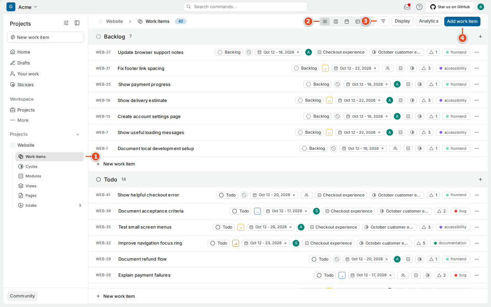
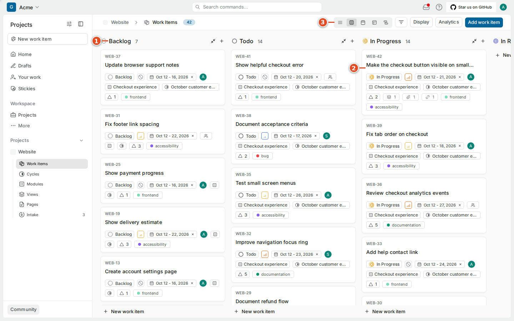
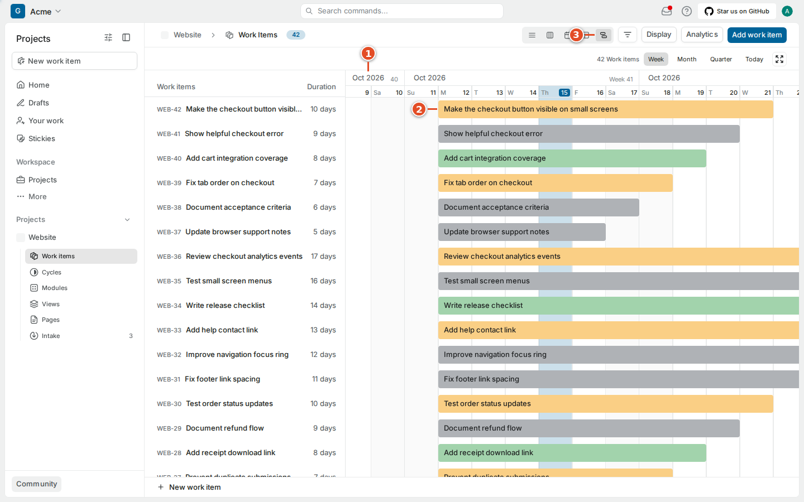
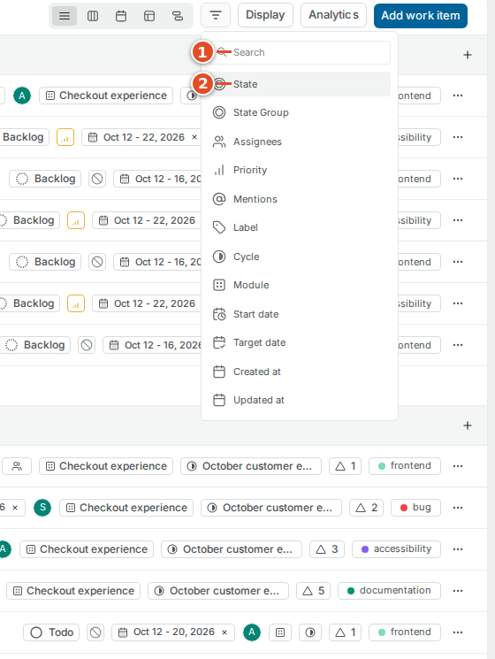
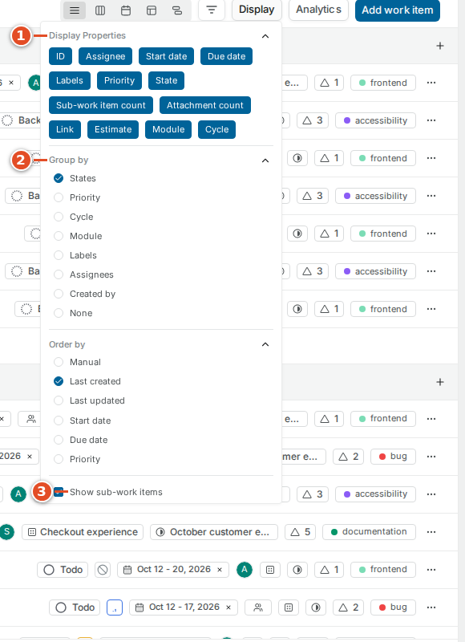

# 05 · Views and layouts

A project can hold more work than you can usefully read at once. Four controls help:

- A **layout** decides how items are arranged: list, board, calendar, spreadsheet or Gantt chart.
- A **filter** decides which items appear.
- **Grouping** splits the matching items into sections, and **ordering** decides which comes first.
- A **saved view** keeps a useful combination so you can return to it.

These controls change only how *you* see shared work. Hiding the Due date column does not remove due dates; filtering to In Progress does not move hidden items anywhere. But editing a property value in any layout changes the real work item, and, for mirrored items, can be synced to GitHub.

## 5.1 Choose a layout

Plane CE v1.4.2 has five layout buttons in the Work items header. Hover over an icon to read its tooltip.

| Layout | Good for answering | Remember |
| --- | --- | --- |
| **List** | What is ready for me to pick up? | Grouping and ordering decide the sequence. |
| **Board** (Kanban) | Where is work piling up? | A column usually represents a state; check the grouping first. |
| **Calendar** | What has a date in this period? | Items without dates do not appear. |
| **Spreadsheet** | How do properties compare across many items? | Editable cells change the real item. |
| **Gantt** | How do planned date ranges overlap? | A bar shows planned dates, not progress. |

## 5.2 List: a readable queue

The list shows one row per item with its identifier, title and the properties you chose to display.

### Goal: scan the project's work as a list

**Steps**

1. Open the project's **Work items** page from the project navigation. ①
2. Select the list icon among the layout buttons. ②
3. Read the group heading above the rows and check the ordering in **Display** (section 5.8).
4. Use the filter button ③ to narrow the list, or **Add work item** ④ to create one.
5. Open an item to read its description before deciding what it means.

**Result:** a sorted, grouped list of matching items.

The count next to a group counts items that match the current view. If an item seems missing, check filters, collapsed groups and sub-work-item visibility before creating a duplicate.

## 5.3 Board: discuss the flow of work

A board shows items as cards in columns. Grouped by state, it is a good shared picture for a stand-up: what is waiting, what is being built and what is ready for review.

### Goal: move work across the board

**Steps**

1. Select the board icon. ③
2. Check what the column headings represent ①; usually states.
3. Open a card ② before you change its state.
4. Drag the card to another column, or change its state in the item.
5. Check that the new value is correct.

**Result:** the card sits in the new column and the item's state has changed.

If the board is grouped by a different property, such as assignee, dragging a card changes that property instead. A wide board scrolls sideways; scroll before deciding that Done or Cancelled is missing.

> **Tip:** With git-sync's shipped rules you rarely need to drag cards between In Progress, In Review and Done: pushing a branch, requesting a review and merging do it for you. Watching the board after a merge is a quick way to confirm that sync is working.

## 5.4 Calendar: dated work

The calendar places items on their dates. It helps you review a delivery week or notice several items due on the same day. It is not a complete backlog, because undated items have nowhere to go.

### Goal: review what is due this month

**Steps**

1. Select the calendar icon. ③
2. Check the displayed month ① and navigate to the period you need.
3. Open a dated item, such as `WEB-42` ②.
4. Check its date in the item's properties before changing it.

**Result:** you see the items due in the period.

Changing a deadline is a planning decision. Do not drag dates just to make a crowded calendar look tidier; discuss scope or capacity with the team instead.

## 5.5 Spreadsheet: careful property edits

The spreadsheet shows properties in columns. It is good for comparing state, priority, assignees, dates, modules and cycles across many items.

### Goal: change a property for one item

**Steps**

1. Select the spreadsheet icon. ③
2. Find the row by its identifier at the left, here `WEB-42`. ①
3. Select the cell to change, for example the state cell. ②
4. Choose the new value and wait for the update.
5. Check the row before editing another one.

**Result:** the item has the new value.

Some columns show counts or derived values and cannot be edited. Selecting several rows for a bulk action is different from editing one cell; read the scope of a bulk action before applying it.

> **Warning:** The spreadsheet is not a private draft. Every edit is a real change. On a mirrored item, a change to state, assignees or labels is sent to the linked GitHub issue just as if you had made it on the detail page.

## 5.6 Gantt: compare date ranges

Gantt shows items as bars along a time scale. Use it to see overlapping plans or to discuss start and target dates.

### Goal: compare planned dates

**Steps**

1. Select the Gantt icon. ③
2. Check the time scale in the header. ①
3. Find the item and compare its bar ② with the dates.
4. Open the item for exact dates or dependencies.

**Result:** you see how planned ranges overlap.

A bar is a plan. It does not show that anyone has started, and it does not replace a **Blocked by** relation or a comment.

## 5.7 Filter without losing your place

The filter control offers State, State Group, Assignees, Priority, Mentions, Label, Cycle, Module, Start date, Target date, Created at, Updated at and Created by. Ask the narrowest useful question: "assigned to me and not finished" is easier to reason about than a dozen conditions.

### Goal: show only the items you care about

**Steps**

1. Open the filter control beside the layout buttons.
2. Search ① or choose a property category ②.
3. Select one or more values.
4. Check the resulting items and count.
5. Remove the filter when you need the whole project again.

**Result:** only matching items are shown.

Read the displayed selection rather than assuming every click adds an "and". Relative date filters such as "this week" show different items as time passes, even if nobody edits the view.

> **Tip:** To see everything your team is working on in GitHub right now, filter **State Group** to Started. Items that git-sync moved to In Progress or In Review because a branch or PR exists will show up there.

When a teammate says an item is missing, compare project, filters, layout and visible period. Sending the direct link quickly separates a display problem from an access problem.

## 5.8 Display: properties, grouping and ordering

**Display** controls which properties appear and how items are grouped and ordered. In the list layout you can show ID, Assignee, Start date, Due date, Labels, Priority, State, sub-work item count, attachment count, link, Estimate, Module and Cycle.

### Goal: set up the list the way you work

**Steps**

1. Open **Display**.
2. Choose the properties to show. ①
3. Choose **Group by**. ②
4. Choose **Order by**.
5. Turn **Show sub-work items** on or off. ③
6. Close the menu.

**Result:** the layout shows the properties and grouping you chose.

You can group by state, priority, cycle, module, labels, assignees or creator, or not at all. Ordering includes manual order, created, updated, dates and priority. Choices differ by layout. Hiding sub-work items does not detach them from their parents.

> **Note:** The **link** count includes the development links git-sync adds (`[PR]`, `[Branch]`, `[CI]`…). An item with a link count but no manual links is usually one that already has code connected to it.

## 5.9 Save a useful view

A **saved view** names a useful query. Choose a name that says what it shows, such as "Frontend work needing review", not "My view 2".

### Goal: save a view the team can reuse

**Steps**

1. Open **Views** under the project.
2. Start a new view with **Add view**. ②
3. Enter a descriptive name and a short explanation.
4. Configure the filters.
5. Save the view.
6. Open it again to check the items it shows. ①

**Result:** the view appears in the list and anyone with access can open it.

A view does not copy items. An item can appear in many views, and a change made through one view shows wherever the item matches. Before changing the meaning of a shared view, ask the team; others may rely on it every day.

> **Note:** Saved views and pages are Plane-only. git-sync never syncs them to GitHub.

## What you learned

- Layouts, filters, grouping and ordering change only your view; edits to property values change the real item.
- List, Board, Calendar, Spreadsheet and Gantt answer different questions.
- Every edit in any layout is a real change, and on mirrored items it can sync to GitHub.
- Saved views name a reusable query and never copy items.

## Source files

- Plane CE v1.4.2 web application (`apps/web/`), observed in the running test instance
- `src/sync/mirror.ts` (which mirrored fields sync)
- `src/sync/dev-info.ts` (development links that count as item links)
