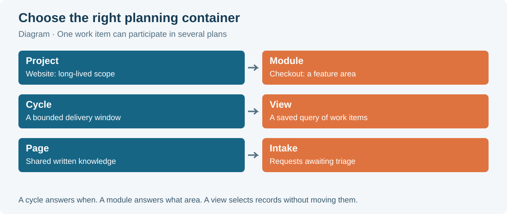
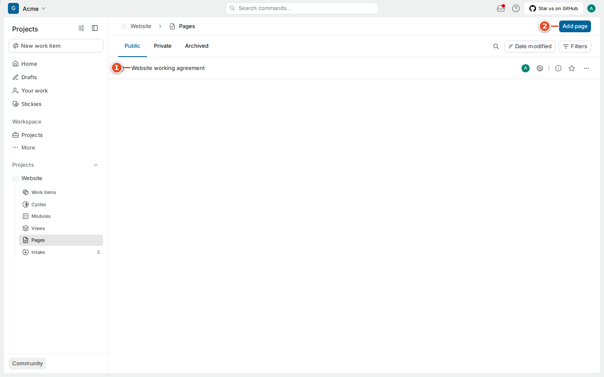
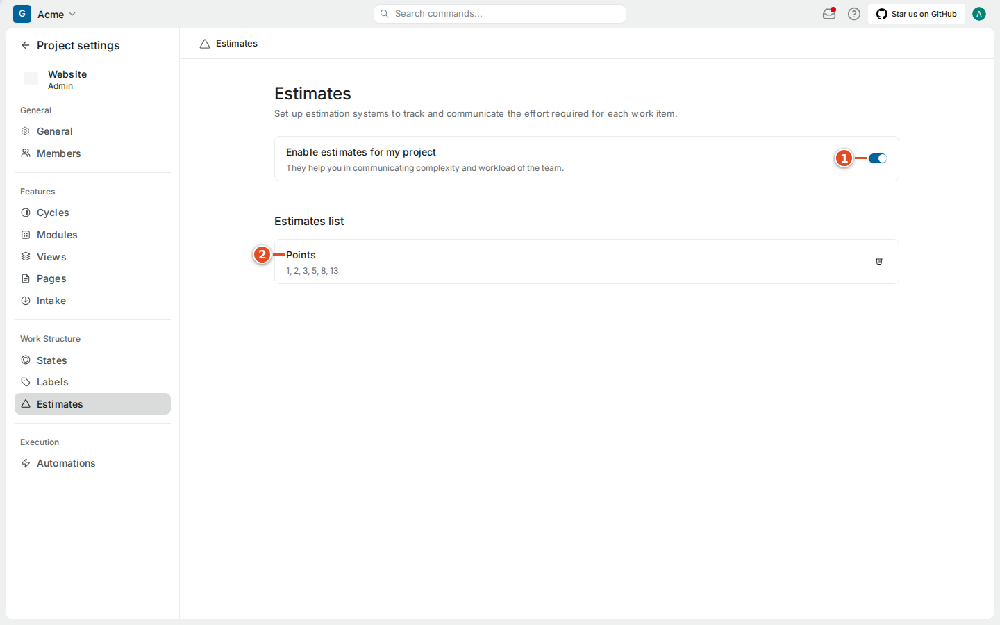
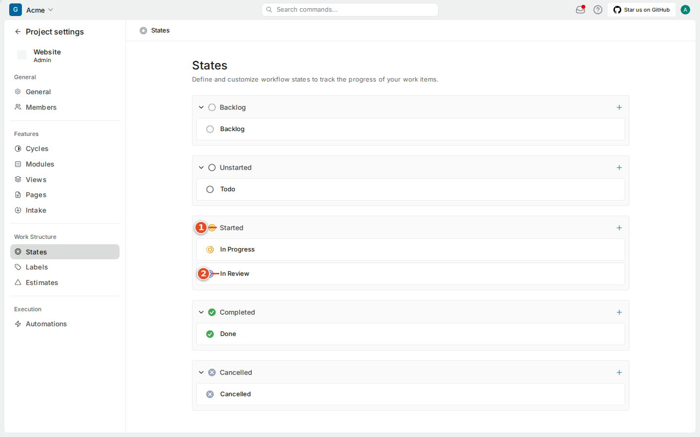
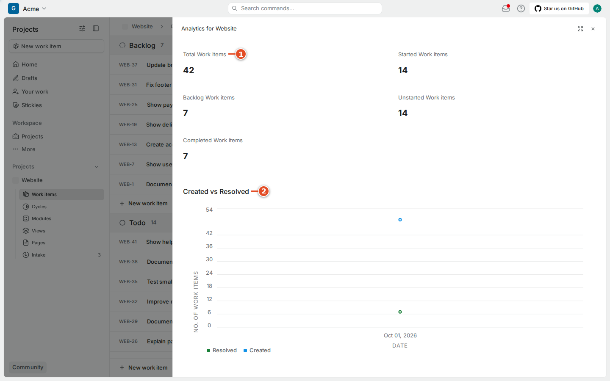

# 06 · Planning

Plane's planning tools answer different questions:

- A **cycle** is a time window: what will we deliver in these two weeks?
- A **module** is a feature area or larger outcome: how is the checkout work going overall?
- A **page** holds written knowledge: how do we review code here?
- **Intake** receives new requests before the team accepts them: what came in, and do we want it?
- A **saved view** is a reusable query (chapter 5).
- **Estimates**, **states** and **analytics** help the team size work, agree on a workflow and see trends.

All of these are present in the Plane CE v1.4.2 test project. A project administrator can turn optional ones on or off.

A work item can be in a module and a cycle at the same time. Adding it to either does not copy it. The original item stays the place for its implementation and discussion.

> **Note:** None of these planning containers sync with GitHub. git-sync never copies cycles, modules, pages, views, estimates or intake requests, and it never sets an item's cycle or module. Your team's plan lives only in Plane.

## 6.1 Work within a cycle

A **cycle** is a bounded period used to plan and check delivery; some teams call it a sprint. The example cycle **October customer experience** has start and end dates and contains the Website items chosen for that period.

### Goal: see what your team committed to this cycle

**Steps**

1. Open **Cycles** under the project.
2. Find the current cycle by name ① and check its dates ②.
3. Open the cycle.
4. Read its work items ① and its dates and progress ②.

**Result:** you see the cycle's committed work and how far it has progressed.

To add an item to a cycle, set its **Cycle** property (or press **Shift + C** on the item). Check the dates so you do not pick a similarly named past cycle.

Cycle progress comes from the included items and their states. It changes when items are added, removed or move between states, which includes state changes made by git-sync when PRs open and merge. A percentage is not a promise about the remaining time; one unresolved dependency can matter more than several finished small tasks.

> **Tip:** In planning, when an urgent item enters a committed cycle, ask what moves out. Changing the cycle is easy; making the capacity decision visible is the useful part.

## 6.2 Use modules for a feature area

A **module** groups work around an area or larger outcome. The example module **Checkout experience** contains several Website improvements and can span more than one cycle. The module has its own status and dates; each item keeps its own state.

### Goal: follow progress on a feature area

**Steps**

1. Open **Modules** under the project.
2. Find the module ① and check its status ②.
3. Open the module.
4. Read its description, properties and progress ②, and review its items ①.

**Result:** you see every item that contributes to the area.

Use the item's **Modules** property (**Shift + M**) to add it to a module. A parent relationship describes how one outcome breaks down into parts; a module is a planning collection. Do not build a huge parent item just to reproduce a module. Marking a module complete does not merge PRs or complete its open items.

## 6.3 Keep team knowledge in Pages

A **page** is a shared document: working agreements, design notes, review checklists, onboarding instructions. A work item's description holds its own acceptance criteria but can link to a page for a convention that many items share.

### Goal: read the team's working agreement

**Steps**

1. Open **Pages** under the project.
2. Find the document, here **Website working agreement** ①.
3. Open it and read its title ① and checklist ②.

**Result:** you know the team's agreed way of working.

To write a page, select **Add page**, give it a clear title and say who it is for. Use headings, and keep checklists short enough to be used. Link to a work item for a specific decision instead of copying a long comment thread.

Page actions such as favorites, locking, archiving and sharing depend on your role. Public sharing can expose content outside the team; follow your organization's policy. A shortcut listed in the keyboard dialog does not prove your account may use the action.

> **Tip:** A page is a good home for your team's git-sync conventions: branch naming, when to write `Closes` versus `Refs`, and which Smart Commit commands to use. Chapter 16 has a starting template.

## 6.4 Triage new requests through Intake

**Triage** means deciding what to do with a new report before it becomes planned work. **Intake** keeps incoming bugs, ideas and feedback apart from the regular queue. A new request is **Pending** and its state is **Triage**. The detail screen offers **Accept** and **Decline**.

### Goal: submit a request through Intake

**Steps**

1. Open **Intake** under the project.
2. Select **Add work item**.
3. Enter a specific title and describe what you observed.
4. Select **Create work item**.
5. Find the new request in the pending list ①.

**Result:** the request waits for triage. Whoever triages it checks for duplicates, clarifies it and then selects **Accept** ③ or **Decline**.

Accepting is a decision, not a way to clear an unread count. Declining is not the same as completing. Leave a reason so the reporter knows what happened. After accepting, check the item's regular state, priority and owner.

> **Note:** git-sync never moves a work item *into* a Triage state, and its normal rules work on accepted items. Have a request accepted before you put its key in a branch or PR and expect automation to apply.

If **Intake** is missing from the project navigation, the team may not use it. Ask who handles incoming requests instead of starting a private backlog.

## 6.5 Understand the estimate system

A project administrator chooses the estimate system. The **Points** templates offer Fibonacci `1, 2, 3, 5, 8, 13`, Linear `1, 2, 3, 4, 5, 6` and Squares `1, 4, 9, 16, 25, 36`, plus a custom scale. The Website project uses Fibonacci points.

As a member, set an item's **Estimate** (**Shift + E**) by comparing it with items the team has already sized. If the team has not agreed what a point means, do not convert points to hours in a report. Changing the estimate system affects how existing values are read, so it is a team and administrator decision.

> **Note:** Estimates do not sync to GitHub, and git-sync's Smart Commit `#time` command does not change them. Time logged with `#time` appears only as a comment (chapter 11).

## 6.6 Read the project's states and labels

States and labels are the team's shared vocabulary. Project settings show states organized by group, and the project's labels. Your role decides whether you can edit them.

> **Warning:** git-sync's rules and Smart Commits refer to states by group and name, for example `started:In Review` or `#in-review`. Renaming or deleting a state that a rule uses can make that rule fail, and the failure appears in the audit log. Ask the project administrator and the git-sync administrator before renaming states such as In Progress, In Review or Done. Likewise, keep the labels **github** and **plane** if your team mirrors issues (chapter 13).

The **Automations** entry in Plane's project settings is separate from git-sync's rules. A rule configured in one place does not appear in the other. For any state change triggered from GitHub, the git-sync mapping and its rules are the place to look (chapters 14 and 26).

## 6.7 Use the project analytics

The project's Work items header has an **Analytics** button. It opens a summary with the total number of work items, counts by state group, a **Created vs Resolved** chart, breakdown controls, and priority and assignee tables with CSV export.

### Goal: look at the project's trend

**Steps**

1. Open the project's **Work items** page.
2. Select **Analytics**.
3. Read the summary ① and the **Created vs Resolved** chart ②, checking the scope and labels.
4. Compare with the project's records before drawing conclusions.

**Result:** you can see whether work is being resolved as fast as it arrives.

Counts describe a selection of records. They do not measure individual productivity or quality. Use charts to ask planning questions, such as why started work is piling up or whether there is enough review capacity. Workspace-level **Analytics** in the workspace navigation covers all projects; check its scope before comparing numbers. This manual does not assume reporting features advertised for other Plane editions.

## What you learned

- Cycles are time windows, modules are feature areas, pages hold knowledge, and Intake holds requests awaiting triage.
- An item can be in a cycle and a module at once; neither copies it.
- Planning data (cycles, modules, pages, views, estimates, intake) never syncs to GitHub.
- Renaming states that git-sync rules use can break automation; coordinate first.
- Analytics show trends in the work, not individual performance.

## Source files

- Plane CE v1.4.2 web application (`apps/web/`), observed in the running test instance
- `src/github/pr-automation.ts` (state targets such as `started:In Review`)
- `src/github/smart-commits.ts` (state commands; never into triage)
- `src/sync/mirror.ts` (fields that are never synced)
