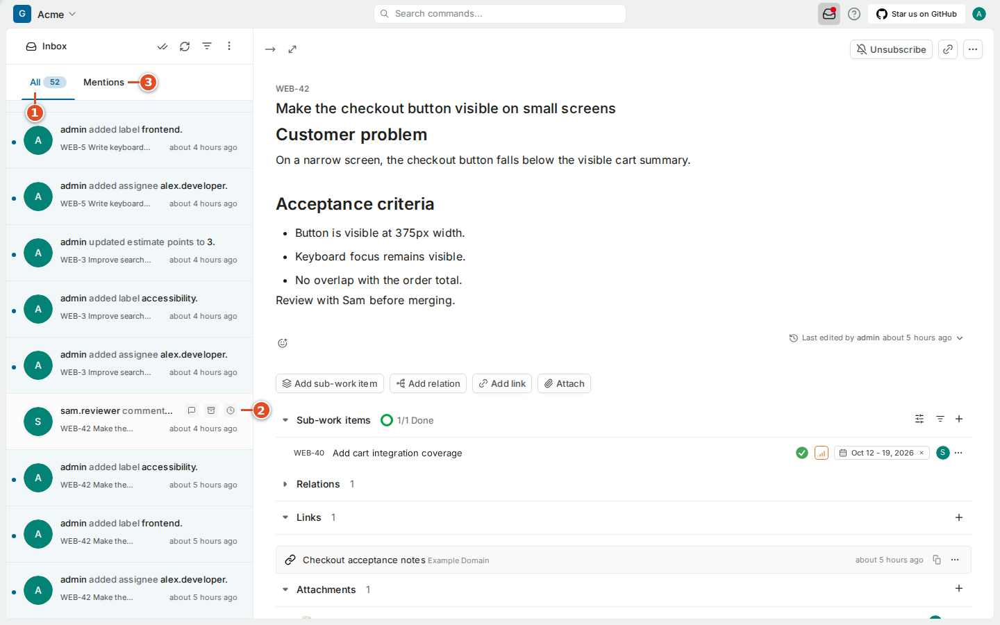

# 07 · Notifications

The **inbox** helps you notice relevant changes without rereading every item in every project. A notification usually needs one of three responses: read it for context, answer a question, or take on a next action. Opening it is only the first step; decide which response it needs.

This chapter covers the inbox, mentions, subscriptions and email, and how git-sync's automatic updates show up among your notifications.

## 7.1 Open the inbox

The inbox control is in the top bar; the shortcut is **G then X**. Your notifications depend on your assignments, subscriptions and activity, so your list differs from a teammate's.

### Goal: deal with today's notifications

**Steps**

1. Select the inbox icon in the top bar.
2. Check the selected category, for example **All** ①, or switch to **Mentions** ③.
3. Open a notification, such as Sam's comment ②.
4. Read the work item and the surrounding discussion.
5. Respond on the work item if a response is needed.

**Result:** you have read the update in context and answered where needed.

A notification can describe something that has since changed again. Read the current work item before acting on an old state or assignment. If someone has already answered a question, a short acknowledgment is more helpful than repeating the answer.

Use the inbox's read, archive and filter controls as labelled on your account. Marking a notification read does not complete the work item. An archived notification and an archived work item are different things. If a notification disappears, check the inbox category and filters before assuming the item was deleted.

## 7.2 Notifications that come from git-sync

git-sync changes Plane through a **service account**, the bot user your administrator created for it. Its changes are ordinary Plane changes, so they produce ordinary notifications. On items you are assigned to or subscribed to, expect notifications like these:

| What happened on GitHub | What you see in Plane |
|---|---|
| A branch named after the item was pushed, or a PR was opened | State changed to **In Progress** |
| A review was requested on the PR | State changed to **In Review** |
| The PR was merged into `main` | State changed to **Done** |
| A commit contained `WEB-42 #comment …` or `#time …` | A new comment with a "via `<commit>` by `<login>`" line |
| A new comment on a mirrored GitHub issue | A new comment beginning "**login** commented on GitHub:" |
| A PR, build, deployment or preview changed | A development link was added or updated (`[PR]`, `[CI]`, `[Deploy]`, `[Preview]`, `[Branch]`) |

These are the shipped defaults; your administrator may have changed the rules (chapter 14). The actor shown for these changes is the git-sync service account, not you, even when you made the commit. Plane-side writes are made by that account.

> **Tip:** If you receive many property-change emails because of automatic state changes, turn off **Property changes** email (section 7.4) but keep **State change** and **Work item completed**. You will still hear when your item reaches Done.

> **Note:** A busy PR can update its `[PR]` link several times: when it opens, when reviews arrive and when it merges. That is git-sync keeping the link current, not a fault.

## 7.3 Mentions are requests for attention

A **mention** directs a comment or description at a specific person. Type `@` in a supported editor and pick the person from the suggestions. Give enough context for them to answer without redoing your investigation.

> **Example:** "@Alex, should the button keep its full translated label at 320 pixels, or may it wrap onto two lines?" asks for a decision. "@Alex, please look" does not say what decision is needed.

Typing someone's name without selecting it from the list does not create a mention. Use mentions sparingly so they stay meaningful; if something is urgent, use the priority and your team's normal process.

> **Note:** On mirrored issues, git-sync translates mentions. A GitHub `@sam-reviews` in an issue comment becomes a real Plane mention of Sam if Sam's GitHub account is linked to Sam's Plane account (chapters 8 and 27). If the GitHub login is not linked to anyone, git-sync keeps it as a link to the GitHub profile instead of guessing who it is. Linking your GitHub account is how you make sure GitHub mentions reach your Plane inbox.

## 7.4 Subscribe to work you need to follow

**Assignment** says who is responsible. **Subscription** says who wants updates. You can subscribe to a dependency, a review or a cross-team change you are not implementing.

### Goal: follow an item without being assigned

**Steps**

1. Open the work item.
2. Select **Subscribe** near its header.
3. Check that the button now reads **Unsubscribe**.

**Result:** you receive notifications for the item's changes.

To stop, select **Unsubscribe**. That does not unassign you or remove your comments. When you follow several dependencies, a saved view (chapter 5) gives you one place to check them together.

## 7.5 Understand email notifications

Personal **Settings → Notifications** has email categories for property changes, state changes, work-item completion, comments and mentions.

### Goal: tune which notifications reach your mailbox

**Steps**

1. Open personal **Settings** and select **Notifications**.
2. Turn the property-change switch ① on or off.
3. Review **State change**, **Work item completed** and **Comments**.
4. Keep the **Mentions** switch ② on.

**Result:** email arrives only for the categories you kept.

Email also needs the server's mail configuration. The handbook's test instance had no mail server, so mailbox delivery was not tested there; the preference controls and in-app notifications were.

**If it went wrong:**

- *An expected email is missing* → first check that the event appears on the work item. Then check your subscription, your preferences and your mailbox filters. If the event is there but mail never arrives, send an administrator one concrete example: item identifier, approximate time and expected category. Never include a password or token.
- *An expected git-sync change never happened at all* → it is not a notification problem. See chapter 17.

## 7.6 Keep notification habits sustainable

A suggested habit: check direct questions before starting a long coding session, and again before you stop for the day. When you hand work over, leave a comment with the next action. A teammate in another timezone should be able to see what you checked, what is still uncertain and who needs to decide.

The inbox is a prompt to return to the shared record. Keep the decision on the work item, the code discussion on the PR, and a link between them; git-sync maintains that link for you when the PR mentions the key. Then the next developer can reconstruct what happened long after the notification has been read.

## What you learned

- The inbox (**G then X**) collects notifications; reading one is not the same as handling the work.
- git-sync's state changes, comments and development links arrive as normal notifications from the service account.
- Mentions on mirrored GitHub issues reach you only if your GitHub account is linked to your Plane account.
- Subscription and assignment are different; email categories control only what reaches your mailbox.

## Source files

- Plane CE v1.4.2 web application (`apps/web/`), observed in the running test instance
- `src/sync/text.ts` (mention and comment translation)
- `src/github/smart-commits.ts` (comment provenance line)
- `src/github/pr-automation.ts` (shipped state rules)
- `src/sync/dev-info.ts` (development links)
