# 08 · The four connections and your GitHub account

Your Plane account tells the team who owns work. Your GitHub account tells the team who changes code. git-sync connects the two, but only after several separate connections are in place. Most confusion with the integration comes from mixing these connections up: "I connected GitHub" can mean four different things, managed by three different people.

This chapter first explains all four connections, so you know which ones are your job and which ones belong to an administrator. It then walks through the one connection every developer makes personally: linking **your** GitHub account on the **My GitHub account** page.

## The four connections

Think of the integration as a chain. Each link must exist before the next one is useful.

| # | Connection | Who sets it up | Where | What it gives |
|---|---|---|---|---|
| 1 | The **GitHub App** is registered and installed on a GitHub organization or personal account | A GitHub organization owner (install) and the Plane instance admin (registration in God mode) | GitHub, then **God mode → GitHub Sync** | git-sync may read and write the repositories the installation covers |
| 2 | That *installation is connected to one Plane workspace* | A workspace admin, sometimes with a link sent to an organization owner | **Workspace settings → GitHub Sync → Workspace GitHub connection** | The workspace may use that installation. One installation belongs to exactly one workspace. |
| 3 | A *repository is mapped to a Plane project* | A workspace admin | **Workspace settings → GitHub Sync → Map a repository** | Events from that repository reach that project, with its rules, policies and Smart Commit setting |
| 4 | *Your Plane user is linked to your GitHub account* | You (or an admin on your behalf) | **My GitHub account** | git-sync recognizes you as the same person on both sides |

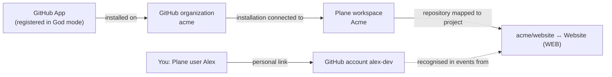

*Diagram: the four connections. Connections 1–3 are shared team configuration; connection 4 is personal.*

A few consequences are worth stating plainly:

- Connecting your personal account (4) **cannot** give git-sync access to a repository. Access comes only from the App installation (1). If your repository is missing, linking again will not help; ask an admin.
- One installation is connected to **one** workspace (2). If an organization's installation is already connected to another Plane workspace, the connection screen says **That installation is connected to another workspace.** An instance admin must move it deliberately.
- A repository that is not mapped (3) produces no links, no Smart Commits and no automation, even if you are linked and the App is installed. The Development panel says **No GitHub repository is mapped to this project.**
- Your link (4) is per workspace. If you work in two Plane workspaces, connect in each.

> **Admin only:** Connections 1–3 are described in Part B: [Register the GitHub App](22-github-app.md), [God mode settings](23-god-mode.md) and [Connect GitHub & map repositories](24-connect-and-map.md). As a developer you never need the App's private key, webhook secret or client secret. If someone asks you to paste one into a work item or chat, stop and ask your admin.

## Find the My GitHub account page

The page is called **My GitHub account**. Its route is:

```text
https://<your Plane address>/git-sync/ui/workspaces/<workspace slug>/account
```

For the demo workspace in this manual that is `https://plane.example.com/git-sync/ui/workspaces/acme/account`. The *slug* is the short workspace name in your Plane URLs (the part after the host, for example `acme` in `https://plane.example.com/acme/projects/`). The page uses your existing Plane session; it is not a separate sign-up site.

### The navigation wrinkle: members do not see the GitHub Sync menu

The Plane fork adds **GitHub Sync** to **Workspace settings**, but that settings entry is restricted to workspace **admins**. Plane hides it from ordinary members, and the admin pages behind it refuse members. If a member opens the workspace's admin page directly, git-sync refuses:

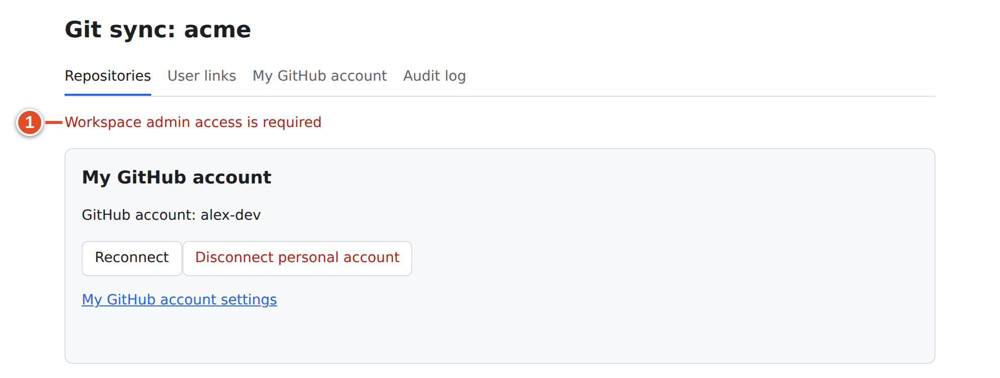

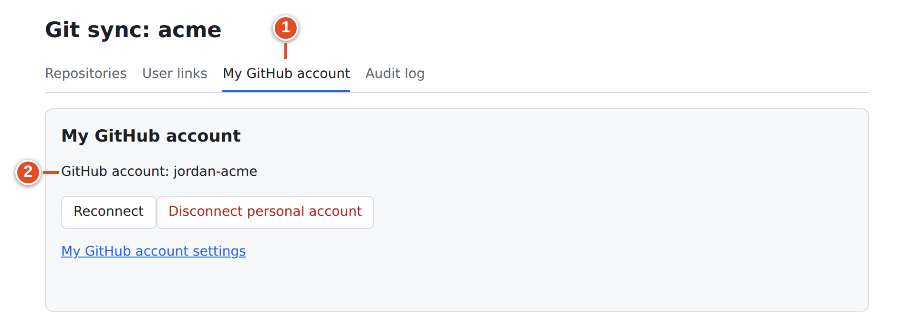

The personal account page itself is open to every workspace member. So:

1. Ask your admin for the direct **My GitHub account** link (or build it from the pattern above).
2. Bookmark it. You will need it again if your authorization expires or you change accounts.

Admins see the same card in two places: on the **My GitHub account** tab of **Git sync: &lt;slug&gt;** and at the top of the **Repositories** tab.

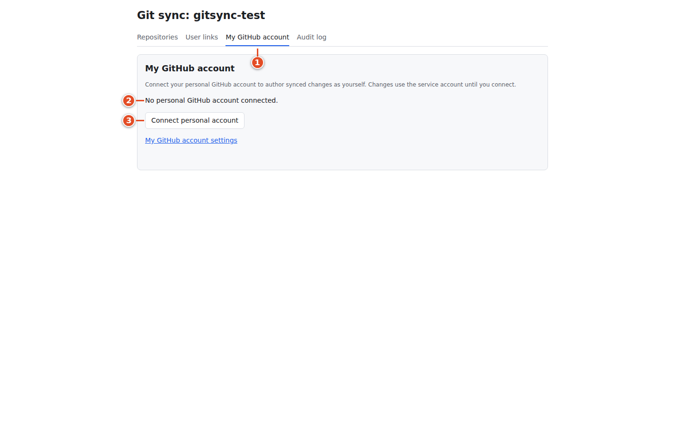

## The states of the My GitHub account card

The card always shows one of these states. The wording is exactly what you will see.

| State | What the card says | What it means |
|---|---|---|
| Not connected | **No personal GitHub account connected.** with the hint "Connect your personal GitHub account to author synced changes as yourself. Changes use the service account until you connect." | No link exists for you in this workspace |
| Connected | **GitHub account:** followed by your login | A link exists, keyed by your GitHub account's stable numeric ID |
| Needs re-authorization | **Needs re-authorization. Reconnect your GitHub account to author changes as yourself.** | The link exists, but GitHub refused or could not refresh the stored token |
| OAuth not configured | **The instance admin must configure the GitHub App OAuth credentials.** (the button is disabled) | The App's client ID and secret are not set in God mode |
| Not a member | **Personal account settings need workspace membership.** | You are signed in to Plane but not a member of this workspace |

The buttons are **Connect personal account** (when not connected), **Reconnect** (when connected or needing re-authorization) and **Disconnect personal account**.

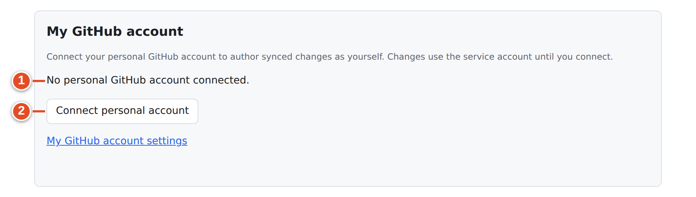

## Connect for the first time

### Goal: link your Plane user to your GitHub account

**Before you start:**

- An admin has completed connections 1–3 (the App is installed, connected to the workspace, and at least one repository is mapped). You can still link before mapping, but nothing will happen yet.
- You are signed in to Plane in the intended workspace.
- In the same browser, you are signed in to GitHub with the account your team expects. Many people have a personal and an employer account; GitHub's authorization page shows which one is being used. Your local `git config user.email` does **not** choose the account.

**Steps**

1. Open your **My GitHub account** link. The card shows **No personal GitHub account connected.** ①
2. Select **Connect personal account**. ②
3. Your browser leaves Plane and opens GitHub's authorization page. This full-page navigation is expected (the page cannot authorize inside Plane's frame).
4. On GitHub, check the account name shown, then approve the authorization.
5. GitHub sends you back to the **My GitHub account** page.

[[SCREENSHOT NEEDED: gh-03-oauth-consent — GitHub's authorize screen during Connect personal account (needs a signed-in GitHub browser session). Capture later with npm run manual:capture -- --only gh-03-oauth-consent]]

**Result:** the page shows the green notice **Your personal GitHub account is connected.** and the card shows **GitHub account:** with your login.

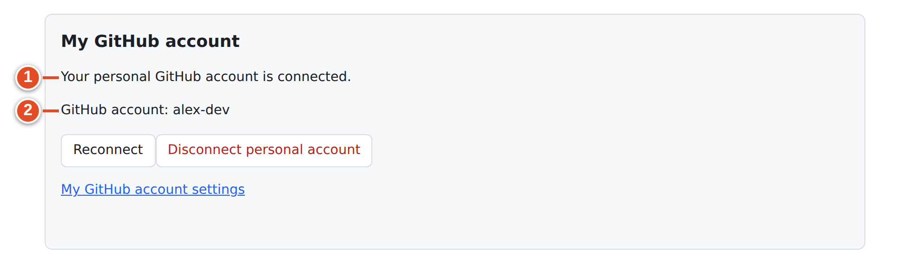

Later visits show the card without the notice:

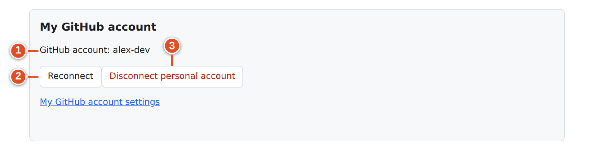

**If it went wrong:** see [Connection errors](#connection-errors) below.

### What happens behind the button

- git-sync creates a single-use, expiring connection link bound to your Plane user (with PKCE, so the code GitHub returns is useless to anyone else).
- After you approve, GitHub returns a code; git-sync exchanges it for a user token and asks GitHub who you are.
- It stores your GitHub login *and its stable numeric account ID*. The ID is what counts: if you later rename your GitHub account, the link still points at the same account, and nobody who later takes your old username inherits your link.
- The GitHub token is stored encrypted. git-sync refreshes it automatically when GitHub issues expiring tokens.
- If an admin previously unlinked you, connecting again lifts that block.

### Other ways a link can be created

- *An admin links you* on the **User links** page (Part B, [User links](27-user-links.md)). The admin types your GitHub login; git-sync checks it with GitHub and stores the numeric ID. No token is stored in that case, so the link identifies you but cannot act as you on GitHub.
- **Automatic email match.** When an event comes from a GitHub user who is not linked, and that user's *public* GitHub email exactly matches the email of exactly one workspace member, git-sync links them and records **Account matched by email** in the audit log. Disconnecting yourself (below) prevents this from re-linking you automatically.

## What your link changes — and what it does not

Being precise here saves a lot of "why does it say the bot did this?" questions.

**Your link lets git-sync recognise you.** Events from GitHub carry an authenticated `sender` (the GitHub account that caused the event). With your link, git-sync can map that sender to your Plane user. This is used for:

- Smart Commit provenance: comments end with "via `<sha>` by `<your login>`".
- Translating GitHub `@mentions` and assignees on mirrored issues into Plane users (an unmapped login in a mention becomes a GitHub profile link; an unmapped assignee is simply dropped).
- Deciding whether problem reports may contain details (some reports are only shown in full to linked members).
- The repository picker an admin sees when mapping repositories (it lists repositories *their* account can access).
- The `{username}` placeholder in a branch-name template, if your team uses one.

**Changes that go from Plane to GitHub can be authored as you.** When you change a mirrored Plane work item, and your stored GitHub token works for that repository, git-sync writes the GitHub side with your token. If the token is missing, expired beyond refresh or refused, it falls back to the App's own identity (`<app-slug>[bot]`). Some steps, such as link-back comments, always come from the App.

**Changes that go from GitHub to Plane appear as the git-sync service account in this release.** The code can write to Plane as an individual user only when it holds that user's *Plane* personal access token (PAT). No screen in this release stores one, so every Plane comment, state change, link and mirrored item created by git-sync shows the service (bot) user as its author. The audit log records this as **Service account attribution** with the reason `no_stored_token`. This is expected behavior, not a failure. The provenance line in Smart Commit comments tells readers who really did it.

> **Note:** A Plane PAT and your GitHub link are two separate credentials. Linking GitHub does not create a Plane PAT, and the member account page has no field for one. Never paste a Plane PAT (or any token) into a commit, comment, chat or screenshot.

> **Example:** Alex pushes `WEB-42 #comment Checked at 320, 375 and 390 px widths`. In Plane the comment appears under the git-sync service user and ends with "via 3b2335d by alex-dev". Sam then edits the title of a mirrored Plane item; because Sam's GitHub token works, the GitHub issue's history shows `sam-reviews` made the edit.

## Reconnect when the card says Needs re-authorization

GitHub can refuse a stored token: you revoked the authorization on GitHub, an organization policy changed, or the refresh token expired. git-sync then marks your link and the card shows:

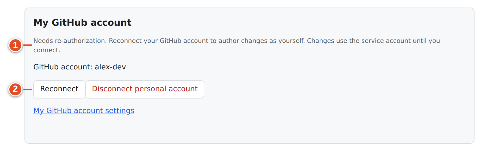

The three states side by side:

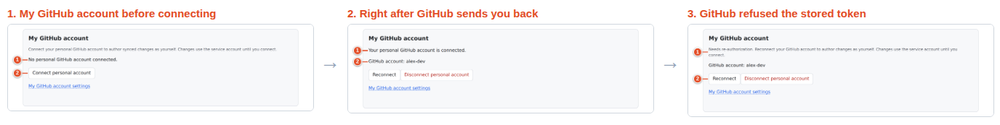

### Goal: restore a working authorization

**Steps**

1. Open **My GitHub account**. The card shows **Needs re-authorization. Reconnect your GitHub account to author changes as yourself.** ①
2. Select **Reconnect**. ②
3. On GitHub, check the account and approve.
4. Back on the card, confirm **GitHub account:** shows your login and the notice is gone.

**Result:** the same link is kept (same numeric ID) with a fresh token.

While the notice is shown, nothing breaks: git-sync keeps recognizing you as the event sender, and GitHub writes fall back to the App identity. The admin's **User links** page shows the same flag next to your name.

> **Tip:** Reconnecting with a *different* GitHub account replaces your link with that account, if it is not linked to someone else in the workspace.

## Disconnect your personal account

Disconnecting is a personal action. It is different from the **Disconnect** button on an organization card in **Workspace GitHub connection**, which an admin uses to disconnect the whole installation and disables its mappings.

### Goal: remove your personal link

**Steps**

1. Open **My GitHub account**.
2. Select **Disconnect personal account**.
3. Read the confirmation: "Disconnect your GitHub account? Synced writes will use the service account until you reconnect." ① Confirm. ②
4. The card returns to **No personal GitHub account connected.**

Your browser shows this confirmation (text recorded from the running UI):

> **Note:** “Disconnect your GitHub account? Synced writes will use the service account until you reconnect.” Choose **OK** to disconnect or **Cancel** to keep the link.

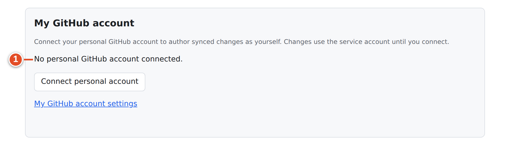

**What disconnect does:**

- Asks GitHub to revoke the authorization (best effort; if GitHub cannot be reached, the local token is deleted anyway).
- Deletes your stored GitHub token. Tokens are stored per Plane user, so this also ends personal GitHub authorship in your other workspaces until you connect again.
- Removes your link in this workspace.
- Records that you unlinked, so the automatic email match does not silently link you again.

**What disconnect does not do:** it does not delete branches, commits, PRs, comments, links on work items, or repository mappings. Your future events are simply treated as coming from an unmapped GitHub user. To stop the whole team's integration, ask a workspace admin.

## Connection errors

When the OAuth round trip fails, GitHub sends you back with an error, and the page shows one of these notices. The text is exact.

| Notice on the page | Cause | What to do |
|---|---|---|
| This connection link has expired, was already used, or belongs to another Plane account. Start again. | The single-use link timed out, was reused (for example the back button), or you returned signed in as a different Plane user | Select **Connect personal account** again in the right Plane session |
| GitHub authorization was declined. You can connect again when ready. | You pressed **Cancel** on GitHub | Connect again when ready |
| GitHub authorization could not be completed. Start again. | The code exchange with GitHub failed | Try once more; if it repeats, send the admin the time and this message |
| This GitHub account is already linked to another member in this workspace. | Another Plane user in this workspace is linked to that GitHub account | Check you used the right GitHub account; otherwise ask an admin to inspect **User links** |
| Ask the instance admin to configure the GitHub App client ID, client secret and App slug. | OAuth is not configured for the App | Ask the instance admin (God mode → GitHub App) |
| GitHub could not complete the connection. Check your account access and try again. | GitHub refused the user lookup after authorization | Retry; check your GitHub account is in good standing |
| The connection could not be completed. Try again; ask an instance admin to check the service if it keeps failing. | Unexpected server error | Retry once, then report |
| Personal account settings need workspace membership. | You are not a member of this workspace | Ask for membership or open the right workspace's link |

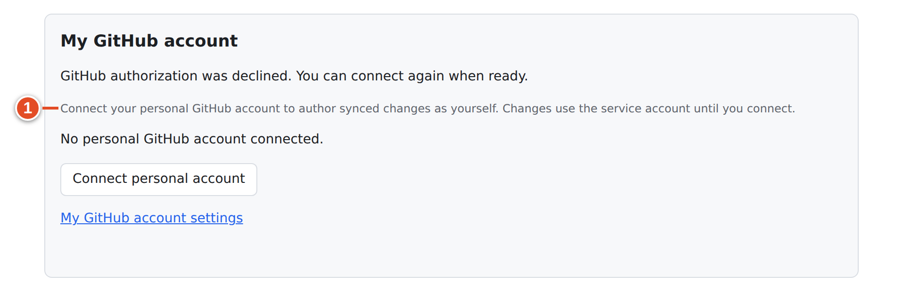

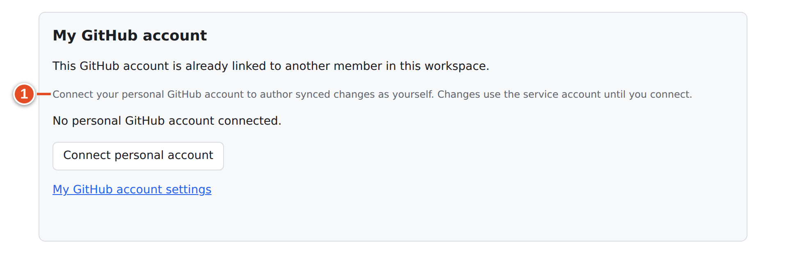

If linking succeeds but your repository still does not sync, the problem is in connections 1–3, not in your link. Give your admin the repository name, the work item key and what you expected to happen.

## A first-day example

Riley joins the `acme` workspace. Riley's admin sends the link `https://plane.example.com/git-sync/ui/workspaces/acme/account`. The card says **No personal GitHub account connected.** Riley selects **Connect personal account**, checks that GitHub shows `riley-codes`, and approves. Back in Plane the notice **Your personal GitHub account is connected.** appears.

Later that week Riley's push contains `WEB-30 #comment Draft layout pushed`. The comment appears on WEB-30 under the git-sync service user, ending with "by riley-codes". Sam, the reviewer, has their own link; Riley's link does not map anyone else.

## What you learned

- There are four connections: App installation, installation ↔ workspace, repository ↔ project, and your personal link. Only the last one is yours.
- Members reach **My GitHub account** through a direct link, because the **GitHub Sync** settings menu is admin-only.
- The link stores your GitHub account's stable numeric ID; **Reconnect** refreshes authorization and **Disconnect personal account** removes the link and the token.
- Plane-side changes made by git-sync show the service account as author in this release; GitHub-side mirror writes can be authored as you.
- Each OAuth error notice tells you exactly which step failed.

## Source files

- `src/ui/client/Connect.tsx` — the My GitHub account card, notices and buttons
- `src/ui/oauth-flow.ts` — start, callback, disconnect, revoke
- `src/auth/github-user.ts` — OAuth exchange, token refresh, `needs_reauth`
- `src/auth/identity.ts`, `src/app/identity.ts` — sender → Plane user, email auto-match
- `src/ui/install-flow.ts` — installation ↔ workspace connection
- `src/app/context.ts`, `src/sync/mirror.ts`, `src/sync/github.ts` — attribution (service account, `asUser`)
- `packages/constants/src/settings/workspace.ts` — admin-only **GitHub Sync** settings entry
