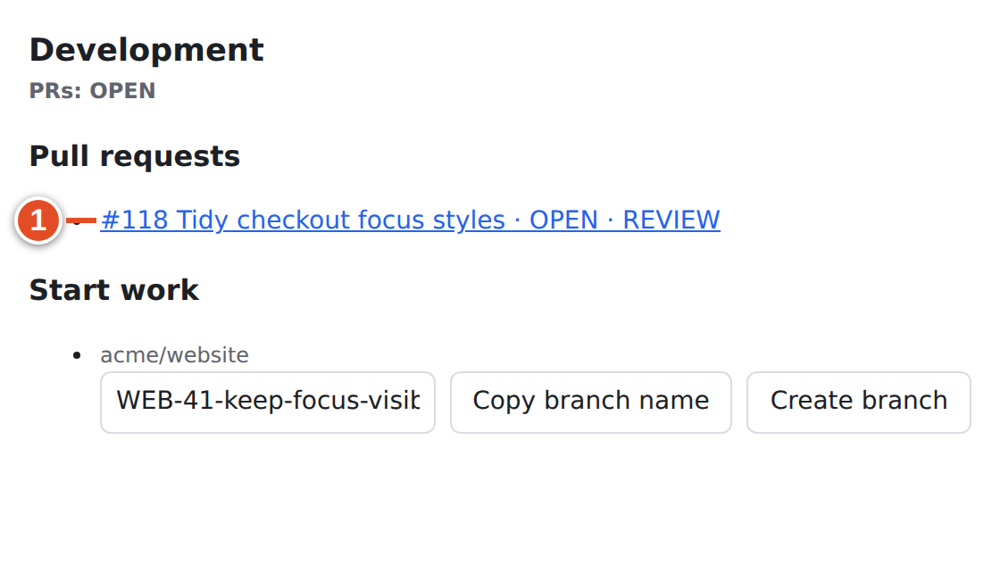
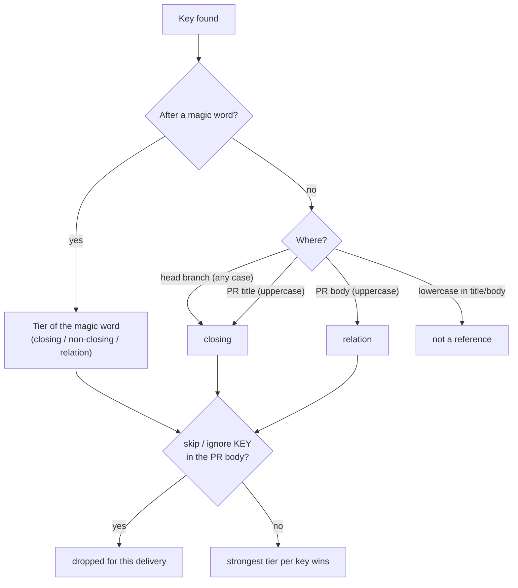
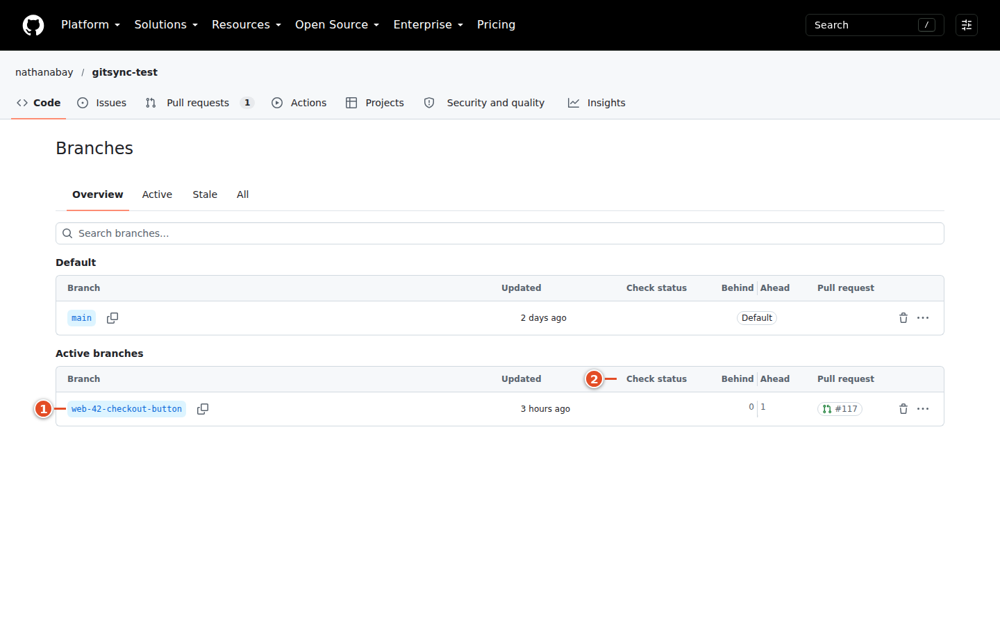

# 09 · Linking branches, commits and pull requests

A work item's key is its short address in code discussions. `WEB-42` means work item 42 in the project whose identifier is `WEB`. When you put that key in a branch name or a pull request, git-sync links the code to the task: the PR shows up in the work item's **Development** panel, a link-back comment appears on GitHub, and the team's automation rules can move the item through its states.

This chapter explains exactly where git-sync looks for keys, how strong each kind of reference is, and how to avoid accidental links. [Chapter 10](10-magic-words.md) covers the magic words and `WEB-NEW` in detail, and [chapter 11](11-smart-commits.md) covers commands inside commit messages.

> **Note:** Everything here applies only to repositories an admin has mapped to a Plane project. In an unmapped repository nothing is scanned.

## The key format

A key is a project prefix, a hyphen and a number:

- The **prefix** starts with a letter, followed by 1–11 letters or digits (so it is 2–12 characters long): `WEB`, `API2`, `MOBILEAPP`.
- The **number** is decimal digits. Leading zeros are dropped: `WEB-0042` is `WEB-42`.
- A key must not start right after a letter or digit, and must not be followed directly by a letter, digit or underscore.

| Text | Result |
|---|---|
| `WEB-42` | Key `WEB-42` |
| `API2-103` | Key `API2-103` |
| `WEB-0042` | Key `WEB-42` |
| `feature/WEB-42-login` | Key `WEB-42` (slash and following hyphen are fine boundaries) |
| `X-42` | Ignored: the prefix is only one character |
| `WEB_42` | Ignored: underscore instead of hyphen |
| `WEB-42more` | Ignored: a letter follows the digits |
| `WEB-42_extra` | Ignored: an underscore follows the digits |
| `42-WEB` | Ignored: wrong order |

Recognizing the shape is only the first step. git-sync then asks Plane whether the work item exists in the workspace. A key with the right shape that does not exist (for example `WEB-999`) is not linked; see [Unknown keys](#unknown-keys) below.

### Prefixes that are never keys

Some technical abbreviations look like keys (`SHA-256`, `UTF-8`, `RFC-7231`). git-sync ignores these prefixes everywhere, even after a magic word:

`UTF`, `SHA`, `ISO`, `AES`, `RSA`, `CVE`, `CWE`, `RFC`, `TLS`, `SSL`, `MD`, `ES`, `PEP`, `USB`, `HTTP`, `IPV`, `SSH`, `GPT`, `RS`, `CRC`, `UTC`, `WIN`.

If your project's identifier is one of these, its keys will never link. Ask an admin to choose a different project identifier.

## Where git-sync looks

Different places are scanned with different rules. Two properties matter: whether a **bare** key (one without a magic word in front) must be uppercase, and what **tier** a bare key gets.

| Where | Bare key must be uppercase? | Tier of a bare key | Used for |
|---|---|---|---|
| PR **head branch** name (the branch with your changes) | No — `web-42-fix` works | **Closing** | PR links; branch pushes |
| PR **title** | Yes | **Closing** | PR links |
| PR **body** (description) | Yes | **Relation** | PR links |
| **Commit message** | Yes | **Relation** | Smart Commits and push rules only — never PR links |
| A key right after a **magic word** (anywhere above) | No — `Refs web-42` works | The magic word's tier | As for the place it appears |

Some practical consequences:

- **The PR handler reads only the head branch, the title and the body.** It does not read the PR's commits. A key that appears only in a commit message never links the PR to the item. Put the key in the branch name or the PR itself.
- The **base** branch (where the PR merges into, such as `main`) is never scanned for keys. Admin rules can *inspect* the base branch (for example "merged into `staging`"), but that is a condition, not a reference.
- The scan is plain text. Markdown code blocks, quotes and links are still text: a pasted example containing `WEB-99` in a PR body creates a relation to WEB-99.

```text
Branch:   feature/web-42-login        → WEB-42, closing
Title:    WEB-42 Improve login        → WEB-42, closing
Title:    web-42 Improve login        → nothing (bare lowercase in a title)
Body:     Related discussion WEB-42   → WEB-42, relation
Body:     Related discussion web-42   → nothing (bare lowercase in a body)
Body:     Refs web-42                 → WEB-42, non-closing (magic word)
Commit:   WEB-42 tidy CSS             → push rules only; no PR link
```

<!-- grammar:references -->

| Text | Where | Result (real parser) | Why |
|---|---|---|---|
| `WEB-42-checkout-button` | branch | WEB-42 (closing) | bare key in a branch |
| `feature/web-42-login` | branch | WEB-42 (closing) | branch keys are case-insensitive |
| `WEB-42 Keep the checkout button visible` | title | WEB-42 (closing) | bare key in a PR title |
| `Closes WEB-42` | body | WEB-42 (closing) | closing magic word |
| `Refs WEB-41` | body | WEB-41 (non-closing) | non-closing magic word |
| `Relates to WEB-40` | body | WEB-40 (relation) | relation magic word |
| `See WEB-40 for context` | body | WEB-40 (relation) | bare uppercase key in a body |
| `Closes WEB-42, WEB-43 and API2-7` | body | WEB-42 (closing); WEB-43 (closing); API2-7 (closing) | several keys after one word |
| `Closes: WEB-42` | body | WEB-42 (closing) | optional colon, then a space |
| `Closes:WEB-42` | body | WEB-42 (relation) | no space after the colon: only the bare key counts |
| `X-42 WEB_42 WEB-42more 42-WEB` | body | no reference | not keys |
| `UTF-8 SHA-256 CVE-2024` | body | no reference | deny-listed prefixes |
| `Closes WEB-42⏎skip WEB-42` | body | skipped: WEB-42 | skip removes the key from this parse |

<!-- /grammar -->

## The three tiers

Each reference has a **tier**, which says how much automation it allows. The tier is separate from the work item's state; it decides which rule actions may change that state.

| Tier | Plain meaning | Typical wording | Can automation change the item's state? |
|---|---|---|---|
| **Closing** | This code finishes the item | `Closes WEB-42`, a key in the branch or title | Yes, including the "merged" step — but only when every linked PR is merged or closed (the merge guard, [chapter 14](14-pr-automation.md)) |
| **Non-closing** | This code is part of the work | `Refs WEB-42`, `Part of WEB-42` | Yes for every step **except** "merged" |
| **Relation** | Useful context only | `Relates to WEB-42`, a bare key in the body | Never |

The gate applies only to *state changes*. If an admin writes a rule that also comments, adds a label or assigns someone, those actions run for every tier. All three tiers show the PR in the Development panel.

The demo run shows the difference. PR #118 says `Refs WEB-41`; opening it moved WEB-41 to **In Progress** (non-closing allows the "opened" step). PR #119 says `Relates to WEB-40`; WEB-40 stayed in **Todo**. Both items still list their PR:



### When the same key appears several times, the strongest wins

git-sync collects every reference in the branch, title and body, then keeps **one** tier per work item: closing beats non-closing, which beats relation. If two references have the same tier, the record notes where it came from, preferring branch, then title, then body, then commit. That preference is bookkeeping only; it never makes a weaker tier win.



*Diagram: how one key becomes a reference with a tier.*

> **Warning:** A bare key in the branch name is already **closing**. If a PR should only contribute part of an item, writing `Refs WEB-42` in the body is not enough when the branch is `web-42-part-one`: the branch's closing reference wins. Use a branch without the key, such as `checkout-layout-part-one`, and `Refs WEB-42` in the title or body.


## Link a pull request to a work item

### Goal: a PR that shows up on WEB-42 and finishes it when merged

**Before you start:** the repository is mapped to the project (the Development panel shows a **Start work** section, not "No GitHub repository is mapped to this project.").

**Steps**

1. Create your branch with the key in it. The easiest way is **Copy branch name** or **Create branch** in the work item's **Development** panel ([chapter 12](12-development-panel.md)), which gives `WEB-42-make-the-checkout-button-visible-on-small-screens`.
2. Push your commits.
3. Open the pull request on GitHub. Put the key in the title, for example `WEB-42 Keep the checkout button visible on small screens`. ①
4. In the body, state the intent on its own line: `Closes WEB-42`. ②
5. Check the branch, title and body for keys you did *not* mean to link.
6. Create the PR, then open WEB-42 in Plane and look at **Development**.


**Result:**

- The work item's **Development** panel lists the PR under **Pull requests** with its status (for example `OPEN · REVIEW`).
- A link titled `[PR] #121 WEB-42 Keep the checkout button visible on small screens · OPEN · REVIEW` is added to the item's links in Plane.
- If the mapping has **Post link-back comments on GitHub** turned on, git-sync comments on the PR once per newly linked item.
- The team's rules run. With the shipped defaults, opening a non-draft PR moves a closing or non-closing item to **In Progress**; a draft PR does the same.

The link-back comment text (verbatim from the demo run):

```text
Linked Plane work item:
- WEB-42: http://plane.example.com/acme/projects/bb57e81d-c161-441f-b50e-907af28f08c2/issues/53486230-16eb-4c87-afc4-ffeb2339a1a9
```

*Text git-sync posted to GitHub in the demo run.*

When a PR links several items at once, the heading becomes "Linked Plane work items:" with one line per item. The comment is posted only for links that are **new** in that delivery, so editing the PR does not repeat it.

[[SCREENSHOT NEEDED: gh-04-pr-linkback — A PR on GitHub with git-sync's 'Linked Plane work item' comment (needs a GitHub session and a live webhook). Capture later with npm run manual:capture -- --only gh-04-pr-linkback]]

**If it went wrong:**

- *Nothing in Development* → the key is lowercase in the title or body without a magic word, the key exists only in commits, or the repository is not mapped.
- *Linked, but the state did not change* → the reference is a relation, or your team's rules have no step for this event. The audit log (ask an admin) shows **Automation rule matched** entries.
- *Linked to the wrong item* → see [Removing a wrong link](#removing-a-wrong-link).

## Branches

A branch name is the strongest and most convenient place for a key: it is closing, case-insensitive, and used both for PR links and for branch pushes.

When you *push a new branch* whose name contains a key, git-sync:

- adds a `[Branch] <branch name>` link to the work item (shown under **Branches** in the Development panel);
- runs the "branch pushed" rule, which by default moves the item to **In Progress**. A new branch never moves an item that is already completed or cancelled back to In Progress.

A good convention is key first, then a short description: `WEB-42-sticky-checkout-button`. The Development panel suggests the team's configured name; see [chapter 12](12-development-panel.md).



## Commits

A key in a commit message does two things, and only two:

1. **Smart Commits** — if the line has a `#command` after the key, git-sync runs it ([chapter 11](11-smart-commits.md)).
2. **Push rules** — an admin may write rules for `push` or `commit.pushed_to_default` events; bare uppercase keys in commit messages are their targets (as relations, so they cannot change state).

A commit message never links a PR, and there is no "Commits" list in the Development panel. To see a PR's commits, open the PR on GitHub.

## Opting out: skip and ignore

In a PR **body**, `skip WEB-42` or `ignore WEB-42` removes WEB-42 from the result of that scan, wherever else it appeared (branch, title or body). The words are case-insensitive. Each phrase covers exactly one key; `skip WEB-42 WEB-43` skips only WEB-42.

```text
Closes WEB-42

This replaces the approach from WEB-17's spike.
skip WEB-17
```

Here WEB-17 is mentioned as context but not linked.

> **Warning:** `skip` only affects new scans. git-sync remembers links it has already made. Adding `skip WEB-42` (or deleting the key) after the PR was linked does **not** remove the stored link, and later events on the PR still reach WEB-42. Use `skip` in the PR body *before* you create the PR.

`skip` and `ignore` work only in the PR body. In a title or branch they are ordinary words.

## Unknown keys

If a reference has the right shape but no such work item exists in the workspace, nothing is linked. git-sync records **Work item reference not found** in the audit log. When the mapping has **Report problems as comments on GitHub and Plane** turned on, and the PR's sender is a linked member of the workspace, git-sync also comments once on the PR (the comment is edited in place, not repeated):

```text
WEB-99 does not match a work item in the linked Plane workspace, so this pull request is not linked to it.
```

The report is limited to linked members on purpose: otherwise anyone who can open a PR could probe which keys exist in your Plane workspace.

## Removing a wrong link

There is no button for developers to remove a link that git-sync has stored. Editing the PR text does not remove it either. If a PR is linked to the wrong item:

1. Tell your workspace admin the PR URL and the wrong key, before the PR is merged.
2. Meanwhile, avoid closing words for that key. A wrong *closing* link can move the wrong item to **Done** on merge.

## One PR, several items; several PRs, one item

**One PR, several items.** State the intent per item on separate lines:

```text
Closes WEB-42
Refs WEB-43
Relates to API-9
```

WEB-42 can complete on merge, WEB-43 moves along but does not complete, and API-9 only shows the PR. Check that the branch and title do not contain a closing key for WEB-43 or API-9.

**Several PRs, one item.** Each PR links on its own. The merge guard decides when the item may complete: at least one linked PR merged and none still open ([chapter 14](14-pr-automation.md)).

## What you learned

- Keys look like `WEB-42`; a fixed deny-list (`SHA`, `UTF`, `RFC` …) is never treated as keys.
- PR links come from the head branch (any case, closing), the PR title (uppercase, closing) and the PR body (uppercase, relation). Commits never link PRs.
- Tiers gate state changes: closing can complete on merge, non-closing moves but never completes, relation never changes state. The strongest tier per key wins.
- `skip KEY` / `ignore KEY` in the PR body prevents a link, but cannot remove one that already exists.
- Link-back comments and unknown-key reports appear on GitHub only when the mapping enables them.

## Source files

- `src/parse/references.ts` — key format, deny-list, scan rules, tiers, `skip`/`ignore`, `-NEW`
- `src/parse/magicWords.ts` — default magic words and tier order
- `src/app/pr.ts` — PR handler: sources scanned, stored links, link-back comment, unknown-key report
- `src/app/push.ts` — branch link on first push, Smart Commits, push rules
- `src/app/rules.ts`, `src/github/pr-automation.ts` — tier gating of `set_state`
- `tests/parse/references.test.ts`
