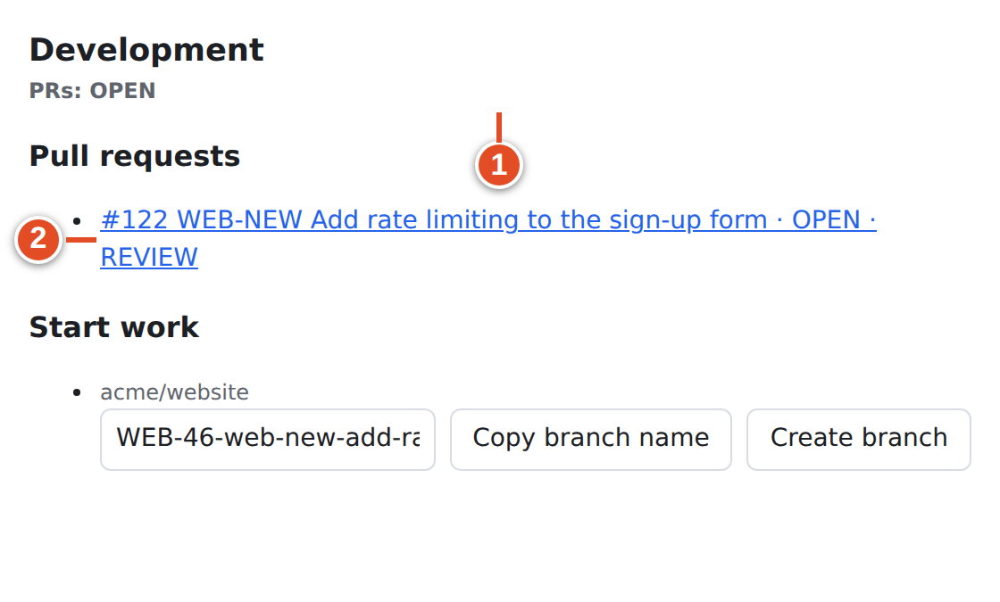

# 10 · Magic words and WEB-NEW

A **magic word** is a short phrase in front of a key that says how the code relates to the task: "this finishes it", "this is part of it", or "this is related". You already met the three tiers in [chapter 9](09-linking.md). Magic words are how you choose a tier deliberately, instead of relying on where a bare key happens to appear.

This chapter lists the shipped magic words, the exact grammar, how admins can change the lists, and the special `WEB-NEW` marker that creates a new work item from a pull request.

> **Note:** Magic words and Smart Commits are different tools. `Closes WEB-42` in a PR describes a relationship that rules act on later (for example on merge). `WEB-42 #done` in a commit message is a command that runs when the commit is pushed. See [chapter 11](11-smart-commits.md).

## The default magic words

These are the lists git-sync ships with (`src/parse/magicWords.ts`). Your instance admin can replace them; the God mode **Magic words** section shows the current lists.

| Tier | Default phrases |
|---|---|
| **Closing** (20) | `close`, `closes`, `closed`, `closing`, `fix`, `fixes`, `fixed`, `fixing`, `resolve`, `resolves`, `resolved`, `resolving`, `complete`, `completes`, `completed`, `completing`, `implement`, `implements`, `implemented`, `implementing` |
| **Non-closing** (7) | `ref`, `refs`, `references`, `part of`, `contributes to`, `toward`, `towards` |
| **Relation** (2) | `relates to`, `related to` |

Words that are *not* on the list, such as `see`, `addresses` or `for`, are just text. The key after them is then treated as a bare key, with the tier that its location gives it (closing in a branch or title, relation in a body).

## Grammar

A magic word matches when all of these hold:

1. The phrase is a separate word: no letter, digit or underscore directly before or after it. `unfixes WEB-42` does not contain the magic word `fixes`.
2. The phrase is case-insensitive: `CLOSES`, `Closes` and `closes` are the same. Words in multi-word phrases may be separated by any whitespace (`part  of`).
3. An optional colon may follow the phrase.
4. *At least one whitespace character* must come before the key. `Closes: WEB-42` works; `Closes:WEB-42` does not, because there is no space after the colon.
5. The key right after the phrase is case-insensitive: `Refs web-42` links WEB-42.

One phrase can cover several keys. Separate them with a comma, `and`, `, and`, `&` or plain whitespace:

```text
Fixes WEB-42, WEB-43 and API-9
Refs WEB-42 WEB-43
Relates to WEB-42 & API-9
Closes: WEB-42
```

Anything else between the phrase and a key breaks the phrase. In `Refs (WEB-42)` the parenthesis stops the phrase; WEB-42 is then a bare key, and its tier depends on where it is.

<!-- grammar:magic -->

| Tier | Default words and phrases (from `src/parse/magicWords.ts`) |
|---|---|
| closing | `close`, `closes`, `closed`, `closing`, `fix`, `fixes`, `fixed`, `fixing`, `resolve`, `resolves`, `resolved`, `resolving`, `complete`, `completes`, `completed`, `completing`, `implement`, `implements`, `implemented`, `implementing` |
| non-closing | `ref`, `refs`, `references`, `part of`, `contributes to`, `toward`, `towards` |
| relation | `relates to`, `related to` |

<!-- /grammar -->

> **Example:** `Closes:WEB-42` in a PR **title** still links WEB-42 as *closing*, but only because a bare uppercase key in a title is closing anyway. The same text in a PR **body** is just a bare key: a *relation*. This is a common surprise. Always put a space after the colon.

### Same key, several phrases

When a key is mentioned with different strengths, the strongest wins (closing > non-closing > relation). If the branch is `web-42-login` and the body says `Refs WEB-42`, the item is linked as **closing** because of the branch. A key that is already classified by a magic word is not counted a second time as a bare key: a title containing only `Refs WEB-42` stays non-closing.

## Choosing the right word

| You want to say | Write | Effect with the shipped rules |
|---|---|---|
| This PR finishes the task | `Closes WEB-42` (or the key in the branch/title) | Item moves to **In Progress** when the PR opens, **In Review** when review is requested, **Done** when merged into `main` |
| This PR is one part of the task | `Refs WEB-42` / `Part of WEB-42` | Item moves along with the PR, but merge never marks it **Done** |
| This PR is only related | `Relates to WEB-42` | Item shows the PR in Development; its state never changes |
| Do not link this key at all | `skip WEB-42` in the PR body | No link from this scan |
| There is no task yet | `WEB-NEW` in the PR title or body | git-sync creates the task (below) |

> **Tip:** Split work across lines so every key's intent is visible to reviewers:
> `Closes WEB-42` / `Refs WEB-43` / `Relates to API-9`.

## How admins change the lists

> **Admin only:** In **God mode → GitHub Sync → Magic words** there is one box per tier, one phrase per line, saved with **Save magic words**. The lists apply to the whole instance.

The validator refuses lists that would be ambiguous or unsafe:

- phrases must be lowercase letters and single spaces only, at most 40 characters;
- each tier must have between 1 and 100 phrases;
- a phrase may appear in only one tier. Otherwise saving fails with a message such as `"refs" is in both closing and non_closing`.

When your instance has custom words, the defaults in this chapter no longer apply. If you are unsure, ask the admin for the current lists, or check the **Magic words** screenshot in [chapter 23](23-god-mode.md).

## Create a work item from a pull request: WEB-NEW

Sometimes the code comes first: a quick fix, a dependency bump, a refactor someone asked for in a hallway. If your team accepts PR-first work, put `<PROJECT>-NEW` in the PR title or body. git-sync creates a new work item in that project and links the PR to it.

### Goal: create and link a new WEB item from a PR

**Before you start:** the repository is mapped to the project whose identifier you use (here `WEB`). Your team agrees PR-first items are acceptable.

**Steps**

1. Open a pull request whose **title or body** contains `WEB-NEW`. For example, title `WEB-NEW Add rate limiting to the sign-up form`. ①
2. Create the PR (or edit or reopen an existing one: the marker is checked on opened, edited and reopened events).
3. Open the Plane project. A new work item has appeared.

**Result:** in the demo run, PR #122 created WEB-46:



What git-sync does:

- The new item's *name is the PR title*, exactly as written (in the demo: "WEB-NEW Add rate limiting to the sign-up form"). Rename it in Plane afterwards if you like; the link stays.
- The item starts in a state from the project's **started** group (In Progress in the demo project).
- The PR is linked to the item with a **closing** link, so merging can complete it like any other closing PR.
- The PR body is not copied into the item's description.
- Repeated deliveries of the same PR do not create duplicates: one item per PR and project.

Rules for the marker:

- `NEW` must be uppercase. The project part may be any case: `web-NEW` works, `WEB-new` does not.
- Only the PR title and body are scanned; a branch called `WEB-NEW-…` or a commit message with `WEB-NEW` creates nothing.
- Prefixes on the deny-list (`SHA-NEW`, `RFC-NEW` …) are ignored.
- If no project has that identifier, nothing is created and the audit log records the failure ("no Plane project has the identifier …").

> **Warning:** Known defect in this release: for an item created by `WEB-NEW`, the link-back comment on GitHub names the project instead of the new key. The demo run posted:
>
> ```text
> Linked Plane work item:
> - WEB: http://plane.example.com/acme/projects/bb57e81d-c161-441f-b50e-907af28f08c2/issues/50b5ef6b-6077-4578-a943-8bb8db2d6cc9
> ```
>
> The URL points to the right item (WEB-46). Only the label is wrong. This is listed in [Appendix E](94-appendix-limitations.md).

> **Tip:** `WEB-NEW` names a project, not a number. If the task already exists, use its real key instead; otherwise you end up with a duplicate.

## Worked examples

Each row shows what the shipped word lists make of a piece of text, and where the text appears. "Bare" means the key is read without a magic word.

| Text | Where | Result |
|---|---|---|
| `Fixes WEB-42` | PR body | WEB-42, closing |
| `FIXES web-42` | PR body | WEB-42, closing (phrase and key are case-insensitive) |
| `Completing: WEB-42` | PR body | WEB-42, closing |
| `Part of WEB-42` | PR title | WEB-42, non-closing (the phrase wins over the bare-title rule for this occurrence) |
| `Contributes to WEB-42 and API-9` | PR body | WEB-42 and API-9, both non-closing |
| `Related to WEB-42, WEB-43` | PR body | WEB-42 and WEB-43, both relation |
| `Closes:WEB-42` | PR body | WEB-42, relation (phrase does not match; bare uppercase key in a body) |
| `Closes:WEB-42` | PR title | WEB-42, closing (bare uppercase key in a title) |
| `Refs (WEB-42)` | PR body | WEB-42, relation (parenthesis breaks the phrase) |
| `unfixes WEB-42` | PR body | WEB-42, relation (`fixes` is not a separate word) |
| `See WEB-42` | PR body | WEB-42, relation (`see` is not a magic word) |
| `Addresses WEB-42` | PR title | WEB-42, closing (bare key in a title) |
| `refs web-42` | PR body | WEB-42, non-closing |
| `web-42` | PR body | nothing (bare lowercase) |
| `Fixes SHA-256` | anywhere | nothing (deny-listed prefix) |
| `Refs WEB-42` with branch `web-42-part-one` | PR | WEB-42, closing (the branch is stronger) |

The generated tables in [Appendix C](92-appendix-grammar.md) run every such example through the real parser, so they always match the code.

> **Example:** A reviewer asks why WEB-43 moved to **Done** although the PR said `Refs WEB-43`. The title was `WEB-42 WEB-43 Checkout fixes`. Bare keys in a title are closing, and the strongest tier wins, so both items were closing. Writing the title without WEB-43 would have kept it non-closing.

## A preview of the merge guard

Closing words have one more safety net. When a PR merges, a closing item moves to **Done** only if **at least one** linked PR has merged and **none** is still open. A PR that was closed without merging neither blocks nor counts. If another linked PR cannot be read from GitHub, git-sync treats it as open, to be safe.

The guard is evaluated only at the moment of a merge. If WEB-36 has two PRs, merging the first one does not complete it (the second is open), and later closing the second PR *without* merging does not re-run the check. Close obsolete PRs before the final merge, or move the item by hand. [Chapter 14](14-pr-automation.md) shows this with screenshots.

## What you learned

- There are 20 closing, 7 non-closing and 2 relation phrases by default; admins can replace them per instance.
- A phrase is case-insensitive, may have a colon, and needs whitespace before the key (`Closes: WEB-42`, not `Closes:WEB-42`).
- One phrase can cover several keys separated by commas, `and`, `&` or spaces.
- `WEB-NEW` in a PR title or body creates a work item named after the PR title, in a started state, linked as closing.
- Closing words complete an item only when the merge guard passes.

## Source files

- `src/parse/magicWords.ts` — default lists and tier order
- `src/parse/references.ts` — magic-word regex, separators, colon rule, `-NEW` marker
- `src/ui/validate.ts` — magic-word validation (`parseMagicWords`)
- `src/app/pr.ts` — `createRequested` (WEB-NEW), merge guard input (`otherPrStates`)
- `src/github/pr-automation.ts` — merge guard on `set_state`
- `tests/parse/references.test.ts`, `tests/a8/grammar.test.ts`
