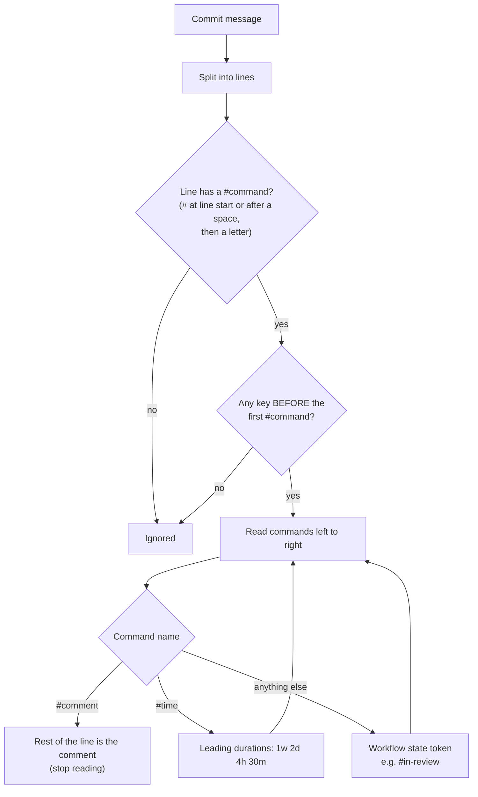
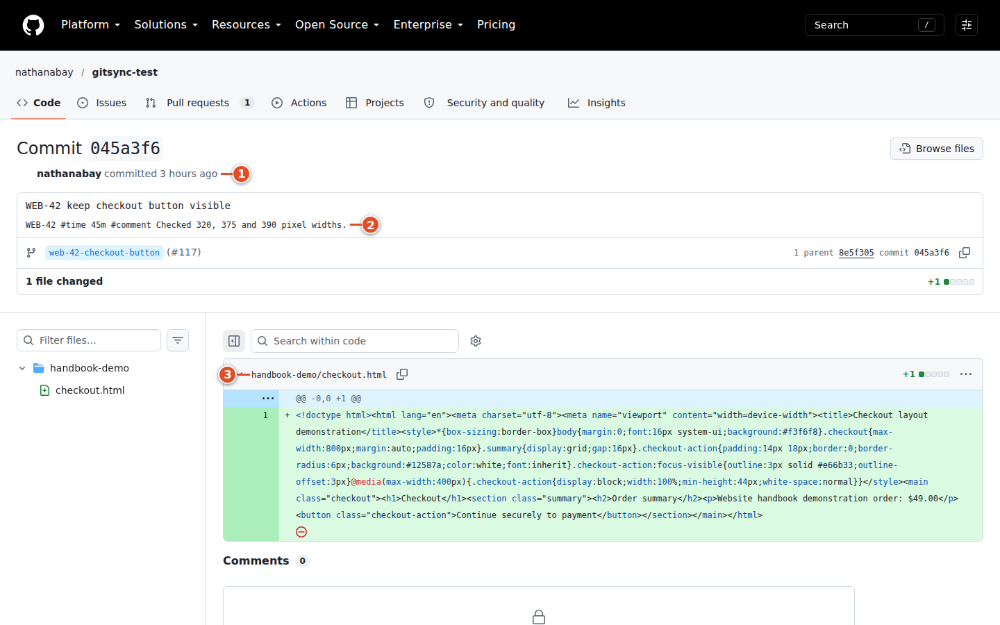

# 11 · Smart Commits

A **Smart Commit** is a command inside a commit message. When you push the commit to a mapped repository, git-sync reads the message and acts on the Plane work item: it adds a comment, records time, or moves the item to another state. You never leave the terminal.

```text
WEB-42 #in-review #time 45m #comment Ready for Sam to review
```

This one line moves WEB-42 to **In Review**, posts a "Time logged" note of 45 minutes, and posts the comment "Ready for Sam to review".

> **Admin only:** Smart Commits are switched on per repository mapping with the **Smart Commits** checkbox ([chapter 25](25-mapping-settings.md)). New mappings start with the instance default **Enable Smart Commits for newly mapped repositories** (on by default). If commands in your repository do nothing at all, check this setting first.

## The grammar in one picture



*Diagram: how git-sync reads one commit message.*

The rules, precisely:

1. **One line is one command context.** A command never continues onto the next line. Each line that should act needs its own key.
2. **Keys must come before the first command on that line.** Text before and between the keys can be ordinary prose: `Fix layout for WEB-42 #comment …` works.
3. **A command** starts with `#` at the beginning of the line or after whitespace, followed by a letter, then letters, digits, `_`, `-` or `'`. So `#123` and `abc#def` are not commands.
4. **Keys** are found like in a PR body: an uppercase bare key (`WEB-42`), or any-case key after a magic word (`refs web-42`). Several keys on one line all receive the same commands.
5. `#comment` and `#time` are reserved and case-insensitive. *Every other command name is a workflow-state token.* There is no `#assign`, `#label` or `#close` command; `#assign` would look for a state called "assign".

<!-- grammar:smart-commits -->

| Commit message | Result (real parser) |
|---|---|
| `WEB-42 #comment Checked at 320, 375 and 390 px` | keys WEB-42 · comment “Checked at 320, 375 and 390 px” |
| `Fix layout WEB-42 #time 1h 30m` | keys WEB-42 · time 1h 30m = 90 min |
| `WEB-42 #time 1w 2d 4h 30m` | keys WEB-42 · time 1w 2d 4h 30m = 3630 min |
| `WEB-42 #in-review #time 45m #comment Ready for Sam` | keys WEB-42 · state #in-review · time 45m = 45 min · comment “Ready for Sam” |
| `WEB-33 WEB-34 #in-progress #comment Shared validation helper` | keys WEB-33, WEB-34 · state #in-progress · comment “Shared validation helper” |
| `WEB-42 #comment see #12 and WEB-7 — this stays text` | keys WEB-42 · comment “see #12 and WEB-7 — this stays text” |
| `WEB-42 #time 3x` | keys WEB-42 · error: #time needs a duration such as 1w 2d 4h 30m, got "3x" |
| `WEB-42 #comment` | keys WEB-42 · error: #comment has no text |
| `#comment no key before the command` | nothing runs |
| `WEB-42 updated the docs` | nothing runs |
| `WEB-42 #done⏎WEB-43 #comment Second line, own key` | keys WEB-42 · state #done ‖ keys WEB-43 · comment “Second line, own key” |

<!-- /grammar -->

### Lines that work and lines that do not

```text
Improve the checkout flow

WEB-42 #in-progress #comment Started redirect handling     ← acts on WEB-42
API-9 #comment Client needs the new error shape            ← acts on API-9
```

```text
WEB-42
#comment Started redirect handling     ← no key on this line: nothing happens
```

```text
#comment WEB-42 added tests            ← key is after the first command: nothing happens
```

```text
WEB-42 #comment We discussed #done but need another review
                                       ← one comment containing the text "#done"; no state change
```

Because `#comment` takes the rest of the line, put state and time commands **before** it.

## The three kinds of command

### #comment — add a comment

`WEB-42 #comment Checked at 320, 375 and 390 px widths; the button stays visible.`

git-sync adds a Plane comment with your text and a provenance line naming the commit and the GitHub account that pushed it. Verbatim from the demo run (Plane comment HTML):

```html
<p>Checked at 320, 375 and 390 px widths; the button stays visible.</p><p><small>via <a href="https://github.com/acme/website/commit/3b2335d710bf1b0ba856a9ca334a2fd2e8a27ac6">3b2335d</a> by alex-dev</small></p>
```

*Text git-sync wrote in Plane in the demo run.*

The text is plain text: Markdown and HTML are escaped, not rendered. An empty `#comment` is reported as a problem.

### #time — record time spent

Plane Community Edition has no worklog feature that git-sync could write to. `#time` therefore posts a **comment** that starts with "Time logged:", followed by what you typed and the total in minutes:

```html
<p>Time logged: 1h 30m (90 minutes)</p><p><small>via <a href="https://github.com/acme/website/commit/7b7ebfdd2c7657165f8c339cbace6cef32e140b6">7b7ebfd</a> by alex-dev</small></p>
```

*Text git-sync wrote in Plane for `WEB-42 #time 1h 30m` in the demo run.*

It does not change estimates, cycle capacity or any report. Durations:

| Unit | Means | Example | Minutes |
|---|---|---|---|
| `m` | minute | `45m` | 45 |
| `h` | hour | `1.5h` | 90 |
| `d` | working day = 8 h | `1d` | 480 |
| `w` | working week = 5 d | `1w` | 2,400 |
| combined | added up | `1w 2d 4h 30m` | 3,630 |

- Units are case-insensitive; decimals are allowed; the total is rounded to whole minutes.
- Only the **leading** durations count: in `#time 1h 30m investigating redirects`, the time is `1h 30m` and the words are dropped. Use `#comment` for the explanation.
- Several `#time` commands on one line are added into one note: `#time 15m #time 20m` posts 35 minutes.
- `1:30`, `two hours` or a missing duration are not durations. The problem is reported as "#time needs a duration such as 1h 30m."
- Each push of a *new* commit with `#time` posts another note; notes are never replaced.

### #state — move the item

Any other command is a **state token**. git-sync looks it up among the states of the target item's own project, in three passes, stopping at the first pass that finds anything:

| Pass | How the state name is compared | `#in-review` finds … |
|---|---|---|
| 1. Exact | lowercase, spaces → hyphens | "In Review" |
| 2. Ignoring hyphens and apostrophes | `#wontdo` = "Won't Do" | — |
| 3. Leading whole words | the token equals the first words of the name | `#in` would match both "In Progress" and "In Review" |

If a pass finds **exactly one** state, that state is used. If it finds **more than one**, the token is ambiguous and refused; git-sync never guesses. If no pass finds anything, the token is refused as unknown.

In the demo project (Backlog, Todo, In Progress, In Review, In QA, Done, Cancelled):

| Token | Result |
|---|---|
| `#done`, `#DONE` | Done |
| `#in-review` | In Review |
| `#in-qa` | In QA |
| `#in` | refused: matches several states |
| `#prog` | refused: matches no state (prefixes must be whole words) |
| `#in review` | token `#in` (ambiguous); the word "review" is ignored — use hyphens |
| `#shipped` | refused: matches no state |

Two more rules:

- **Never into triage.** Automation cannot move an item into a state of the triage group.
- **Each key uses its own project's states.** `WEB-42 API-9 #in-review` can succeed for WEB-42 and fail for API-9 if API has no "In Review" state.

> **Warning:** A Smart Commit state change happens at **push** time, before review and merge. Do not use `#done` to mean "this commit is finished" if your team completes items on merge. Use a comment, or an intermediate state, and let the PR's closing reference do the rest.

## Write and push a Smart Commit

### Goal: comment on WEB-42 and log time from the terminal

**Before you start:** the repository is mapped with **Smart Commits** on; you know the item's key and, for state commands, the exact state names of its project.

**Steps**

1. Make and stage your change.
2. Commit with the command on its own line in the message body:

   ```bash
   git commit -m "Move Place order button into a sticky footer" \
              -m "WEB-42 #comment Checked at 320, 375 and 390 px widths" \
              -m "WEB-42 #time 1h 30m"
   ```

3. Push to the mapped repository: `git push`.
4. Open WEB-42 in Plane and look at its activity.

**Result:** two new comments, both authored by the git-sync service user and ending in "via `<sha>` by `<your GitHub login>`".

[[SCREENSHOT NEEDED: plane-02-smart-comment — A Smart Commit #comment and Time logged comment in Plane's activity (needs a signed-in Plane session on an instance with a live GitHub webhook). Capture later with npm run manual:capture -- --only plane-02-smart-comment]]



**If it went wrong:** see [When a command fails](#when-a-command-fails) and the troubleshooting list at the end of this chapter.

## Several keys, several commands, partial success

```text
WEB-33 WEB-34 #in-progress #comment Shared validation helper for the checkout form
```

In the demo run this line moved **both** WEB-33 and WEB-34 to In Progress and added the same comment to each. For each key the order is: state changes, then the time note, then the comment.

Commands are independent. If one fails, the others still run:

```text
WEB-35 #time 3x #shipped
```

Here `#time 3x` is malformed and `#shipped` matches no state, so nothing is changed on WEB-35, and both problems are reported. A line like `WEB-42 #shipped #comment done` would still post the comment even though the state token failed.

## Who did it: the actor

git-sync decides who performed a Smart Commit from the **authenticated webhook sender**: the GitHub account that pushed, as GitHub reports it. It never trusts the commit's author or committer fields, which anyone can set with `git commit --author` or `git config user.email`.

- The sender is shown in the provenance line ("by alex-dev").
- Bots, GitHub's `ghost` account and senders who are not linked in the workspace are handled as the **service identity**; the audit log records **Service account attribution**.
- In this release every Plane change made by git-sync is written as the service (bot) user, even for linked members, because no per-user Plane token is stored ([chapter 8](08-connections-and-account.md#what-your-link-changes--and-what-it-does-not)). The provenance line is how readers see who did it.

## Each commit runs once

git-sync remembers every commit SHA it has processed in the workspace.

- Pushing the same commit again (to another branch, a fork, or after a failed push) does **not** repeat its commands. If an earlier attempt was interrupted, the unfinished steps are resumed, not repeated.
- **Rewriting history creates new SHAs.** After `git commit --amend`, `rebase`, `cherry-pick` or a squash merge, the rewritten commits are new, and their commands **run again**. Remove or change old `#time` and `#comment` lines when you rewrite, or you will get duplicate notes.

Very large pushes: a GitHub push event lists at most 2,048 commits. For bigger pushes git-sync fetches the rest (up to 10,000) itself. If it still cannot see every commit, it reports "This push was incomplete; some Smart Commit commands may not have been processed."

## Signed commits: what is actually enforced

Some teams want Smart Commits only from commits GitHub shows as **Verified** (signed).

- Enforcement is controlled by the environment variable `REQUIRE_VERIFIED_COMMITS=true` in the service's `git-sync.env` (then restart the service). With it, git-sync asks GitHub for each commit's verification result and *ignores the commands* in unverified commits. The audit log records the rejection, and with **Report problems** on, the commit gets the notice "This commit is not signature-verified; Smart Commit commands were ignored." If GitHub cannot be reached to check, the commit is retried later, never assumed verified.
- God mode also has a checkbox **Require signed commits for Smart Commits** under **Defaults**. *In this release the checkbox is saved but not used*: the push handler reads only the environment variable. Ticking the box changes nothing at runtime. This is listed in [Appendix E](94-appendix-limitations.md).

Your local `git log` showing your name is not verification. Only GitHub's "Verified" badge counts.

## When a command fails

Failures are always recorded in the audit log. Developers see them only if the mapping has **Report problems as comments on GitHub and Plane** turned on (it is **off** by default). Then git-sync posts:

- **On GitHub:** one comment on the commit, listing every problem in that commit.
- **In Plane:** a notice on each affected work item that git-sync could identify, listing the problems that concern that item.

Verbatim from the demo run, for the commit `WEB-35 #time 3x #shipped` (GitHub commit comment):

```text
Git sync could not complete this action:

- ` WEB-35: #shipped matches no Plane state. `
- ` WEB-35: #time needs a duration such as 1h 30m. `
```

*Text git-sync posted to GitHub in the demo run.* (A hidden marker line `<!-- git-sync-problem:… -->` follows, so the comment is updated in place instead of duplicated.)

The Plane notice on WEB-35 listed only the problem tied to that item's state:

```html
<p>Git sync could not complete this action:</p><ul><li><code>WEB-35: #shipped matches no Plane state.</code></li></ul>
```

*Text git-sync wrote in Plane in the demo run.*

And for a key that does not exist (`WEB-999 #comment typo in the key`), only GitHub can be told, because there is no item:

```text
Git sync could not complete this action:

- ` Unknown work item WEB-999. `
```

*Text git-sync posted to GitHub in the demo run.*

The possible messages:

| Message | Meaning |
|---|---|
| `KEY: #token matches no Plane state.` | No state of that project matches the token |
| `KEY: #token matches several Plane states.` | The token is ambiguous (for example `#in`) |
| `KEYS: #time needs a duration such as 1h 30m.` | `#time` without a valid leading duration |
| `KEYS: a Smart Commit command is malformed.` | For example `#comment` with no text |
| `Unknown work item KEY.` | The key does not exist (or git-sync cannot see it) |
| `This commit is not signature-verified; Smart Commit commands were ignored.` | `REQUIRE_VERIFIED_COMMITS` is on and the commit is unverified |
| `This push was incomplete; some Smart Commit commands may not have been processed.` | Very large push; some commits could not be listed |
| `Some Smart Commit commands could not be applied. Check the sync audit log with a linked workspace member.` | The pusher is not a linked member, so details about Plane items are withheld |
| `Could not apply the Smart Commit command for KEY. Check the sync audit log for details.` | Other failure (for example Plane refused the write) |

The withheld-details message exists on purpose: without it, anyone who can push to the repository could learn which work items and states exist in your Plane workspace.

[[SCREENSHOT NEEDED: gh-05-problem-comment — A commit comment from git-sync reporting a Smart Commit problem (needs a GitHub session and a live webhook). Capture later with npm run manual:capture -- --only gh-05-problem-comment]]

> **Tip:** With **Report problems** off, silence is not success. If a command seems ignored, check the item in Plane, then ask an admin to look at the **Audit log** with *errors only* (see [chapter 28](28-health-and-audit.md)).

## More examples

| Commit message line | Result when Smart Commits are on |
|---|---|
| `WEB-42 #comment Added a regression test` | One comment |
| `WEB-42 #time 20m #comment Investigated redirect loop` | Time note (20 minutes), then a comment |
| `WEB-42 #in-review #comment Ready for Sam` | Move to In Review, then a comment |
| `WEB-42 WEB-43 #time 30m` | A 30-minute note on **each** item (not split) |
| `WEB-42 #time 15m #time 20m` | One 35-minute note |
| `Fixes web-42 #comment done` | Works: lowercase key after a magic word |
| `web-42 #comment done` | Nothing: bare lowercase key |
| `WEB-42 #comment Looks good #time 1h` | One comment with the literal text "Looks good #time 1h" |
| `WEB-42 #time` | Reported: #time needs a duration |
| `WEB-42 #comment` | Reported: malformed command |
| `WEB-42 #assign alex-dev` | Tries a state called "assign"; reported as no matching state |
| `WEB-42 #in-review` written in a PR body | Nothing: Smart Commits are read only from pushed commits |

## Troubleshooting

| Symptom | Likely cause | Fix |
|---|---|---|
| Nothing happens for any command | Smart Commits off for the mapping, repository not mapped, or `REQUIRE_VERIFIED_COMMITS` on and the commit unsigned | Ask an admin; check GitHub's Verified badge |
| Comment missing, others fine | Key after the first command, or on a different line | Put the key first on every line |
| State did not change | Token ambiguous/unknown, or the target state is in triage | Use the full hyphenated name (`#in-review`) |
| Duplicate time notes | History rewritten (new SHAs) | Remove old commands when amending or rebasing |
| Comment shows the bot as author | Expected in this release | Read the "by &lt;login&gt;" provenance |

## What you learned

- Write `KEY #command …` on one line; keys must come before the first command, and every line stands alone.
- `#comment` takes the rest of the line; `#time` posts a "Time logged" comment; any other token is a state, resolved exactly, then ignoring hyphens, then by leading whole words, and never guessed.
- Commands run once per commit SHA; amending or rebasing creates new SHAs that run again.
- Only `REQUIRE_VERIFIED_COMMITS` enforces signed commits; the God-mode checkbox is not applied in this release.
- Problems are reported on GitHub and in Plane only when **Report problems** is on; the audit log always has them.

## Source files

- `src/github/smart-commits.ts` — parser (`parseSmartCommits`), durations, state resolution, execution, problem texts
- `src/app/push.ts` — push handler; reads `REQUIRE_VERIFIED_COMMITS` (line 55)
- `src/github/problems.ts` — the "Git sync could not complete this action:" reports
- `src/db/parity.ts` — stored (unused) **Require signed commits** setting
- `src/auth/identity.ts` — sender → actor
- `tests/github/smart-commits.test.ts`, `tests/a8/grammar.test.ts`
