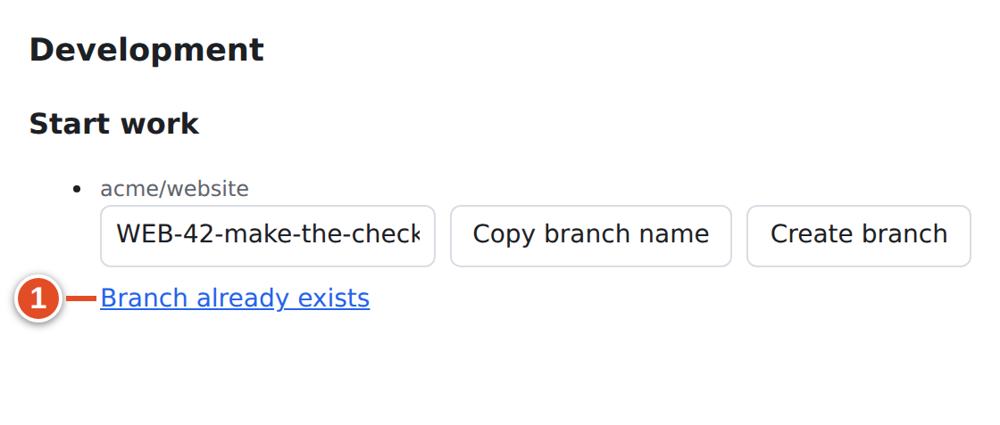
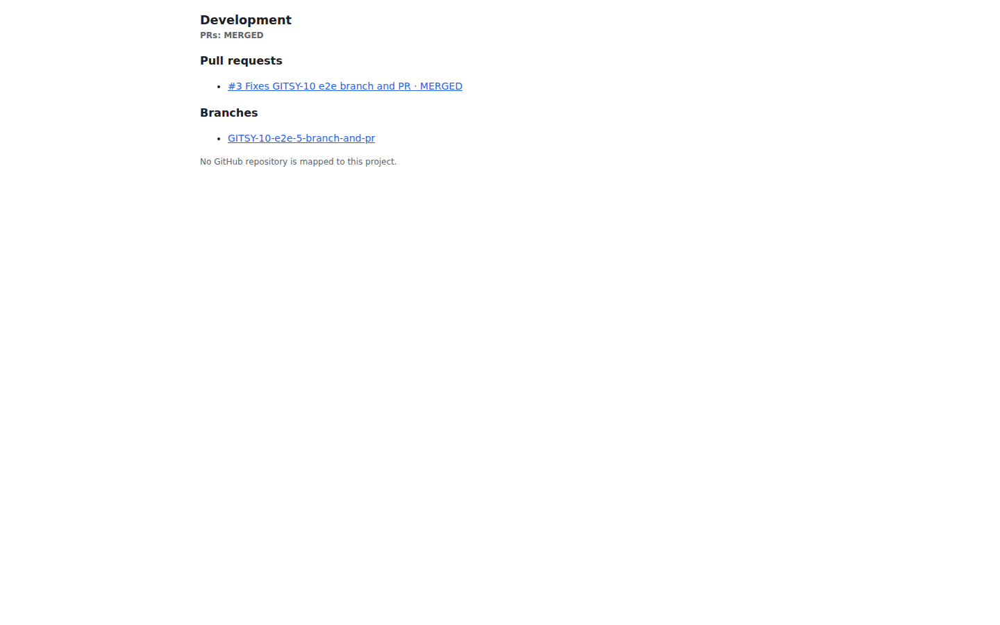

# 12 · The Development panel

Every work item in a project with a mapped repository has a **Development** section in its sidebar. It answers the questions a developer and a reviewer ask most often: *Is there a branch? Is there a PR, and what state is it in? Did the build pass? Where can I try it?* It also gives you the fastest way to start work: a ready-made branch name, or a button that creates the branch on GitHub for you.

## Where to find it

Open any work item in Plane. The **Development** section is in the item's detail sidebar, below the standard properties. It is a small embedded page served by git-sync (an iframe), about 24 rem high, and scrolls on its own.


[[SCREENSHOT NEEDED: plane-01-dev-sidebar — The Development section inside a real Plane work item sidebar with PR, build and preview (needs a signed-in Plane session on an instance with a live GitHub webhook). Capture later with npm run manual:capture -- --only plane-01-dev-sidebar]]

The same panel also has its own address, which is handy for bookmarking or when the sidebar is narrow:

```text
/git-sync/ui/workspaces/<slug>/projects/<projectId>/work-items/<issueId>/development
```

The demo-instance screenshots in this chapter show that direct page. Its content is identical to the sidebar version.

The panel reads with **your** Plane session. If you cannot see the work item in Plane (for example a private project you are not a member of), the panel says **You cannot see this work item.**

## What the panel shows

The panel heading is **Development**, followed by a roll-up of the item's pull requests: **PRs: OPEN**, **PRs: MERGED** or **PRs: DECLINED**. Below it come up to six sections, in this order. A section with nothing to show is hidden.

| Section | Shows | Comes from |
|---|---|---|
| **Pull requests** | Each linked PR: `#number title · status · review` | PR events on GitHub |
| **Builds** | The latest CI result for the linked PR | Check suites, check runs and commit statuses |
| **Deployments** | Deployment environments and their status | GitHub deployment statuses |
| **Previews** | Preview sites from recognized hosting providers | Deployment URLs |
| **Branches** | Branches whose name contains the key | First push of a new branch |
| **Start work** | Suggested branch name, **Copy branch name**, **Create branch** | The project's repository mappings |

Every entry is a link that opens GitHub (or the preview site) in a new tab.

When the project has no mapped repository at all, the panel shows only the sentence **No GitHub repository is mapped to this project.** Ask a workspace admin to map one (Chapter 24).


### Pull requests and their badges

Each PR line is built from the PR's title and two badges.

| Badge | Meaning |
|---|---|
| `OPEN` | The PR is open (drafts too) |
| `MERGED` | The PR was merged |
| `DECLINED` | The PR was closed without merging |
| `REVIEW` | Open PR with no standing approval or change request (or reviews could not be read completely) |
| `APPROVAL` | Open PR with at least one standing approval and no standing change request |
| `REJECTED` | Open PR where at least one reviewer's latest decisive review requests changes |

The review badge is shown only for open PRs. For each reviewer, only their latest *decisive* review counts (approve, request changes, or dismissal). A plain review comment does not cancel an earlier "request changes"; a dismissal does.

The heading's roll-up is `OPEN` if any linked PR is open, otherwise `MERGED` if any merged, otherwise `DECLINED`. It summarizes PRs; it is not the item's Plane state.

### Builds

A build line reads `Build · pass`, `Build · fail` or `Build · pending` (from check suites and runs) or `Commit statuses · …` (from the older commit status API).

| Result | When |
|---|---|
| `pass` | All runs concluded `success`, `neutral` or `skipped` |
| `fail` | Any run concluded `failure`, `timed_out`, `cancelled`, `action_required`, `startup_failure` or `stale` |
| `pending` | Runs are still in progress, or there are none yet |


The link opens the PR's **Checks** tab on GitHub, where the logs are.

### Deployments and previews

When your CI or hosting provider creates GitHub **deployments** for the PR's commit, each environment appears under **Deployments** as `<environment> · <state>`, for example `Preview · success`.

A deployment whose URL belongs to a recognized preview host also appears under **Previews**, named after the provider:

| Provider | URL host ends with |
|---|---|
| Vercel | `.vercel.app` |
| Netlify | `.netlify.app` |
| Cloudflare Pages | `.pages.dev` |
| AWS Amplify | `.amplifyapp.com` |

Verbatim links from the demo run, after Vercel deployed WEB-42's branch:

```text
[Deploy] Preview · success -> https://website-git-web-42-acme.vercel.app
[Preview] Vercel -> https://website-git-web-42-acme.vercel.app
```

*Links git-sync kept on the Plane work item in the demo run.*

> **Note:** Previews are detected *only from GitHub deployment URLs* in this release. A link such as `[Website Preview](https://preview.example.com)` in the PR description is not picked up, even though older documentation said so: the detection code exists but is not called for PR bodies. A preview on another host (your own domain) appears under **Deployments** but not **Previews**.

git-sync does not deploy anything itself. If your pipeline does not create GitHub deployments, these two sections stay hidden.

### Branches

When a **new** branch whose name contains the key is pushed, the branch appears under **Branches** (`[Branch] <name>`). Branches are recorded on their first push only; deleting the branch on GitHub does not remove the line.

### There is no commits list

The panel does not list individual commits. Commit activity shows up in other ways: Smart Commit comments carry the commit hash ([chapter 11](11-smart-commits.md)), and the PR on GitHub has the full commit list. A key that appears only in commit messages does not add anything to this panel.

## Start work: Copy branch name and Create branch

The **Start work** section has one row per repository mapped to the project. Each row shows the repository, a suggested branch name, and buttons.


### The suggested branch name

The name comes from the mapping's branch **template**. The default template is:

```text
{key}-{title-slug}
```

| Placeholder | Becomes |
|---|---|
| `{key}` | The work item key, e.g. `WEB-42` |
| `{title-slug}` | The title in lowercase, words joined by hyphens, cut at a word boundary to at most 50 characters |
| `{username}` | Your linked GitHub login (dropped together with its separator if you are not linked) |

For WEB-42 "Make the checkout button visible on small screens" this gives `WEB-42-make-the-checkout-button-visible-on-small-screens`. Because the key is in the branch name, the branch is a **closing** reference ([chapter 9](09-linking.md)). The whole name is limited to 200 characters.

> **Note:** There is no screen or API to change the template in this release. It is stored per mapping and can only be changed directly in the service database, so most teams use the default. If the stored template does not give a valid Git branch name, that repository's row is not shown.

### Goal: start work on WEB-42 with a correctly named branch

**Before you start:** you are a member of the project (Create branch needs project role **Member** or higher; guests and viewers see only **Copy branch name**). The App installation has **Contents: write** permission (an admin setting).

*Steps (Create branch — remote)*

1. Open WEB-42 and find **Development → Start work**.
2. Check the repository name above the row, if the project has more than one.
3. Select **Create branch**. ③ The button shows **Creating…** while it works.
4. When it finishes, the status line says **Branch created**. The text is a link to the new branch on GitHub.
5. In your local checkout, fetch and switch to it:

   ```bash
   git fetch origin
   git switch WEB-42-make-the-checkout-button-visible-on-small-screens
   ```


*Steps (Copy branch name — local)*

1. Select **Copy branch name**. ② The status line says **Copied**.
2. In your terminal: `git switch -c <paste>` and later `git push -u origin <paste>`.

If the browser blocks the clipboard, the status says **Copy failed; select the name and copy it**. Click into the name field (it selects itself) and copy by hand.

**Result:** a branch with the key in its name. Create branch also:

- adds the `[Branch]` link to the item straight away (otherwise it appears on your first push);
- records **branch_created** in the audit log.

Copying a name changes nothing in Plane. The state changes only when GitHub reports the branch: with the shipped rules, the first push of a new branch moves the item to **In Progress** (unless it is already completed or cancelled).

**How Create branch works:** git-sync uses the GitHub App (not your personal account) to create the branch from the *current tip of the repository's default branch* (usually `main`). It never overwrites anything. Pressing the button again is harmless:



**If it went wrong:**

| Message | Cause | Fix |
|---|---|---|
| **Branch already exists** | A branch with that name is already on GitHub | Use it: `git fetch` and switch to it |
| The repository is empty; push a first commit before creating branches | No default branch yet | Push an initial commit to the repository |
| The GitHub App cannot create branches in this repository (it needs Contents: write) | App permission missing, or the repository is not covered by the installation | Ask an admin |
| Only project members can create branches | Your project role is below Member | Use **Copy branch name**, or ask to be added as a member |
| The mapping's branch template does not give a valid branch name | Custom template produced an invalid name | Ask an admin |

## How the panel stays up to date

The panel is not a live view of GitHub. git-sync keeps a set of *links on the Plane work item*, one per PR, build, deployment, preview and branch, and updates each link in place as GitHub events arrive. The panel reads those links (with your Plane session) and groups them by their title prefix.

The same links are visible in Plane's ordinary **Links** list on the work item, with these prefixes:

| Prefix | Example title (verbatim from the demo run) |
|---|---|
| `[PR]` | `[PR] #121 WEB-42 Keep the checkout button visible on small screens · MERGED` |
| `[Branch]` | `[Branch] WEB-42-make-the-checkout-button-visible-on-small-screens` |
| `[CI]` | `[CI] Build · pass` |
| `[Deploy]` | `[Deploy] Preview · success` |
| `[Preview]` | `[Preview] Vercel` |

> **Warning:** Do not rename or delete these links by hand. git-sync finds them by URL and will recreate or rename them on the next event; editing them only causes confusion.

Consequences:

- If GitHub could not reach git-sync for a while (an outage, a webhook problem), the panel shows the last recorded state until the next event. An admin can redeliver missed webhooks.
- Reload the work item to see changes; the panel does not refresh itself.



## Reading the panel through a PR's life

The full sequence is shown step by step in [chapter 15](15-day-in-the-life.md). In short, for WEB-42 in the demo run:

| Moment | Panel shows | Item state (shipped rules) |
|---|---|---|
| Create branch / first push | **Branches** | In Progress |
| Draft PR opened | **PRs: OPEN**, `OPEN · REVIEW` | In Progress |
| CI running → passed | **Builds** `pending` → `pass` | unchanged |
| Preview deployed | **Deployments**, **Previews** | unchanged |
| Review requested | `OPEN · REVIEW` | In Review |
| Changes requested | `OPEN · REJECTED` | unchanged |
| Approved | `OPEN · APPROVAL` | unchanged |
| Merged into `main` | **PRs: MERGED** | Done |

## What you learned

- **Development** shows Pull requests, Builds, Deployments, Previews, Branches and Start work; empty sections are hidden.
- PR badges: `OPEN`/`MERGED`/`DECLINED`, plus `REVIEW`/`APPROVAL`/`REJECTED` for open PRs; builds are `pass`/`fail`/`pending`.
- Previews come only from deployment URLs on Vercel, Netlify, Cloudflare Pages or AWS Amplify.
- **Copy branch name** uses the template `{key}-{title-slug}` (not editable in the UI); **Create branch** creates the branch on GitHub from the default branch and never overwrites.
- The panel shows links git-sync maintains on the work item (`[PR]`, `[Branch]`, `[CI]`, `[Deploy]`, `[Preview]`); there is no commits list.

## Source files

- `src/ui/client/DevPanel.tsx` — the panel and its messages
- `src/ui/dev-panel.ts` — panel API, access checks, Create branch
- `src/sync/dev-info.ts` — link titles, badges, build status, preview hosts, branch template
- `src/app/checks.ts` — builds, commit statuses, deployments, previews
- `src/app/push.ts` — `[Branch]` link on first push
- `apps/web/core/components/issues/issue-detail/sidebar.tsx` — the iframe in Plane's sidebar
