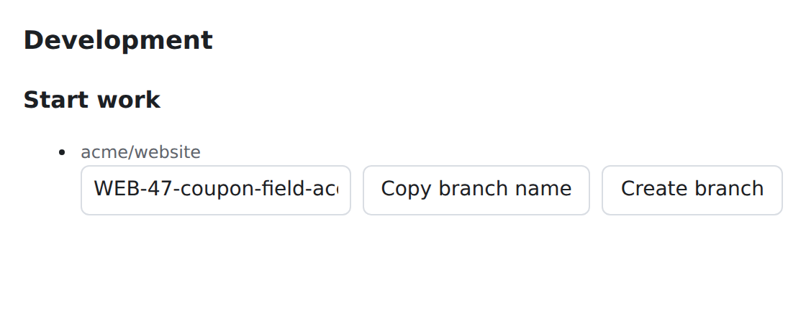

# 13 · Issue mirroring and what syncs

git-sync connects Plane and GitHub in three separate ways. Each has its own rules, so keep them apart in your head:

| Relationship | How it starts | What it does |
|---|---|---|
| **Reference** | A key such as `WEB-42` in a branch name, PR title or PR body | Links the PR or branch to the work item and lets PR automation change its state. No fields are copied. |
| **Smart Commit** | A key plus `#command` in a pushed commit message | Runs that one command (comment, time, state) in Plane. |
| **Mirror pair** | The `plane` label on a GitHub issue, or the `github` label on a Plane work item | Links a GitHub issue and a Plane work item, then copies six fields between them. |

Chapters 9–11 cover references and Smart Commits. This chapter covers **mirror pairs**: what starts one, which fields are copied and in which direction, and what never syncs. It ends with how deliveries, queues, retries and echo suppression work. These explain why a change can take a moment to appear and why nothing loops forever.

> **Example:** `Closes WEB-42` in a PR body lets a merge move WEB-42 to Done, but the PR title never replaces the work item's title. Adding the `plane` label to GitHub issue #131 creates a new Plane work item and keeps its title, description, state, assignees, labels and new comments in step.

## Start a mirror pair

Mirroring is **opt-in**: no issue is mirrored unless someone asks for it with a gate label. Gate-label names are compared case-insensitively.

| Direction | Gate label | Where you add it | Needs |
|---|---|---|---|
| GitHub → Plane | `plane` | On the GitHub issue, when you open it or later | A repository mapping to a Plane project |
| Plane → GitHub | `github` | On the Plane work item | A mapping whose **Sync direction** is **Two-way** |

### Goal: bring a GitHub issue into Plane

**Before you start:** the repository must be mapped to a Plane project. Ask your workspace admin if you are unsure.

**Steps**

1. Open the issue in the mapped repository on GitHub.
2. Add the label `plane`. If the label does not exist yet, create it with that exact name or ask a maintainer to.
3. Wait a moment. git-sync receives the `issues` webhook, queues it and creates the work item.
4. In Plane, open the mapped project and find the new item (filter by the newest items, or search the title).

**Result:** a new work item exists with the issue's title and description. Its first comment points back to the issue. In the demo run, GitHub issue #131 *Coupon field accepts expired codes* became *WEB-47*, and git-sync wrote this comment on it:

```html
<p>Mirrored from GitHub issue <a href="https://github.com/acme/website/issues/131">acme/website#131</a>.</p>
```

*Text git-sync wrote in Plane in the demo run.*

With **Post link-back comments on GitHub** on (the default), git-sync also adds a link on the Plane item and posts a comment on the GitHub issue:

```text
Linked to Plane work item: http://plane.example.com/acme/projects/bb57e81d-c161-441f-b50e-907af28f08c2/issues/7a2b5e69-aca5-49cb-8b4b-b71966c58b01
```

*Text git-sync posted to GitHub in the demo run.*



[[SCREENSHOT NEEDED: plane-03-mirrored-item — A Plane work item created from a GitHub issue labelled plane (WEB-47), showing the "Mirrored from GitHub issue" comment and the issue link. Capture later with npm run manual:capture -- --only plane-03-mirrored-item]]

**If it went wrong:**

- No work item appears → the repository is not mapped, the App cannot reach it, or the label is not exactly `plane`. Ask your admin to check **Errors in the last 24 hours** for the mapping.
- Two work items appear → someone created one by hand while the mirror was being made. Keep the mirrored one, because it holds the link.

### Goal: send a Plane work item to GitHub

**Before you start:** the project's mapping must be **Two-way**. With **GitHub to Plane only**, git-sync ignores every Plane-side event, including the `github` label.

**Steps**

1. Open the work item in Plane.
2. Add the project label `github`.
3. Wait a moment, then open the mapped repository's **Issues** tab on GitHub.

**Result:** a new GitHub issue exists. In the demo run, **WEB-44** *Add rate limiting to the login form* became GitHub issue #120:

```text
#120 Add rate limiting to the login form
Limit failed sign-ins to **5 per minute**.

---
Mirrored from Plane: http://plane.example.com/acme/projects/bb57e81d-c161-441f-b50e-907af28f08c2/issues/f19a4a55-c98c-4829-af86-1505b5001d16
labels: ['plane']
```

*The GitHub issue git-sync created in the demo run.*

git-sync confirmed it on the Plane item with the comment `Mirrored to GitHub issue acme/website#120.` and a link to the issue.

### What creation copies

The two directions do not copy the same things at creation time:

| Created on | Copied when the pair is created |
|---|---|
| Plane (from a GitHub issue) | Title; description converted from Markdown to Plane's HTML; labels except `plane`; assignees whose GitHub accounts are linked to Plane members; state (an open issue gets the mapping's **Open state** or Plane's project default, a closed issue gets the **Closed state** or a completed-group state). git-sync also makes sure a `github` label exists in the project. |
| GitHub (from a Plane item) | Title; description converted to Markdown with a `Mirrored from Plane: <url>` footer; labels, with `plane` added and `github` removed. *Assignees and state are not set at creation.* Later assignment and state changes sync normally. |

Old comments are not copied when a pair is created. Only comments made after that point are mirrored.

> **Note:** Removing the gate label later does **not** unlink the pair. The link is stored durably in git-sync. Pull requests are never mirrored as issues, even though GitHub treats them as issues internally, so editing a PR never renames its work item.

## The six mirrored fields

Once a pair exists, exactly six things can cross between the two sides:

| Field | GitHub → Plane | Plane → GitHub |
|---|---|---|
| Title | Issue title becomes the work-item name | Work-item name becomes the issue title |
| Description | Markdown is converted to Plane HTML | Plane HTML is converted to Markdown |
| State | Closing or reopening the issue picks a mapped Plane state | The Plane state group closes or reopens the issue |
| Assignees | Linked GitHub accounts become Plane assignees | Linked Plane members become GitHub assignees |
| Labels | Label names are found or created in Plane | Added and removed labels are applied on GitHub |
| New comments | Added as a new Plane comment that names its author | Added as a new GitHub comment that names its author |

Everything else stays where it was written (see [What never syncs](#what-never-syncs)).

## Who wins when both sides change: conflict policies

Each mapping has one **conflict policy** per field. A policy decides which side's change is allowed to cross over when both sides could change a value. Workspace admins set policies on the mapping's **Conflict policies** tab (Chapter 25). The UI explains it as *"Which side wins when both change the same field between syncs."*

| Policy (UI label) | Stored value | Meaning |
|---|---|---|
| **Last write wins** | `last_write_wins` | Changes from either side cross over |
| **GitHub is the source of truth** | `source_of_truth:github` | Only GitHub changes cross over to Plane |
| **Plane is the source of truth** | `source_of_truth:plane` | Only Plane changes cross over to GitHub |

The shipped defaults are:

| Field | Default |
|---|---|
| Title | **GitHub is the source of truth** |
| Description | **GitHub is the source of truth** |
| State | **Last write wins** |
| Assignees | **Last write wins** |
| Labels | **Last write wins** |
| Comments | **Last write wins** |

In practice, with the defaults you should *edit a mirrored title or description on GitHub*. A Plane title edit is not sent to GitHub, and the next GitHub title edit overwrites it in Plane.

> **Warning:** A source-of-truth policy is not an editing lock. Plane still lets you type a new title. That local edit stays until the next eligible change arrives from GitHub and replaces it. Agree with your team which side owns which field.

**Sync direction comes first.** If the mapping is **GitHub to Plane only**, every Plane-side event is ignored: no state, comment or label from Plane ever reaches GitHub. Setting a field to **Plane is the source of truth** on such a mapping leaves that field syncing in neither direction. If you see that combination, tell your admin.

"Last write wins" is not a merge of two texts. For whole-value fields, git-sync reads the source object's current value and its `updated_at` time before writing. A delivery that arrives late with an older snapshot does not overwrite a newer value. There is no conflict dialog, so make larger description edits on one side only.

## Closing and reopening

GitHub issues are only open or closed, while Plane projects have many states. The mapping's **Open state** and **Closed state** fields (shown as **Project default** when not set) decide where a GitHub close or reopen lands in Plane.

| What happens | Result on the other side (when the State policy allows it) |
|---|---|
| GitHub issue closed | Plane item moves to the mapping's **Closed state**, otherwise to a completed-group state |
| GitHub issue reopened | Plane item moves to the mapping's **Open state**, otherwise to a not-started (unstarted-group) state |
| Plane item moved into a **completed** state | GitHub issue closed with reason `completed` |
| Plane item moved into a **cancelled** state | GitHub issue closed with reason `not_planned` |
| Plane item moved into any other group | GitHub issue reopened (reason `reopened`) if it was closed |

If the chosen state was deleted or no longer fits, git-sync falls back to a suitable default and records a `mirror_state_fallback` entry in the audit log. It never moves an item into **Triage**.

Moving an item from **In Progress** to **In Review** changes nothing on GitHub, because both are open states. That is expected: GitHub cannot show every Plane workflow step. Likewise, closing a GitHub issue as *not planned* does not choose a cancelled Plane state. Incoming closes always use the mapping's **Closed state** or the completed fallback.

## People: assignees and mentions

People are translated through the workspace's user links: a member's personal link (Chapter 8) or an admin-made link (Chapter 27). Links are keyed by GitHub's stable numeric account ID, never by display name or commit email.

| Situation | What git-sync does |
|---|---|
| GitHub assignee linked to a Plane member | That member becomes a Plane assignee |
| GitHub assignee with no link | Dropped, so the Plane item may show fewer assignees |
| Plane assignee linked to a GitHub account | Added on GitHub. git-sync only adds or removes linked accounts and leaves GitHub assignees it cannot represent alone. |
| `@login` in GitHub text, linked | Becomes a real Plane mention |
| `@login` in GitHub text, not linked | Becomes a link to the GitHub profile |
| Plane mention of a linked member | Becomes `@login` on GitHub |
| Plane mention of an unlinked member | Becomes their display name (or "Unknown user" if none is known) |
| `#123`, `owner/repo#123`, issue URLs | Turned into explicit GitHub links in Plane text |

In the demo, Sam Reviewer commented on #131: *"Reproduced on staging. @alex-dev can you take this?"* Because Alex has linked their GitHub account, the Plane copy contains a real Plane mention of Alex, who gets a notification:

```html
<p><strong>sam-reviews</strong> commented on <a href="https://github.com/acme/website/issues/131#issuecomment-77001">GitHub</a>:</p><p>Reproduced on staging. <mention-component entity_identifier="6a57833d-4e43-49be-924c-f093cddfae76" entity_name="user_mention"></mention-component> can you take this?</p>
```

*Text git-sync wrote in Plane in the demo run.*

Inline code and code blocks are not rewritten.

> **Note:** On the Plane side, every change git-sync makes is shown as made by the git-sync service account, even if it came from you. This release has no way to store a personal Plane token per member. Changes git-sync makes on GitHub *for* a Plane edit are made as you if your personal GitHub link works, and as the App otherwise. The comment text always names the original author ("**alex** commented in Plane:", "*sam-reviews* commented on GitHub:").

## Labels and comments

**Labels** are matched by name, not by internal ID. A label missing on the target side is created where possible. Colors and label descriptions are not copied. GitHub label events send the issue's current label set to Plane, without the `plane` gate label. Plane label events send the added and removed labels, resolved to names.

**Comments:** only **new** comments are mirrored.

- A GitHub comment appears in Plane starting with "**login** commented on GitHub:", with a link to the original.
- A Plane comment appears on GitHub starting with "**Name** commented in Plane:".
- Editing or deleting a comment is **not** mirrored. If both sides need a correction, add a new comment.
- PR review discussions are not mirrored. They belong to a PR, not to a mirrored issue.

## What never syncs

The mirror is deliberately much smaller than Plane's data model. These are **never** copied in either direction:

- priority, start date and due date;
- estimates (points);
- cycles and modules;
- parent and sub-work-item structure, and relations (blocked by, relates to, duplicate of);
- attachments as files (a link or image inside a description survives conversion, but no files are copied);
- subscribers, reactions, views, pages, intake, notification settings and project settings;
- edits and deletions of existing comments;
- label colors and descriptions.

### Deleting is not closing

Plane v1.4.2 sends no webhook when a work item is deleted, so git-sync cannot react straight away. Instead, a **reconciliation** sweep runs every 60 minutes by default. It works out whether a linked item is archived, deleted or just hidden:

| Plane-side situation | What reconciliation does |
|---|---|
| Item or its project **archived** | Marks the link archived. No comment, nothing closed. |
| Item **deleted** (confirmed, or missing on two sweeps in a row) | Marks the link **orphaned** and posts on GitHub: *"The linked Plane work item can no longer be found, so this link has been marked orphaned. Nothing was changed or closed here."* |

So *never delete or archive a work item to close its GitHub issue.* Move it to the agreed completed or cancelled state instead. Deleting a GitHub issue or comment does not delete anything in Plane either.

## How deliveries travel: queues, retries, echoes


A change takes this path:

1. **Webhook.** GitHub or Plane sends a short signed message to git-sync. git-sync checks the signature, records the delivery and queues it, then answers straight away.
2. **Inbound worker.** A worker reads the queued delivery, finds the mapping and decides what should change.
3. **Outbound writes.** Each change is registered in a durable, ordered outbox, with one queue for Plane-bound writes and one for GitHub-bound writes. If Plane is down, GitHub-bound work keeps flowing, and the reverse.
4. **Retries.** A write that fails for a temporary reason (network error, 5xx, rate limit) is retried with back-off. Writes to the same target run in order. A multi-step operation such as "create issue, remember its number, post link-back" resumes where it stopped, so a half-finished mirror never needs to be redone by hand.
5. **Audit.** Every delivery and result is written to the audit log, which your admin can read (Chapter 28).

No fixed delay is promised. A few seconds is normal, but rate limits and outages make it longer. *Do not keep editing to "wake up" the sync.* Each edit is a new event.

Four safeguards stop duplicates and loops:

| Safeguard | What it prevents |
|---|---|
| **Echo suppression** | git-sync remembers each field it wrote (for 10 minutes by default). When the other side reports that same change back, git-sync recognizes it as an echo and ignores it, so nothing bounces back and forth. |
| *Service-user filter* | Plane events made by git-sync's own service account are dropped on arrival. (GitHub bots in general are *not* ignored; their actions run under the service identity.) |
| *Deduplication* | A webhook delivered twice is processed once. A Smart Commit SHA runs its commands once. |
| *Out-of-order protection* | git-sync reads the current state before acting. An old PR event that arrives after a newer one never moves an item backwards, and the audit log records it as ignored. |

Plane sends one webhook per changed field, so one edit can create several queue entries. That is normal.

> **Warning:** A consequence of the service-user filter: when *git-sync itself* changes a mirrored Plane item (for example a PR merge rule moves it to Done, or a Smart Commit `#done` runs), that change is **not** mirrored on to the GitHub issue, because it arrives as a service-account event. If the GitHub issue must close too, write `Closes #131` in the PR so GitHub closes it, or close it by hand.

> **Tip:** If a mirrored change is missing after a few minutes, collect the GitHub issue URL, the Plane key, the time with timezone, and what you expected. Send them to your admin, who can find the delivery in the audit log and **Replay** it if needed (Chapter 17 explains what to send).

## A quick way to investigate a mismatch

1. Decide which relationship you are looking at: a mirror pair, a PR reference, or a Smart Commit.
2. Open the source object (the GitHub issue or the Plane item) and check that the change is really there.
3. Check the mapping's **Sync direction** and the field's conflict policy. Ask your admin if you cannot see them.
4. For people: check that both people have linked GitHub accounts.
5. For state: remember that only group changes (open, completed, cancelled) show on GitHub.
6. Record the expected and the actual result, and report them.

## What you learned

- Mirroring is opt-in per issue: `plane` on GitHub, `github` in Plane (two-way mappings only). Removing the label does not unlink.
- Exactly six fields sync: title, description, state, assignees, labels and new comments, each under a conflict policy. By default GitHub owns title and description.
- State maps by group: completed → closed `completed`, cancelled → closed `not_planned`. Incoming closes use the mapping's **Closed state**.
- Priority, dates, estimates, cycles, modules, relations, attachments and comment edits never sync. Deleting a Plane item never closes anything.
- Deliveries are queued, retried, deduplicated and echo-suppressed, so wait and report instead of re-editing.

## Source files

- `src/sync/mirror.ts`: mirror creation, six-field sync, policies, state mapping, assignees and mentions
- `src/app/issues.ts`: GitHub `issues`/`issue_comment` and Plane `issue`/`issue_comment` handlers
- `src/sync/text.ts`: Markdown ↔ Plane HTML conversion and reference links
- `src/sync/reconcile.ts`, `src/app/main.ts`: reconciliation, archive and orphan handling
- `src/sync/ophash.ts`, `src/db/ledgers.ts`: echo ledger and deduplication
- `src/queue/*`, `src/operations/outbox.ts`, `src/app/writers.ts`: queues, ordered outbox and retries
- `src/ui/validate.ts`: conflict-policy fields and defaults
