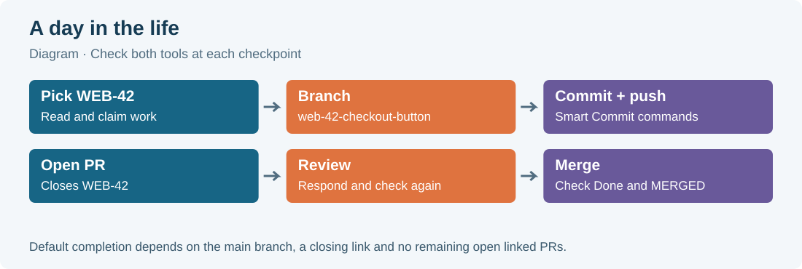
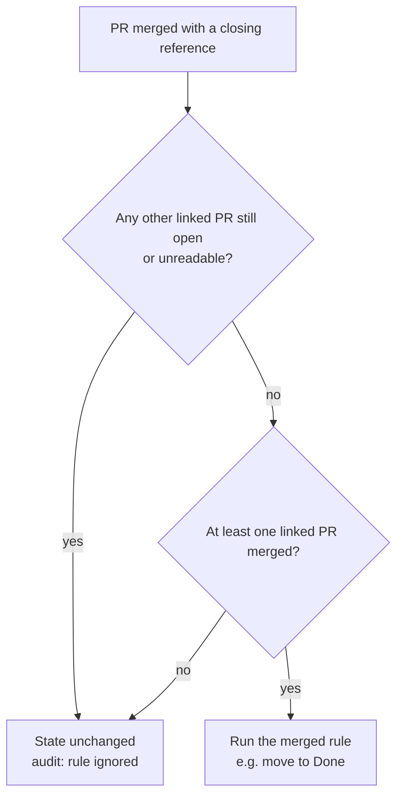
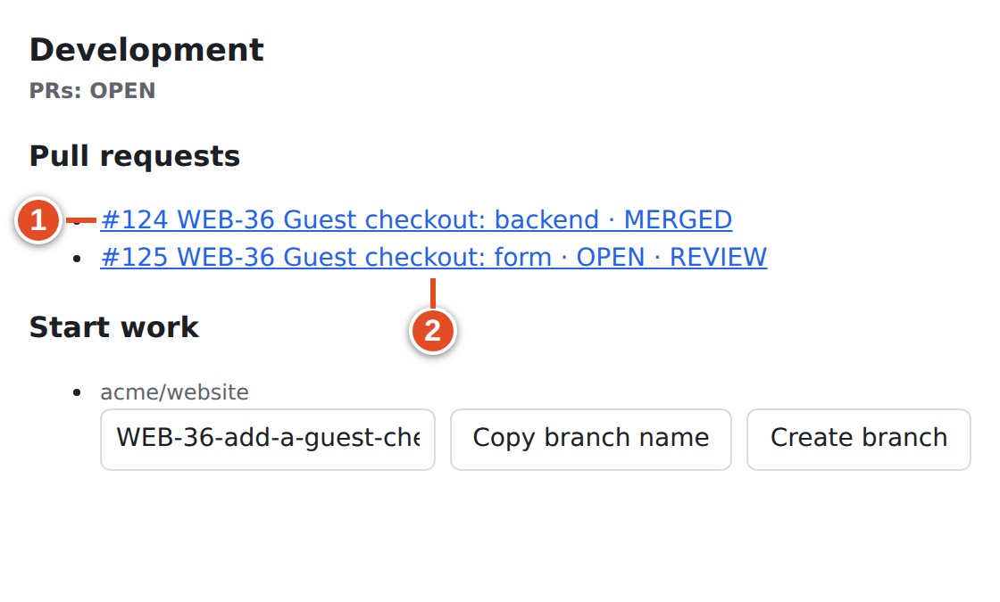

# 14 · PR automation from a developer's view

When your pull request is opened, reviewed or merged, git-sync can move the linked work item to a new state. Your admin sets this up with **rules**; Chapter 26 shows how to edit them. This chapter is for developers. It covers which PR moments trigger a rule, what the shipped defaults do, why a reference's tier matters, how **ready for merge** is decided, and why a merge sometimes does *not* move an item to Done.

> **Note:** Everything here applies to work items linked by a **reference** (branch name, PR title or PR body; see Chapter 9). Mirrored GitHub issues follow Chapter 13 instead.

## Lifecycle points

git-sync turns GitHub events into named **lifecycle points**. Each one is a rule trigger:

| Lifecycle point (rules table) | Trigger name | What you did on GitHub |
|---|---|---|
| Branch pushed | `branch.created` | Pushed a new branch whose name contains the key |
| PR drafted | `pull_request.drafted` | Opened a draft PR, or converted a PR back to draft |
| PR opened | `pull_request.opened` | Opened a normal PR, or marked a draft **Ready for review** |
| Review requested | `pull_request.review_requested` | Requested a reviewer |
| Changes requested | `pull_request.changes_requested` | A reviewer submitted **Request changes** |
| Approved | `pull_request.approved` | A reviewer approved, but the PR is not yet ready for merge |
| Ready for merge | `pull_request.ready_for_merge` | git-sync checked that the PR is approved and green (see below) |
| PR merged | `pull_request.merged` | Merged the PR |
| Closed without merge | `pull_request.closed_unmerged` | Closed the PR without merging |
| Reopened | `pull_request.reopened` | Reopened a closed PR |

Admins can also write rules for `push`, `commit.pushed_to_default`, `check_suite.*`, `deployment_status.*`, `issue.*` and `comment.*` (Appendix D). Those are less common.

## What the shipped defaults do

A new mapping starts with this table. Lifecycle points that are not listed change nothing.

| Lifecycle point | Default target |
|---|---|
| Branch pushed | **In Progress** (started group) |
| PR drafted | **In Progress** |
| PR opened | **In Progress** |
| Review requested | **In Review** (started group) |
| PR merged into a base matching `^main$` | **Done** (completed group) |
| Changes requested, approved, ready for merge, closed without merge, reopened | *no change* |

Some details are easy to miss:

- **Approval does not move the item.** Neither does ready for merge, unless your admin adds a rule for it.
- **Merged into another branch does nothing by default.** A PR merged into `develop` or `staging` leaves the item where it was, unless a branch-aware rule says otherwise (see the staging example below).
- **A new branch never reopens finished work.** If the item is already in a completed or cancelled state, *Branch pushed* leaves it alone. Branches whose names start with `revert-` never trigger *Branch pushed* at all.
- **State names are matched inside their group.** The default `started:In Review` looks for a state called *In Review* in the started group. If your project has no such state but exactly one started state, that state is used. Otherwise the rule fails, and your admin sees the failure in the audit log. Tell your admin if your project names its states differently.
- **Rules evaluate in order and the first match wins.** Only one rule's actions run for each event.

## Tiers decide whether the state may change

Chapter 9 introduced the three reference tiers. For PR automation they matter a lot, because they gate **state changes** (the `set_state` action):

| Tier | Typical text | State changes on PR events | State change on merge |
|---|---|---|---|
| Closing | `Closes WEB-42`, a key in the branch name or PR title | Yes | Yes, if the merge guard passes |
| Non-closing | `Refs WEB-42`, `Part of WEB-42` | Yes | **No** |
| Relation | `Relates to WEB-42`, a bare key in the PR body | **Never** | **Never** |

The demo run shows all three side by side:

- **WEB-41** was referenced with `Refs WEB-41`. Opening the PR moved it to **In Progress**, and a merge would leave it there.
- **WEB-40** was referenced with `Relates to WEB-40`. It stayed in **Todo**, even though the PR is linked and shown in its Development panel.
- **WEB-42** was closed by its branch name, title and `Closes WEB-42`. It went all the way to **Done** (Chapter 15).

Tier gating applies **only** to state changes. Other actions an admin puts in a rule, such as a comment, label, assignee, link or time note, run for every tier. So a relation-only PR can still receive a label from a rule.

## When is a PR "ready for merge"?

git-sync computes readiness itself from GitHub's current data, not from the event you just caused. A PR is ready for merge when **all** of these are true:

1. It is open and not a draft.
2. It has at least one **standing approval**. Only each reviewer's latest decisive review counts (approved, changes requested or dismissed).
3. *No reviewer* still has changes requested. One person's approval does not cancel another person's change request.
4. Every relevant **check suite** has completed as success, neutral or skipped. Suites with no runs, and stale suites, are ignored.
5. The *combined commit status* is success, or no statuses are reported.

git-sync checks this after an approval, after a check suite completes successfully, and when a PR becomes ready for review or is reopened. It fires `pull_request.ready_for_merge` **once per head commit**: pushing a new commit means it can become ready again. In the demo run, the audit log recorded `ready_for_merge fired` for PR #121 when Sam approved it.

By default nothing happens at ready for merge. Admins often add a rule here, such as a comment that says the PR is ready, or a move to a *Ready to ship* state.

> **Note:** Readiness is git-sync's own view. It does not replace GitHub's branch protection, and GitHub may still block the merge button for reasons git-sync does not check (required reviewers, code owners, merge queues).

## The merge guard: one item, several PRs

A work item can be linked to more than one PR. When one of them merges, a closing reference moves the item to Done only if:

- **at least one** linked PR has merged, **and**
- **none** of the linked PRs is still open.

A PR that was closed without merging neither blocks nor counts. A linked PR that git-sync cannot read (deleted repository, no access) is treated as **open**, because finishing work it cannot see would be unsafe.

*Diagram: the merge guard, checked when a linked PR merges.*

In the demo run, WEB-36 had two closing PRs: #124 *Guest checkout: backend* and #125 *Guest checkout: form*. #124 merged while #125 was still open, so WEB-36 stayed **In Progress** and the audit log recorded the merged rule as `ignored`.

> **Warning:** The guard is checked *only at the merge event*. If #125 is later closed *without* merging, git-sync does not go back and finish WEB-36. Close obsolete PRs **before** the final merge, or move the item to Done yourself after an abandoned PR.

## Example: staging and main

Many teams merge feature branches into `staging` first and into `main` at release time. A **branch-aware rule** handles that. The demo mapping has one, added on the **Rules** tab:

| Rule (first match wins) | When | If | Then |
|---|---|---|---|
| merged into `^staging$` | `pull_request.merged` | base branch matches `^staging$` | **In QA** |
| default: merged | `pull_request.merged` | base branch matches `^main$` | **Done** |

In the demo run, PR #126 *WEB-39 Speed up the checkout page* targeted `staging`. On merge, the audit log recorded rule `merged into ^staging$` as applied, and WEB-39 moved to **In QA**. A later release PR from `staging` into `main` that references WEB-39 would move it to **Done**.

## One PR, event by event

This table follows a single closing PR (title `WEB-42 …`, body `Closes WEB-42`) through every GitHub action it can see, using the shipped rules:

| You do on GitHub | Event git-sync receives | Lifecycle point | WEB-42 afterwards | Development badge |
|---|---|---|---|---|
| `git push` of a new branch `WEB-42-…` | `push` (branch created) | Branch pushed | In Progress | Branch listed |
| `gh pr create --draft` | `pull_request` opened (draft) | PR drafted | In Progress | `OPEN · REVIEW` |
| `gh pr ready` | `pull_request` ready_for_review | PR opened | In Progress | `OPEN · REVIEW` |
| Add a reviewer | `pull_request` review_requested | Review requested | **In Review** | `OPEN · REVIEW` |
| Reviewer: **Request changes** | `pull_request_review` submitted | Changes requested | In Review | `OPEN · REJECTED` |
| Push a fix | `push` + `pull_request` synchronize | — (Smart Commits only) | In Review | `OPEN · REJECTED` |
| CI finishes green | `check_suite` completed | (readiness check) | In Review | `[CI] Build · pass` |
| Reviewer: **Approve** | `pull_request_review` submitted | Ready for merge (checks green) or Approved | In Review | `OPEN · APPROVAL` |
| **Merge** into `main` | `pull_request` closed, merged | PR merged | **Done** | `MERGED` |
| **Close** without merging (instead) | `pull_request` closed | Closed without merge | unchanged | `DECLINED` |
| **Reopen** | `pull_request` reopened | Reopened | unchanged | `OPEN · …` |

*Every row except the last two was verified on the demo instance (Chapter 15).*

## Rules your admin may add

The defaults are only a starting point. Rules can also add or remove a label, assign someone, post a comment, add a link, log time as a comment, or create another work item. A rule can be limited by base branch, head branch, PR labels, author, repository or project. Common additions:

| Team wish | Rule idea |
|---|---|
| "Changes requested should send it back" | Changes requested → **In Progress** |
| "Tell us when it's mergeable" | Ready for merge → comment *Ready to merge* |
| "Hotfix branches are urgent" | Head branch `^hotfix/` → add label `hotfix` |
| "Closed without merge means dropped" | Closed without merge → **Cancelled** |
| "Release branch means QA" | Merged into `^release/` → **In QA** |

If a comment, label or assignee appears on your item after a PR event, a rule probably did it. Ask your admin to show you the rule list. The **Rules** tab and the **Test rules** dry-run are described in Chapter 26.

## Reading what happened

When a state does or does not change, three places tell you why:

| Where | What it shows |
|---|---|
| Plane work item: activity and state | The result. The change appears as made by the git-sync service account. |
| **Development** panel | Which PRs are linked and their status and review badges (`OPEN · REVIEW`, `OPEN · REJECTED`, `OPEN · APPROVAL`, `MERGED`, `DECLINED`) |
| Audit log (admin) | One `rule_match` entry per evaluated rule: `applied`, `ignored` (the tier or the merge guard skipped it) or `failed` (for example, the state does not exist) |

Members cannot open the audit log, so send your admin the PR URL and the time (Chapter 17).

## What you learned

- PR events become lifecycle points. By default: branch, draft or open → In Progress; review requested → In Review; merged into `main` → Done. Nothing else moves.
- Tiers gate only state changes: relation never moves an item, and non-closing never moves it on merge.
- Ready for merge means open, not draft, approved, no standing change request and green checks. It fires once per head commit and changes nothing by default.
- The merge guard needs at least one merged and no open linked PR, and it is only checked at the merge event.
- Branch-aware rules let merges into `staging` and `main` mean different states.

## Source files

- `src/github/pr-automation.ts`: lifecycle table, defaults, `prEventToRuleEvent`, `isReadyForMerge`, tier gating, state resolution
- `src/app/pr.ts`: PR handler, merge guard (`otherPrStates`), ready-for-merge firing, link-back
- `src/app/rules.ts`: rule running, push and branch rules, `revert-` exclusion
- `src/rules/engine.ts`, `src/rules/types.ts`: triggers, conditions, actions, first-match evaluation
