# 15 · A day in the life

This chapter follows one small change from start to finish. Alex Developer picks up *WEB-42 — Make the checkout button visible on small screens*, and Sam Reviewer reviews it. Each step says three things:

- **You do:** the exact action in Plane, git or GitHub;
- **git-sync does:** what the service does with the resulting event;
- **You see:** what to check, with a screenshot of the Development panel at that moment.

> **Note:** *About these screenshots.* The Development-panel images are real renders of git-sync's own UI, taken from the *demo instance*: the actual git-sync code running locally on a throwaway database, fed with the same webhook events GitHub would send for every step below. The states, badges, comments and links are what the real code produced. The GitHub screenshots come from an earlier real test on the authorized test repository (PR #117 for the same work item), not from this run. Plane's own work-item page for this run could not be captured; see the placeholders.

The run assumes:

- the shipped rules plus one branch-aware rule (Chapter 14);
- a two-way mapping of `acme/website` to the **Website** (`WEB`) project, with **Smart Commits**, **Post link-back comments on GitHub** and **Report problems as comments on GitHub and Plane** turned on;
- Alex and Sam have both linked their GitHub accounts (Chapter 8).

Your team's rules can differ. Treat every *You see* as a checkpoint against your own setup.

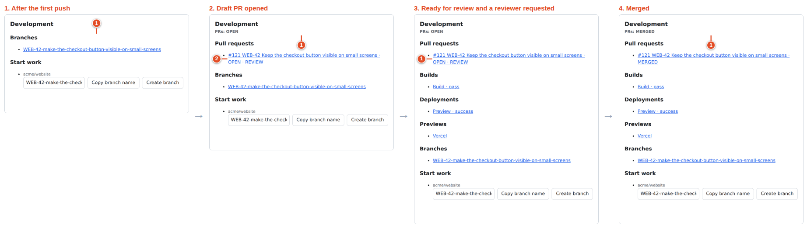

| Step | Event | WEB-42 state afterwards | PR badge |
|---|---|---|---|
| 1–2 | Read and start the item | Todo → In Progress (by hand) | — |
| 3 | **Create branch** | (no event yet) | — |
| 4 | First push with Smart Commits | In Progress | — |
| 5 | Draft PR opened | In Progress | `OPEN · REVIEW` |
| 6 | CI runs, preview deploys | In Progress | `OPEN · REVIEW` |
| 7 | Ready for review + reviewer requested | **In Review** | `OPEN · REVIEW` |
| 8 | Changes requested | In Review | `OPEN · REJECTED` |
| 9 | Fix pushed, CI green, approved | In Review | `OPEN · APPROVAL` |
| 10 | Merged into `main` | **Done** | `MERGED` |

*The demo run, verified: each row is the state the real code produced.*

## Step 1 — Read the work item

**You do:** open **Website → Work items** in Plane and open `WEB-42`. Read the description, the comments, the assignee and the priority. Check for blocking relations.

The description gives the finish line: *Button visible at 320, 375 and 390 px. Focus indicator visible.* That is small, testable and clear. The item is assigned to Alex, its priority is **High**, and it carries the labels `frontend` and `accessibility`.

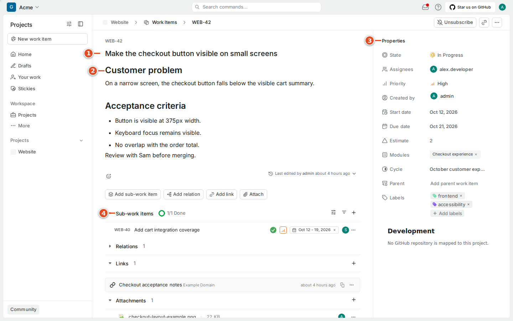

## Step 2 — Say that you started

**You do:** set the state to **In Progress** and add a short comment such as *"Starting the narrow-screen fix; I'll keep the focus order and check the three widths."*

**git-sync does:** nothing yet. Plane-side state changes of a referenced (not mirrored) item are not sent anywhere.

*Why bother?* The automation would also move the item to In Progress on the first push. Setting it yourself tells teammates now, before any code exists.

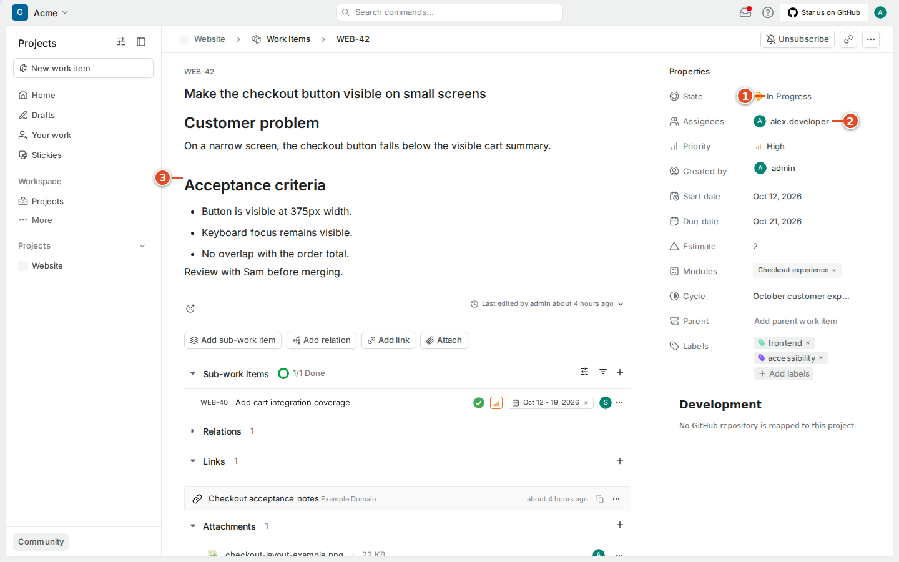

## Step 3 — Create the branch from the Development panel

**You do:** in the work item's sidebar, find **Development**. Under **Start work** it suggests a branch name built from the default template `{key}-{title-slug}`:

```text
WEB-42-make-the-checkout-button-visible-on-small-screens
```

Press **Create branch**. To create the branch yourself instead, press **Copy branch name** and use it in git.

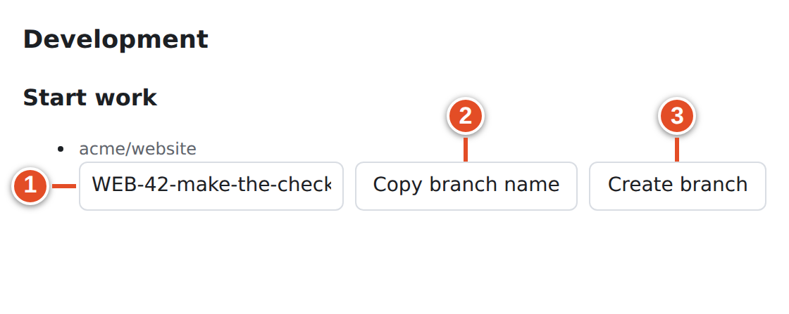

**git-sync does:** it reads the repository's default branch (`main`), then creates the branch on GitHub from main's latest commit using the App's installation. It records a `branch_created` audit entry and adds a `[Branch]` link to the item. Press the button again and it answers **Branch already exists**: nothing is overwritten.

**You see:** **Branch created** with the branch name.

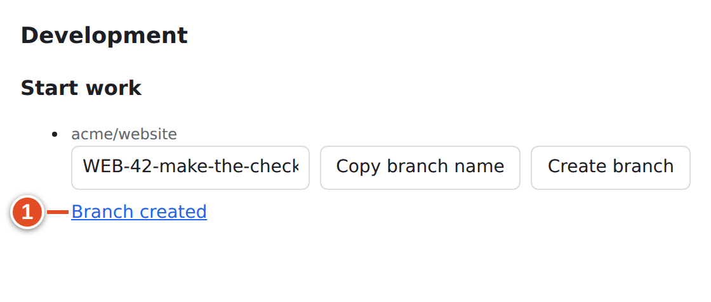

**You do (terminal):** fetch the new remote branch and switch to it. **Create branch** does not touch your laptop.

```bash
git fetch origin
git switch WEB-42-make-the-checkout-button-visible-on-small-screens
```

> **Tip:** The key at the start of the branch name is a **closing** reference: a merge of a PR from this branch can finish WEB-42. If your PR only does part of the work, use a branch name without the key (Variant B below).

## Step 4 — Commit and push, with Smart Commits

**You do:** make the change, run your checks, then commit. Alex made three commits. The first explains the change. The second and third carry Smart Commit commands, with the key first and the command after it on the same line:

```bash
git add src/checkout/footer.css src/checkout/footer.test.ts
git commit -m "WEB-42 Move the Place order button into a sticky footer" \
           -m "Keeps the button inside the viewport on phones."
git commit --allow-empty -m "WEB-42 #comment Checked at 320, 375 and 390 px widths; the button stays visible."
git commit --allow-empty -m "WEB-42 #time 1h 30m"
git push -u origin WEB-42-make-the-checkout-button-visible-on-small-screens
```

(In practice you would put the commands into real commits. `--allow-empty` here just keeps the example short.)

**git-sync does:** GitHub sends one `push` webhook for the whole push.

- **Branch pushed.** The first push of a branch whose name contains `WEB-42` triggers the default rule `branch.created` → **In Progress**. WEB-42 is already In Progress, so nothing visibly changes.
- **Smart Commits.** Each commit is read once, by its SHA. The first commit has no `#command`, so nothing runs for it. The second adds a comment. The third logs time **as a comment**, because Plane CE has no worklog. These are the exact comments the demo run wrote on WEB-42:

```html
<p>Checked at 320, 375 and 390 px widths; the button stays visible.</p><p><small>via <a href="https://github.com/acme/website/commit/3b2335d710bf1b0ba856a9ca334a2fd2e8a27ac6">3b2335d</a> by alex-dev</small></p>
<p>Time logged: 1h 30m (90 minutes)</p><p><small>via <a href="https://github.com/acme/website/commit/7b7ebfdd2c7657165f8c339cbace6cef32e140b6">7b7ebfd</a> by alex-dev</small></p>
```

*Text git-sync wrote in Plane in the demo run.*

The "via … by alex-dev" line is the **provenance**. `alex-dev` is the GitHub account that pushed (the webhook's `sender`), not the author name inside the commit, which anyone can fake. In Plane the comment itself shows as written by the git-sync service account.

**You see:** **Branches** in the Development panel lists the branch, and the two comments appear in the item's activity.

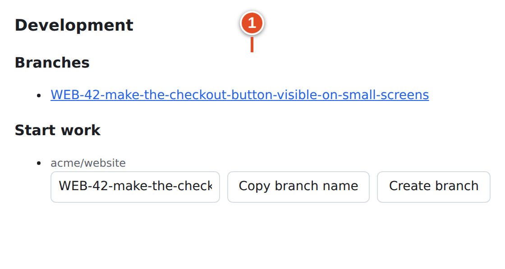


[[SCREENSHOT NEEDED: plane-02-smart-comment — The two Smart Commit comments ("Checked at 320, 375 and 390 px…" and "Time logged: 1h 30m (90 minutes)") in WEB-42's activity in Plane. Capture later with npm run manual:capture -- --only plane-02-smart-comment]]

## Step 5 — Open a draft pull request

**You do:** open a **draft** PR from the branch into `main`. With the GitHub CLI:

```bash
gh pr create --draft --base main \
  --title "WEB-42 Keep the checkout button visible on small screens" \
  --body "Closes WEB-42

The **Place order** button now lives in a sticky footer on narrow screens.

- [x] 320 px
- [x] 375 px
- [x] 390 px"
```

**git-sync does:** reads the branch name, title and body. All three name `WEB-42` as **closing** (branch key, title key and `Closes`), and the strongest tier wins. It then:

- stores the link and runs the `pull_request.drafted` rule → **In Progress** (no visible change);
- adds a `[PR]` rollup link to the item: `#121 WEB-42 Keep the checkout button visible on small screens · OPEN · REVIEW`;
- because link-back is on, posts this comment on the PR:

```text
Linked Plane work item:
- WEB-42: http://plane.example.com/acme/projects/bb57e81d-c161-441f-b50e-907af28f08c2/issues/53486230-16eb-4c87-afc4-ffeb2339a1a9
```

*Text git-sync posted to GitHub in the demo run.*

**You see:** **Pull requests** in Development, with **PRs: OPEN** as the roll-up and the PR's own `OPEN` badge. The review part shows `REVIEW` because nobody has decided yet.

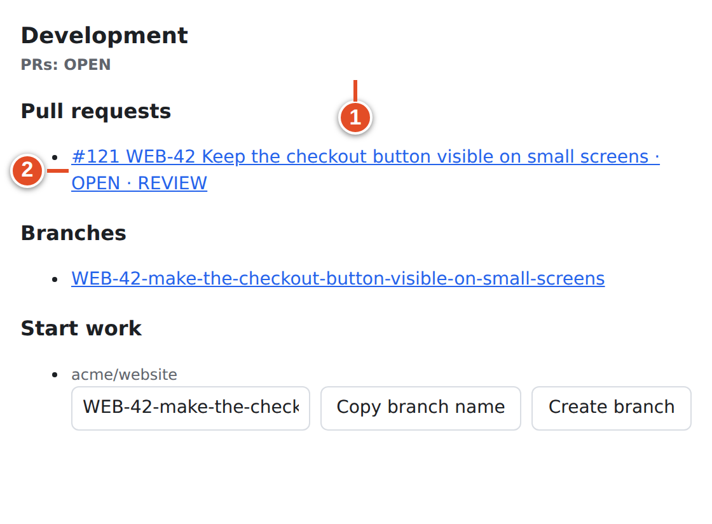


## Step 6 — CI runs and a preview deploys

**You do:** nothing. Your CI (GitHub Actions in the demo) starts on the push, and your hosting provider (Vercel in the demo) deploys a preview.

**git-sync does:** `check_suite` events update a `[CI]` link: **pending** first, then **pass** (a **fail** looks like WEB-37 in Chapter 12). A `deployment_status` event whose URL ends in `.vercel.app`, `.netlify.app`, `.pages.dev` or `.amplifyapp.com` adds both a `[Deploy]` link and a `[Preview]` link. The demo run kept exactly these links on WEB-42:

```text
[CI] Build · pass          -> https://github.com/acme/website/pull/121/checks
[Deploy] Preview · success -> https://website-git-web-42-acme.vercel.app
[Preview] Vercel           -> https://website-git-web-42-acme.vercel.app
```

*Links git-sync kept on WEB-42 in the demo run.*

The rollup links are *updated in place*. The pending build becomes the passing build; no second link is added.

**You see:** **Builds** shows pending, then pass. **Deployments** and **Previews** appear.

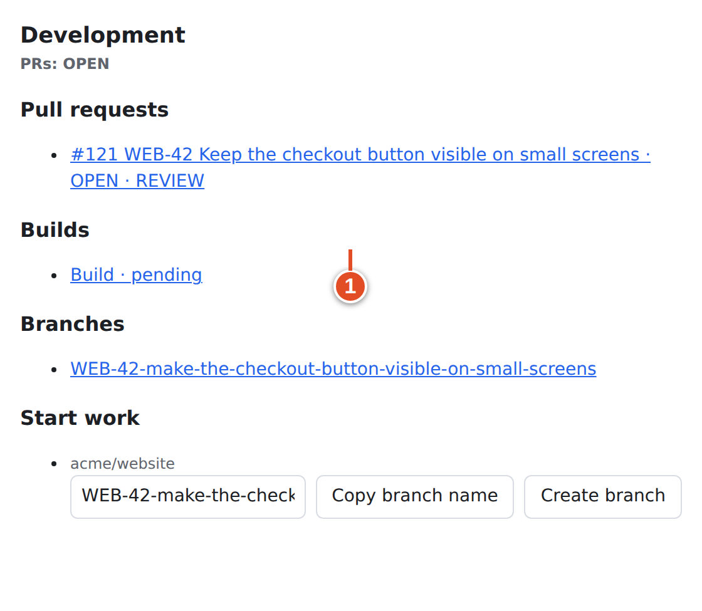

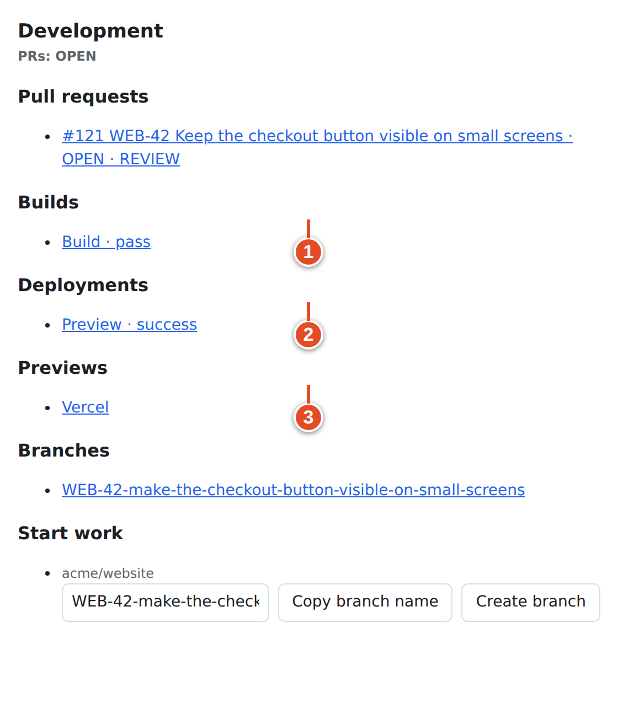

> **Tip:** Open the preview link from the work item to check the change on a real phone before asking for review. Product owners can do the same without opening GitHub.

## Step 7 — Mark ready and request a review

**You do:** mark the PR ready and ask Sam to review:

```bash
gh pr ready 121
gh pr edit 121 --add-reviewer sam-reviews
```

**git-sync does:** *Ready for review* counts as `pull_request.opened` → **In Progress** (no change). *Review requested* runs the default rule `pull_request.review_requested` → **In Review**.

**You see:** WEB-42 moves to **In Review**. The PR still shows `OPEN · REVIEW`.

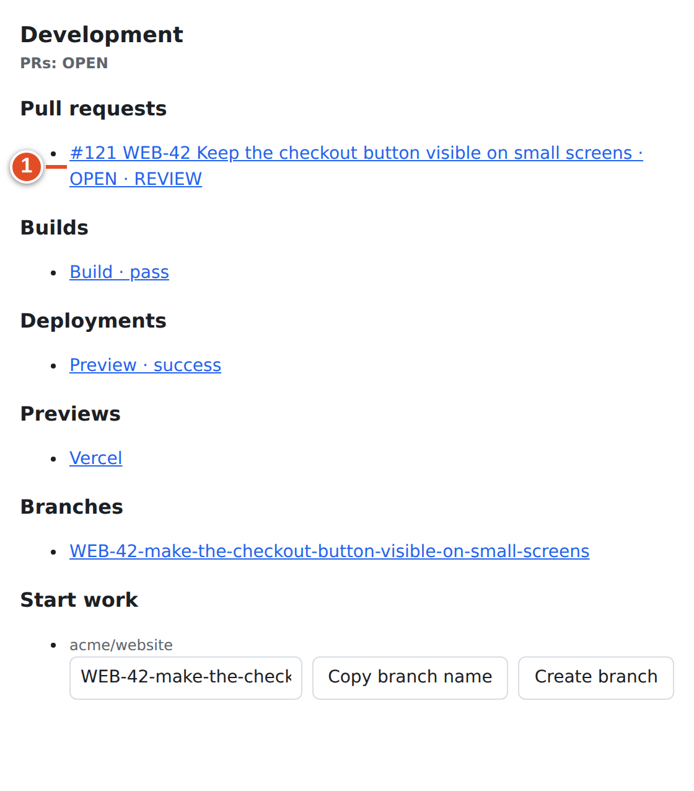

> **Note:** Opening a PR is not the same as requesting a review. The item moves to In Review only when a reviewer is actually requested.

## Step 8 — The reviewer asks for changes

**You do (Sam):** reviews on GitHub and chooses **Request changes**: *"Please keep the focus ring visible on the button."*

**git-sync does:** the `pull_request_review` event becomes `pull_request.changes_requested`. The shipped rules have no target for it, so the state stays **In Review**. The PR rollup link is rewritten to `OPEN · REJECTED`.

**You see:** the review badge changes to **REJECTED**. This means *a reviewer currently wants changes*. It does not mean the PR or the task was rejected.

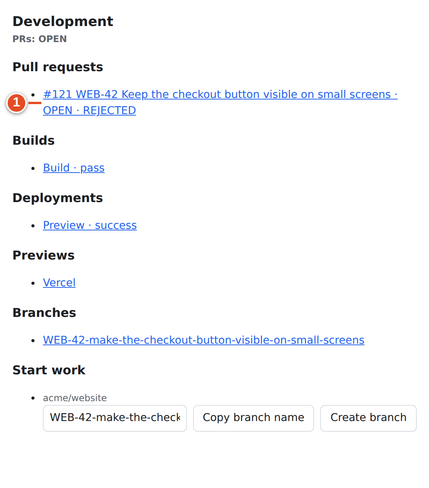


## Step 9 — Fix, push, get approved

**You do:** fix the focus ring and push. You can answer the review in Plane at the same time:

```bash
git commit -am "WEB-42 Keep the focus ring visible on the sticky button #comment Addressed review: focus ring restored."
git push
```

**git-sync does:**

- adds the Smart Commit comment *"Addressed review: focus ring restored."* (with provenance) to WEB-42;
- GitHub sends `pull_request` `synchronize` for the new head commit; CI runs again and passes.

**You do (Sam):** **Approve**.

**git-sync does:** checks readiness against GitHub's current data: open, not draft, approved, no standing change request (Sam's approval replaced Sam's own change request), and checks green. Everything holds, so it fires **ready for merge** once for this head commit (audit: `ready_for_merge fired`). The shipped rules do nothing at that point, so the state stays **In Review**. The rollup becomes `OPEN · APPROVAL`.

**You see:** the review badge reads **APPROVAL**.


How the review badge changed during steps 7–9:

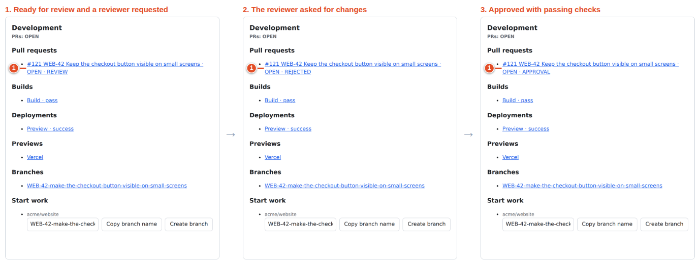

## Step 10 — Merge and verify Done

**You do:** merge the PR into `main` with your repository's merge method (button, or `gh pr merge 121`).

**git-sync does:** `pull_request` `closed` with `merged: true` becomes `pull_request.merged`. Before running the rule, the **merge guard** checks every PR linked to WEB-42. Only #121 is linked and it is merged, so the guard passes. The first matching rule is `default: merged` (base `main` matches `^main$`) → **Done**. The rollup becomes `MERGED`.

**You see:** WEB-42 is **Done**, and the Development roll-up reads **PRs: MERGED**.

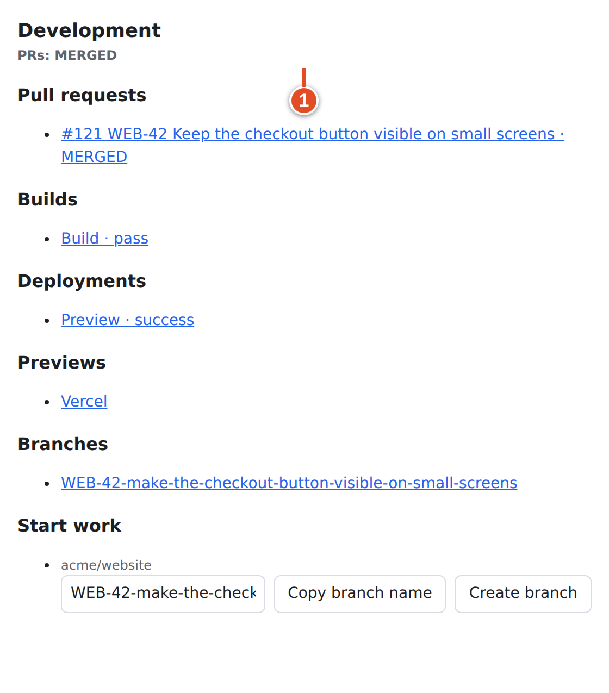

[[SCREENSHOT NEEDED: plane-04-done-after-merge — WEB-42 in Done in Plane's own work-item page after the merge, with the Development section and the three Smart Commit comments. Capture later with npm run manual:capture -- --only plane-04-done-after-merge]]

**Then:** tidy up locally.

```bash
git switch main
git pull --ff-only
git branch -d WEB-42-make-the-checkout-button-visible-on-small-screens
```

> **Warning:** *Merged is not deployed.* Done means "code merged into main" under the default rules. If your team defines Done as "live in production", ask your admin to change the merged target and use a deployment rule or a manual step instead.

**If it went wrong:**

| What you see | Likely reason | What to do |
|---|---|---|
| Stays In Review after merge | Another linked PR is still open (merge guard), or the PR was merged into a base other than `main` | Check **Pull requests** in Development, and the PR's base branch |
| Stays In Progress, never In Review | No reviewer was requested, or the project has no *In Review* state | Request a reviewer; ask your admin about state names |
| No PR in Development | The key is missing from the branch, title and body, or is misspelled (`WEB_42`) | Fix the PR title, or ask your admin to **Replay** the delivery |
| No comment from `#comment` | The key came after the command, or Smart Commits is off | Keys first, same line (Chapter 11) |

## Variant A — A bug starts as a GitHub issue

A tester reports *#131 Coupon field accepts expired codes* on GitHub. The team plans in Plane.

1. On GitHub, add the label `plane` to #131.
2. git-sync creates *WEB-47* in the Website project. In the demo run it landed in **Backlog** (Plane's project default, because no **Open state** is set on the mapping), with the label `bug` copied and Alex as the assignee (Alex's GitHub account is linked).
3. Sam's GitHub comment *"Reproduced on staging. @alex-dev can you take this?"* arrives in Plane as a new comment with a real mention of Alex.
4. Work on WEB-47 exactly like steps 1–10: branch `WEB-47-…`, PR `Closes WEB-47`.
5. When the PR merges, WEB-47 moves to Done. *That change does not close #131.* git-sync makes the change as its own service account, and Plane events from the service account are ignored on arrival (loop prevention). To close the GitHub issue as well, also write `Closes #131` in the PR body: GitHub closes #131 itself at merge.
6. If a person moves WEB-47 to a completed state in Plane instead, the mirror closes #131 with reason `completed`, because the State policy is **Last write wins**.

Do **not** create a second Plane item by hand while the mirror is being created.

## Variant B — Split work across PRs (Refs)

WEB-42 is too big for one review: layout in one PR, keyboard support in another.

- Use branch names **without** the key: `checkout-layout-part-one`, `checkout-keyboard`.
- Put `Refs WEB-42` in each PR's title and body. Do not use a bare key in the title, because a bare title key is closing.
- **Effect:** each PR links to WEB-42 and can move it to In Progress or In Review, but *no merge moves it to Done*. That is what happened to WEB-41 in the demo (`Refs WEB-41`: linked, moved to In Progress on open).
- When the last part merges, move WEB-42 to Done yourself. Alternatively, write `Closes WEB-42` only in the final PR. While any earlier part is still open, the merge guard keeps the item open.

A branch such as `refs/web-42/layout` still contains a bare key and is **closing**. The slash is not the whitespace a magic word needs.

> **Example:** If the parts are separate sub-work items, close each child and refer to the parent: `Closes WEB-43` and `Refs WEB-42` in the same PR body.

## Variant C — One PR finishes two items

```text
Closes WEB-42, WEB-45
```

One magic word can take several keys separated by `,`, `and` or `&`. Each item is checked separately: WEB-45 might stay open because it has another PR still open. Verify both items after the merge.

## Variant D — Reverting a merged change

A revert is new code and new events. git-sync has no "undo everything the old PR did" operation.

1. Create a work item that explains *why* the revert is needed, for example `WEB-51`.
2. Create the revert as usual. GitHub's **Revert** button creates a branch such as `revert-121-WEB-42-make-the-checkout-button-visible-on-small-screens` and pre-fills a PR form. Branches starting with `revert-` never trigger *Branch pushed*, so the old item is not restarted by the push alone.
3. *Before you submit the PR form*, edit its title and body. The pre-filled title `Revert "WEB-42 Keep…"` and the branch name both contain a bare `WEB-42`, and both are **closing** references when the PR is parsed. Write `Closes WEB-51` and, if the old item must not be linked at all, `skip WEB-42` in the body. `skip` removes that key from every source of the PR (branch, title and body). `Relates to WEB-42` alone is not enough here, because the branch name keeps WEB-42 a closing reference. Use `skip WEB-42`, or make the revert on a branch whose name has no key.
4. After merging, reopen WEB-42 yourself if its outcome is no longer delivered.

`skip WEB-42` only stops new linking. It does not remove a link that already exists. Smart Commit commands copied into the revert's commit messages run again, because a revert commit has a new SHA. Check for `#time` or `#done` before you push.

## Variant E — PR first, work item later (WEB-NEW)

Sometimes the code exists before anyone wrote a task. Put `WEB-NEW` (uppercase `NEW`) in the PR title or body:

```bash
gh pr create --title "WEB-NEW Add rate limiting to the sign-up form" \
  --body "Limits sign-up attempts to 5 per minute per IP address."
```

git-sync creates a new work item in the project whose identifier is `WEB`. The item takes the PR's title and a **started**-group state, and is linked to the PR as closing. In the demo run this created *WEB-46*, already In Progress, with the PR in its Development panel. It runs on opened, edited and reopened events, and only once per PR.


> **Note:** In this release, the link-back comment for an item created through `WEB-NEW` shows `- WEB:` instead of the new key (`WEB-46`). The link URL is correct. This is a known defect, listed in Appendix E.

Rename the item in Plane afterwards if `WEB-NEW` in its title bothers you. The title is not re-synced from the PR.

## What you learned

- The full loop, as verified on the demo instance: branch → In Progress; draft and open → In Progress; reviewer requested → In Review; changes requested → `REJECTED` badge; approval → `APPROVAL` and ready for merge; merge into `main` → **Done**.
- **Create branch** creates the branch on GitHub only. Fetch it locally before you work.
- Smart Commits add comments and time notes with "via &lt;sha&gt; by &lt;login&gt;" provenance. Time is a comment, not a worklog.
- Use branches without the key plus `Refs` for partial work, and `Closes A, B` for one PR that finishes two items. Edit revert PR titles before opening them, and use `WEB-NEW` for PR-first work.
- Merged is not the same as deployed. Agree on what Done means in your team.

## Source files

- `manual/demo/events.ts`: the exact events of this chapter's run; `manual/demo/run-loop.sh` replays them
- `src/ui/dev-panel.ts`, `src/ui/client/DevPanel.tsx`: Development panel and **Create branch**
- `src/app/push.ts`, `src/github/smart-commits.ts`: pushes and Smart Commits
- `src/app/pr.ts`, `src/github/pr-automation.ts`: PR lifecycle, ready for merge, merge guard, `WEB-NEW`
- `src/app/checks.ts`, `src/sync/dev-info.ts`: builds, deployments, previews and rollup links
- `src/app/issues.ts`, `src/sync/mirror.ts`: Variant A mirroring
