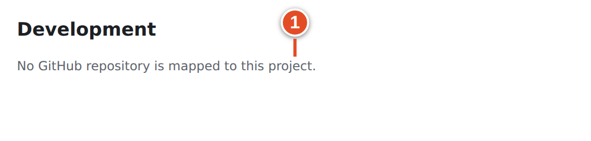
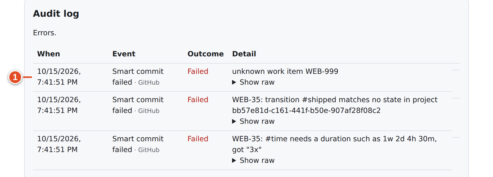
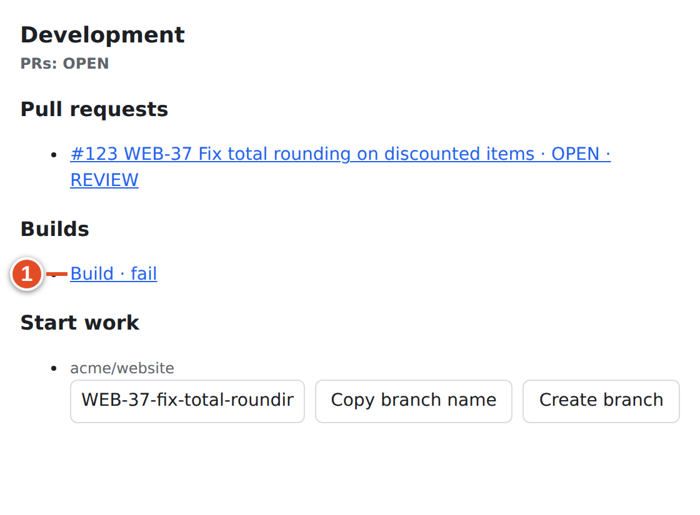

# 17 · Troubleshooting

Most "sync is broken" moments come from one of four causes:

1. **The key was not recognised.** It is misspelled, in the wrong place, or the item cannot be found.
2. **Nothing connects the repository to the project.** There is no mapping, or the App has no access.
3. **The rules did not allow the change.** The tier, the merge guard, the base branch or a missing state blocked it.
4. *The event has not been processed yet,* or it never arrived.

Work from what you can see towards what only an admin can see. Do not recreate items or push "wake-up" commits. Each new commit is a new event and can repeat Smart Commit commands.

> **Tip:** Ask three questions in order: *Is the code linked?* (look at **Development**) → *Did the event arrive?* (ask your admin for the audit log) → *Was the change allowed?* (tier, rules, merge guard).

## Linking

| Symptom | Likely cause | Fix |
|---|---|---|
| No PR in the work item's **Development** panel | The key is missing from the branch, PR title and PR body, or is misspelled | Copy the key from Plane, then edit the PR title or body. An edit triggers a new parse. |
| A key only in commit messages, but no PR link | Commit messages never create PR links | Put the key in the branch, title or body |
| `web-42` in the PR body does not link | Bare keys in the title and body must be uppercase. Only branch names are case-insensitive. | Write `WEB-42`, or use a magic phrase (`Refs web-42` works) |
| `WEB-42_fix` or `WEB_42` in a branch does not link | An underscore breaks the key | Use `WEB-42-fix` |
| `Closes:WEB-42` does not link | A space is required after the magic word (the colon is optional) | `Closes WEB-42` or `Closes: WEB-42` |
| A valid key still does nothing | The item does not exist, or git-sync's service account cannot see that project | Check you can open it; tell your admin (audit `reference_unresolved`) |
| `skip WEB-42` did not remove the link | `skip` only prevents *new* links | Ask your admin; there is no self-service unlink |
| No "Linked Plane work item" comment on the PR | **Post link-back comments on GitHub** is off, or the write is still queued | Check **Development** in Plane first |
| Development says **No GitHub repository is mapped to this project.** | The project has no mapping | Ask a workspace admin to map the repository (Chapter 24) |



## State changes

| Symptom | Likely cause | Fix |
|---|---|---|
| PR is linked, but opening it did not change the state | The reference is a **relation** (bare key in the body, `Relates to`), or the rule targets a state your project lacks | Use the tier you mean (Chapter 9); ask your admin to check the rule |
| Item moved to Done although the PR said `Refs` | A bare key in the **branch** or **title** made it closing, and the strongest tier wins | Partial work: no key in the branch or title |
| Merge did not move the item to Done | Another linked PR is still open (merge guard); the base is not `main`; or the reference is non-closing or relation | Check **Pull requests** in Development, the base branch and the wording |
| The other PR was later closed, but the item is still not Done | The guard is only checked at the merge event | Move the item yourself, or ask your admin to **Replay** the merge delivery |
| Approval did nothing | No default rule for approval or ready for merge | Expected. Merge to finish. |
| Never moved to In Review | No reviewer was requested, or there is no *In Review* state | Request a reviewer; ask your admin about state names |
| Item moved *back* after a merge | It did not: old events are ignored if the PR has changed since | Look for a manual change or a Smart Commit `#…` in a later push |
| A new branch did not reopen a Done item | By design, *Branch pushed* never moves completed or cancelled items | Reopen it yourself if the work really restarts |
| Revert PR closed or linked the old item | Its branch or title contains the old key | Use `skip WEB-42` in the body before submitting (Chapter 15, Variant D) |

## Smart Commits

When **Report problems as comments on GitHub and Plane** is on, git-sync tells you what went wrong. It posts a comment on the commit in GitHub, and on the work item in Plane when the key is known. These are the exact texts from the demo run:

```text
Git sync could not complete this action:

- ` WEB-35: #shipped matches no Plane state. `
- ` WEB-35: #time needs a duration such as 1h 30m. `
```

```text
Git sync could not complete this action:

- ` Unknown work item WEB-999. `
```

*Text git-sync posted to GitHub in the demo run.*

| Symptom | Likely cause | Fix |
|---|---|---|
| Nothing happened after `git commit` | Commands run only after a **push** | Push |
| Nothing happened after a push | Smart Commits are off for this mapping; commits must be signature-verified (`REQUIRE_VERIFIED_COMMITS`); or the key came after the command | Keys first, same line; ask your admin about the mapping and signing |
| "… matches no Plane state" | The state name is wrong for this project | Use the full hyphenated name: `#in-review` |
| "… matches several Plane states" | The token is ambiguous (`#in` matches both In Progress and In Review) | Use more words: `#in-progress` |
| "#time needs a duration…" | Invalid duration (`3x`, `1 hour`) | `45m`, `1h 30m`, `0.5d`, `1w 2d` |
| "Unknown work item WEB-999." | A typo, or a key from another workspace | Fix the key in a *new* commit (the old one never re-runs) |
| `#done` ended up as comment text | `#comment` swallows the rest of the line | Put `#comment` last |
| Commands ran twice | The commit was rebased or amended (new SHA) | Expected. Delete the extra comment in Plane. |
| Item moved before review | A state command (`#done`) in an intermediate commit | Leave state changes to the PR lifecycle |
| Comment shows the git-sync account as author | All Plane-side writes use the service account in this release; the "by &lt;login&gt;" line names you | Expected |



*Your admin's view of the same failures in the audit log.*

## Development panel

| Symptom | Likely cause | Fix |
|---|---|---|
| **Builds** stays pending | CI is still running, or the check suite never completed | Open the build link and look at GitHub Actions |
| **Builds** shows fail | A check failed | Open it, fix the failure and push |
| No **Previews** entry | Only deployment URLs on `.vercel.app`, `.netlify.app`, `.pages.dev` or `.amplifyapp.com` are recognized; a "Preview" link in the PR body is not | Use one of those hosts, or open the deployment link |
| No **Create branch** button | You are not a project member, or there is no mapping | Ask a project admin |
| "Branch already exists" | The branch was created before | Fetch it: `git fetch origin` |
| "The repository is empty; push a first commit before creating branches" | The repository has no commits | Push an initial commit |
| "The GitHub App cannot create branches in this repository (it needs Contents: write)" | App permission | Tell your admin |
| No commit list | The panel has no commits section in this release | Use the branch or PR link |
| "Sign in to Plane to continue" | Your Plane session expired | Sign in again |



## Your GitHub account

| Message on **My GitHub account** | Meaning | Fix |
|---|---|---|
| **No personal GitHub account connected.** | You have not linked yet | **Connect personal account** |
| **Needs re-authorization. Reconnect your GitHub account to author changes as yourself.** | GitHub refused the stored token (revoked, expired, App re-installed) | **Reconnect** |
| *This connection link has expired, was already used, or belongs to another Plane account. Start again.* | You waited too long, used the link twice, or were signed in to Plane as someone else | Start again from the page |
| *GitHub authorization was declined. You can connect again when ready.* | You pressed Cancel on GitHub | Connect again |
| *This GitHub account is already linked to another member in this workspace.* | Someone else linked that GitHub account | Ask your workspace admin (**User links**) |
| *Ask the instance admin to configure the GitHub App client ID, client secret and App slug.* | OAuth is not set up | Tell your instance admin |
| *Personal account settings need workspace membership.* | You are not a member of this workspace | Ask for an invitation |
| You cannot find **GitHub Sync** in workspace settings | That menu is for workspace admins only | Use the direct link `/git-sync/ui/workspaces/<slug>/account` |


Your personal link is **not** the repository's access. Reconnecting does not give the App access to a private repository, and disconnecting does not break the team's sync.

## Mirrored issues and delays

| Symptom | Likely cause | Fix |
|---|---|---|
| GitHub issue with `plane` created nothing | The repository is not mapped, or the label is misspelled | Ask your admin |
| Plane item with `github` created nothing | The mapping is **GitHub to Plane only** | Expected; ask whether two-way is wanted |
| Title edit in Plane not sent to GitHub | Default policy: GitHub owns title and description | Edit on GitHub |
| A field changes on one side only | Direction or policy | Ask which side owns the field |
| Edited comment not updated on the other side | Only new comments are mirrored | Add a correction comment |
| Merge moved the item to Done, but the GitHub issue stayed open | git-sync's own changes are not mirrored back (service-user filter) | Write `Closes #N` in the PR, or close it by hand |
| Deleted Plane item, GitHub issue still open | Deleting is never closing; the link is only marked orphaned | Close the issue deliberately |
| Several minutes and nothing | Queue backlog, rate limit, outage, or a webhook that never arrived | Report it (below); your admin can **Replay** or ask GitHub to redeliver |

## How to send a useful report to an admin

Admins can see the audit log, deliveries, rules and health; you cannot. Give them enough to find the event in one search.

**Include:**

1. **The Plane key(s)**: `WEB-42`.
2. **The GitHub URL**: PR, issue or commit (`https://github.com/acme/website/pull/121`).
3. *The commit SHA*, for Smart Commit problems (`git log -1 --format=%H`).
4. **When**: the time and your **timezone** (for example *14:20 Africa/Addis_Ababa*).
5. *What you expected* and *what you saw*: one sentence each.
6. *What you already tried*, such as a new commit, a manual state change or a reconnect.
7. A **screenshot** of the Development panel or comment, with private data removed.
8. If you saw a problem comment, its exact text.

> **Example:** "WEB-36: PR #124 merged into main at 10:05 Africa/Addis_Ababa, but WEB-36 stays In Progress. Development shows #125 still OPEN. Is the merge guard blocking it, and should #125 be closed?"

**Never send** tokens, cookies, webhook secrets or `.env` files. An admin never needs them from you.

What your admin will do with it: find the delivery in the **Audit log** (filtered with `?errors=1`), open **Show raw**, check the mapping's health and rules, and then **Replay** the delivery or **Retry** a failed write (Chapters 28–29).

## What you learned

- Check in order: linked? → arrived? → allowed? Do not push "wake-up" commits.
- Most link problems are key spelling or placement. Most state problems are the tier, the merge guard or the base branch.
- Turn on **Report problems** to see Smart Commit errors on the commit itself.
- A good report has the key, URL, SHA, time with timezone, expected versus actual, and what you tried. It never contains secrets.

## Source files

- `src/parse/references.ts`, `src/app/pr.ts`: linking and the merge guard
- `src/github/smart-commits.ts`, `src/github/problems.ts`: Smart Commit errors and problem reports
- `src/ui/client/Connect.tsx`, `src/ui/oauth-flow.ts`: account messages
- `src/ui/dev-panel.ts`: Development panel errors
- `src/queue/workers.ts`, `src/sync/mirror.ts`: delivery and mirroring
