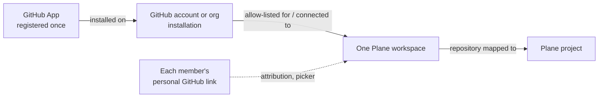

# 20 · Architecture and requirements

This chapter is for the people who install and run git-sync: the server operator, the Plane instance administrator who uses God mode, and the workspace administrators who map repositories. It explains what git-sync adds to a Plane server, how events travel, where data is kept and what you need before you install. Read it once before chapter 21; you will come back to it when something needs diagnosing.

## What git-sync is

git-sync is **one extra container** that runs next to a self-hosted Plane Community Edition installed with Docker Compose. It is called `git-sync` in Compose and listens on port `3100`. It reuses three things Plane already has:

| Plane part | What git-sync uses it for | What git-sync never does |
|---|---|---|
| Postgres (`plane-db`) | Its **own** database `gitsync` and role `gitsync`, created by the installer | It never reads or writes Plane's own tables. Every business change in Plane goes through Plane's API. |
| Valkey (`plane-redis`) | Work queues, under the prefix `gitsync` (setting `QUEUE_PREFIX`) | It does not touch Plane's own keys. |
| Proxy (`proxy`, Caddy) | A route that sends `/git-sync/*` to `git-sync:3100`, inserted before Plane's catch-all | It does not change Plane's other routes. |

Nothing else is added: no extra database server, no extra Redis and no extra public hostname. Everything git-sync shows in a browser lives under your Plane address, for example `https://plane.example.com/git-sync/ui/admin`.

On Plane v1.4.2 the installer can also build two small *Plane UI fork images*, `plane-frontend-gitsync:v1.4.2` and `plane-admin-gitsync:v1.4.2`. They add three things to Plane's own screens:

- **GitHub Sync** in **Workspace settings** (for workspace admins).
- **GitHub Sync** in God mode's sidebar (for instance admins).
- A **Development** section in every work item's sidebar (for everyone).

Each of these is an iframe that shows a git-sync page. The fork touches eight upstream files; the bulk of the UI lives in git-sync itself. If you keep Plane's stock UI (`--keep-plane-ui`), the same pages still open at their direct addresses (Appendix A lists them all).

> **Note:** The Plane menus always say **GitHub Sync**. The pages inside them have headings **Git sync:** `<workspace slug>` and **Git sync: instance settings**. Older notes and the installer's help text say "Git Sync"; that is the same thing.

## The four connections

git-sync only syncs work when four separate connections exist. Different people own each one.

*Diagram: the four connections. One installation belongs to exactly one workspace.*

| Connection | Who sets it up | Where | Chapter |
|---|---|---|---|
| 1. The **GitHub App** is registered and its credentials are entered in git-sync | GitHub account/org owner registers it; the **instance admin** enters it | GitHub settings; God mode → **GitHub Sync** | 22, 23 |
| 2. The App is **installed** on a GitHub account or organization, and that installation is **connected** to one Plane workspace | An org owner installs/approves; a **workspace admin** connects (or the instance admin allow-lists) | GitHub; **Workspace settings → GitHub Sync** | 24, 23 |
| 3. A **repository is mapped** to a Plane project | **Workspace admin** | **Workspace settings → GitHub Sync → Map a repository** | 24, 25 |
| 4. Each *member links their personal GitHub account* | Each member (or a workspace admin, manually) | **My GitHub account** / **User links** | 8, 27 |

One installation can serve only one Plane workspace. If a second workspace tries to connect the same installation, it is refused with "That installation is connected to another workspace." This boundary is deliberate: a webhook from that installation can only ever write into the one workspace that owns it.

## Roles and permissions

| Who | Plane role | What they can open in git-sync |
|---|---|---|
| Instance admin | Signed in to God mode (separate `admin-session-id` session) | `/git-sync/ui/admin`: App credentials, setup checks, defaults, magic words, installation allow-list, disabled mappings, manual mapping recovery, instance audit |
| Workspace admin | Workspace role **Admin** (role 20) | `/git-sync/ui/workspaces/<slug>`: connection, mappings, policies, rules, user links, audit log |
| Member | Workspace role **Member** (15) or higher | Only **My GitHub account** (`/git-sync/ui/workspaces/<slug>/account`) and the **Development** panel of items they can see |
| Guest | Guest | The Development panel only if Plane lets them read the work item |

git-sync never keeps its own user list. On every request it asks Plane, with the browser's own session cookie, who the viewer is and what role they have. A normal workspace session is not enough for God mode pages: they need the God mode session.

> **Admin only:** Members do not see **GitHub Sync** in Workspace settings (Plane CE shows that settings area to admins only). Give members the direct link to **My GitHub account**: `https://<your Plane>/git-sync/ui/workspaces/<slug>/account`.

## How an event travels

1. **A change happens.** Someone pushes, opens a PR or edits an issue on GitHub, or edits a work item in Plane.
2. **A signed webhook arrives.**
   - GitHub posts to `https://<your Plane>/git-sync/webhooks/github`, signed with the App's webhook secret (`X-Hub-Signature-256`).
   - Plane posts **inside Docker** to `http://git-sync.internal:3100/git-sync/webhooks/plane`, signed with the Plane webhook secret (`X-Plane-Signature`).
   - A missing or wrong signature gets `401` and is dropped.
3. **Durable acceptance.** The verified delivery is put on a queue (`inbound-github` or `inbound-plane`) and acknowledged.
   - If Valkey is down, a Plane delivery is kept in Postgres (`inbound_spool`) and replayed every minute once the queue is back.
   - A GitHub delivery gets `503` in that case and must be redelivered from GitHub later (chapter 29).
4. **Reducers decide.** A worker drops duplicates and echoes of git-sync's own writes, finds the mapping and checks that the mapping's installation is still allowed for that workspace. It then works out what should happen: link a PR, run Smart Commit commands, mirror a field, or run a rule.
5. **The ordered outbox writes.** Every intended write to Plane or GitHub is stored first in `outbound_writes`, then carried out in order per target by the `outbound-plane` / `outbound-github` workers.
   - Failed writes are retried with back-off, up to 30 attempts.
   - Rate limits pause the target until the limit's deadline.
6. **Everything is audited.** Each step leaves a row in the audit log (chapter 28).

### Why git-sync ignores its own changes

git-sync writes into Plane as a **service account** (a dedicated Plane user, usually called "GitHub Bot"). When Plane then sends a webhook for that change, git-sync recognizes the service user and the field-level fingerprint of its own write, and drops the echo. This is why the service account must be a **separate** Plane user: if you install git-sync with your own personal API key, your own edits look like echoes and never reach GitHub.

### Background jobs

A `maintenance` queue runs recurring work:

- Replays the Plane spool every minute.
- Prunes echo records every ten minutes (default echo TTL ten minutes).
- Runs **reconciliation** every 60 minutes by default. It checks existing links, marks partners that were deleted in Plane as *orphaned*, and notices when Plane deliveries have stopped arriving.
- Prunes old ledgers hourly.

Both intervals are editable in God mode → **Defaults**.

## Where data lives

| Data | Where | Back it up? |
|---|---|---|
| Mappings, rules, policies, links, audit log, outbox, user links | `gitsync` Postgres database | Yes |
| GitHub App private key, webhook secret, OAuth client secret, members' GitHub tokens | Same database, **encrypted** with AES-256-GCM using `GITSYNC_TOKEN_KEY` | Yes, *together with the key* |
| Service settings (`DATABASE_URL`, `PLANE_SERVICE_PAT`, `GITSYNC_TOKEN_KEY`, …) | `git-sync.env` in Plane's directory, mode `0600` | Yes, privately |
| Optional App key bootstrap file and credential-retirement marker | `git-sync/` directory in Plane's directory | Yes |
| Compose wiring | `docker-compose.override.yaml` (merged, not replaced) | Yes |
| Queued jobs | Valkey under `gitsync:*` | Optional; Plane deliveries also spool to Postgres |

> **Warning:** `GITSYNC_TOKEN_KEY` and the database belong together. Restoring the database with a different key makes every stored secret unreadable (God mode then shows **GitHub App credentials cannot be decrypted. Save the App secrets again.**). The installer always keeps the existing key; never change it by hand.

## Network topology

There are two supported layouts.

**Plane's bundled proxy (default, `--proxy plane`).**
- The installer copies Plane's Caddyfile, inserts `reverse_proxy /git-sync/* git-sync:3100` before Plane's catch-all, and mounts the patched file into the `proxy` service.
- Browsers and GitHub reach git-sync through your normal Plane address.

**Your own reverse proxy (`--proxy external --gateway-network NAME`).**
- git-sync joins your proxy's Docker network under the alias `git-sync`.
- You add a route for `/git-sync/*` to `git-sync:3100` yourself, placed **before** the Plane route.

In both layouts:
- git-sync joins Plane's default Compose network with the alias **`git-sync.internal`**. Plane refuses webhooks to its own public domain and to host names without a dot, so the Plane webhook uses this internal name.
- git-sync talks to Plane's API directly at `http://api:8000`, without going through the public proxy.

## Requirements checklist

| Requirement | Why | Check |
|---|---|---|
| Self-hosted **Plane Community Edition v1.4.2**, installed with Docker Compose (the official `setup.sh` install works) | The UI forks are pinned to v1.4.2; other versions keep stock UI automatically | Plane opens normally |
| Docker Engine with the **Compose plugin**, run by a user who can use Docker and write Plane's directory (usually `sudo`) | The installer drives Compose | `docker compose version` |
| `git` on the server | Building the Plane UI fork images | `git --version` |
| ~2 GB free disk and 10–20 minutes for the first UI image build | Fork build | — |
| A public **HTTPS** Plane address reachable from GitHub (or your GitHub Enterprise Server) | GitHub webhooks and OAuth callbacks | `curl https://<plane>/` from outside |
| A dedicated Plane **service account** with a Personal Access Token, member of every synced workspace | Writes into Plane; echo filtering | Chapter 21 |
| `WEBHOOK_ALLOWED_HOSTS` containing `git-sync.internal` in Plane's env, applied to `api`, `worker`, `beat-worker` | Plane's webhook guard | Installer checks it |
| A GitHub account or organization where you may register and install a GitHub App | App registration | Chapter 22 |
| Plane's `API_KEY_RATE_LIMIT` and git-sync's `PLANE_API_RATE_PER_MINUTE` agreed | Avoid 429s | God mode **Setup checks** |

## Security model in one page

- **Webhooks are signed.** A delivery with a wrong signature is refused before parsing. A signature proves who sent it; it does not grant write access by itself.
- **Every write is authorised again at execution time.** A queued write remembers the mapping, repository and installation that admitted it. The outbox checks that exact authority again before calling Plane or GitHub. A mapping removed or an installation revoked after the event means the write is refused.
- **Browser writes are CSRF-protected.** Every configuration change must come from your exact Plane origin (`PUBLIC_ORIGIN`) with a JSON body.
- **Secrets are encrypted and never shown again.** The App's private key, webhook secret and client secret are write-only in God mode: leave the fields empty to keep them.
- *Personal GitHub tokens* are stored encrypted per member. Members can disconnect at any time, which revokes the token at GitHub when possible.
- **Workspace identity is pinned.** A workspace slug is bound to Plane's immutable workspace ID. If a workspace is deleted and a new one reuses its slug, git-sync answers `409` until an instance admin clears the old data, so the new workspace cannot inherit old credentials.
- **The UI may only be framed by Plane itself.** git-sync pages send `frame-ancestors 'self'`. If your proxy adds `X-Frame-Options: DENY` to everything, the embedded pages go blank (chapter 21, "Blank GitHub Sync page").

## What you learned

- git-sync is one container beside Plane that reuses Plane's Postgres, Valkey and proxy, with its own database and queue prefix.
- Four connections must exist: App credentials, an installation connected to one workspace, a repository mapping, and personal links.
- Events are verified, queued, reduced and written through an ordered, re-authorized outbox; everything is audited.
- The database and `GITSYNC_TOKEN_KEY` must always travel together.
- Before installing you need Docker Compose, a service account with a PAT, the internal webhook allow-list entry and a public HTTPS origin.

## Source files

- `src/app/main.ts` — runtime composition
- `src/api/handler.ts` — signed webhook ingress
- `src/queue/` — queues, workers, maintenance
- `src/operations/outbox.ts`, `src/app/writers.ts` — ordered outbox
- `src/ui/plane-auth.ts` — role checks against Plane
- `apps/README.md` — the Plane UI fork surface
- `docs/superpowers/specs/2026-10-10-plane-github-sync-design.md` — design
