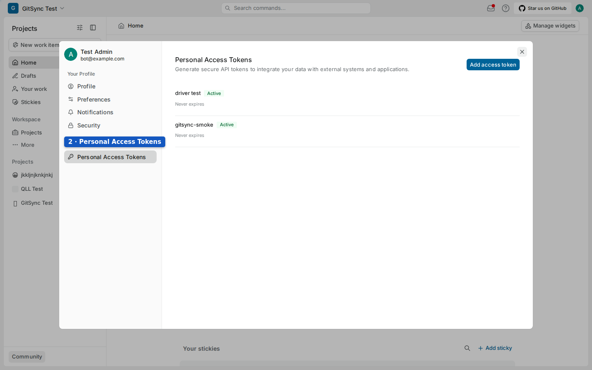
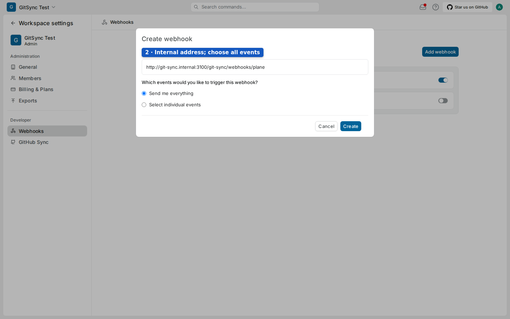
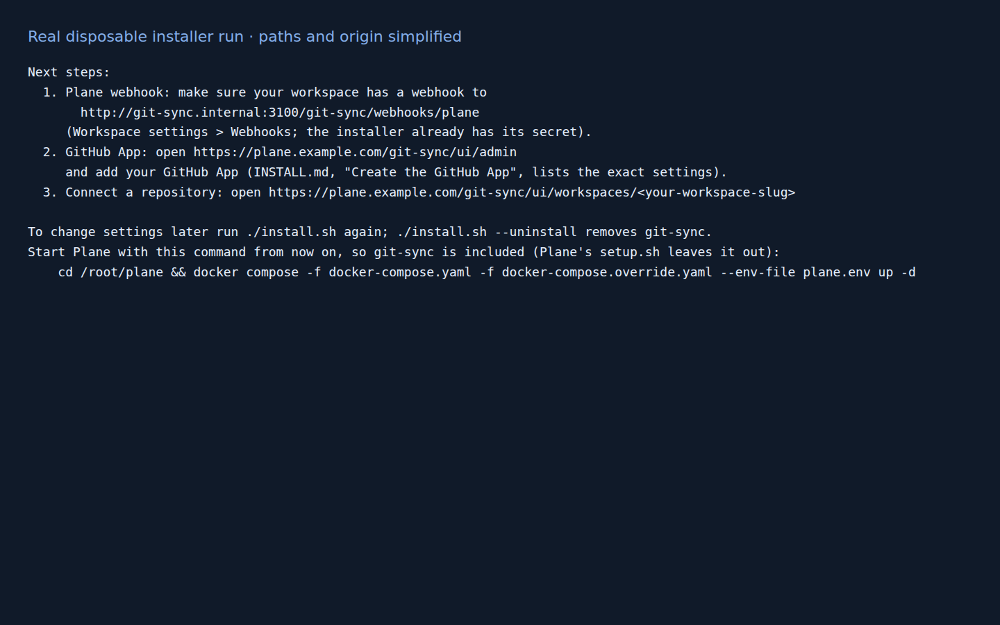
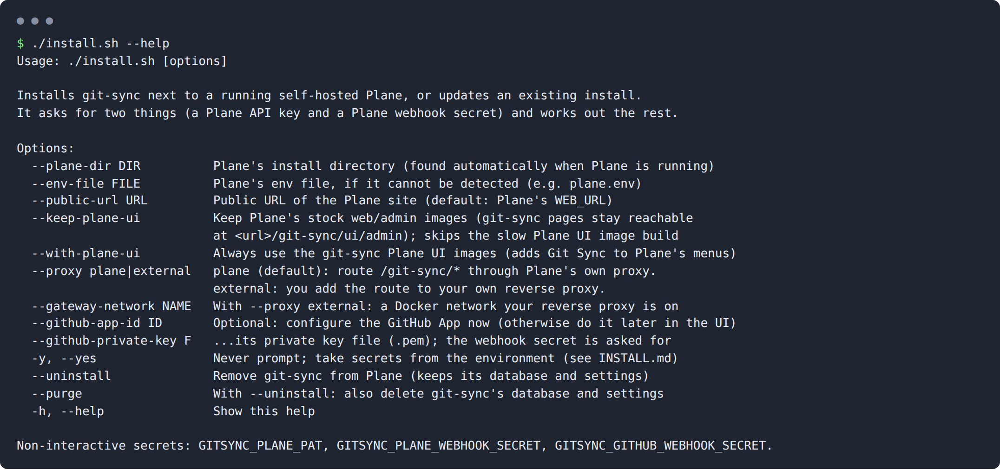

# 21 · Install git-sync

This chapter takes you from a running Plane to a running git-sync. You prepare three things in Plane: a service account, its API key and a webhook. Then you run one command, `./install.sh`, on the Plane server. The GitHub side comes afterwards, in chapters 22–24.


## Overview

| Step | Where | Time | Who |
|---|---|---|---|
| 1. Create a service account | Plane sign-up + **Workspace settings → Members** | 5 min | Workspace admin |
| 2. Create its API key | Plane, signed in *as the service account* | 2 min | Workspace admin |
| 3. Allow the internal webhook host | `plane.env` on the server | 5 min | Server operator |
| 4. Create the Plane webhook | **Workspace settings → Webhooks** | 2 min | Workspace admin |
| 5. Run `./install.sh` | Server shell | 5 min, plus 10–20 min for the first UI build | Server operator |
| 6. Fix framing if the page is blank | Your proxy | as needed | Server operator |

## Step 1 — Create a separate service account

### Goal: give git-sync its own Plane identity

**Before you start:** decide on an email address for the bot. It must be a different Plane user from every person.

> **Warning:** Do not use your own account. git-sync ignores Plane changes made by its service account, because they look like its own echoes. If the service account is you, your own edits never sync to GitHub. The installer prints this reminder too: *"git-sync ignores Plane changes made by this account (they look like its own). Use a dedicated account, not your personal one, or your own edits will not sync to GitHub."*

**Steps**

1. In a private browser window, open your Plane sign-in page and choose **Sign up** (if your instance allows self-registration). Create the user, for example display name **GitHub Bot**.
2. Back in your admin session, open **Workspace settings → Members** and invite the bot to every workspace you will sync.
3. Accept the invitation in the bot's session.
4. Join the bot to the projects you will map, so it can read and update their work items.


**Result:** the bot is a member of the workspace and its projects.

**If it went wrong:**
- *Sign up is not offered* → self-registration is disabled. Ask the instance admin to create the user through the instance's normal account process.
- *A Gmail address is the only one available* → a plus address such as `you+gitsync@example.com` is a distinct Plane user that still delivers to your mailbox. Use it only if your instance accepts it, and double-check you are signed in as the bot before step 2.

## Step 2 — Create the service account's API key

### Goal: a Plane Personal Access Token owned by the bot

**Before you start:** be signed in **as the bot**, not as yourself. A token made in your session belongs to you, whatever its title says.

**Steps**

1. Open the bot's avatar menu and choose **Settings**.
2. Choose **Personal Access Tokens**.
3. Select **Add access token**, enter a title such as `git-sync bot`, choose an expiry, and generate the token.
4. Copy the token into a safe temporary place. You will paste it into the installer's hidden prompt.





**Result:** you have a token. The installer verifies it against Plane (`/api/v1/users/me/`) and records the bot's user ID by itself. You never type that ID.

**If it went wrong:** an expired or revoked token stops all Plane writes. Put a reminder in your calendar before the expiry date; rotation is in chapter 29.

## Step 3 — Allow Plane to send webhooks to git-sync

### Goal: `git-sync.internal` in Plane's webhook allow-list

Plane refuses webhooks to its own public domain and to host names without a dot. git-sync therefore receives Plane's webhooks inside Docker under the alias **`git-sync.internal`**, which the installer adds to Plane's network. Plane only sends to it if the name is in `WEBHOOK_ALLOWED_HOSTS`.

**Steps** (on the server, in Plane's directory)

1. Open Plane's env file (often `plane.env`).
2. Set `WEBHOOK_ALLOWED_HOSTS=git-sync.internal`, or append `,git-sync.internal` if the variable already has a value.
3. Apply it to the running API with your usual full Compose command, for example:

```bash
docker compose -f docker-compose.yaml --env-file plane.env up -d api worker beat-worker
```

Use `up -d`, not `restart`: `restart` keeps the old environment.

**Result:** the running `api` container has the new value. The installer reads it from the running container, not from the file, and stops if it is missing:

```text
Plane does not allow webhooks to git-sync yet. Add git-sync.internal to WEBHOOK_ALLOWED_HOSTS in Plane's env file
  (e.g. WEBHOOK_ALLOWED_HOSTS=git-sync.internal, or append ,git-sync.internal to an existing value),
  restart Plane's api, worker and beat-worker with your usual compose command, then run ./install.sh again.
  Nothing has been changed yet.
```

## Step 4 — Create the Plane webhook

### Goal: Plane sends every workspace change to git-sync

**Before you start:** Step 3 is applied. Do this once **per workspace** you will sync.

**Steps**

1. Open **Workspace settings → Webhooks** and select **Add webhook**.
2. URL: `http://git-sync.internal:3100/git-sync/webhooks/plane` (exactly this; `http`, port `3100`).
3. Choose **Send me everything**.
4. Save, then copy the **secret key** Plane shows. Keep it with the bot token.




**Result:** the webhook exists. Until git-sync is running, Plane cannot deliver to it; keep the gap short. Plane switches a webhook off after about 30–50 minutes of failed connections (chapter 29 explains how to re-enable it).

**If it went wrong:**

| Message in Plane | Cause | Fix |
|---|---|---|
| "Webhook not created" / URL refused | You used your Plane domain, or a name without a dot, or `git-sync.internal` is not in the running `WEBHOOK_ALLOWED_HOSTS` | Use the exact internal URL; repeat step 3 with `up -d` |

> **Note:** The Plane webhook secret, the bot's API key and (later) the GitHub webhook secret are three different secrets. Never substitute one for another.

## Step 5 — Run the installer

### Goal: git-sync running and healthy next to Plane

**Before you start:**
- A shell on the server that runs Plane.
- The bot token and the Plane webhook secret.
- Docker access for your user. Use `sudo` only if root owns the Docker daemon Plane runs on. With rootless Docker, run as the owning user.

**Steps**

1. Get the code and enter it:

```bash
git clone https://github.com/nathanabay/git_plane-intergration.git git-sync
cd git-sync
```

2. Start the installer:

```bash
sudo ./install.sh
```

3. Answer the prompts (typed secrets are hidden):

| Prompt (exact text) | Shown when | Enter |
|---|---|---|
| `Start Plane now and install git-sync on it? [Y/n]` | Plane is installed but stopped | `Y` only if this is the Plane you mean |
| `Plane API key of the git-sync service account:` | First install, or the stored key was rejected | The bot token from step 2 |
| `Plane webhook secret:` | First install | The secret from step 4 |
| `Public URL of your Plane site (e.g. https://plane.example.com):` | Plane's `WEB_URL` could not be read | Your public Plane address |
| `GitHub App webhook secret:` | Only with `--github-app-id` and `--github-private-key` | The App's webhook secret (chapter 22) |

4. Wait. The installer prints one heading per stage:

| Heading | What happens |
|---|---|
| `==> Checking Docker and Plane` | Finds Docker, Compose and Plane (running, stopped, or only its folder). Reproduces how Plane was started and refuses if it cannot. |
| `==> Building the git-sync image` | Builds `git-sync:local` from this checkout. |
| `==> Preparing the Plane UI images (adds Git Sync to Plane's menus)` | On Plane v1.4.2 only: builds `plane-frontend-gitsync:v1.4.2` and `plane-admin-gitsync:v1.4.2` (first time: often 10–20 minutes), or reuses them. |
| `==> Configuring git-sync` | Checks the bot token, checks `WEBHOOK_ALLOWED_HOSTS`, writes `git-sync.env`, creates the `gitsync` database and role, patches the proxy route, merges the Compose override. |
| `==> Starting git-sync` | Validates the merged Compose model, runs `up -d`, waits up to 2 minutes for `/git-sync/healthz`, checks the proxy answers. |


**Result:** the installer ends with **git-sync is installed.** and prints the next steps. It also prints the command you must use **from now on** to start Plane:



```text
Start Plane with this command from now on, so git-sync is included (Plane's setup.sh leaves it out):
    cd /root/plane && docker compose -f docker-compose.yaml -f docker-compose.override.yaml --env-file plane.env up -d
```

> **Warning:** Plane's own `setup.sh` start/restart ignores the override file, so it starts Plane **without** git-sync. Copy the printed command into your runbook and use it instead.

### All installer options



| Option | Use it when |
|---|---|
| `--plane-dir DIR` | More than one Plane runs on the machine ("Found more than one Plane. Choose one with --plane-dir DIR"), or Plane is in an unusual folder |
| `--env-file FILE` | The installer cannot tell which env file Plane was started with ("Could not work out how this Plane was started") |
| `--public-url URL` | Plane's `WEB_URL` is not the address people actually use |
| `--keep-plane-ui` | Keep Plane's stock web/admin images and skip the slow UI build. git-sync pages stay reachable at `<url>/git-sync/ui/admin` and `<url>/git-sync/ui/workspaces/<slug>` |
| `--with-plane-ui` | Always use the git-sync Plane UI images (the default on v1.4.2 is automatic) |
| `--proxy plane` | Default: route `/git-sync/*` through Plane's own proxy |
| `--proxy external --gateway-network NAME` | Your own reverse proxy serves Plane. git-sync joins that Docker network as `git-sync`; add the route yourself (see below) |
| `--github-app-id ID --github-private-key FILE` | Enter the GitHub App at install time instead of in God mode. The two go together; the webhook secret is asked for |
| `-y`, `--yes` | Scripted install: never prompt. Secrets come from `GITSYNC_PLANE_PAT`, `GITSYNC_PLANE_WEBHOOK_SECRET` and `GITSYNC_GITHUB_WEBHOOK_SECRET`; the public URL from `GITSYNC_PUBLIC_ORIGIN` |
| `--uninstall` | Remove git-sync from Plane, keeping its database and settings (chapter 29) |
| `--purge` | With `--uninstall`: also delete git-sync's database and settings |
| `-h`, `--help` | Show the help |

**Example: your own Caddy serves Plane over a Docker network called `gateway`.**

```bash
sudo ./install.sh --plane-dir /root/plane --proxy external --gateway-network gateway
```

The installer then prints the route to add to your proxy, placed **before** the Plane route:

```caddyfile
handle /git-sync/* {
    reverse_proxy git-sync:3100
}
```

**Example: scripted install without prompts.**

```bash
read -r -s -p 'Bot PAT: ' GITSYNC_PLANE_PAT; export GITSYNC_PLANE_PAT
read -r -s -p 'Plane webhook secret: ' GITSYNC_PLANE_WEBHOOK_SECRET; export GITSYNC_PLANE_WEBHOOK_SECRET
sudo --preserve-env=GITSYNC_PLANE_PAT,GITSYNC_PLANE_WEBHOOK_SECRET ./install.sh -y
unset GITSYNC_PLANE_PAT GITSYNC_PLANE_WEBHOOK_SECRET
```

With `-y`, a missing answer is an error that names the variable. The installer never invents a secret.

> **Note:** The non-interactive error for the webhook secret mentions a `--plane-webhook-secret` flag. `install.sh` has no such flag; set `GITSYNC_PLANE_WEBHOOK_SECRET` instead (logged in `manual/notes/discrepancies.md`).

### What the installer changes on the server

| Item | Change |
|---|---|
| `docker-compose.override.yaml` | Adds the `git-sync` service (and, with UI forks, `web`/`admin` image entries). Your own entries, comments and `!override`/`!reset` tags are kept. Backed up first as `.bak-<time>`. |
| `git-sync.env` | Created, mode `0600`, owner-only. Existing values and extra keys are kept on re-runs. Backed up first. |
| `git-sync/` | Private directory for the optional App key and the credential-state marker (owned by UID 1000). |
| Postgres | A `gitsync` role and `gitsync` database on Plane's database server. Plane's own database is untouched. |
| Proxy (bundled mode) | A patched Caddyfile with `reverse_proxy /git-sync/* git-sync:3100` before Plane's catch-all, mounted into `proxy`. Refuses if your proxy already mounts its own Caddyfile. |
| Generated values | Database password, `GITSYNC_TOKEN_KEY` (32 random bytes, base64), `PUBLIC_ORIGIN`, `PLANE_API_RATE_PER_MINUTE` (read from Plane's `API_KEY_RATE_LIMIT`), `PLANE_SERVICE_USER_ID` |

### Is it safe on a live Plane?

- **No change unless Plane can be reproduced.** The installer only touches Plane's containers if it can rebuild exactly how Plane was started. It compares Compose's configuration hash for `api` and `plane-db` with the running containers; if they differ, it stops before changing anything.
- **Plane's own services are not recreated.** Only the proxy and, with the UI images, the `web` and `admin` apps restart.
- **Backups first.** Changed files are backed up next to themselves before each change.
- **Plane's data is never touched.** git-sync uses its own database and role; `--purge` drops only those.
- **Secrets are never printed.** Do not run the installer with `bash -x`, which would print them.
- **Existing override files are flagged.** If an existing override file was not loaded when Plane started, the installer warns: "…exists but the running Plane was started without it; its other entries will now apply too".

## Step 6 — Blank GitHub Sync page? Fix framing

Plane shows git-sync inside an iframe. git-sync allows framing by the same origin (`frame-ancestors 'self'`). If your reverse proxy adds `X-Frame-Options: DENY` or `Content-Security-Policy: frame-ancestors 'none'` to **every** response, the embedded page stays blank.


### Goal: the embedded page loads

**Steps**

1. Open `https://<your Plane>/git-sync/ui/admin` in its own tab. If it loads there but not inside Plane, framing is the problem.
2. Exclude `/git-sync/*` from the blanket header. Caddy:

```caddyfile
plane.example.com {
    handle /git-sync/* {
        header -X-Frame-Options
        reverse_proxy git-sync:3100
    }
    handle {
        header X-Frame-Options DENY
        reverse_proxy plane-proxy:80
    }
}
```

   nginx:

```nginx
location /git-sync/ {
    proxy_pass http://git-sync:3100;
    proxy_set_header Host $host;
    proxy_hide_header X-Frame-Options;
}
location / {
    proxy_pass http://plane-proxy:80;
    add_header X-Frame-Options DENY always;
}
```

3. Validate and reload the proxy, then reload the Plane page.

**Result:** **GitHub Sync** shows the git-sync page inside Plane.

**If it went wrong:** check every proxy layer (CDN, outer proxy, Plane proxy). One layer adding a denial is enough to block the frame. Keep git-sync's own `frame-ancestors 'self'`: do not remove all CSP.

## Check the installation

```bash
curl -i https://plane.example.com/git-sync/healthz
```

The answer is `200` with `{"status":"ok"}`. This only proves the HTTP service answers. Next, open God mode → **GitHub Sync** and look at **Connection health** and **Setup checks** (chapter 23).

## Troubleshooting the installer

| Message | Cause | Fix |
|---|---|---|
| `Docker is not installed.` / `Cannot talk to the Docker daemon.` | No Docker or no permission | Install Docker; use `sudo` or the right rootless user |
| `The Docker Compose plugin is missing` | Old Docker | Install the Compose plugin |
| `Plane is not installed here (no Plane found in Docker or in the usual folders).` | No Plane found | Install Plane first, or pass `--plane-dir` |
| `Found more than one Plane. Choose one with --plane-dir DIR` | Several Plane projects | Pass `--plane-dir` |
| `Could not work out how this Plane was started (which env file it uses).` | Env file not detected | Pass `--env-file /path/plane.env` |
| `Running Plane with --env-file … does not reproduce the running Plane; check the file` | Wrong env file | Use the file Plane really runs with; never bypass |
| `Plane's directory … is not writable by this user (try sudo)` | Permissions | Run as the owner or with sudo |
| `Plane rejected the API key` | Expired, revoked or wrong token | Make a new bot token; run `GITSYNC_PLANE_PAT=<key> sudo -E ./install.sh` or answer the re-prompt |
| `Plane does not allow webhooks to git-sync yet…` | Step 3 not applied | Add `git-sync.internal`, `up -d api worker beat-worker` |
| `Plane's proxy service is not running. If you use your own reverse proxy, pass --proxy external` | External proxy | Use `--proxy external` |
| `could not read the Caddyfile from Plane's proxy image; use --proxy external` / proxy already mounts its own Caddyfile | Custom proxy | Use `--proxy external` and add the route yourself |
| `building plane-…-gitsync:v1.4.2 failed (re-run, or use --keep-plane-ui)` | UI build failed (network, disk) | Re-run, or `--keep-plane-ui` |
| `the merged compose configuration is invalid (a backup of the override was kept next to it)` | Override conflict | Inspect the override and its `.bak-` file |
| `git-sync did not become healthy within 2 minutes (logs above)` | Start failure | Read the printed logs; `docker compose logs git-sync` |
| `GitHub App ID must be a number` / `--github-app-id and --github-private-key go together` | Bad App options | Pass both, numeric ID, readable PEM |
| Installer stops with no message | Shell error, lost terminal, Docker failure | Note the exit code, check Docker context and logs, re-run interactively (never with `bash -x`) |

## What you learned

- Prepare a dedicated service account, its API key, the `git-sync.internal` allow-list entry and a Plane webhook to `http://git-sync.internal:3100/git-sync/webhooks/plane` first.
- `./install.sh` finds Plane, proves it can reproduce it, builds images, writes `git-sync.env`, creates its own database, routes `/git-sync/*` and waits for health.
- Every option, prompt and message, and how to run it non-interactively with `-y`.
- Always start Plane afterwards with the printed full Compose command.
- A blank embedded page is a proxy framing header; exclude `/git-sync/*`.

## Source files

- `install.sh` — host-side installer and options
- `src/install/main.ts`, `plane-env.ts`, `plane-api.ts`, `env-file.ts`, `compose.ts`, `caddy.ts`, `database.ts` — container-side configuration
- `INSTALL.md`, `deploy/APPLY.md` — installation reference and runbook
- `src/ui/static.ts` — UI security headers (`frame-ancestors 'self'`)
