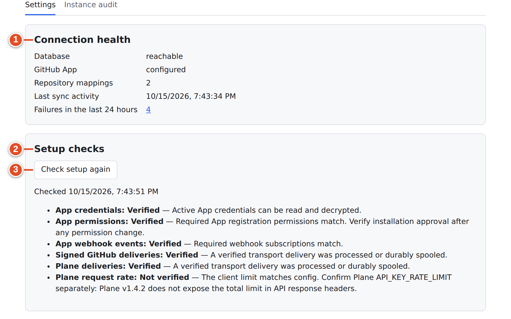
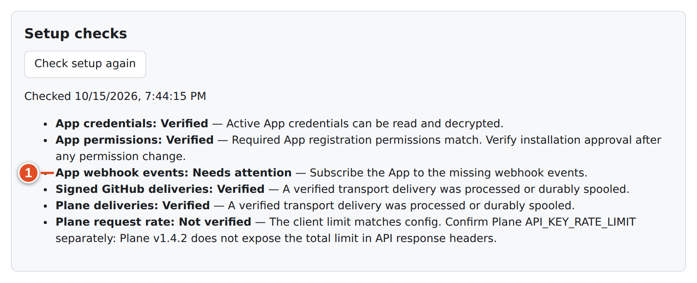
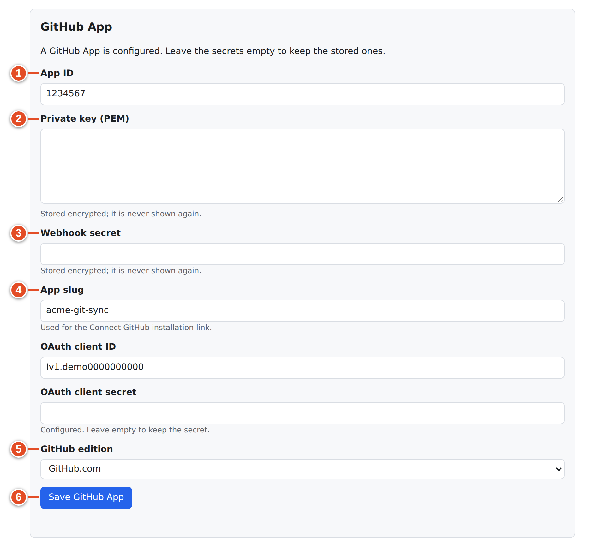
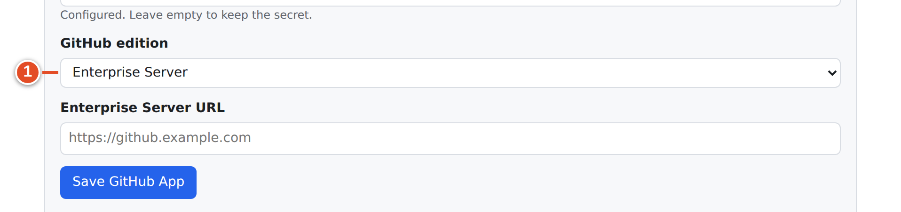
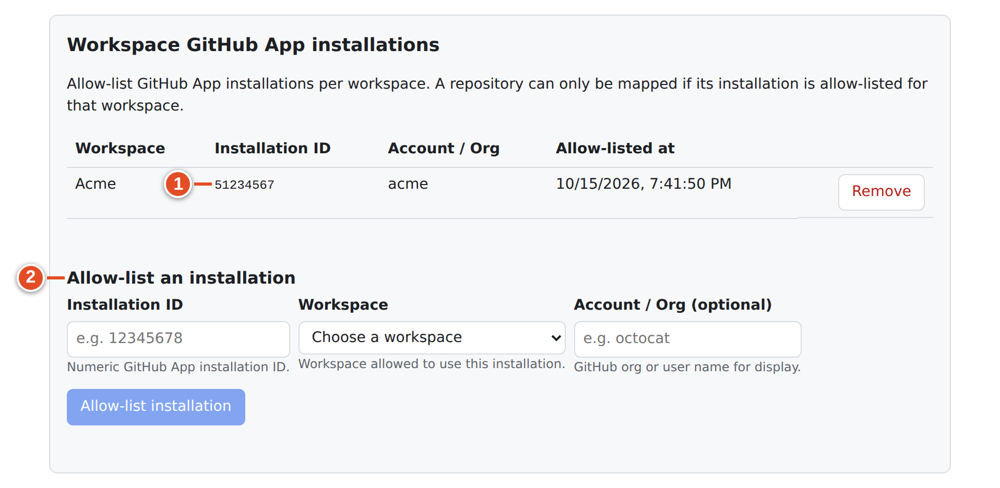
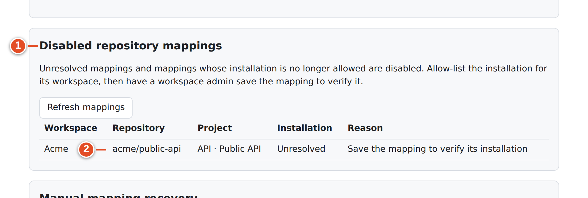
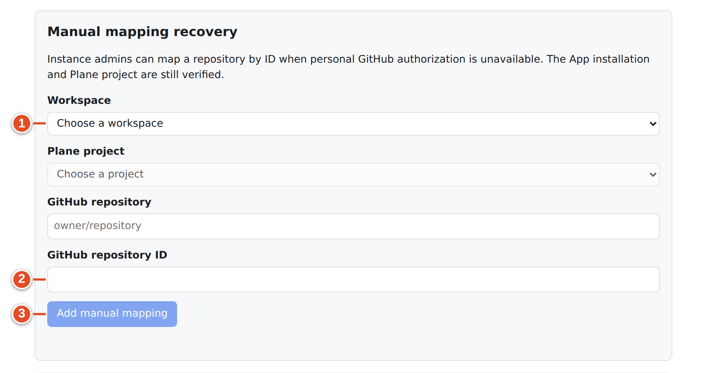
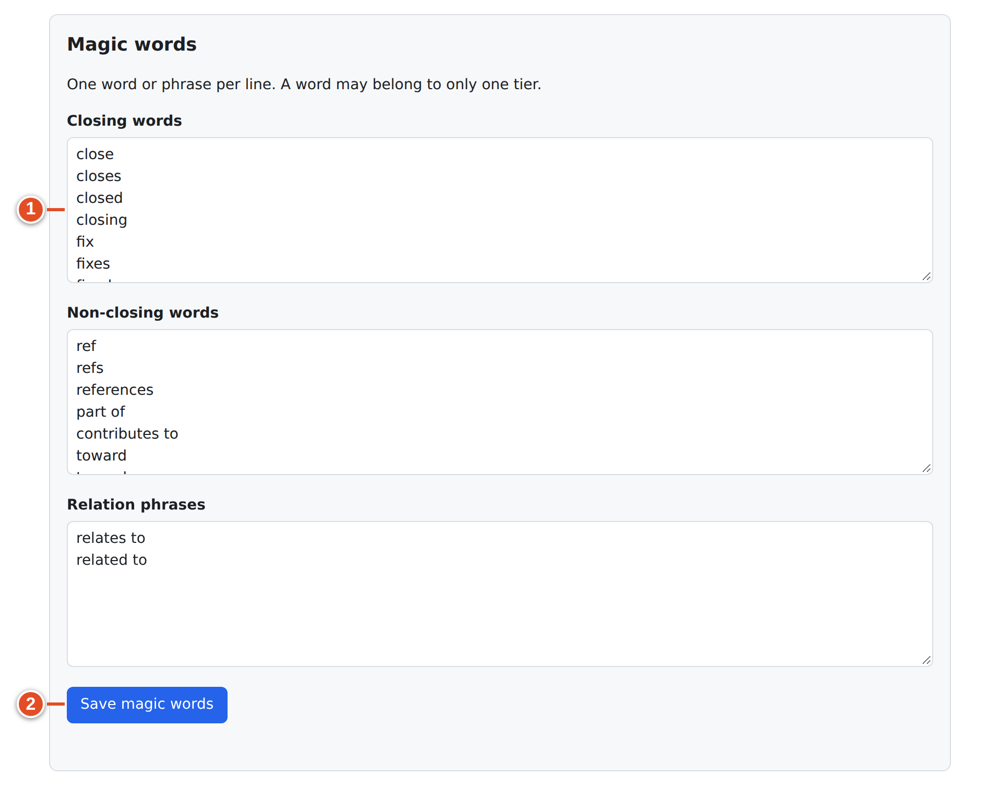
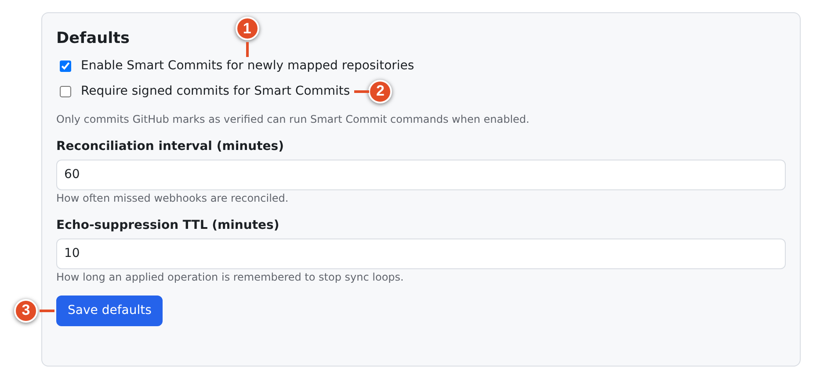

# 23 · God mode settings (instance admin)

Everything that applies to the *whole Plane instance* lives on one page, **Git sync: instance settings**. That includes the GitHub App credentials, the setup checks, which installation belongs to which workspace, the magic words and the defaults. Only a Plane **instance administrator** signed in to God mode can open it.

## Open the page

1. Open God mode on your Plane (`https://<your Plane>/god-mode/`) and sign in as an instance admin.
2. Choose **GitHub Sync** in the sidebar ("Manage GitHub synchronization.").

Without the UI fork (installed with `--keep-plane-ui`), open `https://<your Plane>/git-sync/ui/admin` directly. You still need a God mode session in the same browser. A normal workspace session gets **Not authorised** with "The instance settings need a Plane instance-admin session."

The page has two tabs: **Settings** (this chapter) and **Instance audit** (chapter 28). The Settings tab contains, top to bottom:

| Section | Purpose |
|---|---|
| **Connection health** | Is the database reachable, is an App configured, how many mappings, latest activity, recent failures |
| **Setup checks** | Six read-only checks of credentials, App registration, deliveries and rate limit |
| **GitHub App** | Enter or replace the App's credentials and GitHub edition |
| **Workspace GitHub App installations** | Allow-list which installation belongs to which workspace |
| **Disabled repository mappings** | Mappings that cannot sync and why |
| **Manual mapping recovery** | Map a repository by ID when nobody can authorize personally |
| **Magic words** | The closing / non-closing / relation phrase lists |
| **Defaults** | Smart Commits default, signed-commit preference, reconciliation interval, echo TTL |

## Connection health

| Card | Meaning |
|---|---|
| **Database** — reachable / unreachable | git-sync can query its `gitsync` database |
| **GitHub App** — configured / not configured | App credentials are stored or supplied by the environment |
| **Repository mappings** | Number of mappings across all workspaces (Unknown if unreadable) |
| **Last sync activity** | Most recent recorded activity |
| **Failures in the last 24 hours** | Count; the link opens the instance audit filtered to errors |

If the stored App secrets cannot be decrypted, a red notice appears: **GitHub App credentials cannot be decrypted. Save the App secrets again.** (chapter 30).

## Setup checks

**Setup checks** runs six read-only checks when the page opens; **Check setup again** re-runs them. Each shows **Verified**, **Needs attention** or **Not verified**, with a one-line explanation. Nothing is written anywhere by running them.

| Check | Verified when | Typical "Needs attention / Not verified" text and fix |
|---|---|---|
| **App credentials** | "Active App credentials can be read and decrypted." | "No GitHub App is configured yet…" → fill **GitHub App**. "App credentials cannot be read or decrypted…" → see chapter 30. |
| **App permissions** | "Required App registration permissions match. Verify installation approval after any permission change." | "The App registration is missing required permission levels. Update it and verify installation approval." → fix permissions on GitHub (chapter 22) |
| **App webhook events** | "Required webhook subscriptions match." | "Subscribe the App to the missing webhook events." → tick all nine events |
| **Signed GitHub deliveries** | "A verified transport delivery was processed or durably spooled." | "No verified transport delivery is recorded yet. Make an issue or PR change to verify the webhook." |
| **Plane deliveries** | Same as above, for Plane | Same; check the Plane webhook exists and is enabled |
| **Plane request rate** | "Plane's deployment setting and this service's request limit match." | Usually **Not verified**: "The client limit matches config. Confirm Plane API_KEY_RATE_LIMIT separately: Plane v1.4.2 does not expose the total limit in API response headers." This is normal. **Needs attention** "The active client request limit differs from PLANE_API_RATE_PER_MINUTE. Restart with matching settings." means the running service and its configuration disagree. |

> **Note:** **App permissions** and **App webhook events** read the App **registration** with the App's own identity (`GET /app`). They cannot tell whether an organization owner has already *accepted* changed permissions on an installation. After changing permissions, also check each installation on GitHub.

> **Tip:** "Not verified" for the two delivery checks right after installation just means nothing has happened yet. Open a PR or edit a work item, then press **Check setup again**.

## Enter the GitHub App

### Goal: git-sync can authenticate as your GitHub App

**Before you start:** the six values from chapter 22: App ID, private key file, webhook secret, App slug, Client ID and client secret.

**Steps**

1. Scroll to **GitHub App**. A new instance says "No GitHub App is configured yet."
2. **App ID** — the number. ①
3. **Private key (PEM)** — paste the whole contents of the downloaded `.pem` file, including the `BEGIN`/`END` lines. ②
4. **Webhook secret** — the value you set on GitHub. ③
5. **App slug** — "Used for the Connect GitHub installation link." ④
6. **OAuth client ID** and **OAuth client secret** — "Required for personal account authorization." ④
7. **GitHub edition** — **GitHub.com**, **Enterprise Cloud with data residency** (then **Enterprise Cloud subdomain**), or **Enterprise Server** (then **Enterprise Server URL**). ⑤
8. Select **Save GitHub App**. ⑥

**Result:** the panel now says "A GitHub App is configured. Leave the secrets empty to keep the stored ones." Secret fields say "Stored encrypted; it is never shown again." and "Configured. Leave empty to keep the secret." Press **Check setup again**; **App credentials**, **App permissions** and **App webhook events** should turn **Verified**. The running service picks up new credentials within about five seconds; no restart is needed.

**If it went wrong:**
- *"appId must be a positive integer"* → you pasted the Client ID into **App ID**.
- *Connect GitHub stays disabled in workspaces* ("Ask the instance admin to configure the GitHub App client ID, client secret and App slug.") → one of slug, Client ID or client secret is missing.
- *App permissions Not verified* "The App registration could not be read from GitHub…" → wrong private key, wrong App ID, wrong edition/host, or no outbound connectivity.

> **Admin only:** Once you have saved the App in God mode, the stored credentials take precedence over any `GITHUB_APP_ID` / `GITHUB_PRIVATE_KEY_PATH` / `GITHUB_WEBHOOK_SECRET` bootstrap values in `git-sync.env`. git-sync records that the bootstrap is retired, so deleting the stored row later does not quietly revive old environment secrets.

## Workspace GitHub App installations (allow-list)

"Allow-list GitHub App installations per workspace. A repository can only be mapped if its installation is allow-listed for that workspace."

Normally a workspace admin connects an installation with **Connect GitHub** (chapter 24), and git-sync records it here automatically. Use this panel when:
- you want to pre-approve an installation for a workspace,
- an organization owner installed the App directly on GitHub, or
- you need to move or remove an installation.

### Goal: allow an installation for one workspace

**Steps**

1. Find the installation's numeric ID. On GitHub it is the number at the end of the installation's settings URL: `…/settings/installations/<id>`.
2. Under **Allow-list an installation**, enter **Installation ID** ("Numeric GitHub App installation ID."). ②
3. Choose **Workspace** ("Workspace allowed to use this installation.").
4. Optionally enter **Account / Org (optional)** ("GitHub org or user name for display.").
5. Select **Allow-list installation**.

**Result:** the table (**Workspace**, **Installation ID**, **Account / Org**, **Allow-listed at**) shows the entry. git-sync immediately re-checks that workspace's mappings for the installation.

**If it went wrong:** "That installation is already allowed for another workspace; remove it there first" — one installation serves one workspace. **Remove** the other entry first ("Remove allow-list entry for installation &lt;id&gt;?"). Removing an entry **disables** every mapping that used it.

## Disabled repository mappings

"Unresolved mappings and mappings whose installation is no longer allowed are disabled. Allow-list the installation for its workspace, then have a workspace admin save the mapping to verify it."

The table lists **Workspace**, **Repository**, **Project**, **Installation** and **Reason**. The reasons are:

| Reason | Meaning | Fix |
|---|---|---|
| **Save the mapping to verify its installation** (installation **Unresolved**) | The mapping has no verified installation yet (for example, it was restored or created before the allow-list) | A workspace admin opens the mapping and presses **Save changes** |
| **Installation is not allowed for this workspace** | The installation was removed from the allow-list, uninstalled on GitHub, or moved | Allow-list it again (above), or reconnect it, then save the mapping |

**Refresh mappings** reloads the list. A disabled mapping does not sync anything. Its sync health card in the workspace says **Disabled · &lt;reason&gt;** (chapter 28).

## Manual mapping recovery

"Instance admins can map a repository by ID when personal GitHub authorization is unavailable. The App installation and Plane project are still verified."

Use this when a workspace admin cannot use the normal repository picker, for example because nobody with access can connect a personal GitHub account. It is a recovery tool; prefer **Map a repository** in the workspace.

### Goal: map a repository without a personal GitHub link

**Steps**

1. Choose **Workspace**. ①
2. Choose **Plane project**. ②
3. Enter **GitHub repository** as `owner/repository`, and **GitHub repository ID**. The ID is the repository's numeric `id` from `GET /repos/{owner}/{repo}` on the GitHub API. ②
4. Select **Add manual mapping**. ③

**Result:** the mapping is created with default settings: two-way, the instance's Smart Commits default, link-back comments on, problem reports off. A workspace admin can then tune it on its **Settings** tab.

**If it went wrong:**
- Not saved → git-sync still verifies that the repository's installation is allow-listed for that workspace, that the App can read the repository with that ID and name, and that the project belongs to the workspace.
- An ID and name that do not match → refused.

## Magic words

The instance-wide phrases that turn a reference in a PR into a closing, non-closing or relation link (chapter 10 explains them for developers).

| Box | Default |
|---|---|
| **Closing words** | close, closes, closed, closing, fix, fixes, fixed, fixing, resolve, resolves, resolved, resolving, complete, completes, completed, completing, implement, implements, implemented, implementing |
| **Non-closing words** | ref, refs, references, part of, contributes to, toward, towards |
| **Relation phrases** | relates to, related to |

### Goal: change the vocabulary your teams use

**Steps**

1. Edit the boxes: "One word or phrase per line. A word may belong to only one tier." ①
2. Select **Save magic words**. ②

**Rules the save enforces:**
- Only lowercase letters and single spaces (no digits, hyphens or punctuation).
- At most 40 characters per phrase, and 1–100 phrases per tier.
- No tier may be empty.
- A phrase in two tiers is refused with `"<word>" is in both <tier> and <tier>`.

**Result:** the new lists apply to the next PR event in every workspace. Existing links keep their tier.

> **Warning:** Removing a closing word your teams use (for example `fixes`) silently turns `Fixes WEB-42` into a bare body reference, which is only a relation. Announce changes.

## Defaults

| Field | Default | Effect |
|---|---|---|
| **Enable Smart Commits for newly mapped repositories** | On | Pre-ticks **Smart Commits** in the **Map a repository** form. Existing mappings are not changed. |
| **Require signed commits for Smart Commits** | The value of `REQUIRE_VERIFIED_COMMITS` | *Stored but not enforced in this release.* See the warning below. |
| **Reconciliation interval (minutes)** | 60 | "How often missed webhooks are reconciled." Also how quickly a silent Plane webhook is noticed. |
| **Echo-suppression TTL (minutes)** | 10 | "How long an applied operation is remembered to stop sync loops." Too long can swallow a genuine identical edit; too short can let an echo through. |

Select **Save defaults** to store them.

> **Warning:** The checkbox **Require signed commits for Smart Commits** ("Only commits GitHub marks as verified can run Smart Commit commands when enabled.") is saved, but the Smart Commit push handler does not read it. It only reads the environment variable `REQUIRE_VERIFIED_COMMITS` (`src/app/push.ts:55`). To enforce signed commits:
> 1. Set `REQUIRE_VERIFIED_COMMITS=true` in `git-sync.env`.
> 2. Restart git-sync with the full Compose command: `docker compose … up -d git-sync`.
>
> When it is on, an unsigned commit's commands are skipped and audited. If **Report problems** is enabled on the mapping, git-sync posts "This commit is not signature-verified; Smart Commit commands were ignored."

## What you learned

- God mode → **GitHub Sync** (`/git-sync/ui/admin`) holds everything instance-wide and needs a God mode session.
- **Setup checks** verify credentials, App permissions, the nine events, deliveries and the rate limit, without writing anything.
- **GitHub App** secrets are encrypted and write-only; leave fields blank to keep them.
- The installation allow-list binds one installation to one workspace; removing it disables mappings, listed under **Disabled repository mappings**.
- Magic words are validated strictly, and the signed-commit checkbox is not enforced — use `REQUIRE_VERIFIED_COMMITS`.

## Source files

- `src/ui/client/Admin.tsx` — the page
- `src/ui/setup-check.ts` — the six checks
- `src/ui/api.ts` — `/instance/*` routes (`github-app`, `installations`, `magic-words`, `settings`, `health`)
- `src/ui/validate.ts` — `parseGithubApp`, `parseMagicWords`, `parseInstanceSettings`
- `src/app/credentials.ts` — credential source and bootstrap retirement
- `src/app/push.ts` — signed-commit enforcement (environment only)
