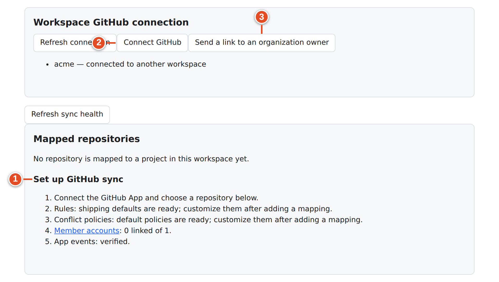
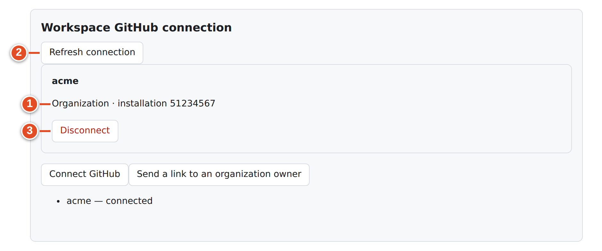
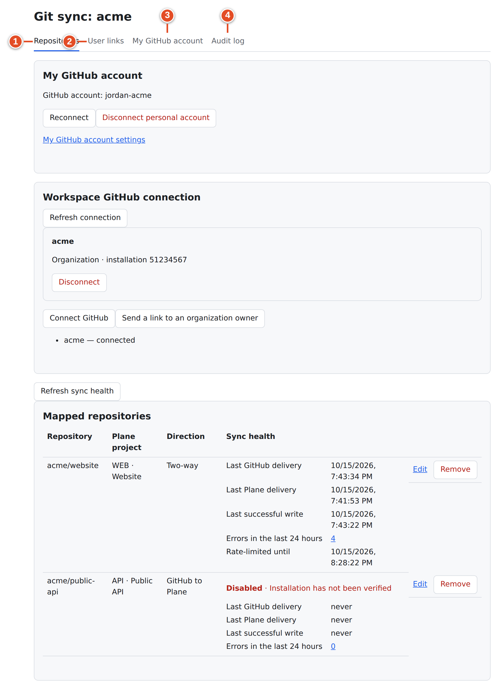
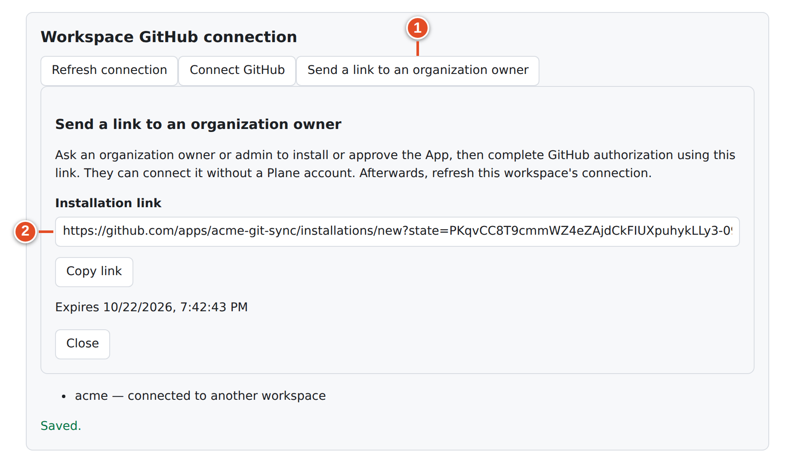
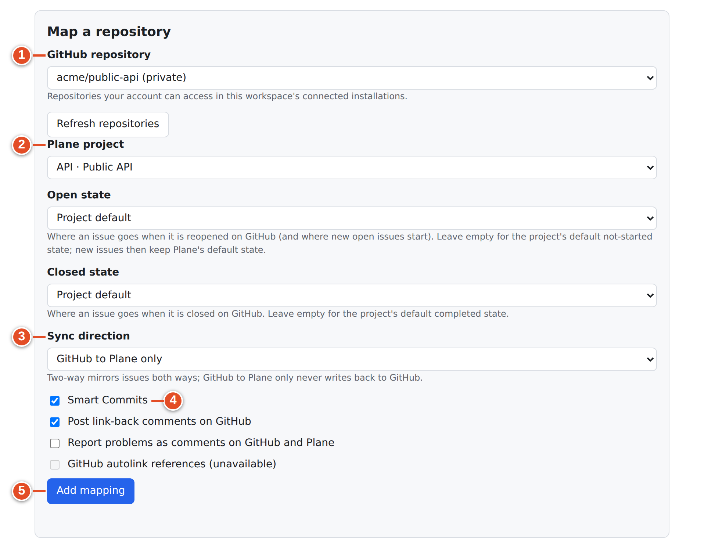
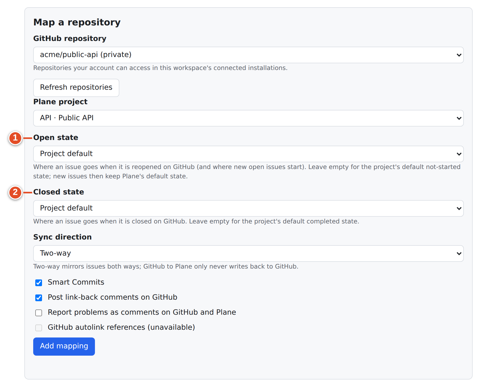
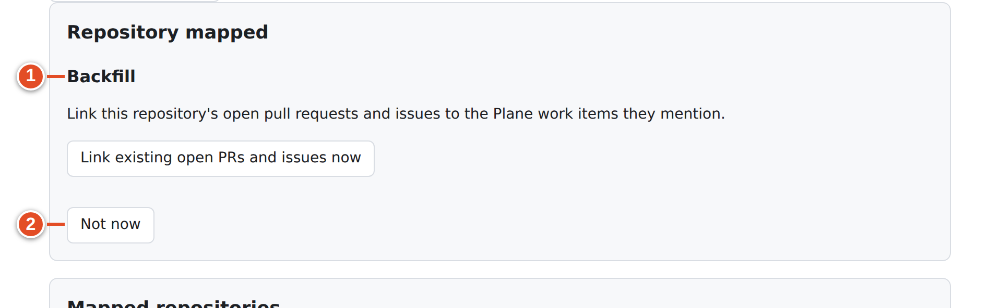

# 24 · Connect GitHub and map repositories (workspace admin)

Once the instance admin has entered the GitHub App (chapter 23), each workspace admin does two things:
- **connect** a GitHub installation to the workspace, and
- **map** each repository to a Plane project.

Both happen on the workspace's **GitHub Sync** page.

## Open the workspace page

1. In Plane, open **Workspace settings → GitHub Sync**. Only workspace *Admins* see this entry.
2. Or open `https://<your Plane>/git-sync/ui/workspaces/<workspace-slug>` directly.

The page heading is **Git sync: &lt;slug&gt;**, with four tabs:

| Tab | What it holds | Chapter |
|---|---|---|
| **Repositories** | Your personal account, the workspace GitHub connection, mapped repositories with sync health, **Map a repository** | this chapter, 28 |
| **User links** | Which Plane member is which GitHub account | 27 |
| **My GitHub account** | Your own personal link | 8 |
| **Audit log** | What git-sync did and why | 28 |

A member who is not an admin sees **Not authorised** ("Workspace settings need a workspace admin."). Members use the direct **My GitHub account** link instead.

## The setup checklist

While no repository is mapped, the **Repositories** tab shows **Set up GitHub sync**, a checklist of what is ready:

| Line | Meaning |
|---|---|
| Connect the GitHub App and choose a repository below. | The next action |
| Rules: shipping defaults are ready; customize them after adding a mapping. | Default lifecycle rules will apply (chapter 26) |
| Conflict policies: default policies are ready; customize them after adding a mapping. | Default field policies will apply (chapter 25) |
| Member accounts: *n* linked of *m*. | How many workspace members have linked GitHub accounts (chapter 27) |
| App events: verified. / need attention from an instance admin. / not yet verified; ask an instance admin to check setup. | The instance's **App webhook events** setup check |

## Connect GitHub to the workspace

### Goal: one GitHub installation connected to this workspace

**Before you start:**
- The instance admin has saved the App, including slug, Client ID and client secret. Otherwise the page says "Ask the instance admin to configure the GitHub App client ID, client secret and App slug." and the buttons are disabled.
- Connect your **personal** GitHub account first (**My GitHub account** tab → **Connect personal account**). git-sync uses it to prove you may connect the installation, and to list repositories you can pick.

**Steps**

1. In **Workspace GitHub connection**, select **Connect GitHub**. GitHub's App installation page opens.
2. On GitHub, choose the **account or organization**, then *All repositories* or *Only select repositories*, and select **Install** (or **Request** if you are not an owner of the organization).
3. GitHub returns you to the Setup URL. git-sync checks the installation:
   - **Personal account:** it must be *your* account.
   - **Organization:** you must be an active **owner or admin**, checked through your personal GitHub token and the App's *Members: Read* permission.
4. You land back on the page with **GitHub is connected to this workspace.**

**Result:** the installation appears as a card: the account name, "*Organization* · installation *&lt;id&gt;*", **Manage repository access on GitHub** and **Disconnect**. The instance's allow-list now holds the installation for this workspace.

The whole workspace page, with its four tabs:

Other states in the same panel:

| You see | Meaning | Do |
|---|---|---|
| *acme* — connected | Already connected to this workspace | Nothing |
| *acme* — connected to another workspace | One installation serves one workspace | Ask that workspace's admin, or the instance admin, to free it |
| *acme* — available + **Finish connecting** | An installation your GitHub account can access but not yet connected | **Finish connecting** |
| *acme* — available + "Ask an organization owner to connect it" + **Send owner handoff link** | You are not an owner of that organization | Send a handoff link (below) |
| **Pending organization approval** — "*org* — requested by *login*. Waiting for an owner to approve." | You pressed **Request** on GitHub | Send the owner a handoff link |
| "Connect your personal GitHub account to finish connecting an installation." | No personal link yet | Link your account first |

Press **Refresh connection** after anything changes on GitHub, for example after an owner approves or you add repositories to the installation.

### Ask an organization owner (handoff link)

When the App must be installed or approved by an organization owner who does not use Plane:

1. Select **Send a link to an organization owner** (or **Send owner handoff link** next to a pending request).
2. If asked "Which GitHub organization should the owner connect? Enter its login.", type the organization's login, for example `acme`.
3. A panel **Send a link to an organization owner** shows the **Installation link**, **Copy link** and when it **Expires** (7 days). Send the link only to the intended owner.
4. The owner opens it, installs or approves the App on GitHub and completes GitHub authorization. They see "The account owner has connected GitHub to this workspace. You can close this page; the workspace admin can refresh the connection." They need no Plane account.
5. You select **Refresh connection**.

The link is bound to that one organization. If the owner uses it for another organization they get "This handoff link was issued for a different GitHub organization…". It grants no Plane access.

### Disconnect

**Disconnect** on the installation card asks "Disconnect *login*? Its mappings will be disabled." After confirming, the installation is removed from this workspace's allow-list. Every mapping that used it is **Disabled** until it is connected again.

### Connection messages

| Message | Meaning |
|---|---|
| state: This connection link has expired, was already used, or belongs to another Plane account. Start again. | Install links last 30 minutes, OAuth links 10 minutes, and each works once |
| not_yours: Your GitHub account cannot access that installation… | You chose an installation your personal account cannot see |
| not_owner: Only an active GitHub organization owner or admin can connect its installation… | Use a handoff link |
| taken: That installation is connected to another workspace. | One workspace per installation |
| not_configured: Ask the instance admin to configure the GitHub App client ID, client secret and App slug. | God mode incomplete |
| installation: GitHub did not return a valid installation… | Start again and pick the intended account |
| Repository access updated and mappings rechecked. | You changed repository selection on GitHub (**Redirect on update**) |

## Map a repository

### Goal: a repository synced with one Plane project

**Before you start:**
- An installation is connected.
- Your personal GitHub account is linked and can access the repository (Triage, Write, Maintain or Admin).
- The Plane project exists.

**Steps**

1. Scroll to **Map a repository**.
2. **GitHub repository** ① — pick from "Repositories your account can access in this workspace's connected installations." Use **Refresh repositories** after changing the installation on GitHub.
3. **Plane project** ② — the project the repository's work belongs to.
4. **Open state** / **Closed state** — leave **Project default** unless you need specific states (see below).
5. **Sync direction** ③ — **Two-way** or **GitHub to Plane only**. "Two-way mirrors issues both ways; GitHub to Plane only never writes back to GitHub."
6. Options ④:
   - **Smart Commits** — pre-ticked from the instance default; lets commit messages run `#comment`, `#time` and state commands.
   - **Post link-back comments on GitHub** — on by default; posts "Linked Plane work item: …" on PRs and issues when a link is first made.
   - **Report problems as comments on GitHub and Plane** — off by default; posts a short notice when a Smart Commit command or a reference fails ("Git sync could not complete this action: …").
   - **GitHub autolink references (unavailable)** — disabled in this release.
7. Select **Add mapping** ⑤.

**Result:** the panel **Repository mapped** appears with a **Backfill** offer, and the repository appears under **Mapped repositories**.

### Open and closed states

These states apply to *mirrored GitHub issues* (chapter 13), not to PR automation.

| Field | Used when | **Project default** means |
|---|---|---|
| **Open state** | "Where an issue goes when it is reopened on GitHub (and where new open issues start)." | The project's default not-started state. New issues keep Plane's default state. |
| **Closed state** | "Where an issue goes when it is closed on GitHub." | The project's default completed state |

If you choose both, they must be different ("Choose different states for open and closed."). Triage states are never offered.

### Backfill existing work

Right after **Add mapping**, git-sync offers: "Link this repository's open pull requests and issues to the Plane work items they mention."

- **Link existing open PRs and issues now** scans open PRs and issues in batches and links them by the same rules as new events. It reports "Checked *n* pull requests and *m* issues: *k* links made, *u* references did not match a work item." If there is more, it adds "More items remain; continue to check the next batch." with **Continue**.
- **Not now** closes the offer. You can run it later from the mapping's **Settings** tab (**Run backfill**).

Backfill only **links** open items that already mention a work item key. It does not import closed history, does not create work items and does not mirror issues that lack the `plane` label.

### Mapped repositories

The table lists **Repository**, **Plane project**, **Direction** ("Two-way" / "GitHub to Plane"), a **Sync health** card (chapter 28), **Edit** and **Remove**.

- **Edit** opens the mapping's tabs (chapters 25–26).
- **Remove** asks "Remove the mapping for *owner/repo*? Its rules and conflict policies are deleted too." Links already made stay in Plane; nothing is deleted on GitHub.

> **Note:** The browser asks first (text recorded from the running UI): “Remove the mapping for acme/website? Its rules and conflict policies are deleted too.”

## If it went wrong

| Symptom | Cause | Fix |
|---|---|---|
| "Connect your personal GitHub account to select a repository." | No personal link | **My GitHub account → Connect personal account** |
| "Reconnect your personal GitHub account to select a repository." | Your token was rejected | **Reconnect** |
| "No repositories available. Connect an installation or ask its owner to grant repository access." | No connected installation, or it does not include the repository | Connect it; on GitHub add the repository to the installation; **Refresh repositories** |
| A repository you expect is missing | Your own access is below Triage, or the installation does not include it | Ask for access; adjust the installation |
| Save refused: "That GitHub installation is not allowed for this workspace" | The repository's installation is connected elsewhere or not allow-listed | Connect it here or ask the instance admin |
| A project is missing | The project is archived, or you are not a member | Join the project |
| Mapping shows **Disabled** | Installation disconnected or removed | Reconnect, then **Save changes** on the mapping |

## What you learned

- **Workspace settings → GitHub Sync** (admins only) has the tabs **Repositories**, **User links**, **My GitHub account** and **Audit log**.
- **Connect GitHub** installs the App and binds that installation to this workspace. Non-owners use a 7-day, organization-bound handoff link.
- **Map a repository** pairs a repository with a project: repository, project, open/closed states, **Sync direction**, Smart Commits, link-back and problem reports.
- **Backfill** links open PRs and issues that already mention keys. **Remove** deletes the mapping with its rules and policies.

## Source files

- `src/ui/client/Workspace.tsx` — `MappingsPage`, `MappingForm`, `BackfillPanel`
- `src/ui/client/Connect.tsx` — connection panel, handoff dialog, callback notices
- `src/ui/client/health.tsx` — setup checklist
- `src/ui/install-flow.ts` — install, claim and handoff flows
- `src/ui/mapping-check.ts` — save-time verification
- `src/operations/tooling.ts` — backfill
