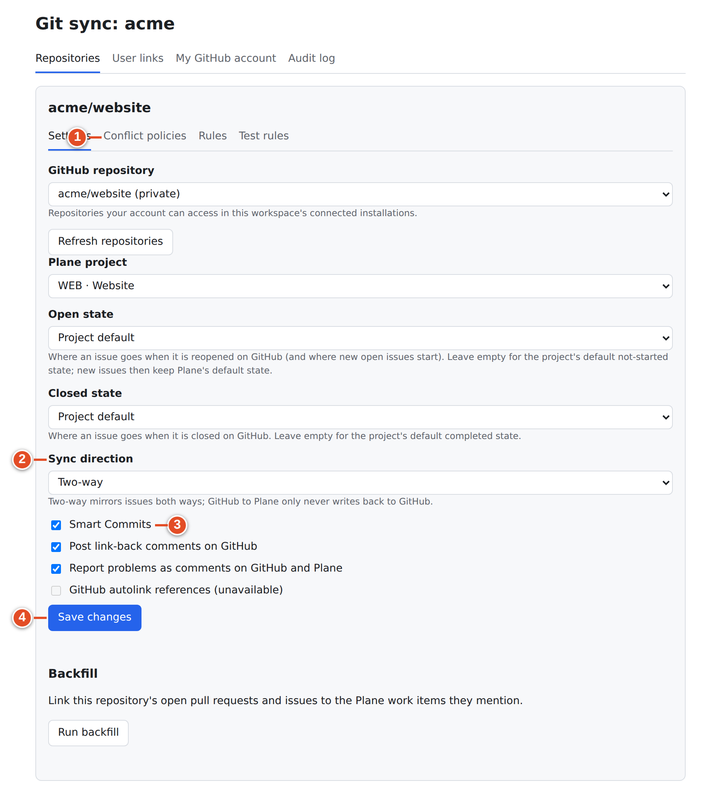
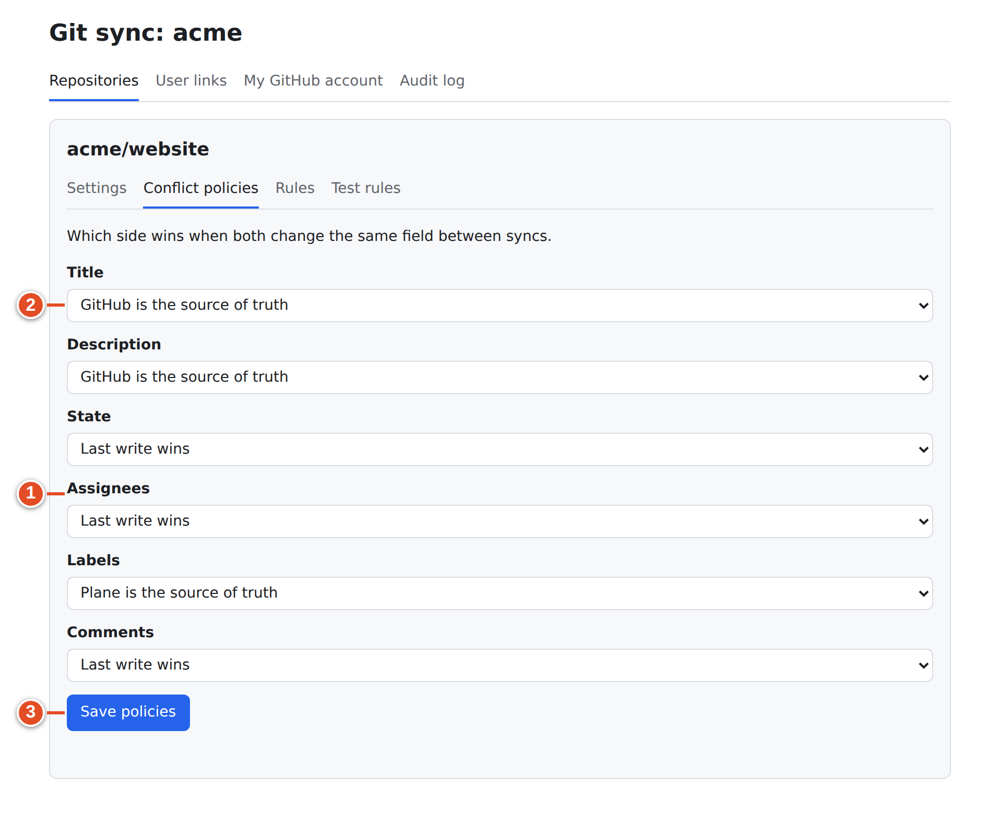

# 25 · Mapping settings and conflict policies

Every mapped repository has its own pages. Open them with **Edit** in **Mapped repositories**. The heading is the repository name (for example `acme/website`), with four tabs:

| Tab | Address | Purpose |
|---|---|---|
| **Settings** | `/git-sync/ui/workspaces/<slug>/mappings/<id>` | The mapping form plus **Backfill** |
| **Conflict policies** | `…/mappings/<id>/policies` | Which side wins for each mirrored field |
| **Rules** | `…/mappings/<id>/rules` | What happens in Plane on each GitHub event (chapter 26) |
| **Test rules** | `…/mappings/<id>/dry-run` | Try rules without writing anything (chapter 26) |

If the mapping no longer exists you see "That mapping does not exist in this workspace." and **Back to repositories**.

## Settings



The **Settings** tab shows the same fields as **Map a repository** (chapter 24), filled with the current values, and a **Save changes** button.

| Field | Default for a new mapping | Changing it later |
|---|---|---|
| **GitHub repository** | — | Possible, to another repository you can access in a connected installation. Use with care: links and history stay with the old numbers. |
| **Plane project** | — | Possible. Custom open/closed states are reset to **Project default**, because states belong to a project. |
| **Open state** / **Closed state** | **Project default** | Affects mirrored issues from then on |
| **Sync direction** | **Two-way** | **GitHub to Plane only** stops every Plane-originated mirror write at once |
| **Smart Commits** | Instance default (on) | Takes effect for the next push |
| **Post link-back comments on GitHub** | On | Only new links get a comment |
| **Report problems as comments on GitHub and Plane** | Off | See below |
| **GitHub autolink references (unavailable)** | Off, disabled | Not available in this release |

Below the form, **Backfill** offers **Run backfill** at any time, with **Continue** for further batches (chapter 24).

**Saving re-verifies authority.** On every save, git-sync re-checks three things:
- that the project belongs to the workspace,
- that the App's installation (allow-listed for this workspace) can read the repository, and
- for a changed repository, that your own GitHub account can access it.

If something changed meanwhile, the save fails with "The mapping changed during verification. Reload it and try again". Saving is also how you re-enable a mapping listed as "Save the mapping to verify its installation".

### Sync direction in practice

| | **Two-way** | **GitHub to Plane only** |
|---|---|---|
| GitHub issue labelled `plane` → creates/updates a Plane work item | Yes | Yes |
| Plane work item labelled `github` → creates a GitHub issue | Yes | **No** (the label is ignored) |
| Plane edits (title, description, state, assignees, labels, comments) → GitHub issue | Yes, subject to conflict policies | **No**, never |
| PR linking, Development panel, Smart Commits, lifecycle rules | Yes | Yes (these write to Plane) |
| Link-back comments and problem reports on GitHub | If enabled | If enabled |

Choose **GitHub to Plane only** when GitHub is the place where issues are managed and Plane is a planning view, or for repositories outside your team's control.

### Link-back comments

When git-sync first links a PR or a mirrored issue to a work item, it posts on GitHub. Real text from the demo run:

```text
Linked Plane work item:
- WEB-42: http://plane.example.com/acme/projects/bb57e81d-…/issues/dd4d0dfb-…
```

*Text git-sync posted to GitHub in the demo run.*

For mirrored issues the text is "Linked to Plane work item: &lt;url&gt;". Each link gets one comment only, the first time. Turn the option off if your team finds the comments noisy; the Development panel in Plane works either way.

### Report problems

With **Report problems as comments on GitHub and Plane** on, git-sync tells the author when something they wrote could not be carried out, instead of only recording it in the audit log. Examples:
- a Smart Commit with an unknown state, a bad `#time` duration, or a key that matches no work item;
- an unsigned commit when signatures are required;
- a PR referencing a key that does not exist.

Real text from the demo run (a commit comment on GitHub):

```text
Git sync could not complete this action:

- ` WEB-35: #shipped matches no Plane state. `
- ` WEB-35: #time needs a duration such as 1h 30m. `
```

*Text git-sync posted to GitHub in the demo run.*

The matching Plane comment on WEB-35 reads "Git sync could not complete this action: WEB-35: #shipped matches no Plane state." Each problem is reported once. Further failures in a burst say "Additional failures are recorded in the sync audit log."

> **Tip:** Turn **Report problems** on for repositories where developers use Smart Commits. Without it, a mistyped `#in-reveiw` silently does nothing visible.

## Conflict policies



A mirrored issue (chapter 13) exists on both sides. "Which side wins when both change the same field between syncs." is decided per field:

| Field | Default | Options |
|---|---|---|
| **Title** | **GitHub is the source of truth** | **Last write wins**, **GitHub is the source of truth**, **Plane is the source of truth** |
| **Description** | **GitHub is the source of truth** | same |
| **State** | **Last write wins** | same |
| **Assignees** | **Last write wins** | same |
| **Labels** | **Last write wins** | same |
| **Comments** | **Last write wins** | same |

What each policy does to a change:

| Policy | A change made on GitHub | A change made in Plane |
|---|---|---|
| **Last write wins** | Copied to Plane | Copied to GitHub |
| **GitHub is the source of truth** | Copied to Plane | **Not** copied. Plane keeps its edit until the next GitHub change to that field overwrites it. |
| **Plane is the source of truth** | **Not** copied | Copied to GitHub |

**Last write wins** does not compare clocks. Because neither Plane nor GitHub delivers events in strict order, git-sync copies the partner's **current** value when it processes an event. Whichever change was made last is what both sides end up with.

**Sync direction** overrides policies. With **GitHub to Plane only**, nothing from Plane is ever applied, whatever a field's policy says.

### Goal: let Plane own the title and description

**Steps**

1. Open the mapping → **Conflict policies**.
2. Set **Title** and **Description** to **Plane is the source of truth** (or **Last write wins**).
3. Select **Save policies** (the button shows **Saving…**, then **Saved.**).

**Result:** from the next edit on, title and description edits in Plane overwrite GitHub, and GitHub edits to those fields no longer reach Plane.

> **Note:** The default makes GitHub own title and description *even on a two-way mapping*. Teams are often surprised that renaming a mirrored item in Plane does nothing on GitHub. That is this policy, not a fault.

> **Warning:** Policies apply to **mirrored issues** only. PR links, Smart Commits and rules write to Plane regardless of policies.

## What you learned

- Each mapping has **Settings**, **Conflict policies**, **Rules** and **Test rules** tabs.
- **Settings** re-verifies the project, installation and repository on every save; saving re-enables a mapping waiting for verification.
- **GitHub to Plane only** stops all Plane-originated writes; link-back comments and problem reports are separate switches.
- Conflict policies decide per field which side's change is copied; title and description default to GitHub.

## Source files

- `src/ui/client/Workspace.tsx` — `MappingPage`, `MappingForm`, `PoliciesEditor`
- `src/ui/api.ts` — `PATCH /mappings/:id`, `GET/PUT /mappings/:id/conflict-policies`
- `src/ui/validate.ts` — `DEFAULT_CONFLICT_POLICIES`, `parseConflictPolicies`
- `src/sync/mirror.ts` — `shouldApply`
- `src/github/problems.ts` — problem reports
