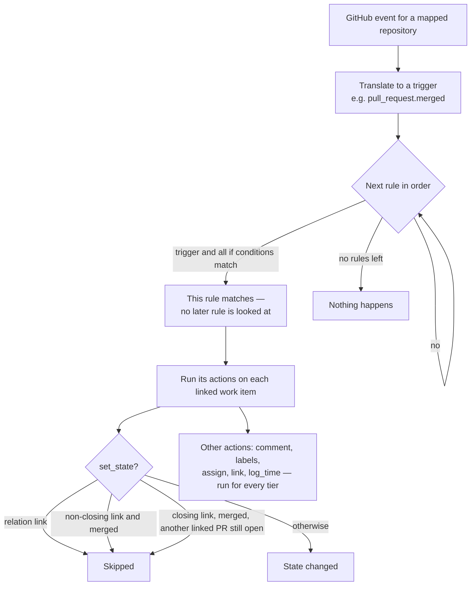
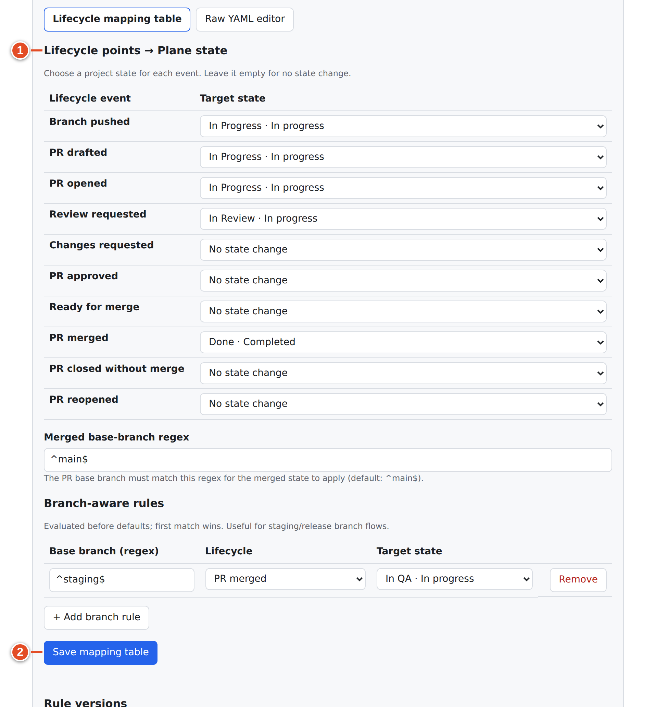
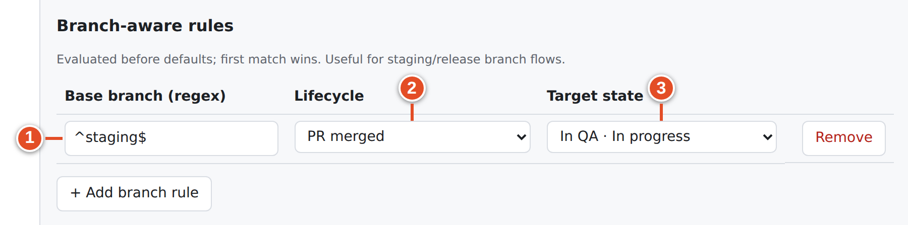
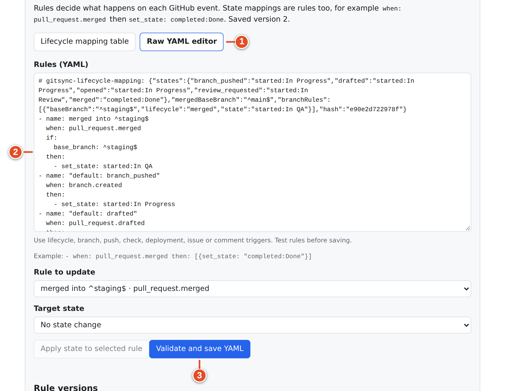
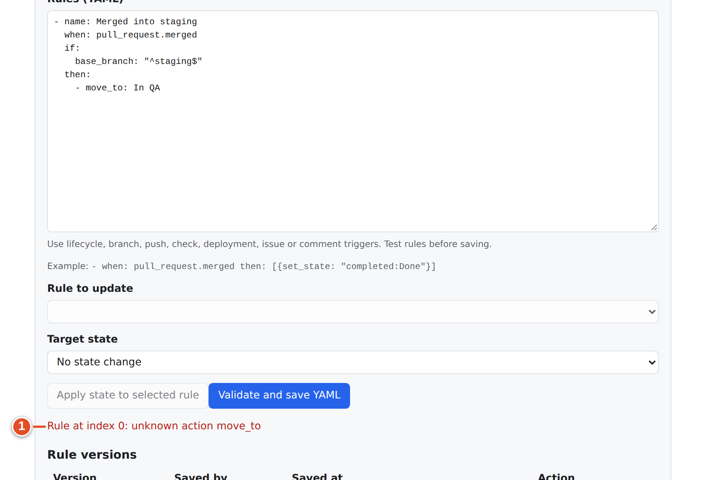
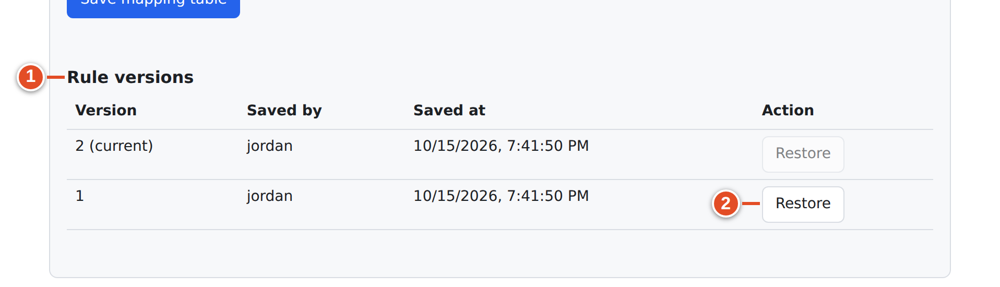
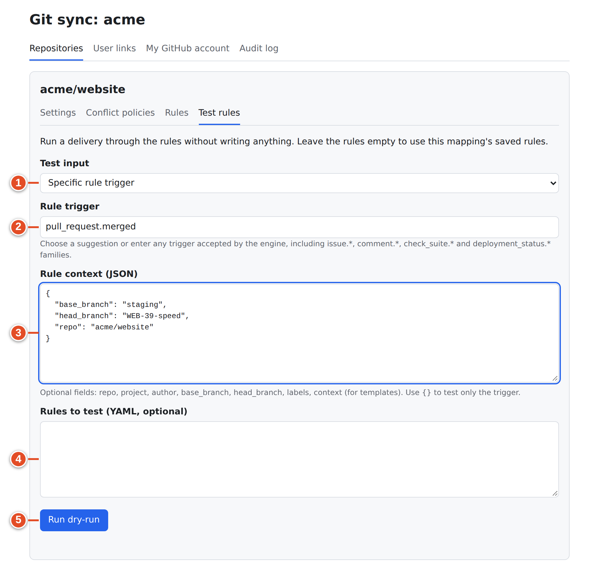
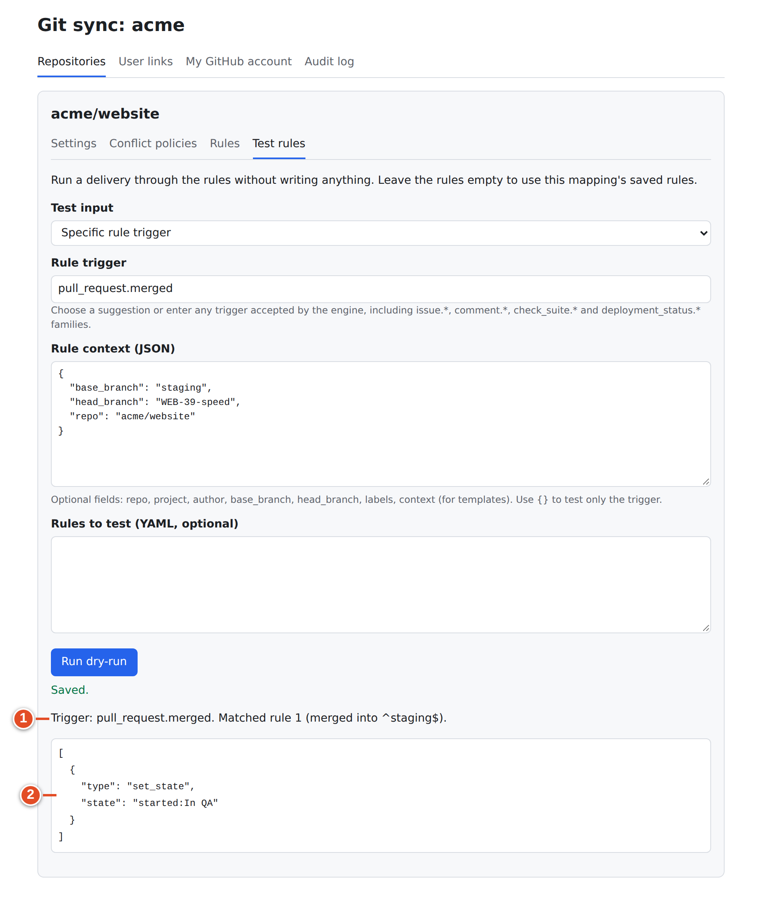
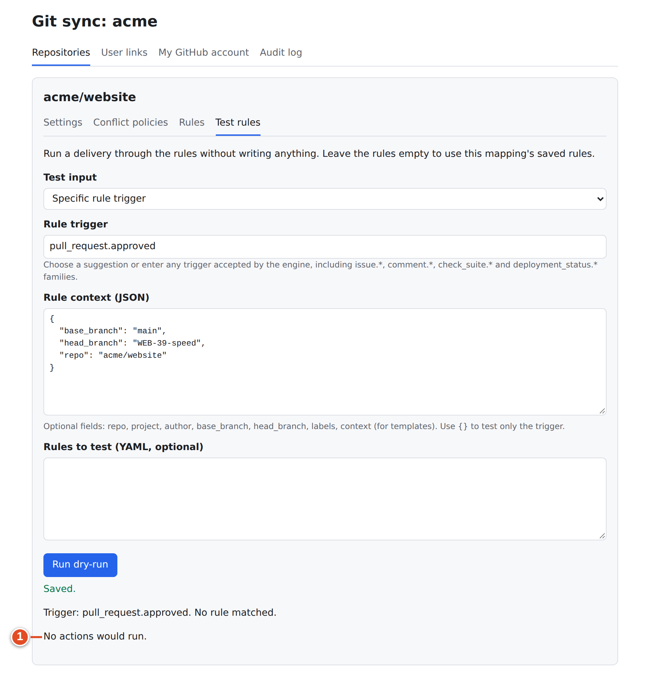
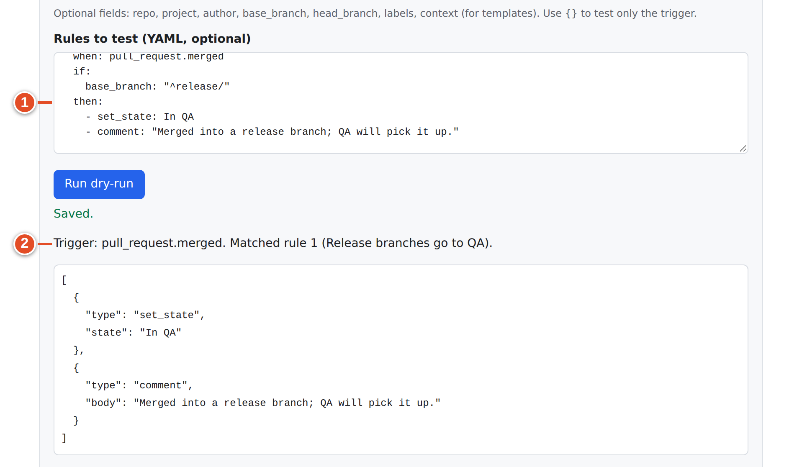

# 26 · Rules: lifecycle table, branch-aware rules, YAML, versions and Test rules

Rules decide what git-sync does **in Plane** when something happens on GitHub. A typical rule: "when a PR is merged into `main`, move its work items to Done". Every mapping has one ordered list of rules. You edit it on the mapping's **Rules** tab and try it safely on **Test rules**.

"Rules decide what happens on each GitHub event. State mappings are rules too, for example when: pull_request.merged then set_state: completed:Done."

## How rules are evaluated



*Diagram: rule evaluation. The first matching rule wins; reference tiers gate only state changes.*

Key points:

1. **First match wins.** Rules are checked from the top. The first rule whose `when` trigger and every `if` condition match is used, and its actions run. No other rule runs for that event.
2. **Targets are the linked work items.**
   - For PR events: every work item the PR links to (by branch, title, body, stored links or `WEB-NEW`).
   - For pushes: the items named in the commit messages.
3. *Tiers gate `set_state` only* (chapter 9 explains tiers):
   - a **relation** link (`Relates to WEB-42`, or a bare key in a PR body) never changes state;
   - a **non-closing** link (`Refs WEB-42`) changes state on every trigger **except** `pull_request.merged`;
   - a **closing** link changes state on merge only when at least one linked PR is merged and *none is still open* (the merge guard; a PR that cannot be read counts as open, and the check runs only at that merge).
4. **Other actions run for every tier.** That covers comments, labels, assignees, links and logged time.
5. **Finished work is never reopened by a new branch.** `branch.created` will not move a Done or Cancelled item back.
6. **Never into Triage.** A state target in the triage group is refused.

## The shipping defaults

If you never save rules, this table applies (chapter 14 shows it from a developer's view):

| Lifecycle point | Trigger | Default target |
|---|---|---|
| Branch pushed | `branch.created` | `started:In Progress` |
| PR drafted | `pull_request.drafted` | `started:In Progress` |
| PR opened | `pull_request.opened` (also *ready for review*) | `started:In Progress` |
| Review requested | `pull_request.review_requested` | `started:In Review` |
| Changes requested | `pull_request.changes_requested` | no change |
| PR approved | `pull_request.approved` | no change |
| Ready for merge | `pull_request.ready_for_merge` | no change |
| PR merged | `pull_request.merged`, base branch matching `^main$` | `completed:Done` |
| PR closed without merge | `pull_request.closed_unmerged` | no change |
| PR reopened | `pull_request.reopened` | no change |

### State targets

A target can be written three ways:

| Form | Example | Resolves to |
|---|---|---|
| `group:Name` | `started:In Review` | The state named *In Review* in the *started* group. If no such name exists but the group has exactly one state, that one. Otherwise the rule fails and is audited "state … does not exist". |
| `group` | `completed` | The group's default state, otherwise the group's first state |
| `Name` | `In QA` | The state with that name, only if exactly one state in the project has it (case-insensitive) |

Groups are `backlog`, `unstarted`, `started`, `completed`, `cancelled` (and `triage`, which automation refuses).

> **Warning:** A project that has several started states but none called **In Review** makes the review-requested default fail. Either create **In Review** or change that row of the table.

## Rules tab — lifecycle mapping table

Open the mapping → **Rules**. The status line says either "Using shipping defaults (not saved yet)." or "Saved version *n*." Two editing modes are offered: **Lifecycle mapping table** and **Raw YAML editor**.



### Goal: change what a lifecycle point does

**Steps**

1. Under **Lifecycle points → Plane state** ("Choose a project state for each event. Leave it empty for no state change."), pick a **Target state** for any **Lifecycle event**:
   - Branch pushed, PR drafted, PR opened, Review requested, Changes requested, PR approved, Ready for merge, PR merged, PR closed without merge, PR reopened.
   - The picker offers each project state ("*In Review* · In progress"), each group ("*Completed (any matching state)*") and **No state change**.
2. Optionally change **Merged base-branch regex** ("The PR base branch must match this regex for the merged state to apply (default: ^main$)."). For example `^(main|master)$`.
3. Select **Save mapping table**.

**Result:** a new rule version is saved and used from the next event.

> **Note:** **Ready for merge** fires once per head commit when the PR is open and not a draft, has at least one standing approval and no standing "changes requested", and all checks and the combined commit status are successful (neutral and skipped count as success). Map it to a state such as *Ready to merge* if your team wants the board to show it.

### Branch-aware rules

"Evaluated before defaults; first match wins. Useful for staging/release branch flows."



### Goal: merging into `staging` moves work to In QA, merging into `main` to Done

**Steps**

1. Select **+ Add branch rule**.
2. **Base branch (regex)**: `^staging$`. ①
3. **Lifecycle**: PR merged. ② (For *Branch pushed* the base column shows "N/A (branch has no base)".)
4. **Target state**: `In QA` (or `started:In QA`). ③
5. Keep the table's **PR merged** row at Done with **Merged base-branch regex** `^main$`.
6. **Save mapping table**.

**Result:** the compiled YAML puts the branch rule first:

```yaml
- name: merged into ^staging$
  when: pull_request.merged
  if:
    base_branch: ^staging$
  then:
    - set_state: started:In QA
- name: "default: branch_pushed"
  when: branch.created
  then:
    - set_state: started:In Progress
# … the other defaults …
- name: "default: merged"
  when: pull_request.merged
  if:
    base_branch: ^main$
  then:
    - set_state: completed:Done
```

In the demo run, PR #126 merged into `staging` moved WEB-39 to **In QA**; PR #121 merged into `main` moved WEB-42 to **Done**.

## Rules tab — raw YAML editor

Choose **Raw YAML editor** for anything the table cannot express: labels, comments, links, assignees, logged time, issue/check/deployment triggers.



### Goal: write and save a custom rule

**Steps**

1. In **Rules (YAML)** ("Use lifecycle, branch, push, check, deployment, issue or comment triggers. Test rules before saving."), edit the list.
2. Test it on **Test rules** first (below).
3. Select **Validate and save YAML**. Invalid rules are refused with a message naming the rule, for example `Rule at index 2: unknown trigger pull_request.merge`.

To change only the state of one rule without retyping YAML, choose **Rule to update** ("Rule *n* · *triggers*"), pick a **Target state**, and select **Apply state to selected rule**.



> **Warning:** Switching between modes can replace work.
> - Leaving YAML for the table with custom rules asks: "The current YAML contains custom rules or manual edits that cannot be represented in the table. Switching to table mode will replace your rules with defaults upon save. Discard custom YAML?"
> - Saving the table over custom YAML asks: "Saving the mapping table will overwrite your custom YAML rules. Overwrite?"

### Rule format

```yaml
- name: Optional label shown in the audit log      # optional
  when: pull_request.merged                       # one trigger or a list
  if:                                             # optional; all must match
    base_branch: "^release/"
  then:                                           # one or more actions, one key each
    - set_state: "completed:Done"
    - comment: "Released in {{release}}"
```

*Triggers (`when`)*

| Trigger | Fires on |
|---|---|
| `pull_request.drafted`, `.opened`, `.review_requested`, `.changes_requested`, `.approved`, `.ready_for_merge`, `.merged`, `.closed_unmerged`, `.reopened` | PR lifecycle points |
| `pull_request.*` | Any of the above |
| `branch.created` | First push of a new branch |
| `push` | Any push (items named in commit messages) |
| `commit.pushed_to_default` | A push to the default branch |
| `check_suite.<conclusion>` e.g. `check_suite.success`, `check_suite.failure`; `check_suite.*` | CI results |
| `deployment_status.<state>` e.g. `deployment_status.success`; `deployment_status.*` | Deployments |
| `issue.<action>` e.g. `issue.opened`, `issue.closed`; `issue.*` | Issue events (GitHub or Plane) |
| `comment.<action>` e.g. `comment.created`; `comment.*` | Issue comments |

*Conditions (`if`)*

| Key | Value | Matching |
|---|---|---|
| `base_branch` | regex | PR base branch |
| `head_branch` | regex | PR head branch, pushed branch, deployment ref |
| `labels_any` | list | At least one label present (exact case) |
| `labels_all` | list | All labels present (exact case) |
| `author` | login or list | GitHub login of the event sender, case-insensitive |
| `repo` | `owner/name` or list | Case-insensitive |
| `project` | Plane project UUID or list | Exact |

*Actions (`then`)*

| Action | Value | Effect in Plane | Gated by tier? |
|---|---|---|---|
| `set_state` | state target | Move the item | **Yes** |
| `add_label` | label name | Add a label (created if missing) | No |
| `remove_label` | label name | Remove a label | No |
| `assign` | GitHub login | Add the linked Plane member as assignee (skipped if unlinked) | No |
| `comment` | text | Comment on the item | No |
| `add_link` | `{url, title}` | Add a link to the item | No |
| `log_time` | duration | Comment "Time logged: *duration*" (Plane CE has no worklog) | No |
| `create_issue` | `{project, title}` | Create a work item in that project (identifier or UUID); once per event | No |

Text values may use `{{path}}` templates filled from the event context, for example `{{issue.title}}` or `{{comment.url}}`. A template that cannot be resolved fails the rule, which is audited.

*Example: label and announce failing builds*

```yaml
- name: Failing CI
  when: check_suite.failure
  then:
    - add_label: ci-failing
    - comment: "CI failed on the linked pull request."
- name: CI fixed
  when: check_suite.success
  then:
    - remove_label: ci-failing
```

## Rule versions

Every save (table or YAML) creates a new version. **Rule versions** lists **Version**, **Saved by**, **Saved at** and **Action**; the newest is "*n* (current)".



**Restore** asks "Restore version *n*? This creates a new version and replaces unsaved editor changes." Restoring never deletes history; it saves the old rules as a new current version.

## Test rules (dry run)

"Run a delivery through the rules without writing anything. Leave the rules empty to use this mapping's saved rules."



### Goal: prove a rule does what you expect before saving it

**Steps**

1. **Test input**: choose one of two modes.
   - **Webhook delivery**: choose **Source** (GitHub or Plane) and **Event**. Then either paste a **Payload (JSON)**, or enter **Recorded delivery (audit entry id)** ("Uses the payload stored in the audit log instead of the one below."). Audit entry ids are on the **Audit log**.
   - **Specific rule trigger**: type a **Rule trigger** (suggestions offered) and a **Rule context (JSON)** ("Optional fields: repo, project, author, base_branch, head_branch, labels, context (for templates). Use {} to test only the trigger.").
2. Optionally paste **Rules to test (YAML, optional)**. If empty, the saved rules (or the defaults) are used.
3. Select **Run dry-run**.

*Example input* (specific rule trigger):

```text
Rule trigger:  pull_request.merged
Rule context:  {"base_branch": "staging", "repo": "acme/website"}
```

**Result:**
- A match shows "Trigger: pull_request.merged. Matched rule 1 (merged into ^staging$)." followed by the actions as JSON.
- No match shows "Trigger: … No rule matched." and **No actions would run.**
- A delivery that is not an automation event shows "That delivery is not an automation event."





To try rules before saving them, paste them into **Rules to test (YAML, optional)**. The dry-run then uses those rules instead of the saved ones and still writes nothing:



A dry run shows rule *selection* and the actions. It does not check that a state exists in the project or that the write would be allowed for a given tier. Those are checked when the rule really runs, and failures appear in the audit log as **Automation rule matched** with outcome *failed* or *ignored*.

## If it went wrong

| Symptom | Likely cause | Check |
|---|---|---|
| A PR merge did not move the item to Done | Base branch does not match `^main$`; link is non-closing/relation; another linked PR still open; no matching rule | Audit log: *Automation rule matched* outcome *ignored*, or no entry; **Test rules** with the base branch |
| "Automation rule matched … failed: state … does not exist" | Target state name not in this project | Fix the target or create the state |
| A branch rule never fires | It sits after a broader rule that matches first | Move it up; branch rules from the table are always first |
| Labels condition never matches | Case differs | Labels compare exactly |
| Custom YAML disappeared | Saved the table over it | **Rule versions → Restore** |

## What you learned

- Rules are an ordered list; the first matching rule wins and its actions run on the linked items.
- Tiers gate only `set_state`; the merge guard protects multi-PR work.
- The lifecycle table and branch-aware rules compile to YAML; the YAML editor exposes every trigger, condition and action.
- Every save is a version you can restore; **Test rules** shows matches and actions without writing anything.

## Source files

- `src/rules/engine.ts`, `src/rules/types.ts` — grammar and evaluation
- `src/github/pr-automation.ts` — `QLL_DEFAULTS`, `compileLifecycleRules`, state resolution, tier gating, ready for merge
- `src/app/rules.ts`, `src/app/rule-events.ts` — live execution and event translation
- `src/ui/client/Workspace.tsx`, `rule-editor.ts` — Rules and Test rules tabs
- `src/ui/dry-run.ts` — dry-run endpoint
