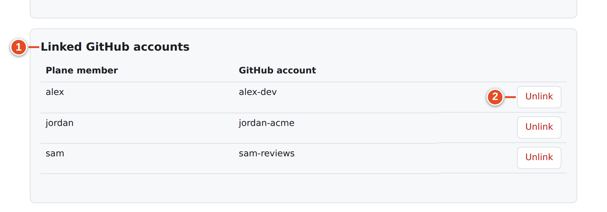
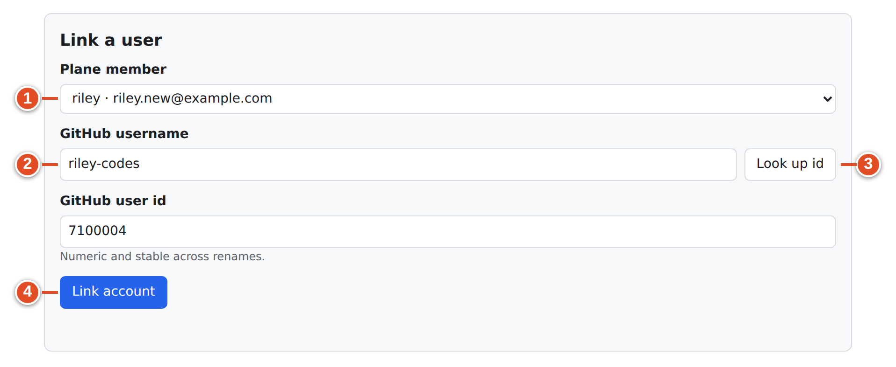
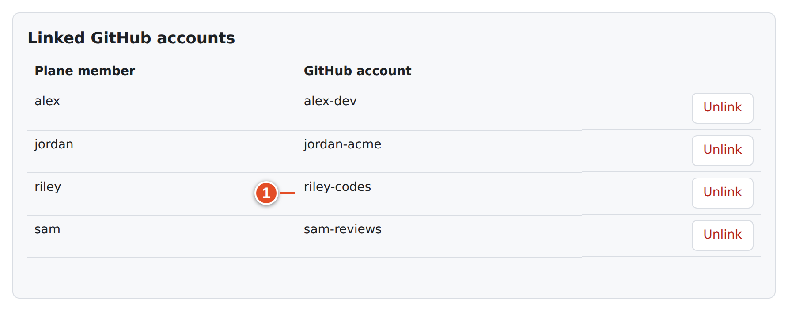

# 27 · User links

A **user link** pairs a Plane member with a GitHub account in one workspace. git-sync uses user links to:

- recognize **who** did something on GitHub. The webhook's authenticated sender (never the commit author name) is translated to a Plane member for Smart Commit provenance ("via *sha* by *login*"), assignee and `@mention` translation, and rule `assign` actions;
- write **Plane → GitHub** mirror changes *as that person* when their personal token works, instead of as the App;
- fill the **Branch name** `{username}` placeholder and the repository picker for that member.

> **Note:** In this release every write **into Plane** is made by the service account (the bot), even when the GitHub user is linked. A link improves attribution in GitHub and in git-sync's records; it does not make Plane show the member as the author.

There are three ways a link is made:

| How | Who | Stores a personal token? | Chapter |
|---|---|---|---|
| The member uses **Connect personal account** (GitHub OAuth) | The member | Yes, encrypted | 8 |
| An admin uses **Link a user** on this page | Workspace admin | No | this chapter |
| Automatic email match: an unlinked GitHub sender whose **public** GitHub email equals exactly one member's Plane email | git-sync | No | this chapter |

## Open the page

**Workspace settings → GitHub Sync → User links**, or `/git-sync/ui/workspaces/<slug>/users`.

**Linked GitHub accounts** lists **Plane member** and **GitHub account** for every link. In the demo:
- Jordan Admin (`jordan-acme`) and Alex Developer (`alex-dev`) connected themselves;
- Sam Reviewer (`sam-reviews`) was linked by the admin.

A row marked "Needs re-authorization. Reconnect using this member’s own Plane session." means GitHub refused that member's stored token, for example because they revoked the App on GitHub. Until they **Reconnect** on **My GitHub account**, their mirror writes fall back to the App. Admins cannot reconnect for them.

With no links, the page says "No Plane users are linked to GitHub accounts yet. Unlinked users are attributed to the service account."

## Link a user manually

### Goal: tell git-sync that a Plane member is a given GitHub account

**Before you start:** the person must be a member of this workspace. Ask them for their GitHub username.

**Steps**

1. Under **Link a user**, choose **Plane member**. ①
2. Type **GitHub username**. ②
3. Select **Look up id**. ③ git-sync asks GitHub for the account and fills **GitHub user id** ("Numeric and stable across renames."). If GitHub does not know the login you see **Lookup failed**.
4. Select **Link account**. ④

After **Link account** the new link appears in the list at once:

**Result:** the link appears in the list with GitHub's canonical spelling of the login.

**Checks git-sync makes on save:**

| Refusal | Why |
|---|---|
| "That GitHub account does not exist" | The login is unknown on your GitHub host |
| "githubId does not match that GitHub login" | The id you typed is not that account's id; use **Look up id** |
| "That Plane user is not a member of this workspace" | Only members can be linked |
| "githubLogin is not a valid GitHub username" | Typo |
| A uniqueness error | That GitHub account is already linked to another member; one GitHub account can be linked to only one member per workspace |

Links are keyed by GitHub's **numeric id**, so a later rename on GitHub does not break them.

## Unlink

**Unlink** asks "Unlink *login*? Any credentials stored for this user are deleted." After confirming:

- the link is removed and the member's stored GitHub token (if any) is deleted;
- git-sync remembers the unlink, so *automatic email matching will not re-link* that GitHub account. Only an explicit **Link account** or the member's own **Connect personal account** links it again;
- future events from that GitHub account are attributed to the service identity and audited as **Service account attribution**.

> **Note:** The browser asks first (text recorded from the running UI): “Unlink alex-dev? Any credentials stored for this user are deleted.”

## Automatic email matching

When an event arrives from a GitHub sender with no link, git-sync tries one careful match:

1. It reads the sender's **public** GitHub profile email.
2. It compares it with the email addresses of the workspace's Plane members.
3. If **exactly one** member matches, it links them and audits **Account matched by email**.
4. If there is no public email, no match or several matches, it links nobody and audits the reason.

Bots (`*[bot]`, `ghost`, accounts of type Bot) are never matched, nothing is guessed, and an unlinked account is never matched again automatically.

## Member accounts in the setup checklist

While a workspace has no mappings, **Set up GitHub sync** shows "Member accounts: *n* linked of *m*." It links to this page. Aim for every developer who pushes code to be linked before you rely on Smart Commits.

## If it went wrong

| Symptom | Cause | Fix |
|---|---|---|
| Smart Commit comments say "by *login*" but the audit shows **Service account attribution** | That GitHub login is not linked in this workspace | Link it |
| A member's mirror edits on GitHub appear as the App | No personal token, or token needs re-authorization | Member uses **Connect personal account** / **Reconnect** |
| Assignee from GitHub not copied to Plane | The GitHub assignee is not linked | Link the user; unlinked assignees are dropped |
| An unlinked person keeps getting re-linked | It does not happen: unlinks are remembered | — |

## What you learned

- User links map Plane members to stable GitHub ids for attribution, assignees, mentions and the repository picker.
- Members connect themselves via OAuth; admins can link by username with **Look up id**; careful public-email matching links only exact single matches.
- **Unlink** deletes stored credentials and stops email re-matching.
- Plane-side writes still come from the bot in this release.

## Source files

- `src/ui/client/Workspace.tsx` — `UserLinksPage`
- `src/ui/api.ts` — `GET /user-links`, `PUT/DELETE /user-links/:planeUserId`
- `src/ui/mapping-check.ts` — `createGithubUserLookup`, `createPlaneMemberCheck`
- `src/app/identity.ts` — email matching
- `src/db/ledgers.ts` — user-link tombstones
