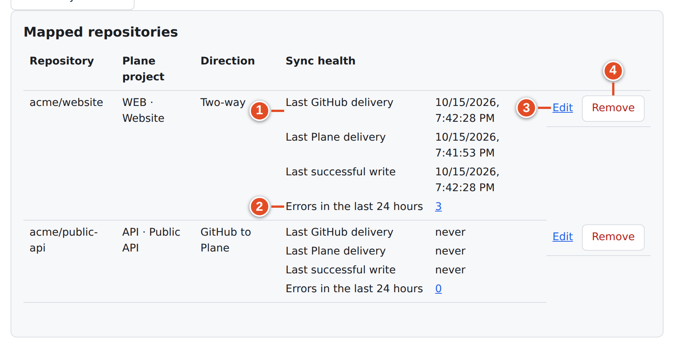
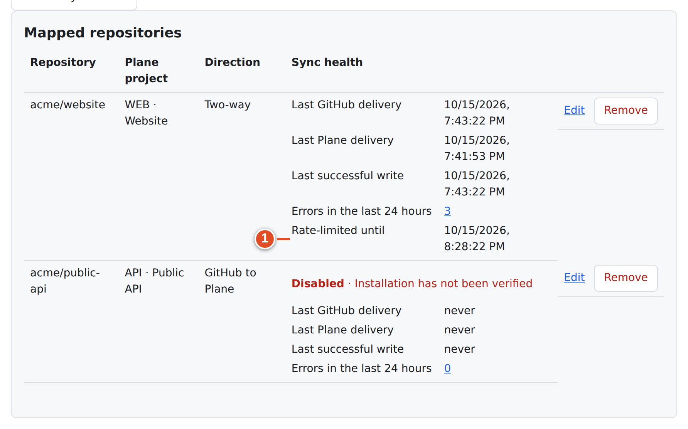
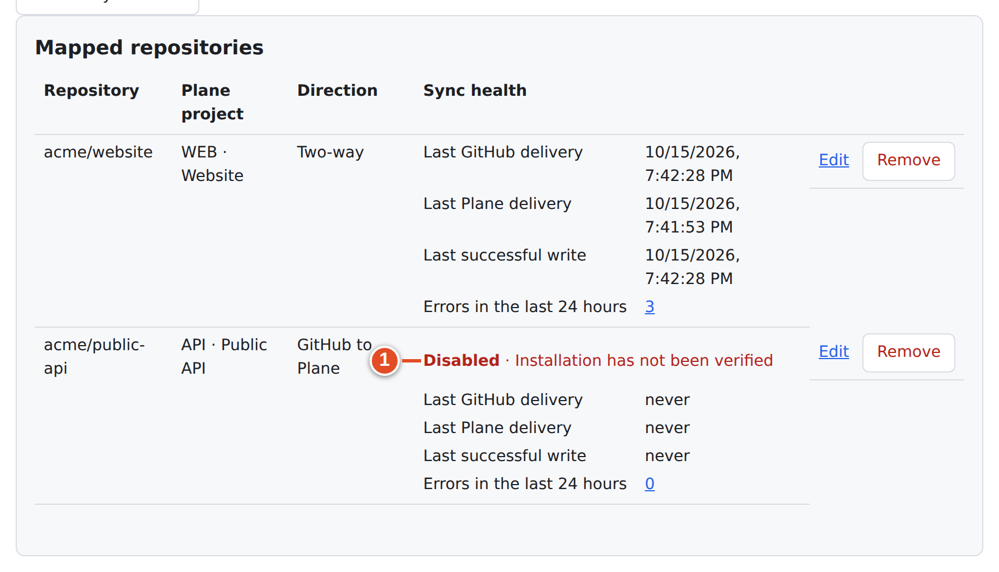
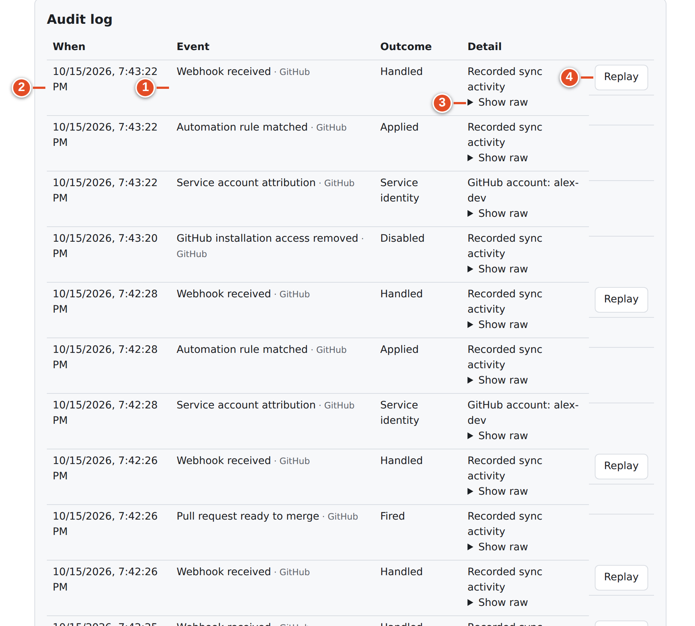
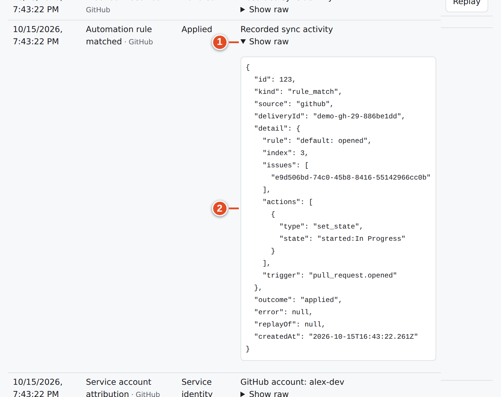
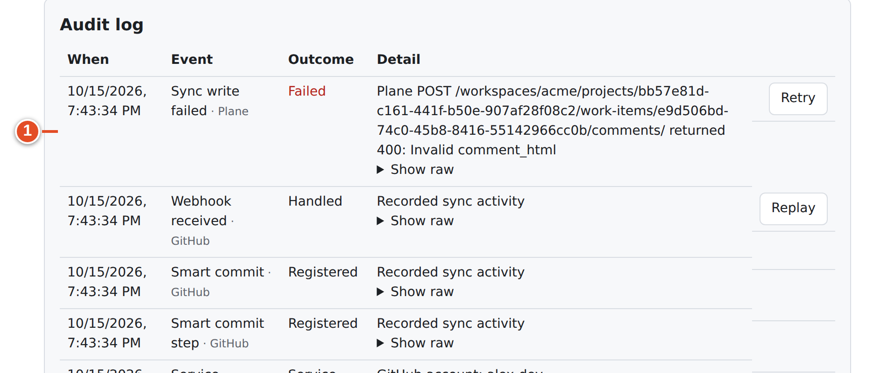
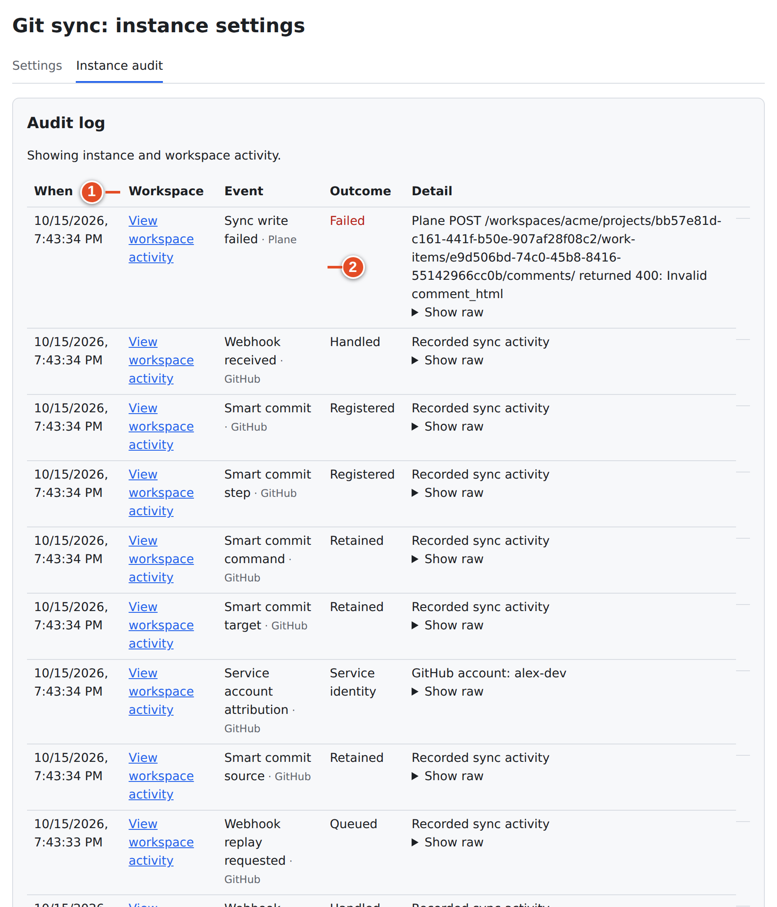
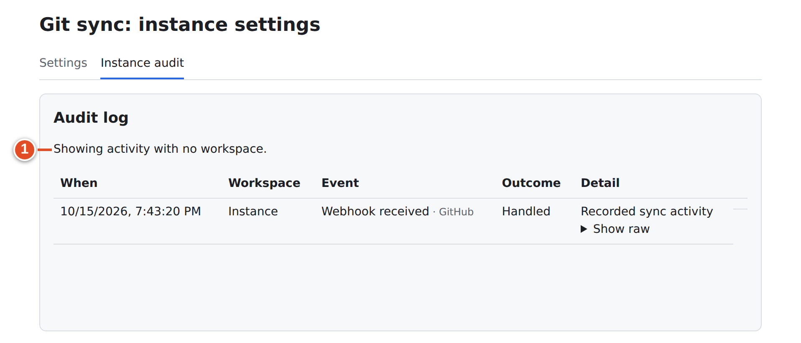

# 28 · Sync health and the audit log

You will get questions like "why didn't my PR move WEB-42?" or "is the integration working at all?". Answer them with two tools:

- **Sync health** — a quick status board per mapping.
- **Audit log** — a diary of every delivery git-sync received and every decision it made.

This chapter explains both, for workspace admins and for the instance admin.

## Three levels of "healthy"

| Level | Where | Proves |
|---|---|---|
| Liveness | `GET /git-sync/healthz` → `{"status":"ok"}` | The HTTP service answers. Nothing about the database, GitHub or Plane. |
| Instance health | God mode → **Connection health** and **Setup checks** (chapter 23) | Database reachable, credentials decryptable, App registered correctly, deliveries seen |
| Mapping health | Workspace → **Mapped repositories** → **Sync health** | This repository's deliveries, writes, errors, rate limits |

## Sync health cards

Each row in **Mapped repositories** has a **Sync health** card. The page refreshes it every 30 seconds; **Refresh sync health** refreshes it now.

| Line | Meaning | Worry when |
|---|---|---|
| **Last GitHub delivery** | Newest verified GitHub webhook for this repository | **never**, or hours old while people are pushing |
| **Last Plane delivery** | Newest verified Plane webhook for this workspace | **never**, or old while people edit work items (see the banner below) |
| **Last successful write** | Newest write git-sync completed to Plane or GitHub for this mapping | Deliveries are recent but writes are not |
| **Errors in the last 24 hours** | Count of failed audit entries for this mapping; the number links to the audit log filtered to them | Not zero — open it |
| **Rate-limited until** | Shown only while GitHub or Plane has paused git-sync; writes resume at that time | Often, or far in the future |
| **Disabled · *reason*** | Shown only when the mapping cannot sync | Always — fix the reason |

### Banners at the top of the workspace page

| Banner | Meaning | Do |
|---|---|---|
| "The sync database is unreachable. Settings and activity cannot be loaded." | git-sync cannot reach its Postgres | Operator: check `plane-db` and git-sync logs |
| "Plane changes have stopped arriving. Ask a workspace admin to re-enable the Git sync webhook in Plane’s webhook settings." | Reconciliation found Plane changes newer than the last Plane delivery by more than 30 minutes. Plane has probably switched the webhook off. | Re-enable it (chapter 29) |
| "GitHub App credentials could not be decrypted. Ask an instance admin to repair the GitHub App settings." | Stored secrets unreadable | Chapter 30 |

## The audit log

Open **Audit log** in the workspace tabs (`/git-sync/ui/workspaces/<slug>/audit`). Entries are newest first.

| Column | Content |
|---|---|
| **When** | Time recorded |
| **Event** | A readable label plus "· GitHub" or "· Plane" for the source |
| **Outcome** | What happened: *handled*, *applied*, *registered*, *retained*, *ignored*, *failed*, *partial*, *fired*, *created*, *service_identity*, … |
| **Detail** | Short summary: the error text if any, otherwise "GitHub account: *login*", "Rule: *name*" or "Recorded sync activity"; **Show raw** expands the full entry |

Buttons per entry:

| Button | On | Effect |
|---|---|---|
| **Show raw** | Every entry | Expands the stored JSON detail (payload excerpts, ids, error) |
| **Replay** | Received deliveries (**Webhook received**) | Asks "Replay this delivery? It runs again under a new delivery id and may write to Plane and GitHub." and queues the stored payload again |
| **Retry** / **Retry scheduled** | **Sync write failed** entries | Schedules that failed write again (chapter 29) |

**Load older entries** pages further back.

> **Warning:** Raw entries can contain issue text, comments and GitHub logins. Keep screenshots of them private.

### Common event labels

| Label | Meaning |
|---|---|
| Webhook received | A verified delivery was accepted (raw kind `inbound_delivery`) |
| Branch or commit push / Pull request updated / GitHub issue updated / Plane work item updated / Comment updated / Commit status updated | Processing of that kind of event |
| Smart Commit action completed | One Smart Commit command was applied |
| Automation rule matched | A rule matched: *applied* (wrote), *ignored* (matched but every target was skipped by tier or merge guard), *failed* (e.g. unknown state) |
| Pull request ready to merge | Ready-for-merge fired for a head commit |
| Work item creation requested by pull request | A `WEB-NEW` PR created an item |
| Mirrored work item created | Issue mirroring created a partner |
| Work item reference not found | A key in a PR matched nothing |
| Service account attribution | The sender was unlinked or a bot, or had no stored token, so the service identity was used |
| Account matched by email | Automatic user link (chapter 27) |
| Sync write / Sync write failed / Sync write retry scheduled | Outbox write results |
| GitHub installation is not approved / GitHub installation access removed | Mapping authority problems |
| Plane webhook has stopped arriving | The silent-webhook detector fired |
| Development link updated / Deployment status updated | Development panel data changed |

### Filtering

The page has *no filter controls*. Filters are URL parameters, and the health links set them for you:

| Parameter | Example | Shows |
|---|---|---|
| `errors=1` | `/git-sync/ui/workspaces/acme/audit?errors=1` | Failed entries only |
| `mappingId=<id>` | `…/audit?mappingId=1&errors=1` | One mapping |
| `hours=<n>` | `…/audit?errors=1&hours=24&mappingId=1` | The last *n* hours (up to 8760) |

The **Errors in the last 24 hours** number opens `?mappingId=<id>&errors=1&hours=24`, and the page says "Errors in the last 24 hours for mapping *id*."

The other URL parameters work the same way. For example, `?mappingId=1&hours=24` shows one mapping's last day:

### Reading a story from the audit log

Real entries from the demo run, oldest first, for one push to WEB-42's branch:

| Entry (Event column) | Outcome | Meaning |
|---|---|---|
| Smart commit source | retained | The commit was recorded for processing |
| Service account attribution | service_identity | `alex-dev` is linked, but no Plane token is stored, so Plane writes use the bot |
| Smart commit target / Smart commit command / Smart commit step | retained / registered | `#comment` for WEB-42 was turned into a durable write |
| Smart commit | registered | All commands of the commit are registered |
| Webhook received | handled | The push delivery itself (recorded when processing ends) |
| Smart Commit action completed | applied | The comment was written in Plane |
| Automation rule matched (**Show raw**: `"rule": "default: branch_pushed"`) | applied | WEB-42 moved to In Progress |

Kinds without a friendly label are shown with their internal name made readable, for example `smart_commit_failed` → "Smart commit failed".

## Instance audit (God mode)

God mode → **GitHub Sync** → **Instance audit** (`/git-sync/ui/admin/audit`) shows activity across the instance:

- By default: "Showing activity with no workspace." These are deliveries that could not be tied to a workspace, such as installation events, unmapped repositories and signature problems.
- With `?scope=all`: "Showing instance and workspace activity." — every workspace, with a **Workspace** column and **View workspace activity** links.
- The **Failures in the last 24 hours** link in **Connection health** opens it filtered to errors.

Without `?scope=all` the instance audit shows only activity that belongs to no workspace:

## What to send when asking for help

When a developer reports a problem (chapter 17 tells them what to collect), gather:

1. The work item key, the PR / commit link, and the time.
2. The mapping's health card (screenshot without raw data).
3. The audit entries around that time, with **Show raw** expanded, shared privately.
4. God mode **Setup checks** results.
5. For operators: `docker compose … logs --tail 200 git-sync`, with secrets removed.

## What you learned

- `/healthz` proves liveness only; use God mode checks and per-mapping health cards for real status.
- Health cards show last deliveries, last write, 24-hour errors, and, only when relevant, **Rate-limited until** and **Disabled**.
- The audit log explains every decision. **Show raw** reveals details, **Replay** re-runs a delivery, **Retry** re-runs a failed write.
- Filters are URL parameters (`errors`, `mappingId`, `hours`, `scope=all`); there are no on-page filter controls.

## Source files

- `src/ui/client/health.tsx` — cards, banners, checklist
- `src/ui/client/Workspace.tsx` — `AuditLogPage`
- `src/ui/client/audit.tsx` — event labels
- `src/ui/client/router.ts` — audit URL filters
- `src/ui/api.ts` — `GET /health`, `GET /audit`, `POST /audit/:id/replay`
- `src/sync/reconcile.ts` — silent-webhook detection
