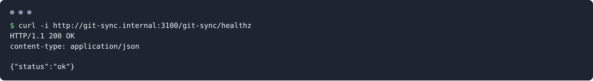
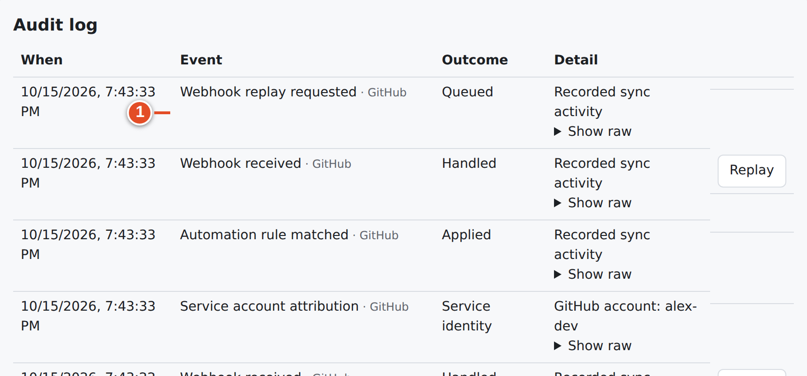
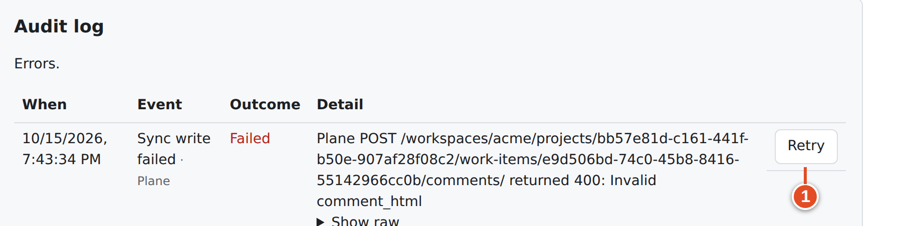

# 29 · Operations: update, rotate, replay, back up, uninstall

This chapter is the operator's runbook. All commands run *on the Plane server, in your Plane directory*, with the filenames your deployment uses. Wherever you see `docker compose …`, use the *full start command the installer printed* (both Compose files and the env file), for example:

```bash
cd /root/plane && docker compose -f docker-compose.yaml -f docker-compose.override.yaml --env-file plane.env up -d
```

## Daily checks

| Check | How | Good |
|---|---|---|
| Service alive | `curl -i https://plane.example.com/git-sync/healthz` | `200` `{"status":"ok"}` |
| Container healthy | `docker compose … ps git-sync` | `healthy` |
| Recent logs | `docker compose … logs --tail 100 git-sync` | No repeated errors |
| Instance status | God mode → **GitHub Sync** → **Connection health**, **Setup checks** | Database reachable, checks Verified |
| Per-repository status | Workspace → **Mapped repositories** health cards | Recent deliveries, few errors |



## Update git-sync

### Goal: run a newer git-sync, keeping all settings and data

**Before you start:** back up (below). Write down the exact installer options this deployment uses (`--plane-dir`, `--env-file`, `--proxy external --gateway-network …`, `--keep-plane-ui`).

**Steps**

1. Enter the checkout and pull:

```bash
cd ~/git-sync
git pull
```

2. Re-run the installer with the same options:

```bash
sudo ./install.sh --plane-dir /root/plane          # plus your other options
```

3. Check `/git-sync/healthz`, God mode **Setup checks** and a mapping's health card.

**Result:**
- The image `git-sync:local` is rebuilt and the service restarted.
- Database migrations run automatically on start; they are ordered, recorded, and safe with several replicas.
- `git-sync.env`, `GITSYNC_TOKEN_KEY`, the database and stored secrets are kept. The installer does **not** ask for the Plane secrets again.

**If it went wrong:**
- Keep the previous checkout revision, and the previous image if you tagged it. To roll back, check out the old revision and re-run the installer.
- A schema-incompatible rollback needs the database backup taken before the update: there are no down-migrations.
- Existing Plane UI fork images are **reused**, not rebuilt. If a release changes the fork patches, remove the old `plane-frontend-gitsync:v1.4.2` / `plane-admin-gitsync:v1.4.2` images before re-running, so they are rebuilt.

> **Note:** "Change a setting" uses the same command: re-run `./install.sh` with the new option, for example `--public-url`. Existing values are kept unless you supply new ones.

## Upgrading Plane itself

The UI fork is pinned to Plane **v1.4.2**. If you upgrade Plane:

1. The installer keeps Plane's stock UI automatically for versions it does not recognize. git-sync keeps working; use the direct `/git-sync/ui/…` links.
2. To get the menus back, the fork's eight files must be re-applied and rebuilt for the new release (see `apps/README.md`, `scripts/verify-fork-patch.mjs`).
3. Always start Plane with the installer's printed command, not Plane's `setup.sh`, so the override (and git-sync) is included.

## Rotate the bot's Plane API key

### Goal: replace `PLANE_SERVICE_PAT` without downtime

**Steps**

1. Signed in **as the bot**, create a new Personal Access Token (chapter 21, step 2).
2. Re-run the installer with the new key in the environment, without putting it in your shell history:

```bash
read -r -s -p 'New bot PAT: ' GITSYNC_PLANE_PAT
export GITSYNC_PLANE_PAT
sudo --preserve-env=GITSYNC_PLANE_PAT ./install.sh --plane-dir /root/plane
unset GITSYNC_PLANE_PAT
```

   (On rootless Docker, run without `sudo` as the user who owns Plane.)
3. The installer verifies the key with Plane, writes it and the bot's user ID to `git-sync.env`, and restarts git-sync.
4. Revoke the old token in Plane after checking that writes still work (make a test Smart Commit or edit a mirrored issue).

If the stored key was revoked first, an interactive re-run prints "Plane rejected the API key" and asks for a new one.

> **Warning:** Never change `GITSYNC_TOKEN_KEY` when rotating the PAT. It is the encryption key for stored secrets, not a Plane credential.

## Rotate the Plane webhook secret

git-sync accepts the current secret and, during a rotation, one previous secret.

1. Note the current value of `PLANE_WEBHOOK_SECRET` in `git-sync.env`.
2. In Plane: **Workspace settings → Webhooks** → the git-sync webhook → regenerate the secret key. Copy it.
3. In `git-sync.env` set `PLANE_WEBHOOK_SECRET=<new>` and `PLANE_WEBHOOK_SECRET_PREVIOUS=<old>`. Then run `docker compose … up -d git-sync`.
4. After an hour, delete `PLANE_WEBHOOK_SECRET_PREVIOUS` and run `up -d git-sync` again.

Keep the gap between steps 2 and 3 short, at a quiet time. A Plane delivery that matches neither secret is refused with `401`, and Plane never resends it.

## Rotate GitHub App credentials

| Credential | How |
|---|---|
| Private key | GitHub: *Generate a private key*. God mode: paste it into **Private key (PEM)**, leave other secrets empty, **Save GitHub App**. Then delete the old key on GitHub. |
| Client secret | GitHub: generate a new one. God mode: **OAuth client secret** → **Save GitHub App**. Delete the old one on GitHub. |
| Webhook secret | Change it on GitHub and in God mode **Webhook secret** close together. There is no "previous" GitHub secret, so deliveries signed with the other secret in between fail with `401`; redeliver them (below). |

New credentials are used within about five seconds of saving; no restart is needed.

## The encryption key (`GITSYNC_TOKEN_KEY`)

- It encrypts the App's private key, webhook secret and client secret, members' GitHub tokens, and in-flight OAuth verifiers.
- It must decode to exactly 32 bytes. The installer generates it once and *always keeps it*.
- **Do not rotate it.** There is no re-encryption command. With a different key, every stored secret becomes unreadable: God mode shows **GitHub App credentials cannot be decrypted. Save the App secrets again.**, GitHub webhooks get `503`, and members must reconnect.
- If the key was lost, chapter 30 explains recovery: restore the key, or re-enter every secret.

## Redeliver GitHub webhooks

GitHub does **not** retry a delivery that received an error. After any outage (git-sync down, `503` while secrets were unreadable, `401` during a secret change):

1. GitHub → **Settings → Developer settings → GitHub Apps →** your App → **Advanced → Recent deliveries**.
2. Redeliver every delivery marked failed since the problem began.

Redelivery is safe: git-sync deduplicates by delivery id, and writes are idempotent.

## Replay a delivery from the audit log

If a delivery **did** reach git-sync but was processed wrongly (for example, before you fixed a missing state or a rule), a workspace admin can replay it:

1. **Audit log** → find the **Webhook received** entry.
2. **Replay** → confirm "Replay this delivery? It runs again under a new delivery id and may write to Plane and GitHub."
3. The entry **Webhook replay requested** appears, followed by the new processing.



Writes that already succeeded are recognized and not repeated. Only deliveries whose raw payload is still retained (audit payload retention: 90 days) can be replayed.

## Retry a failed write

When an outbound write failed permanently (for example a permission was missing, or a state was deleted), fix the cause and then:

1. **Audit log** → open errors (`?errors=1`) → the **Sync write failed** entry.
2. Select **Retry**. It changes to **Retry scheduled**.



The retry re-checks the mapping's authority first. A write whose installation has since been revoked is still refused. A write that is merely rate-limited retries by itself at the deadline; leave it alone.

## Re-enable a Plane webhook that Plane switched off

Plane v1.4.2 switches a webhook off after about 5 failed connection attempts over 30–50 minutes, and emails its creator. git-sync notices with the next reconciliation (default every 60 minutes). It audits **Plane webhook has stopped arriving** and shows the banner "Plane changes have stopped arriving…".

1. Fix what made git-sync unreachable; check `/git-sync/healthz`.
2. Plane: **Workspace settings → Webhooks** → the git-sync webhook → switch it on.
3. Changes made while it was off are **not** resent. Re-save the affected work items in Plane (or make the matching change on GitHub). The audit entry's `latestChangeAt` and `lastDeliveryAt` show the gap.

When Valkey alone is down, Plane deliveries are kept in Postgres and replayed every minute once it is back, so nothing is lost. If both Valkey and Postgres are down, Plane deliveries get `503` and are lost.

## Backups

Back these up together:

| What | Where |
|---|---|
| The `gitsync` database | Plane's Postgres: `docker compose … exec -T plane-db pg_dump -U <plane superuser> gitsync > gitsync.sql` |
| `git-sync.env` (contains `GITSYNC_TOKEN_KEY` and secrets) | Plane's directory, mode 0600 |
| `git-sync/` directory (App key file, credential-state marker) | Plane's directory |
| `docker-compose.override.yaml` and any external proxy config | Plane's directory / your proxy |

> **Warning:** A database backup without the matching `GITSYNC_TOKEN_KEY` cannot decrypt its secrets. Store them together, privately. The installer's `.bak-<time>` files also contain secrets.

Take the backup at a quiet time, or stop git-sync briefly (`docker compose … stop git-sync`). Valkey jobs are not in the database; note the backup time, so that after a restore you know which GitHub deliveries to redeliver.

## Uninstall

### Goal: remove git-sync and keep its data

```bash
sudo ./install.sh --uninstall          # add --plane-dir/--env-file as used at install
```

This removes the `git-sync` service and the installer-managed override entries and proxy route. It restarts Plane's proxy and apps without git-sync ("Restarting Plane's proxy and apps without git-sync"). The `gitsync` database, `git-sync.env` and the `git-sync/` directory are **kept**, so a later install picks everything up again.

### Goal: remove git-sync and delete its data

```bash
sudo ./install.sh --uninstall --purge
```

The installer asks "Delete git-sync's database, settings and stored GitHub credentials for good? [y/N]".

- **Deleted:** the `gitsync` database and role, `git-sync.env` and the state directory.
- **Not deleted:** Plane's database, Plane's data, and the timestamped `.bak-` files, which still contain secrets. Delete those yourself.

After either form:
- Remove any route you added to an **external** proxy yourself.
- Uninstall the GitHub App from your organizations on GitHub if you no longer need it.
- Delete the Plane webhook in **Workspace settings → Webhooks**.
- Revoke the bot's API key.

## What you learned

- Update with `git pull` and the same `./install.sh` options; settings, secrets and the encryption key are kept.
- Rotate the bot PAT through the installer, and the Plane webhook secret with the `_PREVIOUS` overlap. Rotate App secrets in God mode. Never rotate `GITSYNC_TOKEN_KEY`.
- Use GitHub **Recent deliveries** for failed GitHub webhooks, **Replay** for deliveries that arrived, and **Retry** for failed writes.
- Back up the database, `git-sync.env` and `git-sync/` together. `--uninstall` keeps data; `--purge` deletes git-sync's data only.

## Source files

- `install.sh`, `src/install/env-file.ts`, `src/install/main.ts` — update, rotation, uninstall
- `deploy/APPLY.md` — sections 9–12
- `src/operations/tooling.ts`, `src/operations/outbox.ts` — replay and retry
- `src/sync/reconcile.ts`, `src/queue/cron.ts` — silent-webhook detection, spool replay
- `src/index.ts` — `/git-sync/healthz`
