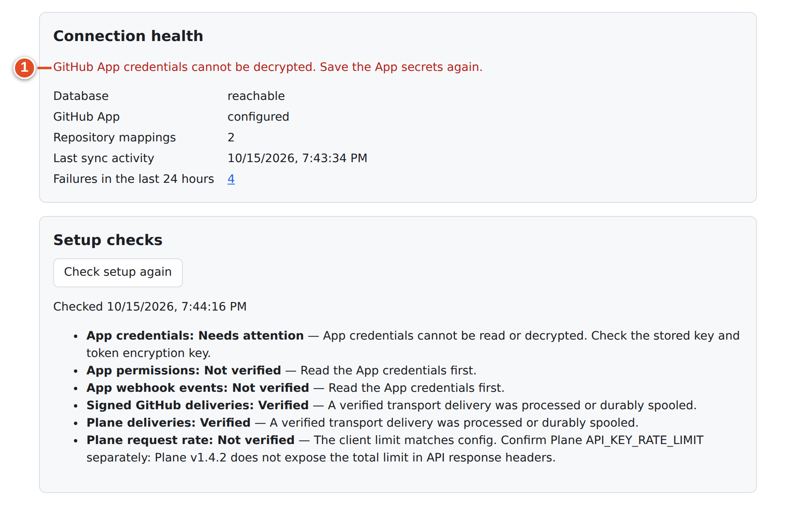

# 30 · Admin troubleshooting

Start from the symptom, then check the smallest part that could cause it. Reinstalling rarely fixes a wrong callback URL or a wrong account. Before you change anything, collect the evidence that chapter 28 lists (health card, audit entries, setup checks, logs).

## A quick triage order

1. `curl -i https://<plane>/git-sync/healthz` — is the service up?
2. God mode → **Connection health** and **Setup checks** — database, credentials, App registration, deliveries.
3. Workspace → the mapping's **Sync health** card — deliveries arriving? **Disabled**? **Rate-limited until**?
4. Workspace → **Audit log** (`?errors=1`) — what did git-sync decide and why?
5. `docker compose … logs --tail 200 git-sync` — startup and connection errors.

## Installation and pages

| Symptom | Likely cause | Fix |
|---|---|---|
| Installer errors | — | See chapter 21, "Troubleshooting the installer" |
| **GitHub Sync** page inside Plane is blank | Proxy adds `X-Frame-Options: DENY` or `frame-ancestors 'none'` to `/git-sync/*` | Exclude `/git-sync/*` from the header in every proxy layer (chapter 21, step 6) |
| **GitHub Sync** missing from Plane menus | Stock UI kept (`--keep-plane-ui` or non-v1.4.2 Plane), or Plane was started with `setup.sh` | Use direct links; start Plane with the installer's printed command |
| Members ask where **GitHub Sync** is | It is admin-only in Workspace settings | Send them `/git-sync/ui/workspaces/<slug>/account` |
| **Not authorised** on `/git-sync/ui/admin` | No God mode session in this browser | Sign in to God mode, reload |
| **Not authorised** "Workspace settings need a workspace admin." | You are a member, not an admin | Ask an admin, or use **My GitHub account** |
| 404 for every `/git-sync/` URL | Proxy route missing (external proxy) or git-sync not running | Add `handle /git-sync/* { reverse_proxy git-sync:3100 }` before the Plane route; check the container |
| `409` "This workspace address belonged to a Plane workspace that was deleted. An instance admin must remove its old git-sync data before it can be used again." | A new workspace reuses a deleted workspace's slug | Instance admin: on the God mode page, open the browser console and run `fetch('/git-sync/api/instance/workspaces/<slug>/stale-data', {method: 'DELETE'})` (API only, no button). This deletes git-sync's old data for that slug after checking the live workspace. |

## GitHub App and credentials

| Symptom | Likely cause | Fix |
|---|---|---|
| **App credentials: Needs attention** "No GitHub App is configured yet…" | Nothing saved | Enter the App (chapter 23) |
| **GitHub App credentials cannot be decrypted. Save the App secrets again.** / **App credentials** "cannot be read or decrypted" / GitHub deliveries answered `503` | `GITSYNC_TOKEN_KEY` changed or lost, or database restored without its key | See "Credentials cannot be decrypted" below |
| **App permissions: Not verified** "The App registration could not be read from GitHub…" | Wrong App ID or private key, wrong edition/host, outbound network blocked | Check App ID (a number), re-paste the PEM, check **GitHub edition**, test `curl https://api.github.com` from the container's network |
| **App permissions: Needs attention** "…missing required permission levels…" | Registration lacks a permission | Fix on GitHub (chapter 22); owners approve; **Refresh connection** |
| **App webhook events: Needs attention** "Subscribe the App to the missing webhook events." | An event not ticked | Tick all nine |
| **Signed GitHub deliveries: Not verified** | No GitHub event received | Make a PR change; then GitHub **Advanced → Recent deliveries**: `404` = wrong webhook URL, `401` = secret mismatch, `503` = decrypt problem, timeout = proxy/firewall |
| **Plane request rate: Needs attention** "The active client request limit differs from PLANE_API_RATE_PER_MINUTE…" | Running service and config disagree | Restart git-sync with the full Compose command |
| **Plane request rate: Not verified** | Normal on Plane v1.4.2 | Compare Plane's `API_KEY_RATE_LIMIT` with `PLANE_API_RATE_PER_MINUTE` yourself; keep them equal (e.g. `600/minute` ↔ `600`) |
| `redirect_uri is not associated with this application` on GitHub | Callback URL or Client ID wrong | Callback must be `<PUBLIC_ORIGIN>/git-sync/oauth/github/callback`; use the App's Client ID |
| **Connect GitHub** disabled: "Ask the instance admin to configure the GitHub App client ID, client secret and App slug." | Missing slug/Client ID/secret | Complete **GitHub App** in God mode |

### Credentials cannot be decrypted

### Goal: restore working credentials after a key mismatch

*Option A — you still have the right key* (best):

1. Find the `GITSYNC_TOKEN_KEY` that matches the database, for example in a backup of `git-sync.env` or an installer `.bak-` file.
2. Put it back in `git-sync.env` and run `docker compose … up -d git-sync`.
3. **Check setup again**, then redeliver failed GitHub deliveries (chapter 29).

**Option B — the key is lost:**

1. In God mode → **GitHub App**, re-enter **every** secret: **Private key (PEM)**, **Webhook secret** and **OAuth client secret**. Generate a new private key and client secret on GitHub if you do not have them. **Save GitHub App**.
2. Every member must **Reconnect** on **My GitHub account**; their old tokens cannot be read.
3. Redeliver failed GitHub deliveries.

## Connecting and mapping

| Symptom | Likely cause | Fix |
|---|---|---|
| Repository picker empty: "No repositories available…" | No connected installation, or the repository is not included in it | Connect; add the repository to the installation on GitHub; **Refresh repositories** |
| "Connect your personal GitHub account to select a repository." | Admin has no personal link | **My GitHub account → Connect personal account** |
| "taken: That installation is connected to another workspace." / "That installation is already allowed for another workspace; remove it there first" | One installation per workspace | Disconnect it there, or ask the instance admin to remove the allow-list entry |
| "not_owner: Only an active GitHub organization owner or admin can connect its installation…" | You are not an owner | **Send a link to an organization owner** |
| "state: This connection link has expired, was already used, or belongs to another Plane account. Start again." | Link older than 30 min (install) / 10 min (OAuth), reused, or a different Plane session | Start again in one browser |
| Mapping card shows **Disabled · Installation is not allowed for this workspace** | Installation disconnected/removed/uninstalled | Reconnect or allow-list it, then **Save changes** on the mapping |
| **Disabled · Save the mapping to verify its installation** | Mapping without a verified installation | Open it and **Save changes** |
| "The mapping changed during verification. Reload it and try again" | Someone else edited it meanwhile | Reload, save again |

## Sync not happening

| Symptom | Likely cause | Fix |
|---|---|---|
| Plane edits never reach GitHub | Mapping is **GitHub to Plane only**; field policy is **GitHub is the source of truth** (default for title/description); no Plane webhook; the editor is the service account | Check direction and policies (chapter 25); check **Last Plane delivery**; never use a personal PAT as the service PAT |
| "Plane changes have stopped arriving…" banner | Plane switched its webhook off | Re-enable it; re-save affected items (chapter 29) |
| **Last GitHub delivery: never** | Webhook URL/secret wrong, App not installed on that repository | GitHub **Recent deliveries**; installation repository selection |
| A GitHub issue never appears in Plane | Missing `plane` label, or repository not mapped | Add the label; map the repository |
| A Plane item never appears on GitHub | Missing `github` label, mapping is **GitHub to Plane only**, or label added by the service account | Add the label as a human user on a two-way mapping |
| PR does not move the item to Done | Base branch not `^main$`; relation/non-closing reference; another linked PR open; state missing | Audit: **Automation rule matched** *ignored* or *failed*; **Test rules** (chapter 26) |
| Review requested does nothing | Project has no **In Review** state and several started states | Create **In Review** or change the rule |
| Smart Commits do nothing | **Smart Commits** off on the mapping; bad grammar; unknown state; sender's commits unsigned with `REQUIRE_VERIFIED_COMMITS=true` | Enable; turn on **Report problems**; audit `?errors=1` |
| The signed-commit checkbox is ticked but unsigned commits still run | The checkbox is not enforced in this release | Set `REQUIRE_VERIFIED_COMMITS=true` in `git-sync.env`, `up -d git-sync` |
| Everything is slow / **Rate-limited until** keeps appearing | GitHub or Plane rate limits | Raise Plane's `API_KEY_RATE_LIMIT` and `PLANE_API_RATE_PER_MINUTE` together; for GitHub, wait — writes resume by themselves |
| Writes appear as the bot in Plane, not the person | Expected in this release | — (chapter 27) |
| A deleted Plane item left its GitHub issue open | Deleting is not closing; Plane v1.4.2 sends no delete webhook | Reconciliation marks the link orphaned and comments on GitHub; close the issue yourself if intended |

## Queues, database and the service

| Symptom | Likely cause | Fix |
|---|---|---|
| "The sync database is unreachable." | Postgres down, or `DATABASE_URL` wrong | Check `plane-db`; git-sync retries migrations every 5 s and keeps accepting Plane webhooks into Valkey meanwhile |
| Container restarts repeatedly | Bad `git-sync.env` value (e.g. `GITSYNC_TOKEN_KEY` not 32 bytes, `PLANE_SERVICE_USER_ID` empty, conflicting GitHub edition settings) | Read the first log lines; fix the value; `up -d git-sync` |
| `healthz` is OK but nothing syncs | Liveness only; workers start after migrations | God mode **Setup checks**, health cards, logs |
| GitHub events lost during an outage | GitHub never retries errors | Redeliver from **Recent deliveries** |

## Asking for help

Share, privately:
- the Plane version and git-sync commit (`git rev-parse --short HEAD` in the checkout);
- the non-secret installer options;
- the God mode **Setup checks** results;
- the failing page;
- relevant audit entries;
- log lines with secrets removed.

**Never** share `git-sync.env`, `.bak-` files, raw tokens or the PEM. Do not run the installer with `bash -x`: it prints secrets.

## What you learned

- Triage in order: `healthz` → God mode checks → health card → audit log → logs.
- Most failures are configuration: proxy framing, callback URLs, the nine events, one-installation-per-workspace, direction and policies, and the merge rule's base branch.
- A key mismatch is fixed by restoring the matching `GITSYNC_TOKEN_KEY`, or by re-entering every secret and asking members to reconnect.
- The signed-commit checkbox is not enforced; use the environment variable.

## Source files

- `src/ui/setup-check.ts` — check texts
- `src/ui/client/Connect.tsx` — connection messages
- `src/ui/client/health.tsx` — banners
- `src/ui/api.ts` — error texts, stale-data route
- `src/config/env.ts` — configuration validation
- `deploy/APPLY.md`, `INSTALL.md` — runbook and installer troubleshooting
